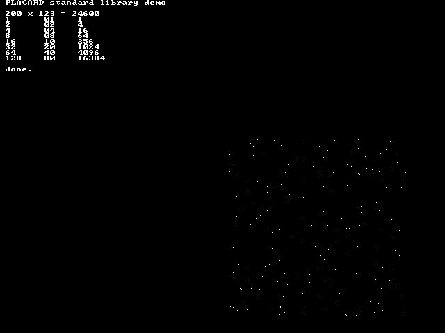

# Standard library

`src/scripts/placard_lib.asm` is a library of subroutines for Placard
programs, with a standard way to call them, a software stack, and a zero
page map that every program shares.  `src/scripts/lib_demo.asm` is a short
example program that uses it, and `src/scripts/test_lib.py` tests every
routine in the simulator.

Date: 10/18/2026

| File | What it is |
|------|------------|
| `src/scripts/placard_lib.asm` | The routines.  Each has a header with its inputs, outputs, changed registers and clocks |
| `src/scripts/zeropage.asm` | The zero page variable assignments (included by the library) |
| `src/scripts/lib_font.asm` | 8x8 font, generated by `gen_lib_font.py` |
| `src/scripts/lib_demo.asm` | Example program (`build\lib_demo.bat` loads it on the board) |
| `src/scripts/test_lib.py` | Tests every routine against a Python model and measures its clocks |
| `src/scripts/rom_lib.asm` | The library and font alone, for the ROM image (`rom_lib.hex`) |



## Using the library

```
#include "placard.asm"
#include "placard_lib.asm"      ; includes zeropage.asm and lib_font.asm

count = 0x20                    ; program variables: zero page x20-x8F

#addr 0x6000                    ; programs run in place from the ROM
main:
    ld   STACK_TOP, ac          ; set up the stack before anything else
    ld   ac, [SP]
    ...
```

The library and font run in place from the ROM at x3000-x3FFF: code at
`LIB_CODE` (x3000-x37FF) and the font at `LIB_FONT` (x3800-x3FFF).  These are
standard places that every program shares, so keep them.  A program runs in
place from ROM x6000-xDFFF (entry at x6000).  Library bank 2
(`LIB2_CODE`, ROM xE000-xFBFF) holds the sound driver, `slot_id`, the FAT
reader, `con_gets` and `mouse_move`; xE000-xE0FF is kept for a future jump
table.  Bank 2 runs in section 7, so section 7 must read the ROM when a
program calls it (it does in map 05).  The boot loader maps the zero
page and x4000-x4FFF to RAM (map = 05, also in `MAP_SHADOW`) and jumps to
x6000.  Program variables and buffers go in RAM: the zero page x20-xBF,
x0100-x1FFF, x4000-x4CFF (x4D00-x4FFF if the program does not use the
FAT reader), x5400-x5A1F and x5C00-x5DF2 (the mode bytes are
at x5A20-x5BFF and the audio buffer is x5DF3-x5FFF).  A 2x or 4x screen
frees part of the video area too (see `vid_mode`).  The RAM is random at power-up, so set
variables in code.  The video always reads the RAM; to read the video RAM,
map sections 3-7 to RAM and back (`plot1` and `con_scroll` do this
themselves).  Both customasm and `placard_sim.py` assemble the library to the
same bytes.  See [ROM.md](ROM.md).  New programs use the library routines
and the zero page map below.

The simulator's assembler now accepts `#include`, `NAME = value` constants
and `#d "string", 0x00` data, as customasm does, and `#addr` may go back to
a lower address (overlapping bytes are still an error).

## Calling convention

There is no call instruction and no hardware stack.  A call puts the return
address in the zero page bytes `LINK_LO` / `LINK_HI` and jumps; the routine
returns with an indirect jump through them.  Every call needs its own return
label.

**CALL** (6 instructions, 12 bytes, 18 clocks; keeps AC, changes X and Y)

```
    ld   LINK_LO, x
    ld   back, [x]              ; return address low byte
    ld   LINK_HI, x
    ld   back >> 8, [x]         ; return address high byte
    ld   routine >> 8, y
    jmp  routine
back:
```

**RETURN** from a leaf routine (2 instructions, 8 clocks; keeps AC and X)

```
    ld   [LINK_HI], y
    jmp  [LINK_LO]
```

- Arguments go in **AC** and **R0-R7**.  Results come back in **AC**, **X**
  and **R0-R7**.  **Y** can never carry a result, because the return jump
  loads it.
- **R0-R7** belong to the caller.  A routine changes only the R registers
  its table entry lists.
- **T0-T7** are scratch.  Any library routine may change any of them, so a
  value kept in a T register does not survive a call.
- A 16-bit value in two R registers is written high:low, so `R1:R0` means
  R0 is the low byte.
- A **tail call** (jumping to another routine as the last step, without
  CALL) passes the caller's LINK on, so the other routine returns straight
  to the caller.  `con_clear` and `con_newline` do this.

## Software stack

The stack is the top of the zero page, xC0-xFF (64 bytes).  `SP` holds the
address of the next free byte, and the stack grows down from xFF.  It uses
the `[0,X]` address mode, so it never touches Y.

**PUSH AC** (6 instructions, 19 clocks; keeps AC, changes X)

```
    ld   [SP], x
    ld   ac, [x]
    ld   x, ac
    dec
    ld   ac, [SP]
    ld   [x], ac
```

**POP AC** (5 instructions, 16 clocks; changes X).  The value is the last
thing loaded into AC, so `beq` / `blt` can test it straight away.

```
    ld   [SP], ac
    inc
    ld   ac, [SP]
    ld   ac, x
    ld   [x], ac
```

To push X, copy it to AC first (`ld x, ac`).  Nothing checks for overflow:
pushing more than 64 bytes runs down into the program variables.

### Routines that call other routines

A CALL overwrites LINK, so a routine that makes calls (not a leaf) saves its
own return address on the stack when it starts, with **PUSH_LINK**, and
returns by jumping to **lib_leave**, which pops it.  Both keep AC, so AC can
carry an argument in and a result out.

**PUSH_LINK** (13 instructions, 42 clocks; keeps AC, changes X, uses 2
stack bytes)

```
    ld   ac, [SAVE_AC]
    ld   [SP], x
    ld   [LINK_HI], ac
    ld   ac, [x]
    ld   x, ac
    dec
    ld   ac, x
    ld   [LINK_LO], ac
    ld   ac, [x]
    ld   x, ac
    dec
    ld   ac, [SP]
    ld   [SAVE_AC], ac
```

**LEAVE** (49 clocks with lib_leave; keeps AC, changes X and Y)

```
    ld   lib_leave >> 8, y
    jmp  lib_leave
```

Everything the routine pushed must be popped before LEAVE.  A template:

```
print_twice:                    ; AC = character, printed twice
    (PUSH_LINK)
    (CALL con_putc)             ; con_putc keeps AC
    (CALL con_putc)
    (LEAVE)
```

`con_puts`, `con_hex8`, `con_dec8` and `con_dec16` in the library are
complete examples.

## Zero page map

`zeropage.asm` defines these names.  Program variables go in x20-x8F.

| Address | Name | Used by | Use |
|---------|------|---------|-----|
| 00-03 | | program | Reset code: `ld main >> 8, y` / `jmp main` |
| 04 | `LINK_LO` | call | Return address low byte |
| 05 | `LINK_HI` | call | Return address high byte |
| 06 | `SP` | stack | Software stack pointer, next free byte |
| 07 | `MAP_SHADOW` | map_set, plot1, con_scroll | Copy of the write-only ROM/RAM map register (the boot sets it to 05 for a ROM program) |
| 08 | `FRAME_LO` | frame_poll, wait_frames | Frame counter low byte |
| 09 | `FRAME_HI` | frame_poll, wait_frames | Frame counter high byte |
| 0A | `LINE_LAST` | frame_poll, wait_frames | Last line read value |
| 0B | `RAND_LO` | rand8 | Random generator state low byte |
| 0C | `RAND_HI` | rand8 | Random generator state high byte |
| 0D | `CUR_COL` | console | Cursor byte column, 0-79 |
| 0E | `CUR_ROW` | console | Cursor text row, 0-59 |
| 0F | `SAVE_AC` | stack | AC parked by PUSH_LINK and lib_leave |
| 10-17 | `R0`-`R7` | caller | Arguments and results |
| 18-1F | `T0`-`T7` | library | Scratch, changed by any routine |
| 20-8F | `USER_ZP` | program | 112 bytes for the program's own variables |
| 90-9E | `SND_*` | sound driver | Sound state ([SOUND.md](SOUND.md#software)); free if the program never calls `snd_*` |
| 9F | | sound driver | Spare, kept for the sound driver |
| A0-BF | `IO_ZP` | I/O drivers | Keyboard state and buffer, SD and mouse state, driver scratch ([IO.md](IO.md#zero-page)) |
| C0-FF | `STACK_LOW`-`STACK_TOP` | stack | Software stack, grows down from FF |

Section 0 (x0000-x1FFF) must read from RAM for the zero page to work.

## Routines

Clocks are for the routine and its RETURN, without the 18-clock CALL, as
`test_lib.py` measured them.  They leave out video stalls (the CPU loses 1
clock in 8 during active video).  At 25.175 MHz, 25,175 clocks is 1 ms.
"Changes" lists everything a routine may change besides LINK and SAVE_AC;
AC is listed when it does not come back as a result.

### Stack

| Routine | In | Out | Changes | Clocks |
|---------|----|-----|---------|--------|
| `lib_leave` | Return address on the stack (from PUSH_LINK).  Jump to it, don't CALL it | AC kept | X, Y, SP + 2 | 49 with the jump |

### Arithmetic

`add16` and `sub16` find the carry from the top bits (they were written
before the carry flag, see [Idioms](#idioms)); `mul8`, `div8` and `div16`
use the carry flag (`bcs`, `bcc`).

| Routine | In | Out | Changes | Clocks |
|---------|----|-----|---------|--------|
| `add16` | R1:R0 = a, R3:R2 = b | R1:R0 = a + b (mod 65536), AC = R1 | T0-T2 | 76-80 |
| `sub16` | R1:R0 = a, R3:R2 = b | R1:R0 = a - b (mod 65536), AC = R1 | T0-T2 | 76-80 |
| `mul8` | R0 = a, R1 = b | R3:R2 = a × b, AC = R3 | T0, T1 | 476-719 (476 + about 12-30 per 1 bit in b) |
| `div8` | R0 = dividend, R1 = divisor | AC = quotient, X = remainder | T0-T3 | about 580-790 |
| `div16` | R1:R0 = dividend, R2 = divisor | R1:R0 = quotient, AC = X = remainder | T1-T3 | about 1300-1890 |
| `rand8` | RAND_HI:RAND_LO = state (seed it once, not 0) | AC = random byte | T0, state | 73-93 |

All are unsigned.  A divisor of 0 gives a quotient of all ones and the
dividend as the remainder.  `rand8` is xorshift16 (`x ^= x << 7; x ^= x >> 9;
x ^= x << 8`), which runs through all 65,535 non-zero states.

### Memory

| Routine | In | Out | Changes | Clocks |
|---------|----|-----|---------|--------|
| `memset` | AC = value, R1:R0 = address, R2 = count (0 = 256) | R1:R0 = end address, R2 = 0 | X, Y, T0 | 12 + 41 per byte |
| `memcpy` | R1:R0 = source, R3:R2 = destination, R4 = count (0 = 256) | R1:R0, R3:R2 advanced, R4 = 0 | AC, X, Y | 9 + 64 per byte |

`memcpy` copies first byte first, so an overlap is safe only when the
destination is below the source.  For more than 256 bytes, call again: the
pointers already point at the next block.

### Video and system

| Routine | In | Out | Changes | Clocks |
|---------|----|-----|---------|--------|
| `vid_addr` | AC = byte column 0-79, R3:R2 = row 0-479 | AC = address high byte, X = low byte, for the row's own line repeat | T0, T1, T4 | 78-82 (1x), 91-95 (2x), 111-115 (4x) |
| `vid_clear` | AC = mode byte: bits 1:0 = 1, 2, 4, 8 bpp (0-3), bits 3:2 = 1x, 2x, 4x (0-2) | x6000-xFFFF = 0, every mode byte = AC | AC, X, Y, T0, T1 | 503,394 (20.0 ms) |
| `vid_mode` | AC = mode byte | Every row's mode byte = AC, pixels kept | AC, X, Y, T0 | 8,661 |
| `plot1` | R1:R0 = x 0-639, R3:R2 = y 0-479, AC = 0 clears, else sets | One pixel of a 1 bpp row (1x, 2x or 4x) | AC, X, Y, T0-T6 | 229-262 |
| `map_set` | AC = map (bit n = 1: section n reads RAM) | Map register and MAP_SHADOW = AC | Y | 18 |
| `frame_poll` | | AC = line read (V9:V2, 124-255), FRAME + 1 when a new frame started, LINE_LAST = AC | X, Y, T0 | 39-53 |
| `wait_frames` | AC = frames 1-255 (0 = 256) | FRAME + AC | AC, X, Y, T0, T1 | Until the AC-th new frame starts |

- After `vid_addr`, `ld ac, y` and then `ld [y,x], ac` or `ld ac, [y,x]`
  read or write the byte.
- Row r's mode byte is at x5A20 + r (x5A20-x5BFF), so a program can give
  different rows different modes.  The video circuit reads it from the RAM in
  horizontal blanking, before the row's pixels, so it takes no screen space.
  `vid_addr` and `plot1` read it too, so section 2 must read RAM (the boot
  sets map = 05).
- Bits 3:2 of the mode byte are the line repeat: in 2x (01) each byte shows
  on two lines and in 4x (10) on four, and the row's bytes move within the
  byte column (see [VIDEO.md](VIDEO.md#line-repeat)).  Use `vid_addr` rather
  than x6020 + column × 512 + row for such rows.  Give both rows of a 2x
  pair (all four of a 4x group) the same repeat bits.  A full 2x screen
  leaves the even video pages x60, x62 ... xFE free (20 KB), a full 4x
  screen x6000-x617F, x6200-x637F ... (30 KB).  1x rows 0-223 never share a
  byte with 2x or 4x rows.
- `plot1` became slower when it learned the line repeat (it calls
  `vid_addr`, 148-159 clocks before).  The text console still assumes 1x
  rows.
- `plot1`'s x = 0 is the first visible pixel (byte column 0, bit 0).
- `plot1` and `con_scroll` read the video RAM, so they write the map with
  `MAP_SHADOW` or F8 (sections 3-7 read RAM) for the read and write
  `MAP_SHADOW` back before they return.  `MAP_SHADOW` must hold the map
  (the boot sets it).
- `frame_poll` must run at least once per frame (16.8 ms) or it misses
  frames.  Elapsed time is FRAME × 16.8 ms plus the line value for finer
  detail (4 lines, 128 µs per step); see the
  [video line read](README.md#video-line-read).
- `wait_frames` reads the line right away, so the first frame it counts may
  be partly over: the wait is between AC - 1 and AC frames.
- `map_set` returns with its next fetch from the caller's section, so that
  section's map bit must not change, or its ROM and RAM must hold the same
  bytes (see the [memory map](README.md#memory-map)).

### Text console

An 80 × 60 text screen of 8×8 characters on 1 bpp rows.  The cursor is
`CUR_COL` (byte column 0-79) and `CUR_ROW` (text row 0-59); write those two
bytes to move it.  The font has printable ASCII (20-7E); codes 80-FF print
the same characters in inverse video.  Call `con_clear` (or `con_home`
after setting the modes yourself) before printing.

| Routine | In | Out | Changes | Clocks | Stack |
|---------|----|-----|---------|--------|-------|
| `con_clear` | | Screen cleared, every row 1 bpp, cursor at 0, 0 | AC, X, Y, T0, T1 | 503,414 (20.0 ms) | |
| `con_home` | | Cursor at column 0, row 0 | X | 20 | |
| `con_putc` | AC = character, 0A = newline | AC kept, cursor moved on | X, Y, T0-T5 | 313 | |
| `con_newline` | | AC kept, cursor at the start of the next row | X, Y, T0-T5 | 39 | |
| `con_scroll` | | AC kept, text moved up one row, bottom row cleared | X, Y, T1-T5 | 1,233,245 (49.0 ms) | |
| `con_puts` | R1:R0 = string ending in a 00 byte | R1:R0 = address of the 00 | AC, X, Y, T0-T5 | about 355 per character | 2 |
| `con_hex8` | AC = value | Two hex digits, AC kept | X, Y, T0-T5 | 829 | 3 |
| `con_dec8` | AC = value 0-255 | Decimal, no leading zeros | AC, X, Y, T0-T7 | 552-1481 | 4 |
| `con_dec16` | R1:R0 = value 0-65535 | Decimal, no leading zeros; R1:R0 = 0, R2 = 10 | AC, X, Y, T0-T5 | about 2,000 per digit | up to 8 |

Moving past column 79 wraps to the next row, and moving past row 59 scrolls
the screen up one text row (49 ms) and stays on row 59.  Strings in a
program are written with `#d`:

```
title:
    #d "PLACARD", 0x0A, 0x00
```

### Sound

The sound driver (`placard_snd.asm`) keeps the audio buffer filled with one
sound at a time.  Call `snd_init` once and `snd_update` every frame; the
others only set a sound up.  [SOUND.md](SOUND.md#software) has the details.

| Routine | In | Out | Changes | Clocks |
|---------|----|-----|---------|--------|
| `snd_init` | | Buffer = 80h, no sound | AC, X, Y | about 9,000 |
| `snd_update` | | Samples written up to the line playing | AC, X, Y, T0-T3 | 18k-42k a frame while a sound plays, about 90 when silent |
| `snd_tone` | R1:R0 = step (Hz x 1.0413), AC = volume 0-127, R2 = frames (0 = until stopped), R3 = fade per frame | | AC | about 110 |
| `snd_note` | AC = MIDI note 0-127 (69 = A 440) | R1:R0 = step for `snd_tone` | AC, X | about 50 |
| `snd_beep` | AC = MIDI note | A 12-frame note that fades | AC, X, Y | about 180 |
| `snd_noise` | AC = volume, R0 = rate 1-128, R2 = frames, R3 = fade | | AC | about 110 |
| `snd_play` | R1:R0 = samples, R3:R2 = count, AC = rate 1-128 (128 = 31.5 kHz) | | AC | about 90 |
| `snd_stop` | | Silent within a frame | AC | 20 |
| `snd_busy` | | AC = 0 when silent | | 17 |

### Expansion cards

| Routine | In | Out | Changes | Clocks |
|---------|----|-----|---------|--------|
| `slot_id` | AC = slot 1-4 | AC = card ID (0 = no card or no "PLC" header), R1:R0 = the slot's base address | X, Y | about 110 |

The boot loader runs a card's boot code before the program starts; see
[EXPANSION.md](EXPANSION.md#boot-code-on-a-card).

### SD card files (FAT16 and FAT32)

`placard_fs.asm` reads files from an SD card formatted by a PC (FAT16 or
FAT32, with or without a partition table; short 8.3 names; read only).
Call `sd_init` and then `fs_mount`.  [IO.md](IO.md#files-on-the-sd-card)
has the details.

| Routine | In | Out |
|---------|----|-----|
| `fs_mount` | | AC = 0, the root is the current folder |
| `fs_root` | | AC = 0, the root is the current folder |
| `fs_next` | | AC = 0 and `FS_ENTRY` = the next entry of the current folder, 1 at the end |
| `fs_open` | R1:R0 = name ending in 00 ("GAME.BIN", "GAMES", "..") | AC = 0: a file is open (`FS_REM` = its size) or a folder is the current folder |
| `fs_read` | R5:R4 = 512-byte buffer | AC = 0 and R5:R4 + 512, 1 at the end of the file |
| `fs_load` | R1:R0 = name, R5:R4 = load address | AC = 0 when loaded |

Errors in AC: 1 end, 2 not found, 4 and 5 SD read errors, 8 not mounted,
9 no FAT file system, 10 FAT12.  They change R0-R5, T0-T7 and the I/O
zero page scratch.  A sector takes about 160,000 clocks (75 KB/s).

### Line input and mouse pointer

| Routine | In | Out | Changes | Clocks |
|---------|----|-----|---------|--------|
| `con_gets` | R1:R0 = buffer, R2 = most characters (1-255) | AC = length, the line and a 00 in the buffer; Backspace works, Enter ends | R3, X, Y, T0-T7, I/O scratch | waits for keys |
| `mouse_move` | R1:R0 = X, R3:R2 = Y, after `mouse_poll` returns 1 | X and Y moved by the packet, kept to 0-639, 0-479 | AC, T0-T3 | about 120 |

## Idioms

Branches test AC (`blt` AC < 0, `bne`, `beq`, `ble` AC <= 0) or the carry
flag (`bcs`, `bcc`).  There is no `bgt` or `bge`: branch the other way with
`ble` or `blt`.

**Carry flag.**  Every ADD or SUB with an AC, X or Y destination (`inc`,
`dec` and `shl` too) sets it: the carry out of an add, the borrow out of a
subtract (1 when a < b, unsigned), the bit shifted out by `shl`.  Every
other instruction keeps it, stores and ADD/SUB to RAM included, so it can be
tested a few instructions later (CPU.md, "Carry flag").

**Unsigned compare a ≥ b** (both 0-255):

```
    ld   [a], ac
    sub  [b], ac
    bcc  a_ge_b                 ; no borrow
```

**AC ≥ 0 / AC > 0**: `blt` or `ble` round the code that runs when it is.

**Bit 7 into the carry**: `shl` (it also shifts AC).  `mul8` and `div8`
shift a byte left and test the bit that fell out with `bcc`.

**Carry without the flag** (how `add16` and `sub16` do it): the carry out
of a + b is bit 7 of `(a & b) | ((a | b) & ~sum)`, and the borrow out of
a - b is bit 7 of `(~a & b) | ((~a | b) & diff)`.

**Branches stay in their page.**  A conditional branch changes only the low
byte of PC, so a routine's branches and their targets must be in one
256-byte page; `jmp` (with Y) crosses pages.  `placard_sim.py` reports a
branch that leaves its page; customasm does not.

## Testing

```
python3 test_lib.py             600 random cases per routine, about 20 s
python3 test_lib.py --quick     60 cases
python3 test_lib.py -k div      only the tests whose name contains "div"
```

Each routine is called through the CALL sequence above with its inputs set
directly in memory, and its results are compared with a Python model.  The
test also fails if a routine changes any zero page byte its documentation
does not list, or leaves SP moved.  The simulator does not model the video
line read, so the test supplies it: a V counter that steps every 800 clocks
through 525 lines.

## Not in the library yet

The keyboard, SNES pad, SD card and mouse drivers are in
`placard_io.asm` at x2000-x2FFF, included by `placard_lib.asm`, with the
same calling convention; [IO.md](IO.md) lists them and `test_io.py` tests
them.  Pixel routines for 2, 4 and 8 bpp rows, line drawing, writing files
to the SD card and the fixed jump table at xE000 are good next additions.
`test_snd.py`, `test_fs.py` and `test_slots.py` test bank 2.
`con_scroll` moved to the last code page (x3700), so new routines need room found in pages 0-6 or a second page.
