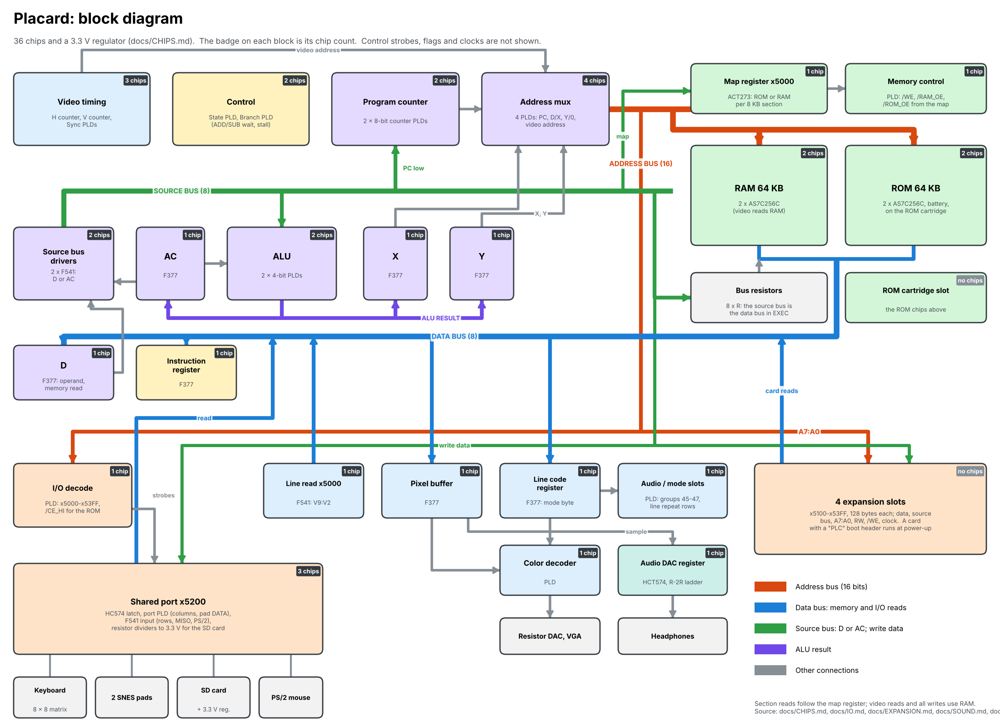
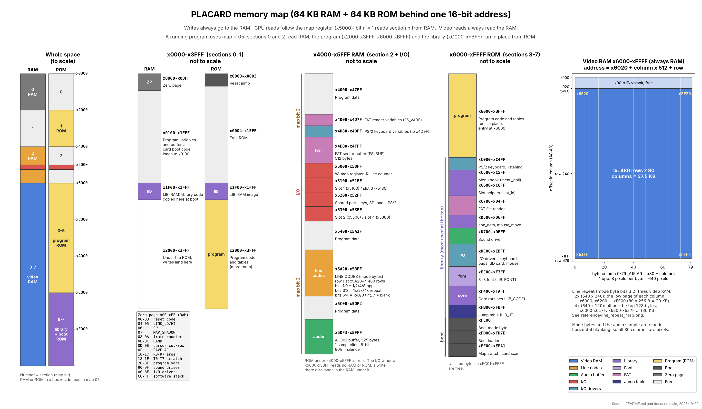
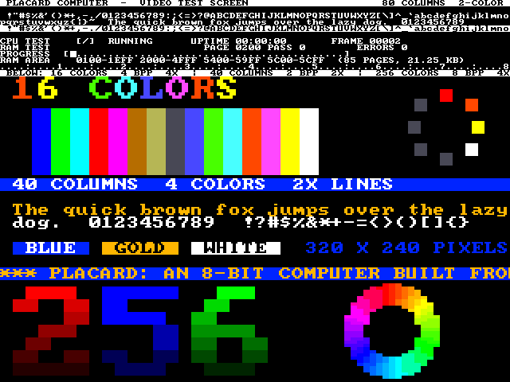
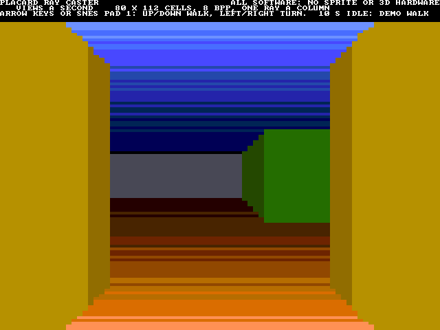
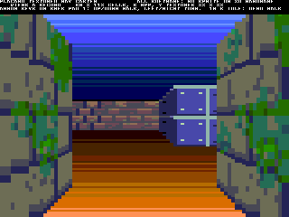
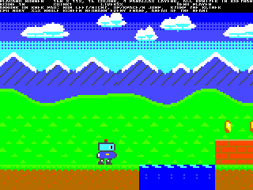
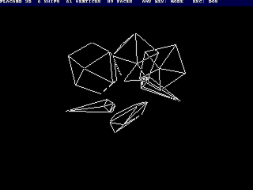

# Placard
## PLA computer
This project is a computer designed using some Programmable Logic Arrays (PLA) 
or Programable Array Logic (PAL) or Programmable Array Devices (PLD) chips.  
This started as a pure 7400-series chip computer, but changed over to using 
some PLA/PLDs to increase the usability while not greatly increasing the chip 
count.  The first PLA was created in 1970 by Texas Instruments.  The PAL was 
created in 1978 by Monolithic Memories which is owned by Lattice Semi today. 
There are some differences between the three types of chips, but this project 
isn't going to distinguished between them.

## Project goals
The project has some hard-goals to maintain:
- Use only through-hole chips similar to the 7400-series DIP chips (or PLA of course)
- Use only active production chips.  No hunting sketchy websites for parts.
- Design true von Neumann CPU from scratch.  No Harvard.  Bare-metal programming on the computer is a must (native compiler).
- Have a video output.  The video standard is open, but probably a legacy output (VGA/Composite/etc).
- Make the instruction set "fun" to program.  This means no racing the beam to draw the screen.  Counting instructions is not fun.
- Built-in keyboard.  No USB/PS2 keyboard.
- Native storage capabilities.  Need to be able to save/load programs as you create them on the computer.

## Block diagram
Each block shows how many chips it uses (33 and a 3.3 V regulator on the main board since 2026-10-25, when the matrix keyboard went and a PS/2 receiver PLD came; the expansion and cartridge slots add none, the cartridge itself has 5).  See [docs/CHIPS.md](docs/CHIPS.md) for the parts.

The drawing is made by `src/scripts/gen_block_diagram.py` (2026-10-23: CPU on the left, memory, I/O and audio in the middle, video on the right); rerun it when the design changes.

The I/O circuitry (SNES pads, SD card, PS/2 keyboard and mouse) is drawn as a schematic in
[docs/IO.md](docs/IO.md#schematic) (`schematics/placard_io_schematic.png`).
The audio circuitry (sample read, DAC register, R-2R ladder, audio line out jack) is drawn in
[docs/SOUND.md](docs/SOUND.md#schematic) (`schematics/placard_audio_schematic.png`).

The real schematic and PCB layout are a KiCad project in [kicad/](kicad/).

To build a board one chip at a time, testing each with a multimeter as it goes in, follow [docs/BRINGUP.md](docs/BRINGUP.md); it has a bring-up test ROM that checks the CPU and memory and shows the I/O on the screen.

## Memory Map
The Placard has 64kB of memory arranged in a 16-bit address bus and 8-bit databus.  The video RAM starts at x6020 and ends at xFFFF, and each row's mode byte (color mode and line repeat) is at x5A20 + row.  There is a 64kB RAM and a 64kB ROM behind the same addresses.  The address space is divided into eight 8kB sections, and a write-only map register at x5000 picks whether each section reads from the RAM or the ROM.

- **Writes always go to the RAM**, even in a section mapped to ROM.  The write strobe (/WE) is not decoded by address, so a write in the I/O window x5000-x53FF also lands in the RAM underneath it.
- **The map register** is a CD74ACT273E clocked by /MAP_WR from the I/O decode PLD; it latches the source bus at the end of the write.  Bit n = 1 makes section n read from RAM, 0 from ROM.  Bit 2 maps x4000-x4FFF and x5400-x5FFF, because x5000-x53FF is the I/O window.  It is write only, so software keeps a copy of the last value it wrote.
- **At power-up every section reads as ROM.**  RUN from the ROM cartridge holds the register's /MR low while the cartridge loads its SRAM and the CPU is held, so the CPU boots from ROM ([docs/ROM.md](docs/ROM.md#loading-the-cartridge)).
- **x5000-x53FF is the I/O window.**  The memory control PLD keeps both the RAM and the ROM off the bus there, so I/O always has priority.  (Until 2026-10-16 the window was x5000-x5FFF, with x5800-x5FFF a mirror.)
- **Only `[Y,X]` reaches the I/O window**; `[0,D]` and `[0,X]` only address the zero page.
- **Video reads always read the RAM** (memory control PLD revision 04); only CPU reads follow the map.  The CPU can run code from the ROM under the video area while the screen shows the RAM, and a program that wants to read the video RAM maps that section to RAM.
- **Programs run from the ROM.**  The library (jump table, core routines, font, I/O drivers, sound, line input, FAT reader, slot helpers and the demo menu hook) is one block at the top of the ROM, xC500-xFBFF, just under the boot loader, and runs in place; a program runs in place at ROM x6000-xBFFF and may use x2000-x3FFF too.  The boot loader copies the library's RAM code to x1F00, gives each expansion card a chance to run its own boot code (like the Apple II), then maps sections 0 and 2 to RAM (map = 05) and jumps to x6000.  Older demos written for RAM x0000 are copied into the RAM at boot instead.  That is the 64K development image; the machine's own 32K image (x8000-xFFFF, the same on both cartridges) holds the boot loader, the library, BASIC and a loader that runs the DOS and programs from the SD card.  See [docs/ROM.md](docs/ROM.md) and [docs/DOS.md](docs/DOS.md).
- **After a map write**, the next instruction must not be fetched from a section whose map bit that write changed, unless the ROM and RAM hold the same byte there (the new map arrives 4.1 ns too late for that fetch).  Copying the ROM into the RAM underneath and then switching the section is safe.  See [docs/TIMING_FIXES.md](docs/TIMING_FIXES.md#romram-map-register-74act273).

The memory control PLD (`ATF22V10_MEM_CTRL.pld`) makes /WE, /ROM_OE and /RAM_OE from the address, the map, RW and PIXEL_ENABLE, using only the low half of each clock.  The I/O decode PLD (`ATF22V10_IO_DECODE.pld`) makes the upper RAM/ROM chip select (/CE_HI) and the I/O strobes.

The RAM is two AS7C256C-15PCN (32K × 8, 15 ns) chips.  The ROM is two more AS7C256C-15PCN on the ROM cartridge, loaded at power-up from two AT28C256 EEPROMs by the cartridge while it stalls the CPU ([docs/ROM.md](docs/ROM.md#loading-the-cartridge)).  See [docs/CPU.md](docs/CPU.md#memory-parts) and [docs/TIMING.md](docs/TIMING.md).

| Address | Map bit | Function  |
|---------|---------|------|
| x0000-x1FFF | 0 | RAM/ROM (zero page, program variables, library RAM code at x1F00; ROM: reset jump) |
| x2000-x3FFF | 1 | RAM/ROM (ROM: program) |
| x4000-x4FFF | 2 | RAM/ROM (program data; FAT variables and buffer at x4D00-x4FFF) |
| x5000-x53FF | none | I/O window (see below) |
| x5400-x5FFF | 2 | RAM/ROM (mode bytes at x5A20-x5BFF, audio buffer at x5DF3-x5FFF) |
| x6000-x7FFF | 3 | RAM/ROM (Video Memory from x6020; ROM: program from x6000) |
| x8000-x9FFF | 4 | RAM/ROM (Video Memory; ROM: program; 32K image: vectors x8000, loader and BASIC x8100, LIB_RAM copy x9F00) |
| xA000-xBFFF | 5 | RAM/ROM (Video Memory; ROM: program; 32K image: BASIC xA000, FAT writer xB000) |
| xC000-xDFFF | 6 | RAM/ROM (Video Memory; ROM: library from xC000: PS/2 keyboard, menu hook, slot helpers, FAT reader, line input, sound, I/O drivers) |
| xE000-xFFFF | 7 | RAM/ROM (Video Memory; ROM: I/O drivers, font xEC00, core routines xF400, jump table xFB00, boot loader xFC00) |

The drawing is made by `src/scripts/gen_memory_map.py`; rerun it when the map changes.

### I/O window
Each 256-byte page has its own strobe from the I/O decode PLD.  Write strobes are low with /WE, and devices latch the source bus on the rising edge at the end of the write.  Read strobes are low on a read the CPU latches into D (LOAD_IMM).  The shared port is described in [docs/IO.md](docs/IO.md) and the expansion slots in [docs/EXPANSION.md](docs/EXPANSION.md).

| Address | Strobe | R/W | Function |
|---------|--------|-----|----------|
| x5000-x50FF | /MAP_WR | W | ROM/RAM map register (built) |
| x5000-x50FF | /LINE_RD | R | Video line counter, V9:V2 (built) |
| x5100-x517F | /EXP1, A7 = 0 | R/W | Expansion slot 1 |
| x5180-x51FF | /EXP1, A7 = 1 | R/W | Expansion slot 3 |
| x5200-x52FF | /PORT_WR | W | Shared port latch (port PLD registers): SD card SCK, MOSI and /CS, SNES pad clock and latch, PS/2 lines; a write to x5202/x5203 also re-arms the PS/2 receiver |
| x5200-x52FF | /PORT_RD | R | Shared port: SD MISO and the free PS/2 clock (x5200), SNES pad data (x5201), PS/2 receiver byte (x5202) and ready flag (x5203) |
| x5300-x537F | /EXP2, A7 = 0 | R/W | Expansion slot 2 |
| x5380-x53FF | /EXP2, A7 = 1 | R/W | Expansion slot 4 |

The window was x5000-x5FFF until 2026-10-16 (the I/O decode PLD did not decode A11, and the expansion ports were at x5500 and x5600).  The unused /SND_WR pin became the A11 input.

### Sound
The video circuit reads one 8-bit sample per scan line from x5DF3-x5FFF (525 bytes, one frame) and plays it through a 74HCT574 and a resistor ladder DAC, at the line rate of 31.47 kHz.  80h is silence.  The library's sound driver (`snd_update` once a frame, with `snd_tone`, `snd_beep`, `snd_note`, `snd_noise` and `snd_play`) refills the buffer behind the line being played.  See [docs/SOUND.md](docs/SOUND.md).

### Video line read
A read anywhere in x5000-x50FF returns the upper 8 bits of the video line counter, V9:V2.  The V counter in the V Counter PLD counts 499 to 1023, and one 74F541 enabled by /LINE_RD puts V9:V2 on the data bus.  The ROM/RAM map register shares the page but is write only, so there is no conflict.  Read it with `ld 0x50, y` then `ld [y,x], ac`.

- **It is a single byte**, so it can't tear between reads.
- **Resolution is 4 lines** (128 us).  Visible rows start at V = 544, so `row / 4 = value - 136`.  A value below 136 means vertical blanking.
- **There is no frame counter.**  Software keeps time by polling: each time the value goes down (from 255 back to 124), a frame has passed.  At the FPGA's 25.000 MHz clock a frame is 525 lines, about 16.8 ms (59.5 Hz).
- **Software must poll at least once per frame**, or it misses a wrap.  Elapsed time is then frames x 16.8 ms plus the line position for finer detail.

## Video
The video is designed to be 640x480 VGA 60Hz standard.  This means a 25.175 MHz clock.  This requires two counters: a horizontal and vertical.  They count 800 and 600 pixels.  This needs a 10-bit counter for each.  The counters form the RAM address space to read the pixel values.  The video memory is organized in a non-traditional way with H,V instead of V,H.

### Line repeat
Bits 3:2 of a row's mode byte make each byte of video memory show on 1, 2 or 4 lines (640 × 480, 240 or 120).  A full 2x screen leaves 20 KB of the video area free (the even pages x60, x62 ... xFE) and a full 4x screen 30 KB.  The audio slot PLD remaps four row address bits, so no chips were added.  See [docs/VIDEO.md](docs/VIDEO.md#line-repeat).

### Text demo
`src/scripts/text_demo.asm` draws a demo screen with the CPU and keeps a test running on it: 80 column text (2 colors, 1x, on row tints: a blue status panel and a rainbow raster bar that bounces behind the text), a 16 color band (4 bpp, 4x), 40 column text (2 bpp, 2x) and a 256 color band (8 bpp, 4x) with "256" in shades of red, blue and green and a turning rainbow ring.  Each frame it tests one page of RAM (85 pages: x0100-x1EFF, x2000-x4FFF, x5400-x59FF and x5C00-x5CFF, 14 patterns each, with a progress bar, pass and error counts) and updates a frame counter, an uptime clock, a spinner, a turning color wheel, the ring and a message that scrolls a pixel a frame.  `build\text_demo.bat` loads it on the board, and `src/scripts/text_demo_sim.py` runs and checks it in the simulator (`--gif` makes an animation).

### DOS, BASIC and demo menu
The machine ships the 32K ROM image (`src/scripts/rom32.masm`, `build\rom32.bat`): the boot loader, the library, PLACARD BASIC (a 16-bit integer BASIC with strings, graphics, sound and SAVE/LOAD on the card, [docs/BASIC.md](docs/BASIC.md)) and a loader that runs `.PLC` programs from the SD card.  The DOS is one of those programs (`DOS.PLC`, `src/scripts/dos.masm`).  At power-up the loader runs the program named in `BOOT.CFG`, or the DOS's file browser (hold Esc) that runs, deletes and picks the boot program, with a command line for `LOAD` and `SAVE` of memory as files.  With no card, or no `DOS.PLC` on it, BASIC starts.  The demo menu is one of those programs (`MENU.PLC`, `src/scripts/menu.masm`): the CPU test, pi, Mandelbrot and the Game of Life run in turn, each until it is done or for 2 minutes (Mandelbrot 3); Esc in any program shows the menu (Up / Down and Enter, or 1-4), a program picked there runs until Esc, and after 2 minutes with no key the menu goes back to running them in turn.  The `sdcard/` folder holds the files for the card; `src/scripts/test_dos.py`, `test_menu.py` and `test_basic.py` check them in the simulator; the `.BAS` files on the card are BASIC examples.  See [docs/DOS.md](docs/DOS.md), [docs/MENU.md](docs/MENU.md) and [docs/ROM.md](docs/ROM.md#the-32k-image).

### Game demos
Four demos show what the CPU can do with no sprite or collision hardware.  The first three are ROM programs written by a Python generator (the tables, the unrolled drawing code and a bit-exact model of the picture), and each has a simulator test that checks every frame against the model.

`src/scripts/raycast.asm` (`gen_raycast.py`) is a ray caster: an 80 × 112 view at 8 bpp (4x line repeat) of a maze with shaded, two-tone walls and a dithered floor and ceiling, walked by a demo script until a key or pad button takes over (arrow keys or SNES pad 1: Up / Down walk, Left / Right turn).  A view takes 143k-170k clocks (a column about 2,000), so it runs at the full 60 views a second using under 40 % of each frame.  `build\raycast.bat` loads it and `src/scripts/test_raycast_sim.py` checks it.

`src/scripts/raycast_tex.asm` (`gen_raycast_tex.py`) is the same maze and demo walk with textured walls, in the style of Wolfenstein 3D: seven 32 × 32 textures drawn by the generator (stone, brick, wood, riveted metal, mossy stone, a circuit board with a 22V10 and a framed Mandelbrot picture), y sides darker than x sides and four levels of distance shading.  Each column finds where the ray hit the wall (two 8 × 8 multiplies), copies that texture column through a shading table into zero page, and draws the wall with a compiled scaler: one unrolled routine per wall height that stores the right texel into each cell.  A view takes 229k-261k clocks (about 3,000 a column), so it still runs at 60 views a second, with room left for sprites.  It uses the ROM x2000-x3FFF for the textures and x6000-xBFFF for the code, tables and scalers, so it builds as its own 64K development image.  `build\raycast_tex.bat` loads it and `src/scripts/test_raycast_tex_sim.py` checks it.

`src/scripts/scroller.asm` (`gen_scroller.py`) is a side-scrolling platformer at 160 × 112, 4 bpp: three parallax bands (clouds, mountains, hills at 1/8, 1/4 and 1/2 speed) over a tiled level, with a robot that runs, jumps, collects coins and stomps slimes, all at 60 frames a second.  The background is redrawn every frame by unrolled strips, top to bottom ahead of the beam, so nothing has to be erased.  The sprites are compiled: each frame of art is its own routine in RAM that stores its bytes (masked where a byte is half transparent) straight into video memory.  Background and sprites take about 93k of the 420k clocks in a frame.  The demo player plays until a key or pad button is pressed (arrow keys or SNES pad 1: Left / Right to run, Up, Space or pad B to jump).  `build\scroller.bat` loads it and `src/scripts/test_scroller_sim.py` checks it.

`sdcard/WIRE3D.PLC` (`gen_wire3d.py`) is an Elite-style wireframe demo and benchmark: convex ships tumbling in 3D at 320 × 240 with hidden lines removed, quarter-square multiplies, projection by log tables and XOR lines erased by drawing them again.  It holds 30 fps with four ships using about 30 % of the CPU; the limit at 30 fps is about 130 vertices and 4,000 pixels of lines a frame, at 20 fps about 190 and 6,000.  [docs/WIRE3D.md](docs/WIRE3D.md) has the measurements; `src/scripts/test_wire3d_sim.py` checks every frame against a model.

### Pixel fill
An easy function is the fill function.  Putting a color in a pixel starts drawing that color.  That color continues to draw until that same color is placed again.  So putting two pixels one a row is enough to draw a whole row of that color.  It's much faster than having the CPU add that color along that entire row.  This is how to get to filled polygons quickly.  The CPU only needs to decide what the boundaries of a shape is, and the video circuit does the rest.  The CPU only drawing wireframes, but gets fully filled polygons.

This is done by just XORing the current color with the RAM value.  So you start with a blue pixel, then put another blue pixel to stop it.  But if you put a purple pixel instead, it will stop drawing blue and start drawing red.  It would normally require multiple chips - at least two quad XOR chips and a 8-bit FF register array.  But this is easily done in a single PLA/PLD

## Standard library
`src/scripts/placard_lib.asm` holds subroutines for new programs: 16-bit
arithmetic, multiply and divide, memory fill and copy, random numbers, frame
timing, pixels, a text console with line input, the keyboard, SNES pad,
PS/2 mouse and SD card drivers, a FAT16/FAT32 file reader, a sound driver
and expansion card lookup.  It also sets the calling convention, the
software stack and the zero page variable map (`zeropage.asm`).  See
[docs/LIBRARY.md](docs/LIBRARY.md).

## Emulator
Open `web/index.html` in a browser to run the PLACARD without hardware: the
32K ROM (or one you load), an SD card (the `sdcard/` folder, a folder of
your own or a card image), the screen, sound, keyboard, mouse and game
controllers, at the real clock rate.  No server is needed.  See
[docs/EMULATOR.md](docs/EMULATOR.md).

## Building and loading a program
The `build` folder has one Windows batch file per assembly program
(`cpu_test.bat`, `test_video.bat`, `text_demo.bat`, `mandelbrot.bat`,
`pi_spigot.bat`, `game_of_life.bat`, `lib_demo.bat`, `raycast.bat`,
`raycast_tex.bat`, `scroller.bat`).  Each one assembles
`src/scripts/<program>.asm` (customasm, or `placard_sim.py` if customasm is not
on the PATH), writes the RAM initialization files `src/hdl/ram.mem` (main
RAM) and `cart_ram.mem` (cartridge SRAM), random bytes like a real SRAM at
power-up (`gen_random_ram.tcl`), and the cartridge EEPROM image
`src/hdl/rom.mem` (boot loader, standard library and font, and the program,
`gen_rom.tcl`; see [docs/ROM.md](docs/ROM.md)), runs
Vivado in batch mode through synthesis, implementation and bitstream, and
programs the Basys 3 over JTAG.  Any other program builds with
`build\build_and_load.bat <program>`.  Add `noasm` (e.g. `cpu_test.bat noasm`)
to skip assembly and use the existing `.hex` file.  Vivado is found on the PATH or under
`C:\AMDDesignTools` / `C:\Xilinx`; set `VIVADO` to the full path of
`vivado.bat` to pick a version.  Logs go to `build/logs`; the Vivado Tcl scripts
behind the batch files are in `build/tcl`.
Add `fast` (e.g. `mandelbrot.bat fast`) to change only the memory contents:
the new `ram.mem`, `cart_ram.mem` and `rom.mem` are written into the last implemented bitstream with
`updatemem` (block RAM map from `build/tcl/write_mmi.tcl`), so synthesis and
implementation are skipped.  It needs one full build first, and a full build
again after any HDL or constraint change.  The first `fast` run after a full
build checks the block RAM map by putting the full build's own image back into
its bitstream; if that does not give the same bitstream it stops with an error.
`build\download_latest.bat` programs the board with the newest bitstream in
`project/placard.runs/impl_1` (`basys_top.bit` or `basys_top_fast.bit`) without
rebuilding.
The batch files play a sound when they finish (`build\ding.bat`): the
Windows "Ding" when the build worked and "Critical Stop" when it failed.
Set `PLACARD_QUIET=1` to turn it off.

### Vivado project
The Vivado project (`project/placard.xpr` and everything else in `project/`)
is not kept in git, because Vivado rewrites the `.xpr` every time it opens it.
`build/tcl/create_project.tcl` makes it from the sources in `src/`, with the
part, file list, testbench and run settings.  The first build makes it by
itself; to open the project in the GUI after a fresh clone, run
`build\create_project.bat` once.  Every `.vhd` file in `src/hdl` is a design
source, so after adding or removing one run `build\create_project.bat force`.
Testbenches and other settings are listed in `create_project.tcl`; change them
there, because a change made only in the GUI is lost the next time the project
is made.
`src/hdl/ram.mem`, `cart_ram.mem` and `rom.mem` are not kept in git either; every
build makes them, and `create_project.tcl` makes the default images if they
are missing.  A project made before the ROM had its own file lists
`video_ram.mem`; the next build swaps it for the new files, or run
`build\create_project.bat force`.
