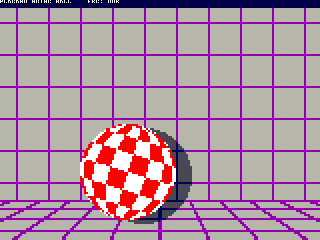

# Boing Ball

`sdcard/BOING.PLC` is the Placard's take on the Amiga's 1984 "Boing" demo:
a red and white checkered ball, its axis tilted 17 degrees, spinning and
bouncing in front of a purple grid with its shadow on the wall.  It runs
at a steady 60 frames a second and uses about a third of the CPU.  It is a
library program for the SD card (run it from the DOS's file browser; Esc
goes back), made by `src/scripts/gen_boing.py`.  `build\boing.bat` loads a
ROM build of the same program for testing on the board without the SD card
(`src/scripts/boing_rom.asm`: a stub at x6000 copies the program from ROM
x8000-xBEFF to RAM x0100-x3FFF and runs it as the DOS would; without the
DOS, Esc does nothing).

Date: 10/28/2026



(The GIF plays at 50 frames a second, the fastest a GIF goes; the demo
runs at 60.)

## The picture

160 × 120, 4 bpp with 4x line repeat, so each pixel is 4 × 4 screen
pixels and square.  The top 16 screen lines are a 1 bpp text band with the
title and the frames per second.  The 4 bpp palette (COLORS.md) already has
the Amiga demo's colors: light gray (B) wall, purple (2) grid, red (4) and
white (A) ball, dark gray (7) shadow, and dark blue (1) where the shadow
crosses a grid line.  The ball is 48 pixels across (920 bytes).  It bounces
on the floor along a parabola (88 frames, 1.5 s a bounce), moves a byte
(2 pixels) sideways every third frame (40 pixels a second), turns at the
walls, and spins the way it is going, a phase every other frame (one
turn in 2.1 s).  `BOUNCE`, `HSTEP` and `SPIN` in `gen_boing.py` set these.

## How

The Amiga draws its ball once and spins it by cycling palette colors.  The
Placard's colors are fixed in the color decoder and there are no sprites or
scroll registers, so the ball is drawn again every frame:

- **Spin**: 8 phases of the ball are worked out in Python, covering 45
  degrees of turn (one red and one white segment), so they repeat
  seamlessly.  A phase is 920 bytes in 4 pages, and none of its rows
  crosses a page.  The 8 phases take 8 KB of the program's 16 KB.
- **Background**: drawn once at the start, twice: into the picture (offsets
  x80-xFF of each odd video page, where 4x rows are read) and as a clean
  copy in the same pages' x00-x7F, which 4x rows leave free (a row's clean
  byte is at its offset AND x7F).
- **A frame**: only the rows the ball and its shadow cover, now or last
  frame, are drawn again (about 52 rows).  Each row is built in 32
  zero-page bytes for the 32 byte columns starting two left of the ball:
  1. copy the clean background in (unrolled, 10 clocks a byte);
  2. darken the shadow's span through a 256-byte table (one table for
     whole bytes, one each for the half byte at either end);
  3. copy this phase's bytes of the ball over it, merging the half bytes at
     its edge with what is under them;
  4. write the 32 bytes to the picture (unrolled, 11 clocks a byte).

  Nothing else is erased: the 32 columns also cover where the ball was,
  since it moves a byte at most.
- **No tearing**: the drawing starts when the frame wraps (the line read
  goes down), 36,000 clocks before the first picture line, and works top
  to bottom at about 2,600 clocks a row against the beam's 3,200.  The
  beam never catches up, so there is no second buffer.

## Measured (simulator, video stall clocks modeled)

| | |
|---|---|
| Frame rate | 60 fps, no frame dropped |
| Work per frame | 133,700 clocks on average, 138,000 at most (33 % of a 420,000-clock frame) |
| Rows drawn per frame | 51.3 on average, 53 at most |
| Least lead on the beam | 60,000 clocks (75 lines) |
| Start-up (screen clear, background) | 67 ms |

So about two thirds of the CPU is left over, enough for sound, a scrolling
grid or a second ball.

## Building and testing

```
python3 gen_boing.py           boing.masm, boing.asm, ../../sdcard/BOING.PLC, boing_rom.asm/.hex
python3 test_boing_sim.py      130 frames checked pixel for pixel against the model, timing, beam lead
python3 test_boing_sim.py --frames 88 --gif ../../reference/boing_sim.gif
python3 test_boing_sim.py --rom          the ROM build from power-up
```

`test_boing_sim.py` works out the expected picture of every frame pixel by
pixel (background, shadow disc, ball phase), not byte by byte as the
program does, so it also catches leftovers from the last frame.  It also
checks that every row is written before the beam reaches it and that no
frame takes more than one video frame.  `customasm` 0.14 builds
`boing_rom.asm` byte for byte the same as `placard_sim.py`.
