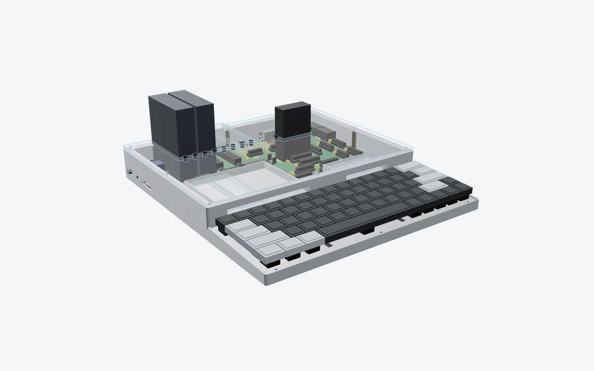
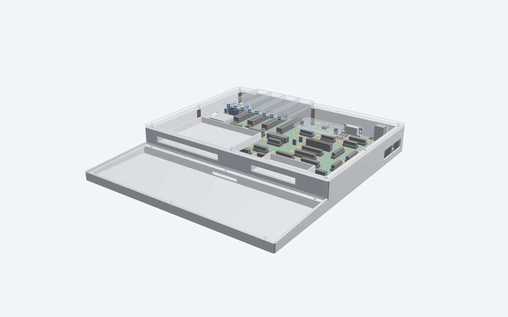
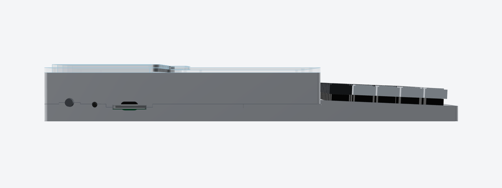
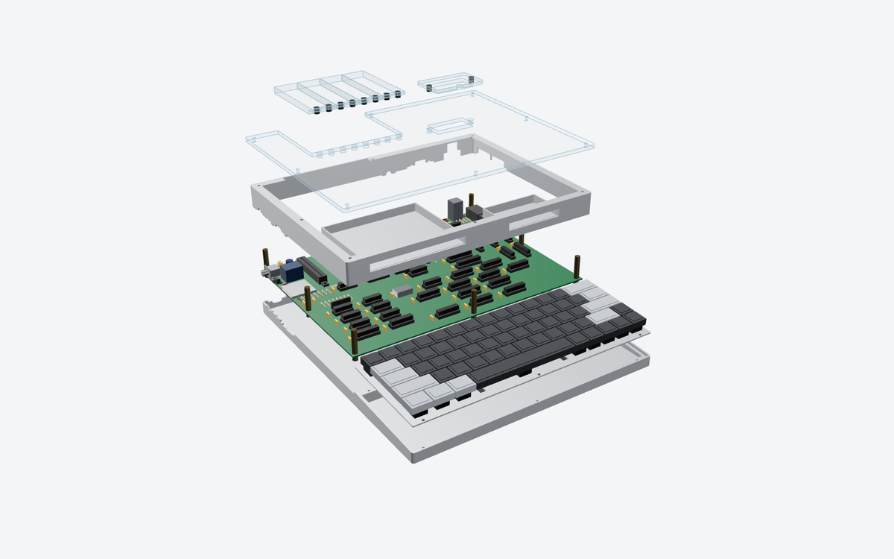
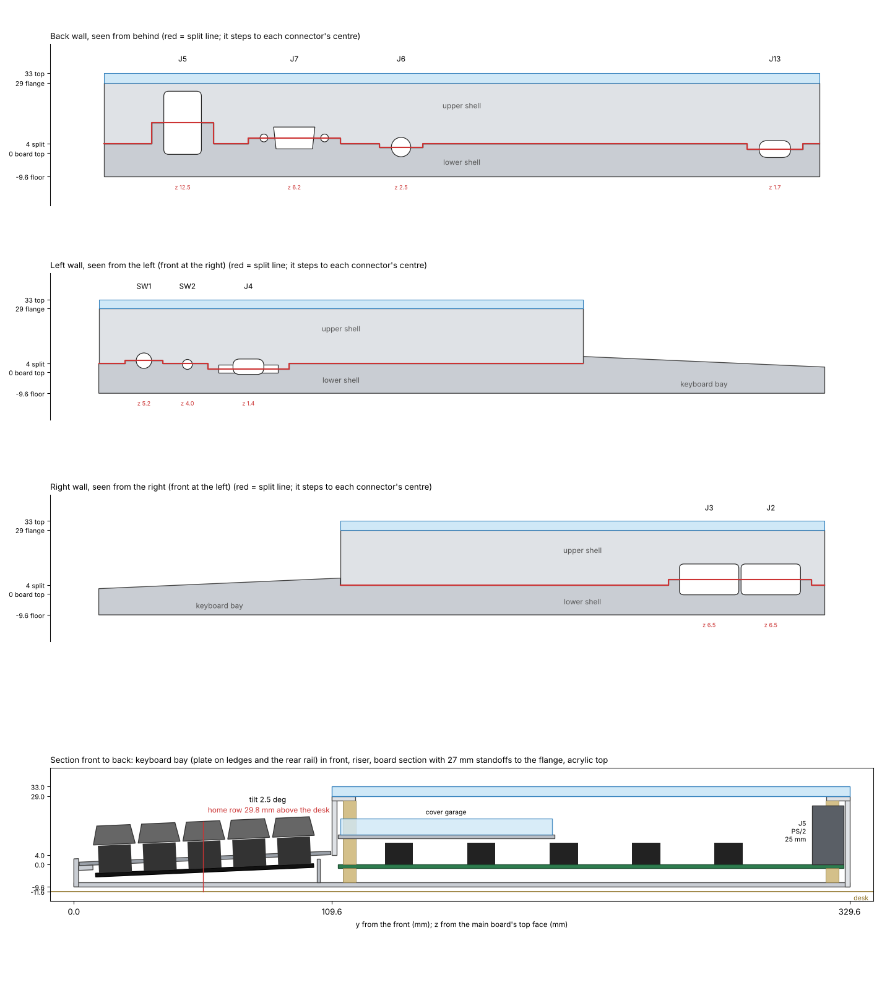
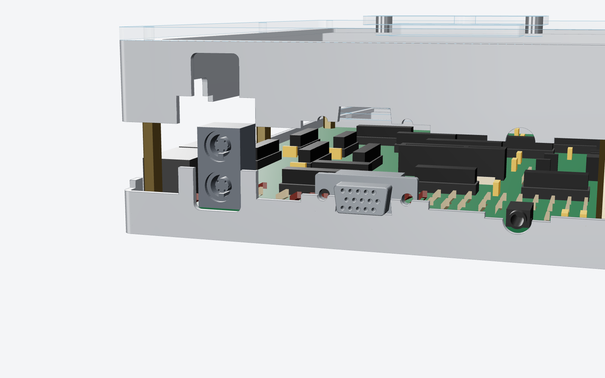
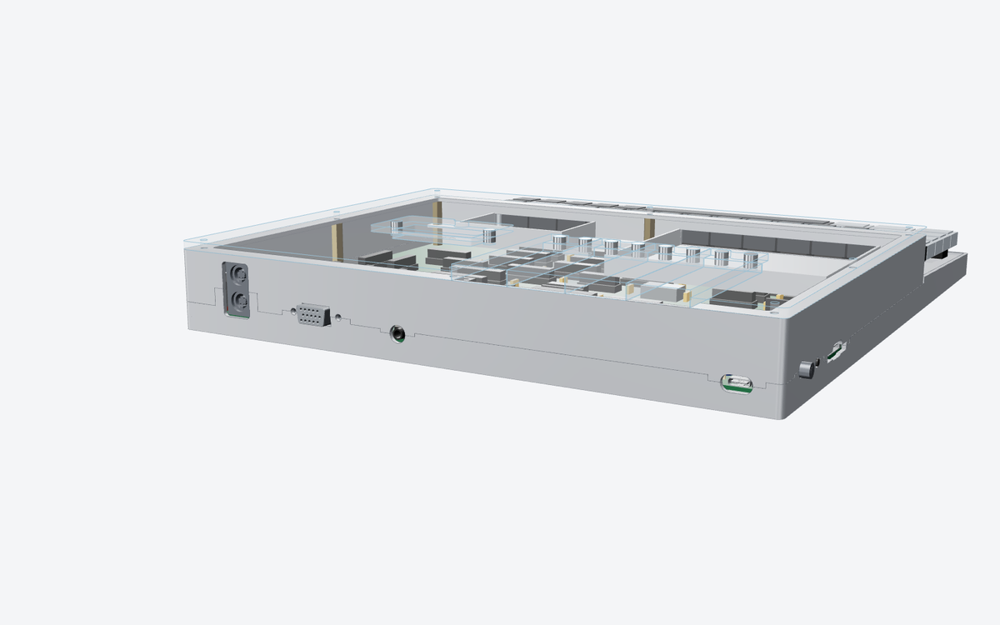
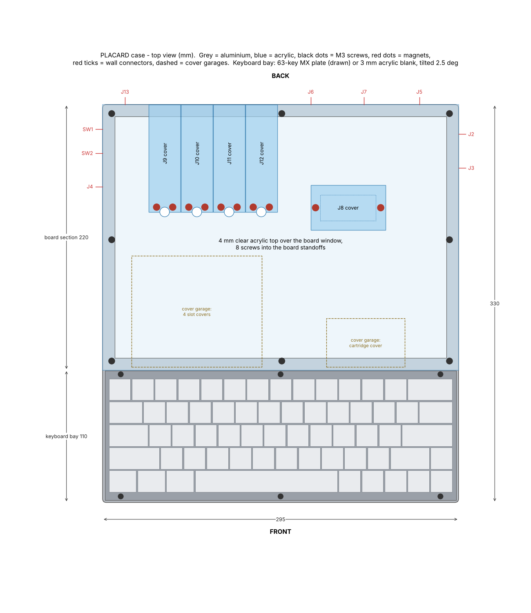
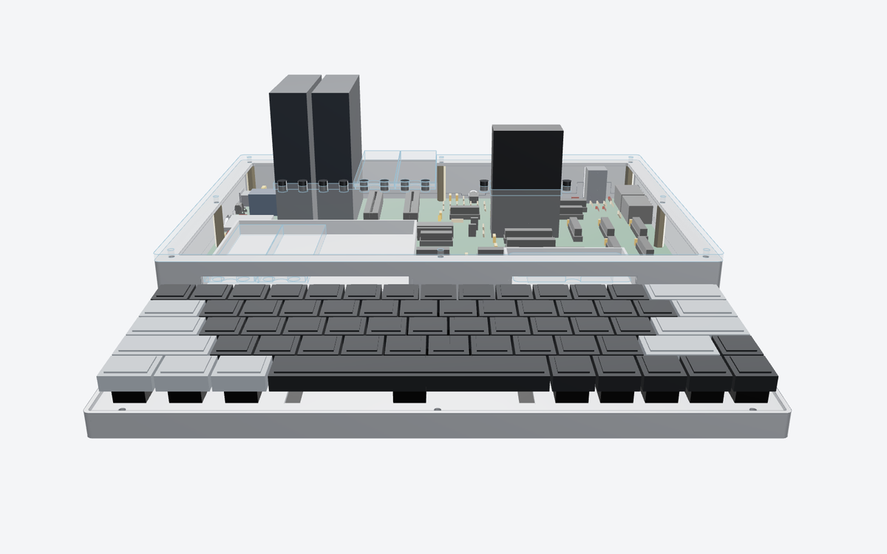
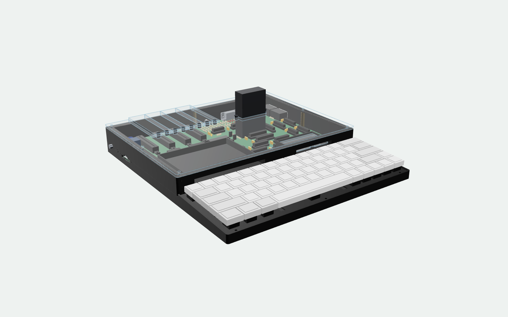

# Case

Date: 2026-10-24

A concept for the PLACARD case: a brushed, anodized aluminium shell that is
strong on the bottom and sides, with a clear acrylic top so the board shows
through.  The Cherry MX keyboard sits in its own bay in front of the main
board, low and slightly tilted, at the height ergonomics guidelines ask for.
Builds without that keyboard close the bay with an acrylic blank.  Each
expansion slot (J9-J12) and the cartridge slot (J8) has its own removable
acrylic cover, held on by magnets.  Two small trays inside the case hold the
covers that are out.

The aluminium is split in two along the connectors.  The board drops straight
down into the lower shell, the connectors rest in half-slots in its walls, and
the upper shell comes down over them and screws on.









Everything here is made by `src/scripts/gen_case.py` from the board file, so
the cut-outs follow the connectors when they move.  It reads each wall
connector's position from `kicad/placard.kicad_pcb` and where its 3D model
(`kicad/lib/placard.3dshapes`) meets the wall.  The board file is only read,
never written.  The files in `case/` and these drawings were made from the
hand-placed 290 x 215 mm board as of 2026-10-24 (Justin's working copy; the
copy in the repository was still the older 290 x 290 one).

## Size

| | mm | in |
|---|--:|--:|
| Outside, width x depth | 295 x 330 | 11.6 x 13.0 |
| Keyboard bay, front to the riser | 110 | 4.3 |
| Board section, riser to the back | 220 | 8.7 |
| Height at the back, desk to acrylic top (2 mm feet) | 44.6 | 1.76 |
| Height at the front edge, desk to rim | 14.0 | 0.55 |
| Home row keycap tops above the desk | 29.8 | 1.17 |
| Keyboard tilt (back higher) | 2.5° | |

The board section's height is set by the stacked PS/2 socket J5 (25 mm tall):
the top flange clears it by 2 mm.

## Keyboard height and tilt

Guidelines: HFES 100 (the US standard for computer workstations) prefers the
home row (A S D F) at **30 mm or less above the desk** and never more than 35
mm; the older German DIN rule also gives 30 mm.  Slope may be 0-15°, and
studies of typists favour flat or slightly negative slopes over steeper
positive ones, because a raised back bends the wrists up.

The keyboard's stack, bottom to top: 2 mm feet, 2 mm floor, 0.5 mm air, 1.7 mm
of switch pins and leads, the 1.6 mm keyboard PCB, 5 mm up to the plate's top
(Cherry MX), then about 15 mm to the top of a Cherry-profile home-row keycap.
Flat, that puts the home row at 27.8 mm.  Each degree of tilt raises it by
about 0.9 mm, so **2.5° is the steepest that stays at 30 mm** (29.8 mm).  The
script picks the tilt from `HOME_ROW_MAX`, so a different keycap height or
target is one constant.  Steeper is allowed by the standard (about 7° stays
under its 35 mm limit) but goes against the wrist research.

Taller keycap profiles raise everything: OEM profile adds about 2 mm, SA about
5 mm.  Cherry profile (or a low profile like XDA) keeps it at 30 mm.

The keyboard could not slide over the main board without changing its height
or tilt: at the back of the bay the keyboard PCB is only level with the main
board's top face, and the main board's chips stand 9 mm above that.  So the bay is
in front of the board, which makes the case 330 mm deep instead of 295.



## Parts

| Part | Qty | Material and finish | Made by |
|---|--:|---|---|
| Lower shell | 1 | 2.0 mm 5052-H32 aluminium, bent tray: floor, keyboard bay walls up to the rim (sloped sides), board section walls up to the split line, ledges under the plate.  Brushed before bending, clear (or black) anodized after | Sheet metal service: laser cut, bend, PEM insert, finish |
| Upper shell | 1 | 2.0 mm 5052-H32, bent: board section walls down to the split line, the riser behind the keyboard (with two slots into the cover garages), top flange round the board window | Same |
| Keyboard rail | 1 | 1.5 mm 5052, Z-shaped: carries the plate's back edge (3 PEM nuts), foot screwed to the floor, a slot for the keyboard ribbon | Same |
| Cover garages | 2 | 1.5 mm 5052 open trays with ears; they hang on the standoffs at H3/H5 and H5/H4 | Same |
| Acrylic top | 1 | 4 mm clear cast acrylic, 295 x 220 mm, laser cut, with 10 magnet holes | Laser cutting service |
| Keyboard plate | 1 (keyboard builds) | 1.5 mm 5052, 63 Cherry MX cut-outs plus 6.75 x 14 mm stabilizer cut-outs (2u, 2.25u, 6.25u; check against the stabilizers bought), anodized | Sheet metal service |
| Keyboard blank | 1 (no-keyboard builds) | 3 mm clear cast acrylic, same outline and holes as the plate | Laser cutting service |
| Slot cover | 4 | 4 mm acrylic plug + 3 mm acrylic cap, solvent welded (Weld-On 4) | Laser cutting service; the builder or kitter welds them |
| Cartridge cover | 1 | Same, sized for J8 | Same |
| Disc magnet, N52, 6 x 3 mm | 20 | 10 in the acrylic top, 10 in the cover caps, glued (cyanoacrylate or epoxy) | |
| PEM standoff, M3, 6 mm (SO-M3-6) | 8 | In the floor under board holes H1-H8 | Sheet metal service |
| PEM nut, M2.5 or M3 (CLS) | 6 | 3 in the front ledge, 3 in the keyboard rail | Sheet metal service |
| M3 male-female hex standoff, 27 mm | 5 | Board top to the top flange at H1, H2, H6, H7, H8; its thread goes through the board into the floor standoff | Ettinger and others sell 1 mm steps; or 25 mm + a 2 mm spacer |
| M3 male-female hex standoff, 11 mm + 16 mm | 3 each | At H3, H5 and H4 the garage ears sit between the two | |
| M3 x 8 button head screw, black or stainless | 8 | Acrylic top | |
| M2.5 or M3 x 6 button head screw | 6 | Keyboard plate or blank | |
| Rubber feet, 2 mm thin | 4 | Under the floor, near the corners | |

The VGA connector's 4-40 jackscrews pass through the back wall and hold the
lower and upper walls together at J7.

STEP models of every part are in `case/`, and DXF cutting files for the flat
parts (acrylic top, blank, plate, both layers of each cover) in `case/dxf/`.
Sheet metal services (Protocase, JLCCNC, PCBWay, Xometry) quote bent parts
from STEP; SendCutSend wants a flat pattern, which their own tool or any CAD
program unfolds from the STEP.

## How it goes together

1. The sheet metal service presses the floor standoffs and the PEM nuts in.
2. Screw the keyboard rail to the floor.
3. Lay the board into the lower shell's board section.  Every connector drops
   into its half-slot in the walls; nothing has to be threaded through a hole.
4. Screw the 27 mm standoffs through H1, H2, H6, H7 and H8 into the floor
   standoffs, and the 11 mm standoffs through H3, H5 and H4.  This clamps the
   board.  Hang the two cover garages on the 11 mm standoffs and screw the
   16 mm standoffs on top of them.
5. Lower the upper shell.  Its tongues drop into the lower shell's notches and
   close over the top halves of the connectors.
6. Lay the acrylic top on and fit its eight screws, into the standoffs.  They
   hold the upper shell down too.
7. Keyboard builds: plug the ribbon into J1 (it runs through the slot in the
   rail and under the riser), lower the keyboard (plate, switches and keyboard
   PCB in one piece) onto the ledges and rail, six screws.  Other builds: lay
   the blank in, six screws.
8. Fit the VGA jackscrews and the covers.

To open it: the top's eight screws, then lift the upper shell off.  The
keyboard comes out on its own six screws without opening anything else.

## The split line

The lower and upper shells meet 4 mm above the board's top face, and at each
connector the line steps up or down to the connector's centre, so every
cut-out is half in the lower shell and half in the upper.  Where a connector's
centre is below 4 mm (USB-C, audio, SD) the lower shell has a notch and the
upper shell a tongue that drops into it; where it is above (VGA, PS/2, SNES,
power switch) the lower shell has a tab and the upper shell a notch.  Each step
runs 5 mm past the cut-out on both sides, and the steps locate the upper shell
sideways.  In the keyboard bay the lower shell's walls rise to the rim
instead, so the bay is one piece with the floor.





Cut-outs (u = mm along the wall from the case's left or front corner; z = mm
above the board's top face):

| Ref | Wall | u | Centre z | Cut-out | Notes |
|---|---|--:|--:|---|---|
| J13 | back | 18.5 | 1.7 | slot 13 x 7 | USB-C power.  The receptacle is flush with the board edge, so its mouth is 2.5 mm behind the outside face; the cut-out fits a USB-C plug's overmould (12.4 x 6.5 typical) |
| J6 | back | 172.5 | 2.5 | 8 mm hole | Audio line out |
| J7 | back | 216.5 | 6.3 | DE-15 D cut-out + two 3.2 mm holes at 25 mm | VGA.  The connector's flange sits 0.5 mm inside the wall; its jackscrews go through |
| J5 | back | 262.5 | 12.5 | 15.5 x 26 rounded | Stacked PS/2, both ports in one opening |
| SW1 | left | 309.1 | 5.2 | 7 mm hole | Power toggle bushing; the lever stands out of the wall |
| SW2 | left | 289.4 | 4.0 | 4.5 mm hole | Reset.  The actuator stands 0.6 mm proud of the wall (a press has to be held 0.5 s, so a knock is harmless) |
| J4 | left | 261.7 | 1.4 | 27 x 3.6 slot + 14 x 7 thumb notch | SD card, push-push |
| J2 | right | 305.1 | 6.5 | 27 x 14 rounded | SNES port 1 |
| J3 | right | 277.1 | 6.5 | 27 x 14 rounded | SNES port 2 |

The connector models are drawn from typical dimensions (see
`gen_kicad_3d_models.py`), so check the cut-outs against the real parts, or
the makers' STEP files, before ordering metal.



## Covers, magnets and garages

- **Openings.**  The acrylic top has one opening for the four expansion slots
  and one for the cartridge, each the slot's shell keepout (the footprint
  courtyard), so an installed card's shell has 1 mm all round.  The four
  expansion slots are 27 mm apart and their shells only 1.2 mm apart, too
  close for acrylic between them, so they share one opening and the four
  covers tile it, one per slot.
- **Covers.**  Each is a 4 mm plug that fills its share of the opening, with a
  3 mm cap welded on top that laps 8 mm onto the acrylic in front (all round
  for the cartridge).  The expansion covers' plugs rest on the back wall's top
  edge at the back.  An 8 mm thumb notch in the cap's front edge lifts each one
  out.
- **Magnets.**  Two 6 x 3 mm N52 disc magnets in each cap's lap, over two in
  the acrylic top (in the front lap for the slot covers, the left and right laps
  for the cartridge cover): 20 magnets in all.  Glue them flush with the
  touching faces, so each pair meets with no gap; mind the polarity (mark one
  face of every magnet before gluing).  A pair at contact holds about 1 kg, so
  a 20 g cover stays put with the case on its side or upside down, and still
  lifts out with a fingernail.  The magnets show through the clear acrylic as
  small grey dots.
- **Garages.**  Two open aluminium trays inside the board section, just behind
  the riser, 11 mm above the board (clear of the 9.1 mm socketed chips), each
  reached through a slot in the riser above the keyboard.  The left one holds
  the four slot covers side by side, the right one the cartridge cover; covers
  slide in cap-up.  They are visible through the acrylic top.  With a card in
  every slot, all five covers fit.



## Other details

- **Keyboard support.**  The plate sits recessed 1.5 mm in the bay's rim, on a
  6 mm ledge along the front, 3.5 mm ledges along the sides and the rail at the
  back, with six screws (three each front and back, in the plate's margins
  clear of the keycaps).  The keyboard PCB hangs from the switches; it can be
  up to 283 mm wide and about 94 mm deep, and needs no standoffs.  The blank
  is 3 mm, flush with the rim.
- **Back flange.**  J9-J12's shell keepouts reach the board's back edge, so the
  flange is cut away over the expansion bay down to the back wall.  Moving
  J9-J12 about 10 mm toward the front would leave a continuous back flange;
  it is not needed.
- **Ventilation.**  Slots in the floor under the middle of the board; warm air
  leaves round the covers, the garage slots and the connector openings.  Check
  the temperature with the top on during bring-up.
- **Finish.**  Clear anodize keeps the brushed look; black anodize costs the
  same.  5052 is the usual alloy for bent parts (6061 cracks on tight bends).
  Bent trays have small open corners (bend relief, about 0.5-1 mm); welding
  and grinding closes them at extra cost.



## Cost estimate

Rough per-unit prices, US dollars, before shipping, tax and tariffs (35 %
assumed elsewhere for China-made parts), from typical 2026 vendor pricing.
**No quotes were requested**; treat each number as plus or minus 40 % until
the STEP and DXF files are uploaded to a quoting site.

| Item | 1 | 10 | 100 | 1,000 |
|---|--:|--:|--:|--:|
| Lower + upper shell, bent 5052, brushed, anodized, PEM inserts (US: SendCutSend, Protocase) | $200-330 | $120-200 | $65-105 | - |
| Same, China (JLCCNC, PCBWay sheet metal) | $100-165 | $65-110 | $38-65 | $27-45 |
| Keyboard rail and two garages, 1.5 mm 5052 | $20-35 | $10-18 | $5-9 | $3-6 |
| Welded and ground corners, both shells | +$40-80 | +$30-50 | +$15-30 | +$10-20 |
| Acrylic: top, blank, 4 slot covers, cartridge cover (cut; welding by hand) | $55-85 | $32-50 | $14-24 | $8-14 |
| Keyboard plate, 1.5 mm 5052 anodized (instead of the blank, about the same either way) | $25-40 | $12-20 | $6-10 | $4-7 |
| 20 N52 magnets, 6 x 3 mm | $4-6 | $3-5 | $2-3 | $1-2 |
| Hardware: standoffs, screws, feet | $9-13 | $7-10 | $4-6 | $3-4 |
| **Case, China sheet metal, open corners** | **$190-300** | **$120-195** | **$65-105** | **$45-75** |
| **Case, US sheet metal, open corners** | **$290-470** | **$175-285** | **$95-150** | - |

That is about twice to three times the $30 acrylic sandwich `KIT_PRICING.md`
assumes at 100, so the complete kit's case line would go up by roughly
$35-75 plus tariff.

Weight: about 0.9 kg of aluminium and 0.4 kg of acrylic.

## Not decided

- Clear or black anodize, and open or welded corners.
- Keycap profile (Cherry assumed; OEM would put the home row near 32 mm).
- Whether the stacked PS/2 stays (it sets the board section's height).
- Whether J9-J12 move forward ~10 mm for a continuous back flange.
- The keyboard PCB outline (up to 283 x 94 mm) and where its ribbon header
  sits (the rail's ribbon slot is in the middle; J1 is about 90 mm behind the
  riser).

## Remaking the files

```
pip install cadquery
python3 src/scripts/gen_case.py                       # STEP + DXF in case/, drawings in docs/
python3 src/scripts/gen_case.py --pcb other.kicad_pcb # from another copy of the board
python3 src/scripts/gen_case.py --mesh src/scripts/case_render/mesh   # also STL meshes for the renders
```

The renders use three.js in headless Chromium (`src/scripts/case_render/`):
make the meshes as above, `npm install three@0.160.0` in `case_render/web`,
serve `case_render/` on port 8765, then `node shoot_case.js [view ...]`;
the views are in `views.json`.  The cartridge in the renders is the short
32K one (39 x 66 mm board).
