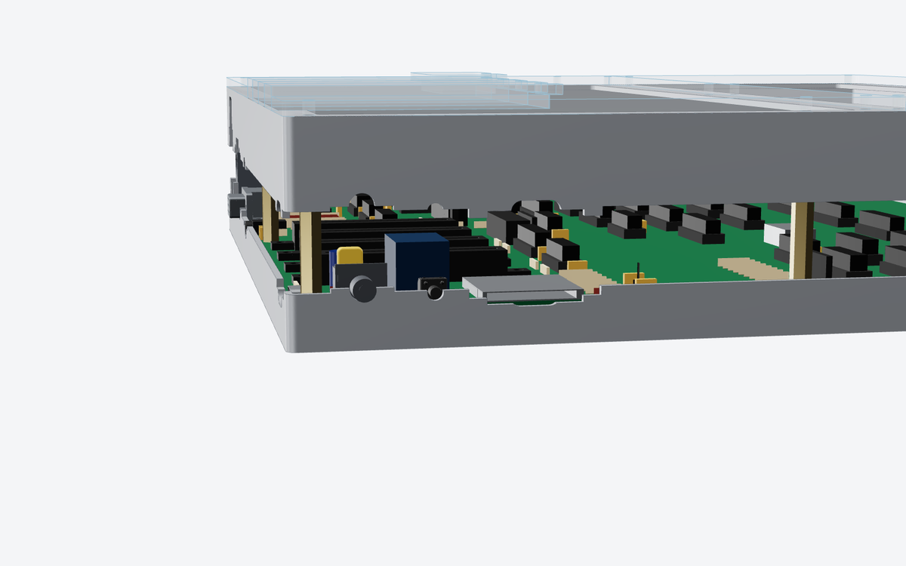

# Case

Date: 2026-10-24

A concept for the PLACARD case: a brushed, anodized aluminium shell that is
strong on the bottom and sides, and a clear acrylic top so the board shows
through.  The keyboard sits in a bay at the front; builds without the Cherry MX
keyboard close the bay with an acrylic blank.  Each expansion slot (J9-J12) and
the cartridge slot (J8) has its own removable acrylic cover.

The aluminium is split in two along the connectors.  The board drops straight
down into the lower shell, the connectors rest in half-slots in its walls,
and the upper shell comes down over them and screws on.


Everything here is made by `src/scripts/gen_case.py` from the board file, so
the cut-outs follow the connectors when they move.  It reads each wall
connector's position from `kicad/placard.kicad_pcb` and where its 3D model
(`kicad/lib/placard.3dshapes`) meets the wall.  The board file is only
read, never written.  The files in `case/` and these drawings were made from
the hand-placed board as of 2026-10-23 (J9-J12 at 27 mm pitch, J8 at board
(184.5, 79.6)).

## Size

| | mm | in |
|---|--:|--:|
| Outside, width x depth | 295 x 295 | 11.6 x 11.6 |
| Height, floor to acrylic top | 44.6 | 1.76 |
| Height with 3 mm rubber feet | 47.6 | 1.87 |
| Keycap tops above the acrylic | about 11 | 0.45 |

The board sits 0.5 mm inside 2 mm walls on all four sides.  The height is set
by the stacked PS/2 socket J5 (25 mm tall): the top flange clears it by 2 mm.
The next tallest part is the relay K1 (15.7 mm).  Without the stacked PS/2
(one port, or both side by side) the case could be about 9 mm lower.

## Parts

| Part | Qty | Material and finish | Made by |
|---|--:|---|---|
| Lower shell | 1 | 2.0 mm 5052-H32 aluminium, bent tray (floor + four walls up to the split line), brushed before bending, clear (or black) anodized after | Sheet metal service: laser cut, bend, PEM insert, finish |
| Upper shell | 1 | 2.0 mm 5052-H32, bent: top flange with the keyboard bay and board windows, four walls down to the split line | Same |
| Acrylic top | 1 | 4 mm clear cast acrylic, 295 x 174 mm, laser cut | Laser cutting service |
| Keyboard blank | 1 (no-keyboard builds) | 4 mm clear cast acrylic, 295 x 121 mm | Same |
| Keyboard plate | 1 (keyboard builds) | 1.5 mm 5052, Cherry MX 14 mm cut-outs for the 63-key layout plus 6.75 x 14 mm stabilizer cut-outs (2u, 2.25u, 6.25u; check against the stabilizers bought), anodized | Sheet metal service |
| Slot cover | 4 | 4 mm acrylic plug + 3 mm acrylic cap, solvent welded (Weld-On 4) | Laser cutting service; the builder or kitter welds them |
| Cartridge cover | 1 | Same, sized for J8 | Same |
| PEM standoff, M3, 8 mm (SO-M3-8, or a stainless equivalent) | 8 | Pressed into the floor under board holes H1-H8 | Sheet metal service |
| PEM nut, M3 (CLS-M3-1) | 6 | Pressed into the upper shell's cross bar (front edge of the acrylic top, back edge of the bay) | Sheet metal service |
| M3 male-female hex standoff, 27 mm | 8 | Board top to the top flange, one per board hole; its thread goes through the board into the floor standoff | Ettinger and others sell 1 mm steps; or 25 mm + a 2 mm spacer |
| M3 x 8 button head screw, black or stainless | 14 | 8 for the acrylic top, 6 for the blank or plate | |
| Rubber feet, 12.7 mm x 3.5 mm (3M SJ5302) | 4 | Under the floor, near the corners | |

The VGA connector's 4-40 jackscrews pass through the back wall and hold the
lower and upper walls together at J7.

STEP models of every part are in `case/` and laser-cutting DXF files for the
acrylic and the keyboard plate in `case/dxf/` (each is the part's outline,
for the 3 mm and 4 mm layers of the covers separately).  Sheet metal
services (Protocase, JLCCNC, PCBWay, Xometry) quote bent parts from STEP;
SendCutSend wants a flat pattern, which their own tool or any CAD program
unfolds from the STEP.

## How it goes together

1. The sheet metal service presses the eight 8 mm standoffs into the lower
   shell's floor and the six nuts into the upper shell's cross bar.
2. Lay the board into the lower shell.  Every connector drops into its
   half-slot in the walls; nothing has to be threaded through a hole.
3. Screw the eight 27 mm standoffs through the board's holes into the floor
   standoffs.  This clamps the board.
4. Lower the upper shell.  Its tongues drop into the lower shell's notches and
   close over the top halves of the connectors (see below).
5. Keyboard builds: plug the ribbon into J1, set the keyboard (plate, switches
   and keyboard PCB in one piece) into the bay.  Other builds: lay the blank
   over the bay.  Six screws: three into the standoffs at H3, H5 and H4 (under
   the front of the flange) and three into the cross bar nuts.
6. Lay the acrylic top on and fit its eight screws: five into the standoffs at
   H1, H6, H2, H7 and H8, three into the cross bar nuts.  These screws hold the
   upper shell down too.
7. Fit the VGA jackscrews, the slot covers and the cartridge cover.

To open it: the top's eight screws and the bay's six, then lift the upper
shell off.  The board stays screwed to the floor.

## The split line

The lower and upper shells meet 4 mm above the board's top face, and at each
connector the line steps up or down to the connector's centre, so every
cut-out is half in the lower shell and half in the upper.  Where a connector's
centre is below 4 mm (USB-C, audio, SD) the lower shell has a notch and the
upper shell a tongue that drops into it; where it is above (VGA, PS/2, SNES,
power switch) the lower shell has a tab and the upper shell a notch.  Each step
runs 5 mm past the cut-out on both sides.  The steps also locate the upper
shell sideways, front to back on the side walls and left to right on the back
wall.





Cut-outs (u = mm along the wall from the case's left or front corner; z = mm
above the board's top face):

| Ref | Wall | u | Centre z | Cut-out | Notes |
|---|---|--:|--:|---|---|
| J13 | back | 18.5 | 1.7 | slot 13 x 7 | USB-C power.  The receptacle is flush with the board edge, so its mouth is 2.5 mm behind the outside face; the cut-out fits a USB-C plug's overmould (12.4 x 6.5 typical) |
| J6 | back | 172.5 | 2.5 | 8 mm hole | Audio line out |
| J7 | back | 216.5 | 6.3 | DE-15 D cut-out + two 3.2 mm holes at 25 mm | VGA.  The connector's flange sits 0.5 mm inside the wall; its jackscrews go through |
| J5 | back | 262.5 | 12.5 | 15.5 x 26 rounded | Stacked PS/2, both ports in one opening |
| SW1 | left | 274.5 | 5.2 | 7 mm hole | Power toggle bushing; the lever stands out of the wall |
| SW2 | left | 254.7 | 4.0 | 4.5 mm hole | Reset.  The actuator stands 0.6 mm proud of the wall (a press has to be held 0.5 s, so a knock is harmless) |
| J4 | left | 227.1 | 1.4 | 27 x 3.6 slot + 14 x 7 thumb notch | SD card, push-push |
| J2 | right | 270.5 | 6.5 | 27 x 14 rounded | SNES port 1 |
| J3 | right | 242.5 | 6.5 | 27 x 14 rounded | SNES port 2 |

The connector models are drawn from typical dimensions (see
`gen_kicad_3d_models.py`), so check the cut-outs against the real parts, or
the makers' STEP files, before ordering metal.


## Top, bay and covers

- **Top flange.**  The upper shell's top is a flange around two windows: the
  keyboard bay at the front (285 x 100 mm, starting 11 mm from the front) and
  the board window behind it (275 x 154 mm), with a 20 mm cross bar between
  them.  The acrylic top and the bay panel both rest on the flange; they meet
  over the cross bar, 121 mm from the front.
- **Keyboard bay.**  The 63 keys (15 x 5 units, 285.75 x 95.25 mm) sit in the
  front 100 mm, so the bay is deeper than the 65 mm `gen_kicad_pcb.py` marks
  for the keyboard: it covers the board from 181 mm behind its back edge to the front edge.
  The switch plate rests on the flange; the keyboard PCB hangs from the
  switches 5 mm below the plate's top, 25.5 mm above the main board, so it
  needs no standoffs and its outline can be up to 284 x 99 mm.  The plate and
  the blank share their six screw holes.
- **Acrylic top.**  4 mm rather than 3 mm because it spans 275 mm.  It has one
  opening for the four expansion slots and one for the cartridge, each the
  slot's shell keepout (the footprint courtyard), so an installed card's shell
  has 1 mm all round.
- **Slot covers.**  The four expansion slots are 27 mm apart and their shells
  only 1.2 mm apart, too close for acrylic between them, so they share one
  opening and the four covers tile it, one per slot.  Each cover is a 4 mm plug
  that fills its quarter of the opening, with a 3 mm cap welded on top that
  laps 4 mm onto the acrylic in front; the plug's back end rests on the back
  wall's top edge.  A 10 mm thumb notch in the cap's front edge lifts it out.
  Take out one cover per card fitted.
- **Cartridge cover.**  The same plug and cap over J8's opening, the cap
  lapping 4 mm all round.
- **Back flange.**  J9-J12's shell keepouts reach the board's back edge, so the
  flange is cut away over the expansion bay down to the back wall.  Moving
  J9-J12 about 10 mm toward the front would leave a continuous back flange,
  which is stiffer and gives the covers a ledge at the back; it is not needed
  for this design.
- **Ventilation.**  Nine 150 x 5 mm slots in the floor under the middle of the
  board; warm air leaves round the covers and the connector openings.  The
  board draws roughly 1-1.5 A at 5 V, which a closed aluminium box of this
  size sheds easily, but check the temperature with the top on during
  bring-up.


## Finish choices

- **Clear anodize** (shown) keeps the brushed metal look.  5052 anodizes a
  little warmer and less even than 6061; 6061-T6 needs a larger bend radius in
  2 mm (about 3 mm inside radius) and may crack on tight bends, so 5052 is the
  usual choice for bent parts.  Brush (#4 grain) before bending, anodize after.
- **Black anodize** is the same price and hides the bend corners better.
- **Corners.**  Bent trays have small open corners (bend relief, about 0.5-1 mm).
  Welding and grinding the four corners of each shell closes them, at extra
  cost (below).  A CNC-machined version (both shells pocketed from 6061 plate)
  has sharp, seamless corners and costs several times more.

## Cost estimate

Rough per-unit prices, US dollars, before shipping, tax and tariffs (35 %
assumed elsewhere for China-made parts), from typical 2026 vendor pricing.
**No quotes were requested**; treat each number as plus or minus 40 % until
the STEP and DXF files are uploaded to a quoting site.

| Item | 1 | 10 | 100 | 1,000 |
|---|--:|--:|--:|--:|
| Lower + upper shell, bent 5052, brushed, anodized, PEM inserts (US: SendCutSend, Protocase) | $180-300 | $110-180 | $60-95 | - |
| Same, China (JLCCNC, PCBWay sheet metal) | $90-150 | $60-100 | $35-60 | $25-40 |
| Welded and ground corners, both shells | +$40-80 | +$30-50 | +$15-30 | +$10-20 |
| Both shells CNC machined from 6061 plate, brushed, anodized (China) | $600-1,000 | $350-550 | $160-260 | $100-160 |
| Acrylic: top, blank, 4 slot covers, cartridge cover (cut; welding by hand) | $60-90 | $35-55 | $15-25 | $9-15 |
| Keyboard plate, 1.5 mm 5052 anodized (instead of the blank, about the same either way) | $25-40 | $12-20 | $6-10 | $4-7 |
| Hardware: standoffs, screws, feet | $8-12 | $6-9 | $4-6 | $3-4 |
| **Case, China sheet metal, open corners** | **$160-250** | **$100-165** | **$55-90** | **$37-60** |
| **Case, US sheet metal, open corners** | **$250-400** | **$150-245** | **$80-125** | - |

Compared with the earlier estimate (`/mnt/project-files/hardware/case_cost_estimate.md`,
for a 140 mm deep board), the aluminium shell is about twice the cost of the
acrylic sandwich `KIT_PRICING.md` assumes ($30 at 100): about $55-90 at 100 from
China, so the complete kit's case line goes up by roughly $25-60 plus tariff.
An all-acrylic version of this same layout (laser-cut walls instead of
aluminium) would stay near the old $30.

Weight: about 0.8 kg of aluminium and 0.45 kg of acrylic.

## Not decided

- Clear or black anodize, and open or welded corners.
- Whether the stacked PS/2 stays (it sets the case height).
- Whether J9-J12 move forward ~10 mm for a continuous back flange.
- The keyboard PCB outline (up to 284 x 99 mm) and the J1 ribbon length (about
  200 mm from the front of the bay to J1).

## Remaking the files

```
pip install cadquery
python3 src/scripts/gen_case.py                       # STEP + DXF in case/, drawings in docs/
python3 src/scripts/gen_case.py --pcb other.kicad_pcb # from another copy of the board
python3 src/scripts/gen_case.py --mesh /tmp/case_mesh # also STL meshes for the renders
```

The renders use three.js in headless Chromium (`src/scripts/case_render/`):
make the meshes with `--mesh case_render/mesh`, `npm install three@0.160.0`
in `case_render/web`, serve `case_render/` on port 8765, then
`node shoot_case.js [view ...]`; views are in `views.json`.
