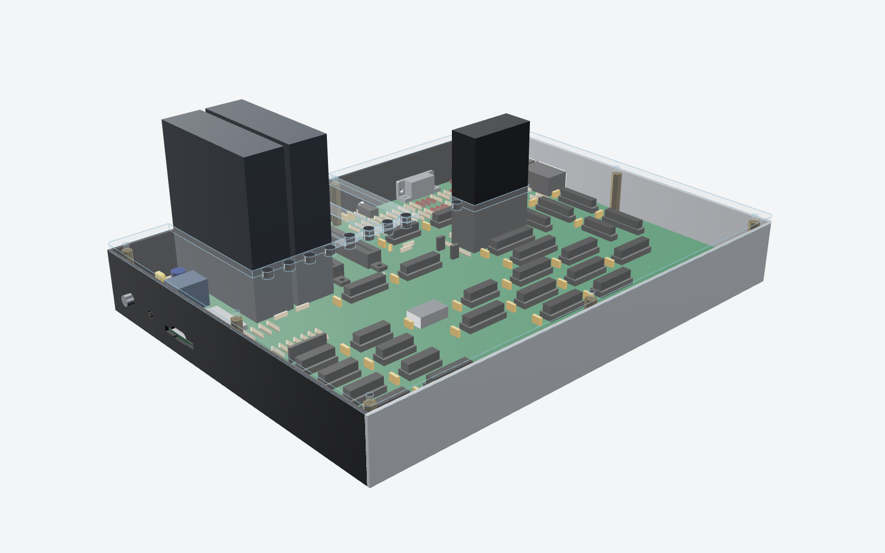
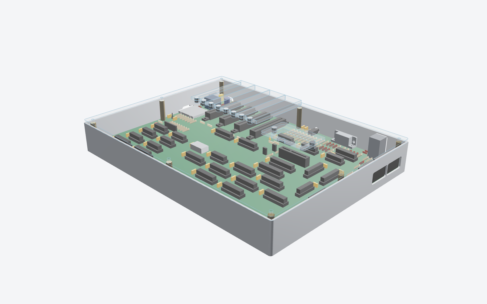
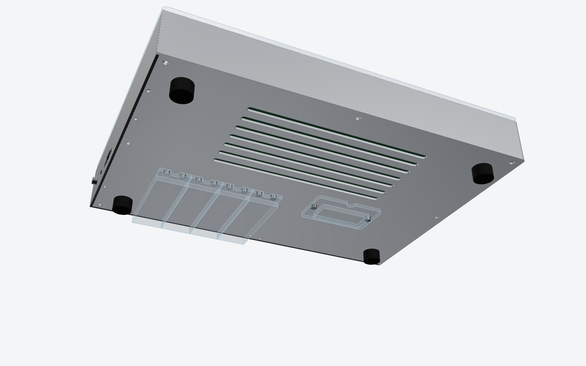
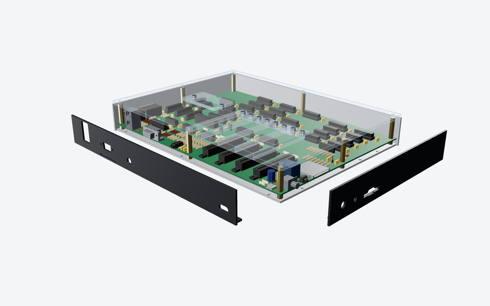

# Case

Date: 2026-10-27

This is a concept for the PLACARD case. The case is brushed, anodized
aluminium, strong on the bottom and sides, with a clear acrylic top so the
board shows through. Each expansion slot (J9-J12) and the cartridge slot (J8)
has its own removable acrylic cover, held on by magnets. A cover that is out
parks under the case: its magnets cling to steel discs set flush in the floor,
right below where it fits on the top. The case stands on 10 mm feet, so the
parked covers clear the desk.

The aluminium is a tray (the floor with the front and right walls) and two
flat plates for the back and left walls. Only the back and left have
connectors that reach through the wall (VGA, audio, power and reset), so the
board drops straight down into the tray. Each plate then slides onto its
connectors from outside and screws to the floor, and the acrylic top holds
the tops of all four walls. Every connector opening is a single clean hole
in one part, and no seam runs through any of them. (Until 2026-10-27 the
case was split in two along the connectors instead.)

There is no keyboard. The built-in Cherry MX keyboard was dropped on
2026-10-25 (CHIPS.md), and the computer takes a PS/2 keyboard on J5. The
keyboard bay, plate, blank, rail and cover garages of the 2026-10-24 design
went with it.








Everything here is made by `src/scripts/gen_case.py` from the board file, so
the cut-outs follow the connectors when they move. The script reads each
wall connector's position from `kicad/placard.kicad_pcb`, and where the
connector's 3D model (`kicad/lib/placard.3dshapes`) meets the wall. The board
file is only read, never written. The files in `case/` and these drawings
were made from the 290 x 215 mm board as of 2026-10-27.

## Size

| | mm | in |
|---|--:|--:|
| Outside, width x depth | 295 x 220 | 11.6 x 8.7 |
| Height, desk to the acrylic top | 50.6 | 1.99 |
| Height of the case itself, without the feet | 40.6 | 1.60 |
| Feet | 10 | 0.39 |

The case is the board plus 0.5 mm all round and the 2 mm walls. Its height is
set by the stacked PS/2 socket J5, which is 25 mm tall; the acrylic top,
lying on the walls, clears it by 2 mm. The feet are as tall as a parked cover (7 mm) plus 3 mm.


## Parts

| Part | Qty | Material and finish | Made by |
|---|--:|---|---|
| Tray | 1 | 2.0 mm 5052-H32 aluminium, two bends: the floor with the front wall and the right wall (SNES cut-outs) up to the acrylic, with vent slots, 10 holes for the steel parking discs and 6 countersunk holes for the plate screws. Brushed before bending, clear (or black) anodized after | Sheet metal service: laser cut, bend, PEM insert, finish |
| Back plate | 1 | 2.0 mm 5052-H32, flat with a 6 mm flange bent in along the bottom: USB-C, audio, VGA and PS/2 cut-outs, 3 PEM nuts (M3) in the flange, the flange notched round J7's pins | Same |
| Left plate | 1 | Same: power switch, reset and SD cut-outs, 3 PEM nuts | Same |
| Acrylic top | 1 | 4 mm clear cast acrylic, 295 x 220 mm, laser cut, with 10 magnet holes | Laser cutting service |
| Slot cover | 4 | 4 mm acrylic plug + 3 mm acrylic cap, solvent welded (Weld-On 4) | Laser cutting service; the builder or kitter welds them |
| Cartridge cover | 1 | Same, sized for J8 | Same |
| Disc magnet, N52, 6 x 3 mm | 20 | 10 in the acrylic top, 10 in the cover caps (through the 3 mm cap, flush with both faces), glued with cyanoacrylate or epoxy | |
| Steel disc, 6 x 2 mm (zinc-plated mild steel, or 6 x 2 mm magnets) | 10 | In the floor under the 10 magnet spots, flush with the underside, pressed in and glued | Sheet metal service or the builder |
| PEM standoff, M3, 6 mm (SO-M3-6) | 8 | In the floor under board holes H1-H8 | Sheet metal service |
| M3 male-female hex standoff, 27 mm | 8 | Board top to the acrylic top at H1-H8; its thread goes through the board into the floor standoff | Ettinger and others sell 1 mm steps; or 25 mm + a 2 mm spacer |
| M3 x 8 button head screw, black or stainless | 8 | Acrylic top | |
| M3 x 6 countersunk screw | 6 | Up through the floor into the plates' flanges, flush under the case | |
| Rubber feet, 16 mm across, 10 mm tall, self-adhesive | 4 | 24 mm in from each corner, clear of the corner standoffs and the parked covers | |

The VGA connector's 4-40 jackscrews pass through the back plate and hold it
to J7 as well.

The plates can be anodized a contrasting colour (black plates on a brushed
silver tray in most renders here), so the joins look intentional.

STEP models of every part are in `case/`. DXF cutting files for the flat
parts (the acrylic top and both layers of each cover) are in `case/dxf/`.
Sheet metal services (Protocase, JLCCNC, PCBWay, Xometry) quote bent parts
from STEP. SendCutSend wants a flat pattern, which their own tool or any CAD
program unfolds from the STEP.

## How it goes together

1. The sheet metal service presses in the floor standoffs, and, if asked,
   the steel discs.
2. Lower the board straight down into the tray. The SNES ports only touch
   the right wall's inside face, so nothing has to be threaded through a
   hole.
3. Screw the 27 mm standoffs through H1-H8 into the floor standoffs. This
   clamps the board.
4. Slide the back plate forward onto USB-C, audio, VGA and PS/2. Its flange
   slides over the floor, under the board; it's notched where J7's pins come
   through, and clears the rest by 2 mm or more. Fit three countersunk screws
   up through the floor.
5. Slide the left plate on over the power switch, reset and SD in the same
   way, three screws.
6. Lay the acrylic top on and fit its eight screws into the standoffs. It
   lies on all four walls and holds the plates' tops.
7. Stick the four feet on, then fit the VGA jackscrews and the covers.

To open it, take out the top's eight screws and lift the top off. The board
comes out once the six plate screws are out and the plates are slid off.

## The connector plates

The tray and plates were chosen by how far each connector reaches past the
board's edge (from the 3D models):

| Wall | Connector | Past the board edge | Through the wall? |
|---|---|--:|---|
| back | J13 USB-C | 0 mm | no, flush |
| back | J6 audio | 2.5 mm | yes |
| back | J7 VGA | 6.4 mm | yes |
| back | J5 PS/2 | 0.5 mm | no, touches the inside face |
| left | SW1 power toggle | 6.5 mm | yes |
| left | SW2 reset | 3.1 mm | yes |
| left | J4 SD | 0 mm | no, flush |
| right | J2, J3 SNES | 0.5 mm | no, touches the inside face |

The board is 0.5 mm from each wall's inside face. Nothing reaches into the
front or right walls, so those are bent up from the floor and the board
drops in past them. The back and left walls are flat plates that slide on
afterwards. Each plate is one flat laser-cut part with one bend, so its holes
are accurate to about 0.1 mm. If a connector moves, only that plate changes,
not the bent tray.




Cut-outs (u = mm along the wall from the case's left or front corner; z = mm
above the board's top face):

| Ref | Wall | u | Centre z | Cut-out | Notes |
|---|---|--:|--:|---|---|
| J13 | back | 18.5 | 1.7 | slot 13 x 7 | USB-C power.  The receptacle is flush with the board edge, so its mouth is 2.5 mm behind the outside face; the cut-out fits a USB-C plug's overmould (12.4 x 6.5 typical) |
| J6 | back | 172.5 | 2.5 | 8 mm hole | Audio line out |
| J7 | back | 216.5 | 6.3 | DE-15 D cut-out (wide side up) + two 3.2 mm holes at 25 mm | VGA.  The connector's flange sits 0.5 mm inside the wall; its jackscrews go through.  Until 2026-10-27 the D was cut upside down in the back wall |
| J5 | back | 262.5 | 12.5 | 15.5 x 26 rounded | Stacked PS/2 (keyboard and mouse), both ports in one opening |
| SW1 | left | 199.5 | 5.2 | 7 mm hole | Power toggle bushing; the lever stands out of the wall |
| SW2 | left | 179.7 | 3.5 | 4.5 mm hole | Reset.  The actuator stands 0.6 mm proud of the wall (a press has to be held 0.5 s, so a knock is harmless) |
| J4 | left | 152.0 | 1.4 | 27 x 3.6 slot + 14 x 7 thumb notch | SD card, push-push (Hirose DM1AA-SF-PEJ(82)) |
| J2 | right | 195.5 | 6.5 | 27 x 14 rounded | SNES port 1 |
| J3 | right | 167.5 | 6.5 | 27 x 14 rounded | SNES port 2 |

The connector models are drawn from typical dimensions (see
`gen_kicad_3d_models.py`). Check the cut-outs against the real parts, or the
makers' STEP files, before ordering metal.


## Covers, magnets and parking

- **Openings.**
  - The acrylic top has one opening for the four expansion slots and one for
    the cartridge. Each is the slot's shell keepout (the footprint
    courtyard), so an installed card's shell has 1 mm all round.
  - The four expansion slots are 27 mm apart, but their shells are only
    1.2 mm apart. That's too close for acrylic between them, so they share
    one opening and the four covers tile it, one per slot.
- **Covers.**
  - Each cover is a 4 mm plug that fills its share of the opening, with a
    3 mm cap welded on top. The cap laps 8 mm onto the acrylic in front (all
    round for the cartridge).
  - The expansion covers' plugs rest on the back wall's top edge at the
    back.
  - An 8 mm thumb notch in the cap's front edge lifts each cover out.
- **Magnets.**
  - Each cap's lap has two 6 x 3 mm N52 disc magnets. They sit over two
    magnets in the acrylic top: in the front lap for the slot covers, and in
    the left and right laps for the cartridge cover.
  - The cap magnets go right through the 3 mm cap, flush with both faces, so
    they work on the top and underneath.
  - Mind the polarity: mark one face of every magnet before gluing.
  - A pair at contact holds about 1 kg. A 20 g cover stays put with the case
    on its side or upside down, and still lifts out with a fingernail.
  - The magnets show through the clear acrylic as small grey dots.
- **Parking.**
  - A cover that is out goes under the case, cap up against the floor and
    plug down, in the same spot it covers on the top. Its magnets cling to
    two steel discs set flush in the floor's underside.
  - Steel has no polarity, so any cover sits either way round, and the
    covers can't repel each other or the discs.
  - The four slot covers lie side by side and reach toward the front from
    the back edge. The cartridge cover parks under the cartridge slot.
  - A parked cover hangs 7 mm below the floor, and the 10 mm feet leave
    3 mm to the desk.
  - The discs are 6 x 2 mm, the floor's thickness. A 6 x 3 mm N52 magnet
    holds roughly 0.5 kg on a disc that thin, which is plenty for a 20 g
    cover.
  - If the steel discs are hard to source, 6 x 2 mm magnets glued in with
    the right face down work too, at the cost of polarity care.
  - Nothing parks inside the case, so a dropped cover never means opening it.

## Other details

- **Card shells at the back.** J9-J12's shell keepouts reach the board's
  back edge, so the expansion opening in the acrylic runs back to the back
  plate's inside face, and the slot covers' plugs rest on its top edge.
- **Ventilation.** Seven slots run across the floor's front half, in front of
  the parked covers. Warm air leaves round the covers and the connector
  openings. The 10 mm feet leave a clear air gap under the floor. Check the
  temperature with the top on during bring-up.
- **Finish.**
  - Clear anodize keeps the brushed look; black anodize costs the same.
  - 5052 is the usual alloy for bent parts (6061 cracks on tight bends).
  - The tray's one bent corner (front right) has a small open gap (bend
    relief, about 0.5-1 mm). Welding and grinding closes it at extra cost.
    The other three corners are where the plates butt against the tray and
    each other.


## Cost estimate

These are rough per-unit prices in US dollars, before shipping, tax and
tariffs (35 % is assumed elsewhere for China-made parts), from typical 2026
vendor pricing. **No quotes were requested**, so treat each number as plus or
minus 40 % until the STEP and DXF files are uploaded to a quoting site. The
metal is now one bent tray and two flat plates with one bend each (the split
shells of 2026-10-25 were two bent parts with a stepped seam).

| Item | 1 | 10 | 100 | 1,000 |
|---|--:|--:|--:|--:|
| Tray + back and left plates, 5052, brushed, anodized, PEM inserts (US: SendCutSend, Protocase) | $150-250 | $95-160 | $51-88 | - |
| Same, China (JLCCNC, PCBWay sheet metal) | $80-130 | $50-85 | $30-50 | $21-35 |
| Welded and ground front-right corner of the tray | +$15-30 | +$10-20 | +$5-15 | +$4-10 |
| Acrylic: top, 4 slot covers, cartridge cover (cut; welding by hand) | $45-70 | $26-40 | $11-19 | $6-11 |
| 20 N52 magnets 6 x 3 mm + 10 steel discs 6 x 2 mm | $5-7 | $4-6 | $2-4 | $1-2 |
| Hardware: standoffs, screws, 10 mm feet | $11-15 | $9-12 | $6-8 | $4-6 |
| **Case, China sheet metal, open corner** | **$140-220** | **$90-145** | **$49-80** | **$32-54** |
| **Case, US sheet metal, open corner** | **$210-340** | **$135-220** | **$70-120** | - |

At 100 units that's about two to three times the $30 acrylic sandwich that
`KIT_PRICING.md` assumes. The complete kit's case line would go up by
roughly $20-50, plus tariff.

Weight: about 0.65 kg of aluminium and 0.3 kg of acrylic.

## Not decided

- Clear or black anodize, matching or contrasting plates, and an open or
  welded tray corner.
- Whether the stacked PS/2 stays. It sets the case's height.
- Steel discs or magnets in the floor.

## Remaking the files

```
pip install cadquery
python3 src/scripts/gen_case.py                       # STEP + DXF in case/, drawings in docs/
python3 src/scripts/gen_case.py --pcb other.kicad_pcb # from another copy of the board
python3 src/scripts/gen_case.py --mesh src/scripts/case_render/mesh   # also STL meshes for the renders
```

The renders use three.js in headless Chromium (`src/scripts/case_render/`).
Make the meshes as above, then run `npm install three@0.160.0` in
`case_render/web`. Serve `case_render/` on port 8765, then run
`node shoot_case.js [view ...]`. The views are in `views.json`. The
cartridge in the renders is the short 32K one (39 x 66 mm board).
