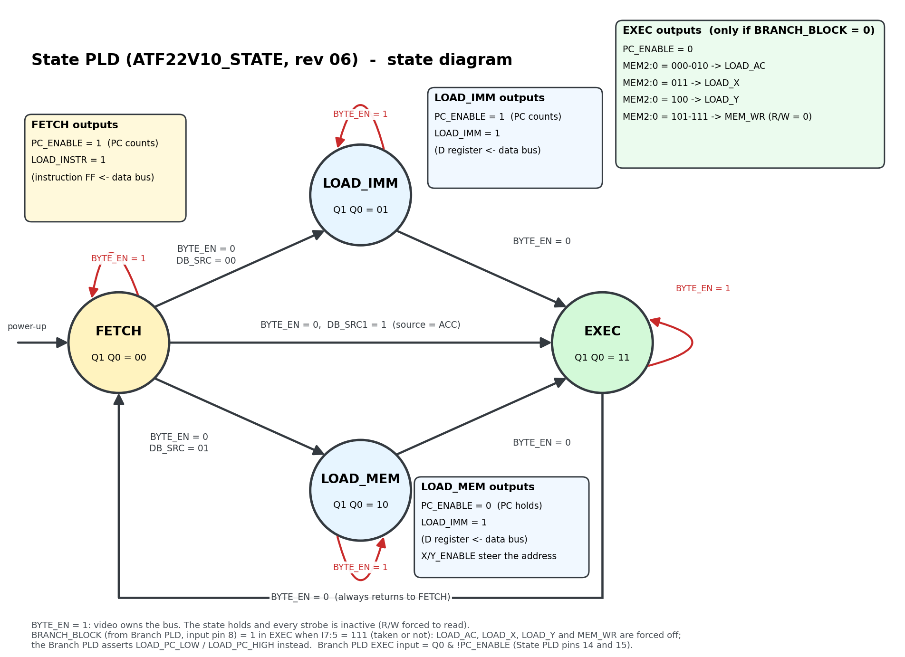

# CPU operations

The CPU in this system is made of logic gates and registers.  The CPU 
interfaces to the memory space (RAM/ROM) by outputting a memory address, and 
then reading/writing using the data bus.

The CPU executes one instruction in either 2 or 3 clocks.  The CPU first 
performs a FETCH to get the next instruction from memory.  The next state 
depends on the instruction.  If it is an immediate instruction or a memory 
load, then it goes to a LOAD state which transfers from the memory to a 
temporary register D.  The last state is the EXECUTE state which will use the 
ALU and write a value to a register or to memory.  The LOAD state can be 
skipped if an instruction does not need data from memory; for example, a 
shift-left instruction adds the Accumulator to itself.

ADD and SUB with an AC, X or Y destination take one more clock: the first
EXEC clock is a wait clock so the carry can ripple through both ALU PLDs at
25.175 MHz (see [ALU_TIMING.md](ALU_TIMING.md)).  The Branch PLD makes the
wait by sending STALL to the State PLD and the PC PLDs (the same stall the
video uses; it passes through the ROM cartridge, which also uses it to hold
the CPU while it loads, ROM.md) for the first EXEC clock, and its ALU_DONE register ends the
wait on the second.  Stores do not wait, because they write the source bus,
not the ALU result.  A store from AC to [0,X] or [Y,X] goes through
LOAD_MEM (one more clock) so its address and data settle a clock before the
write (see [TIMING_FIXES.md](TIMING_FIXES.md)).  So an instruction takes 2
to 4 clocks, plus any video stall clocks.

The state diagram is drawn by `src/scripts/gen_state_diagram.py` (State PLD
revision 12, 2026-10-18); rerun it when the State PLD changes.

## Registers

There are 4 registers in the system that are accessble for use in instructions. 
- Accumulator
- X
- Y
- D (immediate/memory)

The D register can be loaded either from the program counter location (immediate
 instruction) or from a memory location indicated in the instruction.

Only D and the Accumulator can be a source (see "Source mode").  X and Y
are destinations and address registers: they are loaded from the ALU (an
immediate, a zero-page byte or AC through the ALU) and read only by the
address mux.  X was also a source until 2026-10-19; its F541 and the source
'138 were removed, so software keeps a copy of X in RAM, or the value in AC,
when it needs to read it.

## Memory access mode

The memory can be accessed through four access modes using the X and Y 
registers.
- [Y,X] will access a 16-bit address based on both Registers
- [0,D] will access the zero page of memory using an immediate value stored
alongside the instruction.
- [0,X] will access the zero page of memory using the X register to access one 
of the 256 zero locations.
- [Y,D] is a possible combination, but not supported in the instruction set.

The memory space consists of both a 64kB RAM and a 64kB ROM.  All writes go to 
the RAM module.  Reads are controlled by a memory bank selector register which 
is configurable by software (a write-only 74ACT273 at x5000).  The memory space is divided into 8 sections. 
Each section can be configured as either ROM or RAM.  In x4000-x5FFF the
map bit covers x4000-x4FFF and x5400-x5FFF; x5000-x53FF is the I/O window.  At startup, all regions
are selected as ROM.  The software will execute from ROM initially until 
reconfigured: the ROM's boot loader maps the zero page and x4000-x4FFF to
RAM and runs the program in place from the ROM (see [ROM.md](ROM.md)).
Video reads always read the RAM (memory control PLD revision 04), whatever
the map says, so the CPU can run from the ROM under the video area while
the display shows the RAM.  See the [memory map](../README.md#memory-map).

### Memory parts

- RAM: 2 × AS7C256C-15PCN (Alliance Memory, 32K × 8, 15 ns, 28-pin PDIP).
  A15 selects which chip is accessed: the lower chip's /CE is the address
  mux's A15 and the upper chip's /CE is /CE_HI from the I/O decode PLD.
  Both chips' /OE is /RAM_OE and their /WE is /WE, both from the memory
  control PLD (see [TIMING_FIXES.md](TIMING_FIXES.md)).
- ROM: 2 × AS7C256C-15PCN on the ROM cartridge, with their /CE the same
  way as the RAM (A15 and /CE_HI) and their /OE from /ROM_OE (memory
  control PLD).  They lose their contents at power-off, so at power-up the
  cartridge holds the main board's clock and copies two AT28C256-15PU
  EEPROMs into them, with the CPU's PC as the address counter (2026-10-20,
  [ROM.md](ROM.md#loading-the-cartridge)).  The battery-backed SRAM used
  until then drained a coin cell in about two weeks.

See [TIMING.md](TIMING.md) for the timing analysis with these parts.

### RAM write timing

The RAM is asynchronous, so the write pulse must start after the address, data
and R/W have settled and must end before they change.  The State PLD's R/W
(pin 23, 1 = read) is low for the whole EXEC state of a store.  The memory
control PLD (ATF22V10_MEM_CTRL.pld) makes the write strobe and both read
enables from it, the clock and PIXEL_ENABLE:

    WRITE   = !RW & !PIXEL_ENABLE
    READ    = (RW & !SRC_EN) # PIXEL_ENABLE   (SRC_EN: EXEC, see "One data bus")
    /WE     low when CLK = 0 and WRITE
    /RAM_OE low when CLK = 0 and READ of a RAM section
    /ROM_OE low when CLK = 0 and READ of a ROM section

While RUN is low (the cartridge or a slot-1 boot card is loading) the
PLD lets go of /WE (revision 09) and a 10k pull-up holds it high; a boot
card drives it then (EXPANSION.md, "Booting from slot 1").

Every memory cycle, read or write, uses only the low half of the clock.  The
address and source bus have the whole high half to settle, and /WE returns
high at the rising edge, before the state, address and data change (the
SRAM's write recovery and data hold times are 0 ns).  At 25 MHz the pulse is
about 20 ns, which suits a 10-15 ns SRAM.

### One data bus

The source bus is also the memory data bus: there is no separate buffer
between the CPU's source registers and the RAM data pins (the RAM
write-data buffer was removed on 2026-10-18).  The bus has two kinds of
owner:

- **The memories and I/O read buffers**, in the low half of a FETCH,
  LOAD_IMM or LOAD_MEM clock (and of any video read clock), when /RAM_OE,
  /ROM_OE or an I/O read strobe is low.
- **The source F541s (D or AC)**, for the whole of EXEC while
  PIXEL_ENABLE is low.  Both F541s' /OE1 is the branch PLD's /SRC_EN
  (pin 16, low for `EXEC & !PIXEL_ENABLE`), and /OE2 picks the source
  (see "Source mode"), so a source drives only in EXEC, and a video read
  clock (including a stall in EXEC) turns both off.

The CPU never needs memory data in EXEC: the instruction loads in FETCH,
D in LOAD_IMM or LOAD_MEM, and the I/O read strobes already need LOAD_IMM.
The branch PLD's /SRC_EN (pin 16, low for `EXEC & !PIXEL_ENABLE`) also
goes to the memory control PLD (pin 22), which leaves a CPU read out of
any clock with /SRC_EN low.  The ALU's B input, the PC low byte, the map register,
the port latch and a store's write data all read the bus in EXEC, when
the source drives it.

Changing hands:

- **Start of EXEC (accepted overlap).**  The read in the clock before EXEC
  ends at the rising edge, but the memory can still drive for up to about
  14.5 ns after it (memory control PLD 7.5, then tOHZ 7), and the source
  F541 can turn on as early as about 7 ns after it.  So the two can drive
  the bus against each other for up to about 7 ns per instruction.
  **Series resistors** (one per bit, between the joined outputs of the
  two source F541s and the bus) limit that current; size them against
  the RC delay they add to the ALU path (47 ohms into about 50 pF is
  about 2.4 ns).
- **End of EXEC.**  The source F541s turn off by about 19.5 ns after the
  edge (State PLD 5.5, branch PLD /SRC_EN 7.5, F541 disable 6.5); the next
  read starts when the clock falls, about 20 ns after it, plus the memory
  control PLD's delay.  About 2.5 ns to spare at a 47 % high half (1 ns
  with the '138 before 2026-10-19).
- **End of a write.**  /WE rises (memory control PLD) and /MAP_WR or
  /PORT_WR rises (I/O decode PLD) at most 7.5 ns after the edge; the
  source F541s can turn off a little before that at minimum delays.  The
  bus then floats for a moment and holds its level (the 10k pull-ups and
  the bus capacitance), and the SRAM's data hold time is 0 ns.

Timing with the source enabled only in EXEC: /SRC_EN falls about 13 ns
into EXEC (State PLD 5.5 + branch PLD 7.5) and the F541 enable adds 9.5,
so source D (always after a LOAD clock, so I1 is long settled) is valid
at about 22.5 ns.  Source AC straight after FETCH waits for /AC_SEL (IR
10.5 + audio PLD 7.5 = 18 ns), so the bus is valid at about 27.5 ns and a
single-clock logic op takes 27.5 + ALU 7.5 + AC setup 2 = 37 ns, 2.7 ns
to spare (ALU_TIMING.md).  After a video stall PIXEL_ENABLE falls about
10 ns into the clock, so the bus is valid at about 27 ns.  A store's data
is valid long before the end of the write (needed by T + 2.2 - 8 =
33.9 ns).

The FPGA model keeps the read bus (ROM/RAM data) and the source bus
separate because it cannot use tri-state buses.

### Fallback: the write-data buffer

If the prototype has trouble with the shared bus (the start-of-EXEC
overlap, or noise from it), put the buffer back.  This is how the design
was before 2026-10-18:

- **Two buses.**  The source F541s drive the source bus all the time
  (/OE1 tied low instead of /SRC_EN, /OE2 still picks D or AC), and it feeds
  the ALU B input, the PC low byte, the map register and the port latch
  only.  The RAM/ROM data pins, the I/O read buffers, the IR, D and the
  pixel buffer are on a separate memory data bus.
- **One more SN74F541N** (the write-data buffer): A inputs on the source
  bus, Y outputs on the memory data bus, both /OE pins on /WE (memory
  control PLD pin 16), so it drives only during the write pulse.  Every
  memory cycle uses only the low half of the clock, so there is a dead
  time on both sides of the pulse and no overlap.
- **PLDs.**  The memory control PLD's pin 22 (SRC_EN) is tied low (or
  revision 05 is used), so a CPU read can happen in EXEC again (it is
  harmless then).  The branch PLD's SRC_EN output can stay; nothing reads
  it.
- **Timing** (TIMING.md, "RAM write cycle", as it was): write data valid
  is the F541 enable plus tDW, 9.5 + 8 = 17.5 ns against the 19.86 ns
  pulse.

## Source mode

The source bus drives to three locations: the B-input of the ALU, the low-side 
of the program counter, and into the memory.  The instruction's source bits
(S1:S0, bits 1:0) determine which source is placed on the source bus.
- 00: D register containing the immediate value
- 01: D register containing a memory value
- 10: Accumulator
- 11: Accumulator (the same as 10; the assembler never makes it)

Only bit 1 matters, so there is no decoder (since 2026-10-19).  Each of the
two source F541s has two active-low enables:

| F541 | /OE1 | /OE2 | Drives when |
|---|---|---|---|
| D  | /SRC_EN (branch PLD pin 16) | I1 (instruction register bit 1) | EXEC, source 00 or 01 |
| AC | /SRC_EN (branch PLD pin 16) | /AC_SEL = !I1 (audio PLD pin 21) | EXEC, source 10 or 11 |

The audio slot PLD (revision 04) had two free pins, so it makes the one
inverter (`AC_SEL = I1`).  It sits in the single-clock ALU path, which
needed a -7 part until the instruction register became a PLD (2026-10-21);
now it is a -10 (CHIPS.md, "PLD speed grades").  A D source always has a LOAD clock before EXEC, so
I1 is settled a clock before /SRC_EN falls.  The only select change at the
start of EXEC is D to AC (I1 rising after FETCH), which turns the D F541
off (I1 directly, about 10 ns) before /SRC_EN turns either on (about
13 ns), so the two never drive together.

Before 2026-10-19 code 11 was the X register, with a third F541, and an
SN74F138 decoded S1:S0 into the three /OE pins.  Removing X as a source
saved both chips; reading X now takes a copy in RAM or in AC
([LIBRARY.md](LIBRARY.md) has the idioms).

The source bus is how the CPU writes data back into the RAM (it is the
memory data bus in EXEC, see "One data bus").  It's possible to
read a location from the ROM and then write it back to the RAM in one
instruction.

## ALU

There are not many good retro options for ALUs today.  Gigatron uses 10 MUX 
chips.  Novasaur uses ROM lookup tables.  An ALU is simply a combinational 
truth table of operations.  There are three mode inputs for the whole chip and 
two input data ports (4-bits per port).  There aren't enough logic/pins to 
support a full 8-bit ALU, but a 4-bit ALU is possible.  It needs 4 outputs for 
data, and 2 outputs for flags (zero Z, negative N).

| S2   | S1 | S0 | Function  | Instruction |
|------|----|----|-----------|------|
| 0    |  0 |  0 | PASS B    | LD   |
| 0    |  0 |  1 | A AND B   | AND  |
| 0    |  1 |  0 | A OR B    | OR   |
| 0    |  1 |  1 | A XOR B   | XOR  |
| 1    |  0 |  0 | A + B     | ADD  |
| 1    |  0 |  1 | A - B     | SUB  |
| 1    |  1 |  0 | A >> 1    | SHR  |
| 1    |  1 |  1 | PASS A    | BRA/JMP |

Adding the three data bits (A, B, and C for carry), the entire truth table of 6 
inputs can be created.  The two outputs from the table are the data bit and the 
carry bit, so two functions are needed for each bit.  That makes 8 total blocks.  
Each output pin is coupled with a logic block, so 8 output pins are needed.

For the flags, the negative flag is simply the output of the highest data bit.  
Zero only uses the four data outputs which is trivial for one output block. 

## Branching

Branching happens similar to the Gigatron.  The ALU instruction bits (7:5) 
111 indicates a branch/jump.  The instruction memory mode bits (4:2) dictate
the type of branch/jump.  A value of 000 will cause a jump (16-bit load of PC).
A value of 111 will cause a branch (8-bit load of lower PC byte).  The others
are conditional based on the ALU result.  

BCC with an AC target (`bcc ac`) is two bytes: the opcode and a
pad byte (BGE had the same before it became BCC).  Its memory field (101) is the same as a zero-page store's, and the
State PLD sends both through LOAD_IMM rather than decoding the opcode in FETCH,
which was too slow at 25.175 MHz (see TIMING_FIXES.md).  The assembler adds
the pad byte.

Using the Zero flag, the value of the Accumulator can be determined if it is 
equal-to-zero.  The Negative flag (the MSB of the Accumulator) 
determines if the Accumulator is positive or negative.  This determines 
greater-than-zero or less-than-zero.  BLT, BNE, BEQ and BLE use these two
flags.  There is no BGT or BGE: branch the other way with BLE or BLT (for
AC > 0, BLE around the code; for AC >= 0, BLT around it).

### Carry flag

Memory modes 001 and 101 are BCS and BCC, branch if the carry flag is set or
clear (Branch PLD revision 11; they were BGT and BGE, which no program used
and BLE and BLT can stand in for).  The carry flag is a register in the
Branch PLD (pin 20).  It takes the high ALU PLD's COUT (Branch PLD pin 14)
at the end of every ADD or SUB with an AC, X or Y destination, including
`inc`, `dec` and `shl`:

- ADD: the carry out of bit 7 (1 when A + B > 255)
- SUB: the borrow out of bit 7 (1 when A < B, unsigned)
- `shl` (`add ac, ac`): the bit shifted out of bit 7

Every other instruction keeps it: loads, stores, AND/OR/XOR, SHR, branches,
and ADD or SUB that stores to RAM (they have no ALU wait clock and write the
source bus, not the result).  So it can be tested several instructions after
the ADD or SUB, for example a 16-bit add:

    ld   [lo], ac
    add  [b_lo], ac
    ld   ac, [lo]        ; a store keeps the carry
    ld   [hi], ac
    bcc  nc
    inc
nc: add  [b_hi], ac
    ld   ac, [hi]

It powers up clear.  The carry is settled a pass before the ALU result (four
PLD passes to COUT, five to F3), so it fits in the ALU wait clock with 16.9 ns
to spare (see the Branch PLD source).  No chip was added.

| MemMode | Branch | Z | NEG | Meaning | LoadPCLow | LoadPCHigh |
|---------|--------|---|-----|---------|-----------|------------|
|   000   |   JMP  | X |  X  | Always  |     1     |      1     |
|   001   |   BCS  | X |  X  | C=1     |     1     |      0     |
|   001   |   BCS  | X |  X  | C=0     |     0     |      0     |
|   010   |   BLT  | 0 |  0  |  AC>0   |     0     |      0     |
|   010   |   BLT  | 0 |  1  |  AC<0   |     1     |      0     |
|   010   |   BLT  | 1 |  0  |  AC=0   |     0     |      0     |
|   011   |   BNE  | 0 |  0  |  AC>0   |     1     |      0     |
|   011   |   BNE  | 0 |  1  |  AC<0   |     1     |      0     |
|   011   |   BNE  | 1 |  0  |  AC=0   |     0     |      0     |
|   100   |   BEQ  | 0 |  0  |  AC>0   |     0     |      0     |
|   100   |   BEQ  | 0 |  1  |  AC<0   |     0     |      0     |
|   100   |   BEQ  | 1 |  0  |  AC=0   |     1     |      0     |
|   101   |   BCC  | X |  X  | C=0     |     1     |      0     |
|   101   |   BCC  | X |  X  | C=1     |     0     |      0     |
|   110   |   BLE  | 0 |  0  |  AC>0   |     0     |      0     |
|   110   |   BLE  | 0 |  1  |  AC<0   |     1     |      0     |
|   110   |   BLE  | 1 |  0  |  AC=0   |     1     |      0     |
|   111   |   BRA  | 0 |  0  |  AC>0   |     1     |      0     |
|   111   |   BRA  | 0 |  1  |  AC<0   |     1     |      0     |
|   111   |   BRA  | 1 |  0  |  AC=0   |     1     |      0     |

