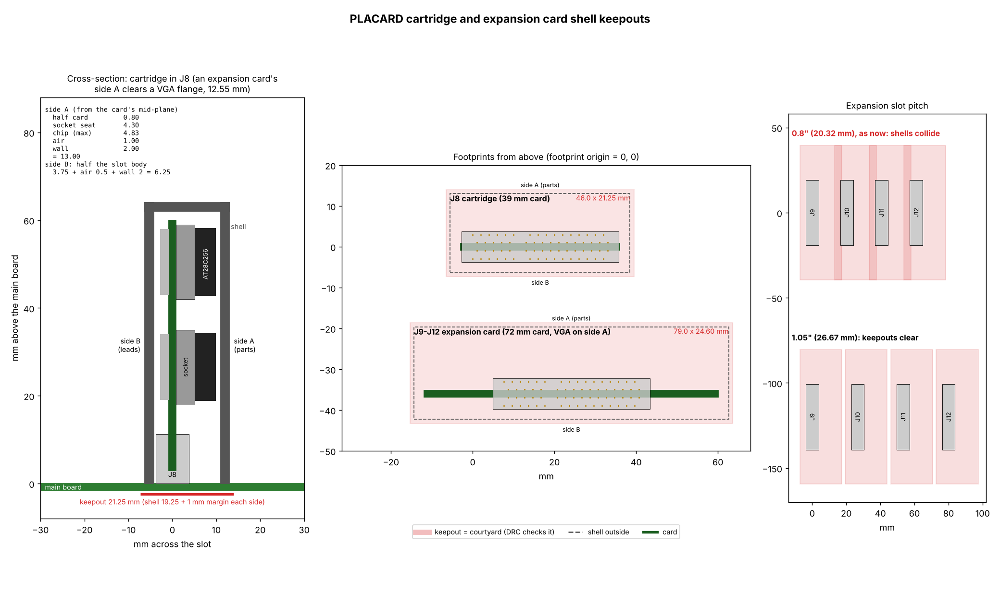
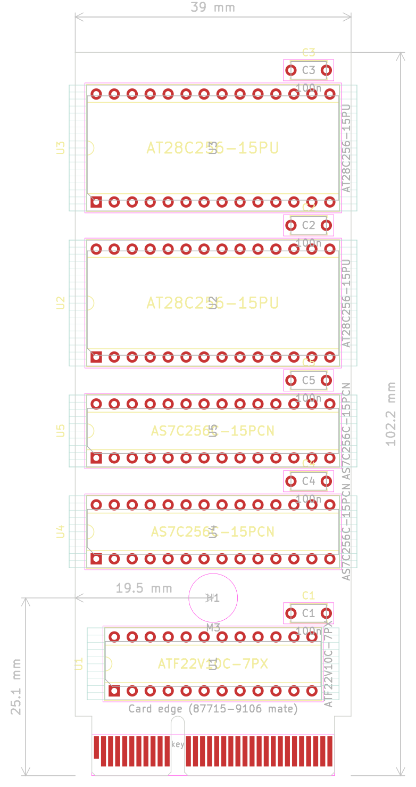
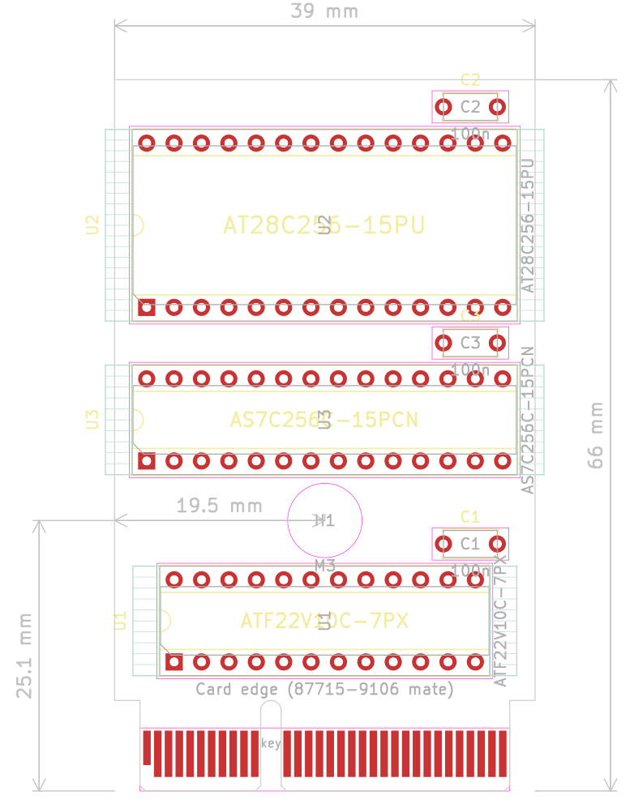

# Expansion slots and ROM cartridge slot

Date: 2026-10-23

The Placard has four expansion slots, each a 2 x 20, 0.1" (2.54 mm)
pitch card-edge socket, and one ROM cartridge slot, a keyed 2 x 32,
1.0 mm pitch socket (Molex 87715-9106, "ROM cartridge slot" below).  The
expansion slots stand in a bay at one back corner, front to back at 1.05"
(26.67 mm) pitch or more ("Shell keepouts" below), so a card's outer end can carry its own connector at the back edge,
like a PC card.  The cartridge slot is top loading, inboard.  Board sizes
are in `hardware/pcb_size_estimate.md` (project files).

No chips are added for the slots: they are wired straight to the buses.
Slot 1 can also boot the machine when no cartridge is fitted ("Booting
from slot 1" below).

## Expansion slot addresses

The I/O decode PLD has two expansion selects and no free pins, so the four
slots share them and split each 256-byte page by A7.  Each slot also has a
**SEL** pin, tied on the main board, that tells the card which half it
answers, so the same card works in any slot without a jumper.

| Slot | Select | SEL pin | Card answers when | Addresses |
|---|---|---|---|---|
| 1 | /EXP1 | GND | A7 = 0 | x5100-x517F |
| 2 | /EXP2 | GND | A7 = 0 | x5300-x537F |
| 3 | /EXP1 | +5 V | A7 = 1 | x5180-x51FF |
| 4 | /EXP2 | +5 V | A7 = 1 | x5380-x53FF |

A card has 128 addresses (A6:A0).

## Boot code on a card

Like an Apple II card, a card can change the boot.  At power-up the boot
loader (`src/scripts/rom_boot.asm`) looks at slots 4, 3, 2 and 1 before it
starts the program.  A card that wants to run code at boot starts with
this header in its first bytes (offsets from the slot's base address):

| Offset | Holds |
|---|---|
| 00-02 | "PLC" (50 4C 43) |
| 03 | Card ID, 1-255 (pick one; 0 means none) |
| 04 | Boot code length n, 1-90 (0 = no boot code, the card is only named) |
| 05 | Checksum: the sum of the n code bytes, mod 256 |
| 06-5F | The boot code |
| 60-7F | Free for the card's registers |

For each slot whose header and checksum are good, the boot loader copies
the n code bytes to RAM x0100 and calls them with the library's CALL, with
AC = the slot number (1-4), R1:R0 = the slot's base address, SP = FE and
`MAP_SHADOW` = 01 (map 01: the zero page reads RAM, the rest ROM).  The
code may use the library and the I/O drivers; it is built without the
library source, so it calls them through the jump table at xFB00, whose
entries never move ([LIBRARY.md](LIBRARY.md#jump-table)).  It then either:

- **returns**, and the scan goes on with the next slot and then the normal
  boot (a card that only sets itself up, or adds a device), or
- **never returns**, and takes the boot over: it can load a program from
  its own memory or from the SD card (`fs_load`), copy its own ROM, and so
  on.

Its code must keep zero page xFF (the slot being scanned), leave map 01
when it returns, and keep section 7 reading the ROM (the scan runs there).
90 bytes is enough for a loader that reads more of the card through its
registers.  **Holding Esc at power-up skips the scan**, to get past a card
whose code hangs.

An empty slot fails the "PLC" check: with nothing driving the read bus it
reads FF from the pull-ups below, or, if the bus has not risen yet, the
last byte on it, which is the scan's own `ld [y,x], ac` opcode (09).  A program can find cards later with the
library's `slot_id` (AC = slot 1-4 gives AC = card ID or 0, R1:R0 = base
address).

**Read bus pull-ups.**  D7:D0 get 10k pull-ups to +5 V on the main board
(one 9-pin bussed 10k SIP network; not a chip, no PLD logic), so an empty
slot or an unused I/O address reads FF rather than a floating level.  They
only set the level when nothing drives the bus and do not slow a driven
read.  The simulator reads an empty slot as FF.

## Expansion slot pinout

Side A is the card's component side.  Contact 1 is at the end nearest the
back edge of the main board.

| # | Side A | Side B |
|--:|---|---|
| 1 | GND | GND |
| 2 | +5 V | +5 V |
| 3 | D0 | D1 |
| 4 | D2 | D3 |
| 5 | D4 | D5 |
| 6 | D6 | D7 |
| 7 | GND | GND |
| 8 | BT1 | BT2 |
| 9 | BT3 | BT4 |
| 10 | BT5 | BT6 |
| 11 | BT7 | BT8 |
| 12 | GND | CLK |
| 13 | A0 | A1 |
| 14 | A2 | A3 |
| 15 | A4 | A5 |
| 16 | A6 | A7 |
| 17 | /EXP | SEL |
| 18 | RW | LOAD_IMM |
| 19 | /WE | /RESET |
| 20 | GND | GND |

| Signal | Direction | Meaning |
|---|---|---|
| D7:D0 | card drives on its reads | The CPU's read bus (into the D register) |
| BT1-BT8 | | Boot contacts.  Slot 1: BT1 STALL_IN, BT2 STALL_OUT, BT3 PC_ENABLE, BT4 PIXEL_ENABLE, BT5 /CART, BT6-BT8 reserved ("Booting from slot 1").  Slots 2-4: not connected.  An ordinary card leaves all eight unconnected |
| A7:A0 | to card | Address low byte |
| /EXP | to card | /EXP1 (slots 1, 3) or /EXP2 (slots 2, 4), address only: low for any access to the page |
| SEL | to card | GND (slots 1, 2) or +5 V (slots 3, 4) through a 1k resistor: the A7 value the card answers |
| RW | to card | 1 = read cycle |
| LOAD_IMM | to card | 1 when the CPU latches the read bus into D (the State PLD's strobe, stall clocks already excluded) |
| /WE | to card | The write pulse, low in the low half of a write clock (about 20 ns).  10k pull-up: the memory control PLD lets go of it while RUN is low, and a boot card in slot 1 drives it then |
| CLK | to card | The 25.175 MHz CPU clock |
| /RESET | to card | RUN from the ROM cartridge: low from power-up until the cartridge has loaded the ROM and lets the CPU run (ROM.md, "Loading the cartridge").  With no cartridge, a boot card in slot 1 drives it |
| +5 V, GND | | 2 power and 7 ground contacts, the grounds spread between the fast groups |

## Building a card

**Writes.**  A card's write strobe is `/EXP low, /WE low, A7 = SEL` (plus
any A6:A0 register select).  Latch D7:D0 on the strobe's rising edge, at
the end of /WE, as the RAM and the main board's devices do.  The board has
one data bus (CPU.md, "One data bus"): in a write the source F541s drive
it, through the 47-ohm series resistors, from the start of EXEC until
about 19.5 ns after the clock edge that ends it, and /WE rises within 7.5
ns of that edge.  (Until 2026-10-22 the slots also carried SD7:SD0, the
source F541s' side of the resistors: the same data, left over from the
two-bus design.  Those eight contacts are now BT1-BT8.)

**Reads must not put a decoder after /EXP.**  An I/O read has one 39.7 ns
clock: the address is valid at 20.5 ns and /EXP at 28 ns, which leaves
9.5 ns for the card's buffer to drive the bus before the 2 ns setup of the
D register.  So the card's read buffer (a 74F541, or a 74F245 with DIR set
by RW) takes /EXP straight on one enable, and everything else on its other
enable:

    74F541 /OE1 = /EXP
    74F541 /OE2 = card PLD: low when RW = 1, LOAD_IMM = 1, A7 = SEL
                  (and the A6:A0 register select, if any)

The card's PLD works from the address, RW and LOAD_IMM, which are valid
by 20.5 ns, so its 7.5 ns is in parallel with the I/O decode's and both
enables arrive by 28 ns.  A card PLD output that drives the bus directly
(with an output enable term) must also use /EXP in that same term, not a
strobe made from it.

**Load.**  The slots are unbuffered and every bus line reaches all four.
Give each line one input (or one 3-state output) on a card, keep traces
short, and keep the card's read buffer close to the edge fingers.

**Reset.**  /RESET is only one clock long.  A card that needs a reset makes
its own: a 22V10's registers clear at power-up, and other parts need an RC
power-on reset or a reset register the software writes.

**Power.**  Two +5 V contacts carry about 2 A together on a typical socket
(1 A per contact; check the socket's rating).  Keep each card well under
that, since the four slots share the main board's supply.

## Booting from slot 1

With no cartridge in its slot, a **boot card** in slot 1 can load the main
RAM and start the machine.  It works like the cartridge's loader (ROM.md,
"Loading the cartridge"), with the main RAM in place of the cartridge's
SRAM:

1. From power-up the card holds STALL_OUT high at each PC address (FETCH
   and LOAD_IMM, PC_ENABLE high), reads the byte from its EEPROM, puts it
   on D7:D0 and pulses the RAM's **/WE** (the memory control PLD lets go
   of /WE while RUN is low, revision 09), then releases the CPU for one
   step.  The IR holds 02h, so the CPU only walks the addresses.  The card
   skips the video read clock (PIXEL_ENABLE) and writes nothing in the I/O
   window x5000-x53FF.
2. When the PC wraps from xFFFF to x0000 the card raises **RUN**.  The map
   is then 00 (all ROM), and there is no ROM, so the card keeps stalling
   each PC read and feeding the CPU the EEPROM's byte, without /WE, until
   it sees the CPU's **first write** (/WE low from the memory control
   PLD).
3. The image's first write is the map write: x0000 is the 1-byte `nop`
   (02h) as on the cartridge, and the code from x0001 loads registers
   (immediates only: no memory reads, no ADD/SUB) and writes map = FF, all
   RAM.  The card then lets go, and STALL_OUT follows STALL_IN.  The CPU
   goes on from the same bytes in the RAM.

The load takes about 33 ms, as the cartridge's does.

**Slot 1's boot contacts** (slots 2-4 leave them unconnected):

| Contact | Signal | Direction | Notes |
|---|---|---|---|
| A8 (BT1) | STALL_IN | to card | the Branch PLD's STALL (pin 19), as on cartridge B17 |
| B8 (BT2) | STALL_OUT | from card | to the State PLD and PC PLDs, joined to cartridge B18 (10k pull-up) |
| A9 (BT3) | PC_ENABLE | to card | State PLD pin 15, as on cartridge B19 |
| B9 (BT4) | PIXEL_ENABLE | to card | Sync PLD pin 19, as on cartridge A18 |
| A10 (BT5) | /CART | to card | cartridge B10: low when a cartridge is fitted (10k pull-up) |
| B10, A11, B11 (BT6-BT8) | reserved | | not connected |

Slot 1 also uses /RESET (RUN, B19) and /WE (A19) as outputs while it boots.

**A cartridge always wins.**  The card drives STALL_OUT, RUN and /WE (and
its EEPROM onto D7:D0) only while /CART is high.  So:

| Cartridge | Boot card in slot 1 | What boots |
|---|---|---|
| fitted | either | the cartridge, as before.  The card is an ordinary card afterwards (a "PLC" header lets the boot's card scan find it) |
| none | fitted | the boot card, from main RAM |
| none | none | nothing: STALL_OUT's pull-up keeps the CPU stalled (or the bring-up jumpers, BRINGUP.md) |

**Building a boot card** (3 chips, nothing designed yet):

- A loader PLD (ATF22V10C-7): the cartridge PLD's equations (revision 04)
  with /CART on every output enable, /WE in place of the SRAM's /WE, the
  I/O window left out of /WE, and the feed of step 2.  PREV15 has no job
  after the wrap, so it can hold the "feed until the first write" flag and
  the design still fits 10 cells.  A -7 part (every PLD is one) leaves
  the STALL path about +7 ns, which covers the longer trace to
  slot 1.  /WE goes back into the PLD through its pin feedback.
- A page counter PLD: A15:A8 for the EEPROM, the wrap and the I/O window
  check, stepped when a copy at A7:A0 = FF ends (the PC walks every
  address in order from x0000).  A7:A0 come from the slot.  A 74HC4040
  ripple counter settles about 130 ns too late at a page boundary.
- An AT28C256: a 32K image, seen in both halves of the RAM.

**No ROM.**  A machine booted this way runs from RAM only, and x6000-xFFFF
is the screen, so a program and its library get about 20 KB (x0100-x4FFF
and the free parts of x5400-x5FFF), less any screen area it leaves unused.
The standard library runs in place from the cartridge ROM at xC000-xFFFF
and can't be used as it is.  A boot card can carry a small program, or a
loader that loads one from the SD card or the card's own hardware.

## ROM cartridge slot

The ROM (two AS7C256C 32K x 8 SRAMs, loaded at power-up from two
AT28C256 EEPROMs on the same cartridge, ROM.md "Loading the cartridge";
one of each on the 32K cartridge) is on a plug-in cartridge.  The cartridge gets the address and data
lines and the same chip selects the ROM chips have on the main board.

The connector is a Molex 87715-9106: 64 contacts (2 x 32) at 1.0 mm
pitch, through-hole, vertical, for a 1.57 mm (0.062") card, the PCI
Express x4 socket.  Its key sits between contacts 11 and 12, so a
cartridge only goes in one way.  Each contact is rated 1.1 A.  The
cartridge needs gold fingers at 1.0 mm pitch, a bevelled edge and the key
notch.  Side A and side B are the two faces of the card; contacts 1-11
are the short section before the key and 12-32 the long one after it, as
on a PCI Express x4 card.

| # | Side A | Side B |
|--:|---|---|
| 1 | GND | GND |
| 2 | +5 V | +5 V |
| 3 | A0 | A1 |
| 4 | A2 | A3 |
| 5 | A4 | A5 |
| 6 | A6 | A7 |
| 7 | A8 | A9 |
| 8 | A10 | A11 |
| 9 | A12 | A13 |
| 10 | A14 | /CART (GND on the cartridge: one is plugged in) |
| 11 | GND | GND |
| | *key* | *key* |
| 12 | D0 | D1 |
| 13 | D2 | D3 |
| 14 | D4 | D5 |
| 15 | D6 | D7 |
| 16 | /CE_LO (A15 from the address mux: lower chip) | /CE_HI (I/O decode PLD: upper chip) |
| 17 | /ROM_OE (memory control PLD) | STALL_IN (the branch PLD's STALL, to the cartridge) |
| 18 | PIXEL_ENABLE (to the cartridge) | STALL_OUT (from the cartridge to the State and PC PLDs, 10k pull-up on the main board) |
| 19 | RUN (from the cartridge, pull-down on the main board) | PC_ENABLE (State PLD, to the cartridge) |
| 20 | CLK (25.175 MHz board clock, to the cartridge) | spare |
| 21 | GND | GND |
| 22-30 | spare | spare |
| 31 | GND | GND |
| 32 | spare | spare |

Two +5 V contacts (2.2 A together), a GND on each side every ten
contacts (8 in all), 33 signals and 21 spares (B20, A22-A30, B22-B30,
A32, B32), kept for programming the EEPROMs in place, battery charging,
card detection and other functions (not assigned yet).

- D7:D0 is the memory data bus that the RAM also drives.  The ROM chips'
  timing on the cartridge is the same as on the main board, plus the
  connector, so keep the cartridge's traces short.
- **CLK** is next to the GND at 21 to keep its return path short.
- **/CART** lets the main board tell an empty slot: with no cartridge, a
  10k pull-up reads high.  It goes to slot 1's BT5, so a boot card there
  only boots the machine with no cartridge ("Booting from slot 1").  With
  neither, STALL_OUT's pull-up keeps the CPU stalled, so the board needs a
  cartridge, a boot card (or the STALL and RUN jumpers, BRINGUP.md) to
  start.
- **The loader** (ROM.md "Loading the cartridge") needs CLK,
  PIXEL_ENABLE, PC_ENABLE, STALL_IN, STALL_OUT and RUN.  The cartridge
  stalls the CPU through STALL_OUT while it copies each byte; the
  instruction register PLD holds 02h (`ld ac, ac`) while RUN is low.
  /ROM_WE is gone: the cartridge makes its SRAMs' /WE.

## Shell keepouts

Cartridges and expansion cards are enclosed in shells whose edges come
down to the main board surface, so nothing else may stand inside a
shell's outline.  The keepout is the courtyard of the slot footprints
(J8 `Molex_87715-9106_PCIe_x4_Vertical`, J9-J12
`CardEdge_2x20_P2.54mm_Vertical`), so KiCad's courtyard check flags any
part, or a neighbouring slot's shell, inside it.  Tracks, vias and copper
pours may run under a shell.  The same box is drawn on User.Eco1 with a
label, beside the chip-puller boxes.  The numbers are constants in
`src/scripts/gen_kicad_connectors.py` (`shell_box()`), and
`src/scripts/gen_shell_keepout.py` draws `docs/shell_keepout.png`.

**Height of a card** (across the slot, from the card's mid-plane).  The
tallest part is a socketed 28-pin DIP: the AT28C256 ROMs on the
cartridge.  An expansion card may carry its own connector at its outer
end, so its side A clears a right-angle VGA (DE-15) connector instead:
the flange is 12.55 mm tall, taken as standing from the card face, so
side A is 0.8 + 12.55 + 1.0 air + 2.0 wall = 16.35 mm.  Parts go on side
A; side B carries only trimmed leads.

| Side A (parts) | mm | Side B (leads) | mm |
|---|--:|---|--:|
| Half the card (1.6 mm) | 0.8 | Half the slot body (J8 7.5 mm, J9-J12 9.9 mm wide) | 3.75 / 4.95 |
| Socket seat (dual-wipe or machined, chip shoulders rest on it) | 4.3 | (half card 0.8 + leads 2.0 = 2.8 is less) | |
| AT28C256 PDIP-28, max above its seating plane (28P6) | 4.83 | | |
| (socket + chip 9.13, rounded up to 9.2) | 0.07 | | |
| Air over the chips | 1.0 | Air | 0.5 |
| Shell wall | 2.0 | Shell wall | 2.0 |
| **Shell, side A** | **13.0** | **Shell, side B** | **6.25 / 7.45** |

The shell's skirt goes round the slot body, so on side B it is set by the
slot, not the card.  A ZIF socket does not fit; the 100n disc capacitors
are lower than a socketed chip (bend one over if it stands taller).  Each
side of the keepout adds 1 mm for the shell's placement tolerance.

**Length.**  The cartridge's chips lie horizontally (long side along the
fingers), stacked one above another, so the card is as wide as J8's body
(39 mm): the widest courtyard, a 28-pin socket, is 36.25 mm, and the
shell's skirt has to go round the 39 mm slot anyway.  The chip-puller
room at each socket end may hang past the card edge (the shell comes off
to change a chip).  The card is centred on the middle of J8's contacts.
The 64K and 32K cartridges are two boards (Justin, 2026-10-24), placed
by `src/scripts/gen_kicad_cart_pcb.py` in
`kicad/cartridge_64k/cartridge_64k.kicad_pcb` (5 chips, 39 x 102.2 mm)
and `kicad/cartridge_32k/cartridge_32k.kicad_pcb` (3 chips: U1 loader
PLD, U2 EEPROM, U3 SRAM; 39 x 66.0 mm), finger tab included (8.4 mm,
KiCad's PCIe card edge).  Bottom to top: the fingers, U1, the mounting
hole, the SRAMs, the EEPROMs.  An M3 hole (H1) on the card's centre line,
in the row gap right above U1, screws the card to its shell; the gap is
7.9 mm (the hole's 6.9 mm courtyard, room for the screw head or the
shell's boss).  Because everything below the gap is the same on both
boards, H1 is at the same place on both: 19.5 mm from the card's left
edge and 25.1 mm above the finger edge, so one shell design takes either
card (only its height differs).  (Before 2026-10-24 the hole was under
the lower ROM, which would have put it at a different height on the two
boards.)  The boards are 2 layers, 1.57 mm, placed and netted but not
routed; the script leaves an existing board file alone unless run with
`--force`, so the layout can be finished by hand.  An expansion card is 72 mm
wide (the slot body, 71.1 mm, plus 0.5 mm a side).  The shell adds 0.5 mm
air and a 2 mm wall each end, and the keepout 1 mm more.

| Slot | Shell outside | Keepout (courtyard) | From the footprint origin |
|---|---|---|---|
| J8 cartridge | 44 x 19.25 mm | 46 x 21.25 mm | x -6.5 to 39.5, y -7.25 (side B) to 14 (side A) |
| J9-J12 card | 77 x 23.8 mm | 79 x 25.8 mm | x -15.37 to 63.63, y -8.45 (side B) to 17.35 (side A) |

**Expansion slot pitch.**  A card's keepout is 25.8 mm across, so the
slots need at least 25.8 mm between centres; at the old 0.8" (20.32 mm)
neighbouring shells collide, and 1.0" (25.4 mm) is 0.4 mm short.  Use
1.05" (26.67 mm) or more (Justin, 2026-10-23: a wider pitch is fine).  A
card that reaches the board's back edge for its own connector needs that strip kept clear too; the keepout
covers only the shell over the slot.

## To check

- **Write data from D7:D0.**  Cards now latch the bus side of the source
  series resistors.  Check the hold time at a card's strobe edge (the
  card's PLD delays its strobe after /WE) against the F541s turning off,
  on the first card.
- **STALL_OUT on two connectors.**  STALL_OUT now runs to the cartridge
  slot and slot 1.  Keep the stub to slot 1 short and check it for ringing:
  it is in the +2.2 ns STALL path.
- **The boot card** is not designed or simulated yet.  tb_cart_load.vhd is
  the starting point (main RAM /WE, the feed until the first write, the
  page counter, /CART).

- **Empty slot reads.**  Through 10k the bus rises in about 0.5 us, much
  longer than the read clock, so an empty slot really reads what the bus
  held (the opcode 09) or something between.  Either fails the header
  check; confirm on the board that an empty-slot boot skips all four slots.

- **Glitches on /EXP.**  /EXP is decoded from the address only, and /WE
  goes low (22.1 ns) before /EXP has settled (28 ns), so a card's write
  strobe can see a short low pulse while the address changes.  A latch
  that clocks on the strobe's rising edge then takes a wrong value.  The
  first card should check this on a scope; if it shows, the I/O decode
  PLD's /EXP terms can include /WE for writes (a PLD change), or the card
  can qualify its strobe with CLK.
- **Read bus loading.**  Four slots of trace and the cards' 3-state
  outputs add capacitance to D7:D0, which every read uses.  The read path
  has 0.2 ns of margin, so measure the read timing with four cards in.
- **Expansion socket.**  A 2 x 20, 0.1" card-edge socket with 1.6 mm (0.062") card
  slot, through-hole, in active stock (for example the Sullins EBC20DCAN
  family); not stock-checked yet.  Cards need hard gold fingers with a
  bevelled edge.
