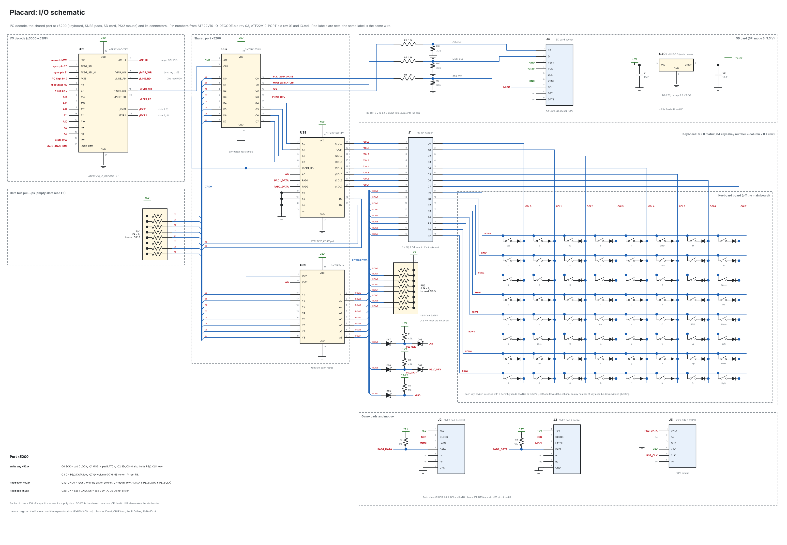

# I/O: keyboard, SNES pads, SD card, PS/2 mouse

Date: 2026-10-19

The keyboard, both SNES pads, the SD card and a PS/2 mouse share one port
at x5200-x52FF.  They are polled, never used at the same moment, so they
share one output latch, one input buffer and one PLD.  The expansion slots
are described in [EXPANSION.md](EXPANSION.md).

| Part | Job |
|---|---|
| SN74HC574N | Port latch: written at any x52xx, clocked by /PORT_WR (I/O decode PLD pin 19) |
| ATF22V10C-7PX | Port PLD (`ATF22V10_PORT.pld`): keyboard columns from the latch, pad DATA onto the bus on odd reads |
| SN74F541N | Port input: key rows on even reads (/OE1 = /PORT_RD, /OE2 = A0) |
| 3.3 V regulator | SD card (not chosen yet; an LM1117-3.3 in TO-220 is one choice) |

Besides the chips: 64 key switches with a Schottky diode each, 3 more
Schottky diodes on the rows (MISO, PS/2 DATA, PS/2 CLK) and 2 from the
latch to the PS/2 lines, 8 row pull-ups, the pull-ups on the pad DATA
lines, MISO and the PS/2 lines, three resistor dividers for the SD card, the SD socket, two pad sockets and a
mini-DIN 6 for the mouse.

## Schematic



The drawing is made by `src/scripts/gen_io_schematic.py` (2026-10-18);
rerun it when the pins change.  It shows the I/O decode PLD, the port
chips and the connectors:

| Ref | Connector | Pins |
|---|---|---|
| J1 | Keyboard, 1 x 16 header, 2.54 mm | 1-8 = /COL0-/COL7 (port PLD pins 14-21), 9-16 = ROW0-ROW7 (74F541 A1-A8).  The keys and their diodes are on the keyboard board; the row pull-ups stay on the main board |
| J2, J3 | SNES pad 1 and 2 | 1 +5 V, 2 CLOCK (latch Q0), 3 LATCH (latch Q1), 4 DATA (port PLD pin 7 or 8), 5-6 not used, 7 GND |
| J4 | Full-size SD socket (SPI) | 1 CS, 2 DI, 5 CLK from the dividers R6-R11; 7 DO = MISO; 4 VDD 3.3 V; 3, 6 GND; 8, 9 not used |
| J5 | Mini-DIN 6, PS/2 mouse | 1 DATA, 3 GND, 4 +5 V, 5 CLK |

## The port

**Write, any address x5200-x52FF (the latch):**

| Bit | Line | Notes |
|---|---|---|
| 0 | SCK, pads' CLOCK | SPI mode 3: SCK idles high.  The pads also idle with CLOCK high |
| 1 | MOSI, pads' LATCH | The card ignores MOSI while /CS is high; LATCH high only reloads the pads |
| 2 | SD /CS | 0 also holds the PS/2 CLK line low through a Schottky diode, which stops the mouse |
| 3 | PS/2 DATA | 0 holds the PS/2 DATA line low through a Schottky diode (to send to the mouse) |
| 7:4 | Keyboard column | 0-7 drive that column low (port PLD), 8-15 drive none |

**Read an even address (74F541):** D7:D0 = rows 7:0 of the driven column,
0 = key down.  Row 7 is also SD MISO, row 6 the PS/2 DATA line and row 5
the PS/2 CLK line, each through a Schottky diode, so with no column driven
a read shows those three lines.

**Read an odd address (port PLD):** D7 = pad 1 DATA, D6 = pad 2 DATA
(0 = button down).  D5:D0 are not driven, so software masks them.

**At rest** the latch holds **FB** (`P_IDLE`): no column, PS/2 DATA free,
/CS low (card selected and idle, mouse held off), MOSI and SCK high.
Every driver leaves the latch at FB, and the boot loader writes FB first,
because the 74HC574 powers up with random bits.

**Why the columns come from the latch.**  The plan had a 74F138 decode the
column from the address during the read.  That path (/PORT_RD, '138,
column, key diode, row, 74F541) is about 45 ns, and an I/O read has one
39.7 ns clock with 0.2 ns to spare.  With the column held by the latch,
the column is steady long before the read, so the read is only the
74F541's enable, like the line read.  Software writes the column, waits 4
instructions for the rows to settle and reads.  The port PLD replaces the
'138, so the chip count is the same.

**Why the PLD and not the free pins of an existing PLD.**  The PLDs with
free pins (branch, audio, memory control, H and V counters) do not see
the port latch, A0 or /PORT_RD, and the I/O decode PLD has no free pins.
Moving the column decode into one of them would need those signals routed
in and still a part to drive the pad bits, so a small new PLD is the
cheaper choice.  It has 4 inputs to spare.

## Keyboard

An 8 x 8 matrix, 64 keys.  Columns are the port PLD's /COL0-/COL7 (push-pull,
low when driven), rows are the 74F541's inputs with 4.7k pull-ups.  Every
key has a Schottky diode in series, cathode toward the column, so any
number of keys can be down at once without ghosting and a high column never
drives a row.

Key number = column x 8 + row.  `kbd_map` in `placard_io.asm` gives the
characters.

| Column | Row 0 | Row 1 | Row 2 | Row 3 | Row 4 | Row 5 | Row 6 | Row 7 |
|---|---|---|---|---|---|---|---|---|
| 0 | Esc | 1 ! | 2 @ | 3 # | 4 $ | 5 % | 6 ^ | 7 & |
| 1 | 8 * | 9 ( | 0 ) | - _ | = + | Backspace | Tab | Q |
| 2 | W | E | R | T | Y | U | I | O |
| 3 | P | [ { | ] } | \ \| | Ctrl | A | S | D |
| 4 | F | G | H | J | K | L | ; : | ' " |
| 5 | Enter | Left Shift | Z | X | C | V | B | N |
| 6 | M | , < | . > | / ? | Right Shift | Up | Caps Lock | Fn |
| 7 | \` ~ | Alt | Space | Delete | Home | Left | Down | Right |

Codes: Enter 0A, Backspace 08, Tab 09, Esc 1B, Delete 7F, Up 11, Down 12,
Left 13, Right 14, Home 15.  Ctrl gives the character AND 1F.  Shift,
Ctrl, Alt, Fn and Caps Lock give no character; Caps Lock toggles caps lock.

`kbd_scan` scans all 8 columns once per frame, about 620 clocks with no new
key, and puts each new press in an 8-entry buffer (`kbd_getc` takes them).
`KBD_NOW` (xA0-xA7) holds the last scan's rows, for games that want to
know which keys are held.  Keys are not debounced: a key bounces for less
than a frame, so a once-per-frame scan sees at most one bounce and reads it
either way.

`con_gets` (in the library at `INPUT_CODE`) reads a typed line into a buffer (R1:R0, at
most R2 characters, ending with a 00), echoing it on the console with
Backspace on the same text row; Enter ends it and AC = the length.  It
scans the keyboard once a frame while it waits.

## SNES pads

Two 7-pin SNES sockets: +5 V, CLOCK (latch bit 0), LATCH (latch bit 1),
DATA, GND.  The DATA lines have 10k pull-ups and go to the port PLD's
PAD1 and PAD2 inputs.  The pads' DATA lines are never tri-stated and read
low after the 16th bit, so they can't share the key rows.

`pad_read` reads both pads in one pass, about 800 clocks: R1:R0 = pad 1,
R3:R2 = pad 2, bit n = 1 while button n is down (0 B, 1 Y, 2 Select,
3 Start, 4 Up, 5 Down, 6 Left, 7 Right, 8 A, 9 X, 10 L, 11 R).  An empty
socket reads 0000.

## SD card

SPI mode 3, bit-banged.  SCK, MOSI and /CS come down from the 5 V latch
through a resistor divider each, at the SD socket: 1.8k from the latch
(R6-R8), 3.3k to ground (R9-R11).

- **Levels:** a 5 V high gives 3.24 V (3.17 V with the 74HC574's high
  of about 4.9 V at 1 mA), inside the card's 2.06 V (0.625 x VDD) to
  3.6 V input high.  A low is under 0.1 V.
- **Speed:** the divider is a 1.17k source.  Into about 15 pF (card input
  plus trace) that is a 17 ns time constant, so an edge crosses the card's
  threshold in about 20 ns.  The drivers' fastest SCK half period is
  several instructions (over 300 ns, SCK is under 1 MHz), and `sd_init`'s
  slow clocks are far slower.
- **Current:** about 1 mA per line while it is high.  At rest (FB) SCK and
  MOSI are high and /CS is low, so about 2 mA.  The latch also drives the
  pads' CLOCK and LATCH from the same pins at the full 5 V; 1 mA is well
  inside the 74HC574's drive.

MISO needs no buffer going the other way.  The card drives it at 3.3 V,
and it reaches row 7 only through its Schottky diode, cathode at MISO: a
low pulls the row down, a high turns the diode off and the row's 4.7k
pull-up takes it to 5 V, so the 74F541 never sees the 3.3 V level at all.
The 10k pull-up to 3.3 V holds MISO high when the card lets go of it.
The low (card output up to 0.4 V plus the diode) is the margin listed
under "To check before building".

| Routine | Does | Clocks |
|---|---|---|
| `sd_init` | Starts the card: 80 clocks below 400 kHz with /CS high, CMD0, CMD8, ACMD41 until ready, CMD58, CMD16.  Takes SDSC (version 1 and 2) and SDHC/SDXC cards.  AC = 0 ready, 1 no card, 2 did not start, 3 unusable | about 200,000 (8 ms) |
| `sd_read` | One 512-byte block (R3:R0 = block number, R5:R4 = buffer).  AC = 0, 4 refused, 5 no data | about 140,000 (5.5 ms) |
| `sd_write` | One 512-byte block.  AC = 0, 4 refused, 6 not accepted, 7 card stayed busy | about 195,000 |

Block numbers are always 512-byte blocks; `sd_read` and `sd_write` turn them
into byte addresses for SDSC cards.  About 90 KB/s reading.

### Files on the SD card

`src/scripts/placard_fs.asm` (in the library at `FS_CODE`, ROM xC700-xD4FF) reads files
from a card formatted on a PC, FAT16 or FAT32, with a partition table (the
first partition) or without one.  It is read only, finds short 8.3 names
("LONGFI~1.TXT" for a long name), and does not read FAT12 (volumes under
about 16 MB).

```
    (CALL sd_init)              ; AC = 0 when the card is ready
    (CALL fs_mount)             ; AC = 0: the root is the current folder
    ld   name & 0xFF, ac        ; R1:R0 = "GAME.BIN", 00
    ld   ac, [R0]
    ld   name >> 8, ac
    ld   ac, [R1]
    ld   0x00, ac               ; R5:R4 = x0100, where to load it
    ld   ac, [R4]
    ld   0x01, ac
    ld   ac, [R5]
    (CALL fs_load)              ; AC = 0 when loaded
```

| Routine | Does | Clocks |
|---|---|---|
| `fs_mount` | Finds the file system; the root becomes the current folder | about 130,000, 260,000 with a partition table |
| `fs_root` | The root becomes the current folder | about 2,000 |
| `fs_next` | The next entry of the current folder in `FS_ENTRY` (name 0-10, attributes 11 with 10h = folder, size 28-31); AC = 1 at the end.  Skips deleted entries, long name parts and the volume name | about 1,000, or 140,000 when it reads a sector |
| `fs_open` | R1:R0 = a name ending in 00 (any case).  A file opens for `fs_read` with `FS_REM` = its size; a folder (or "..") becomes the current folder | about 1,000 per entry passed plus 140,000 per sector |
| `fs_read` | The next 512 bytes of the open file to R5:R4, which moves on by 512; AC = 1 at the end | about 160,000 (75 KB/s) |
| `fs_load` | `fs_open` and `fs_read` to the end, to R5:R4 | about 160,000 per 512 bytes |

Errors in AC: 1 end, 2 not found, 4 and 5 from `sd_read`, 8 not mounted,
9 no FAT file system, 10 FAT12.  There is one reader: after `fs_open` of a
file, `fs_next` starts the folder over, and `fs_read` can't go on after
`fs_next` or another `fs_open`.  The last sector is read whole, so up to
511 bytes past the end of the file are written.  The reader's variables are
at x4D00-x4D7F and its sector buffer at x4E00-x4FFF (section 2, RAM in map
05).  `test_fs.py` checks it on FAT16 and FAT32 images made by `mkfs.fat`
and `mtools` (it skips when they are not installed).

## PS/2 mouse

The mouse needs no chips: its CLK and DATA lines are open collector, so the
latch pulls them low through Schottky diodes and the rows read them back.

| PS/2 line | Pulled low by | Read on |
|---|---|---|
| CLK | latch bit 2 (= SD /CS) low | row 5 |
| DATA | latch bit 3 low | row 6 |

Both lines have 4.7k pull-ups to 5 V on the main board, as a PS/2 host
must.  Because /CS is low at rest, the mouse is held off (CLK low) except
while software listens to it.  A keyboard scan or pad read raises /CS for
under 50 us, shorter than a PS/2 device waits before it starts to send, so
the mouse can't start a packet then.  `sd_init` is the one exception: its
start clocks keep /CS high for about 370 us, once, when a card is started.

| Routine | Does | Clocks |
|---|---|---|
| `mouse_init` | Resets the mouse (FF: FA, then AA 00 after its self test) and turns reporting on (F4: FA).  AC = 0 running, 1 no mouse, 2 wrong answer | up to 1 s while the mouse tests itself |
| `mouse_poll` | Lets the mouse send for about 1 ms; reads one 3-byte packet if it starts.  AC = 1 new packet, 0 nothing, 2 bad packet.  `MOUSE_B` bit 0 left, 1 right, 2 middle; `MOUSE_DX` right and `MOUSE_DY` down, -127 to 127 | about 24,000 (1 ms) with nothing new, about 76,000 (3 ms) with a packet |
| `mouse_cmd` | Sends one command byte and reads the FA acknowledge, for other settings (sample rate F3, resolution E8) | about 55,000 |

The mouse runs in stream mode.  While it is held off it keeps adding up
its movement, so a poll once per frame loses nothing; one packet carries
up to 255 counts each way, and the driver clamps to ±127.  If a frame or
the packet is cut off (the poll gives up just as the mouse starts), the
mouse sends the whole packet again at the next poll, as PS/2 requires.
A mouse must start sending within about 0.85 ms of being let go; if one
is slower, raise `MOUSE_WAIT` in `placard_io.asm` (each step adds 0.25 ms
to every poll).

`mouse_move` (in the library at `INPUT_CODE`) adds a packet's movement to a pointer
position in R1:R0 (X) and R3:R2 (Y), held to 0-639 and 0-479.  Call it
after `mouse_poll` returns 1.

## Rules for software

- Use the drivers, or leave the latch at FB (`P_IDLE`) when done.
- Never hold /CS high for 50 us or more outside `sd_init` (the mouse would
  start sending with nobody listening).
- Scan the keyboard once per frame, not faster (bounces).
- Mask D5:D0 when reading the pads at an odd address.

## Zero page

The drivers use xA0-xBF (`zeropage.asm`); programs have x20-x8F.

| Address | Name | Use |
|---|---|---|
| xA0-xA7 | KBD_NOW | Rows of each column from the last scan, 0 = down |
| xA8-xAF | KBD_BUF | Key buffer (8 entries, holds 7) |
| xB0, xB1 | KBD_HEAD, KBD_TAIL | Key buffer indexes |
| xB2 | KBD_FLAGS | bit 0 caps lock |
| xB3 | IO_TMP | Driver scratch |
| xB4 | SD_FLAGS | bit 0 block addressing (SDHC), bit 1 slow clock, bit 7 ready |
| xB5-xB8 | MOUSE_B, MOUSE_DX, MOUSE_DY, MOUSE_ST | Mouse buttons, movement and state |
| xB9-xBC | IO_T0-IO_T3 | Driver scratch |

## Code

The drivers are `src/scripts/placard_io.asm`, at `IO_CODE` (ROM
xDC00-xEBFF), part of the library block at the top of the ROM, running in
place (ROM.md).  They use the library's calling convention, and the public
ones have fixed jump table entries ([LIBRARY.md](LIBRARY.md#jump-table)).
`placard_lib.asm` includes them.

- `src/scripts/io_devices.py`: models of the port, key matrix, pads, SD
  card and mouse for `placard_sim.py` (`Cpu(..., io=SharedPort())`).
- `src/scripts/test_io.py`: tests every driver against the models, and
  checks that each leaves the latch at FB and keeps /CS-high times under
  50 us.
- `src/scripts/io_demo.asm` (`build\io_demo.bat`): starts the SD card,
  shows the end of block 0, starts the mouse, echoes typed keys and prints
  pad buttons and mouse packets.  On the Basys3, set SW15 before reset to
  use the mouse (the keyboard is then not connected).

## FPGA model (Basys3)

`basys_top.vhd` has the latch, the port PLD (`port_pld.vhd`) and the
74F541's inputs.

| Placard | Basys3 |
|---|---|
| Key matrix | The USB keyboard, through `ps2_key_matrix.vhd`, while SW15 = 0 |
| PS/2 mouse | The USB mouse on the same port, while SW15 = 1 (the latch drives the PS/2 pins open drain) |
| SD card | PmodMicroSD on JB (top row): JB1 /CS, JB2 MOSI, JB3 MISO, JB4 SCK |
| Pads | SNES pads on JC (top row): JC1 CLOCK, JC2 LATCH, JC3 pad 1 DATA, JC4 pad 2 DATA, plus the Pmod's 3.3 V and GND |

The Basys3's USB port is one PS/2 port, so the model uses the keyboard or
the mouse, picked by SW15.  The pads run from the Pmod's 3.3 V in the
model.  A SNES pad is CMOS shift registers and is generally run at 3.3 V by
FPGA projects, but that is not checked here.

## To check before building

- **Row pull-up and diode margins.**  A row reads a low through a Schottky
  diode from MISO or a PS/2 line: about 0.3 V across a BAT85 at 1 mA plus
  the line's own low (up to 0.4 V for a PS/2 device) is about 0.7 V against
  the 74F541's 0.8 V.  Use low-forward-voltage Schottkys (BAT85 or
  similar) and measure it on the first board.  Larger pull-ups lower the
  diode drop but slow the row's rise after a key is released: with 4.7k and
  about 50 pF a row rises past 2 V in about 120 ns, inside the drivers'
  4-instruction settle time (about 320 ns).
- **Stock:** the regulator is not stock-checked yet.  The
  ATF22V10C-7PX, SN74F541N and SN74HC574N are the same parts as elsewhere
  in the design.
