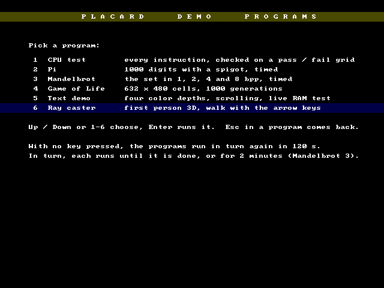

# Demo menu ROM

One ROM image holds six demo programs and a menu that runs them.  It is
built by `src/scripts/gen_menu_rom.py` and loaded with `build\menu.bat`.

Date: 10/20/2026



## What it does

| # | Program | Kind | Done when |
|---|---------|------|-----------|
| 1 | CPU test (`cpu_test.asm`) | RAM program | every test has run; the pass / fail grid stays 10 s |
| 2 | Pi (`pi_spigot.asm`) | RAM program | 1000 digits and the time are shown; they stay 10 s |
| 3 | Mandelbrot (`mandelbrot.asm`) | RAM program | all four color depths are drawn (about 2 min 15 s on the board; its limit is 3 minutes) |
| 4 | Game of Life (`game_of_life.asm`) | RAM program | 1000 generations (about 4 min 40 s, so in turn it stops at 2 minutes) |
| 5 | Text demo (`text_demo.asm`) | ROM program | never (2 minute limit) |
| 6 | Ray caster (`raycast.asm`) | ROM program | never (2 minute limit) |

- At power-up the programs run **in turn**, in the order above: each one
  until it is done or for 2 minutes (Mandelbrot 3, so it finishes), then
  the next, and after the last the first again.  `LIMIT_S` in
  `gen_menu_rom.py` sets a longer limit per program.
- **Esc** in any program shows the menu.
- In the menu, **Up / Down** move the highlight and **Enter** (or Space)
  runs the highlighted program; **1-6** run that program at once.  A
  program picked from the menu has no time limit: it runs until Esc (a
  program that finishes stays on its result).
- With **no key for 2 minutes** in the menu, it goes back to running them
  in turn, starting with the highlighted program.  The menu counts the
  seconds down on the screen.

The side scroller is not in the menu ROM; it needs the same ROM pages as
the text demo.

## How a program is run

**ROM programs** (text demo, ray caster) run in place, as they do on
their own: the menu jumps to the entry with map 05.  Their pages must not
overlap, so `gen_raycast.py` places the ray caster in the pages the text
demo leaves free (x6100-x8FFF, xB100-xBEFF) and builds its 10 KB of
height and step tables in the RAM at start.  Each ROM program has a
4-byte jump at x6000 to its real entry; in the menu ROM x6000 is the
menu's own jump.

**RAM programs** (CPU test, pi, Mandelbrot, Game of Life) were written to
run from RAM x0000 with map FF, like the boot loader's RAM image.  The
menu's loader does what the boot does: clears RAM x0000-x49FF, copies the
program in, then maps everything to RAM and jumps to x0000.  The four are
stored packed:

- The CPU test's x0100-x1EFF is kept at the same address in ROM section
  0 (that ROM is free: the zero page reads RAM while any program runs).
  The loader copies those pages with map 04.
- Every other byte is in runs (destination, length up to 256) stored one
  after the other in the free ROM: x2800-x3FFF, x4000-x4FFF,
  x5400-x5FFF and xBF00-xBFFF.  The loader reads them with map 01.
  `menu_data.asm` has the run tables.

Pi builds its 9.5 KB product table at start instead of carrying it, so it
fits.

## The hook

There are no interrupts, so each program gives the menu a chance about
once per frame:

- a ROM program calls the library's `menu_poll` (`placard_menu.asm`,
  jump table entry 54);
- a RAM program (map FF, no library) carries its own copy of the same
  check, written by `menu_hook.py`: `hk_poll` every frame, `hk_hold` when
  it starts showing a final result, `hk_done` when a run is complete.

They talk to the menu through the menu block at RAM x5D00:

| Address | Name | Use |
|---------|------|-----|
| x5D00-x5D02 | `MB_MAGIC` | "MNU" while the menu is in charge |
| x5D03 | `MB_MODE` | 0 = in turn (time limit), 1 = picked (until Esc) |
| x5D04-x5D05 | `MB_LEFT` | frames left (in turn) |
| x5D06 | `MB_LAST` | last line read (RAM programs' hook) |
| x5D07-x5D08 | `MB_FRAME`, `MB_SYNC` | `menu_poll`'s frame count |
| x5D09 | `MB_WHY` | why the program stopped: 1 = Esc, 2 = time up or done |
| x5D0A | `MB_CUR` | scratch for the RAM programs' hook |
| x5D0B-x5D0C | `MB_HOLD` | frames a finished result stays (10 s) |
| x5D0D | `MB_PROG` | the program running |
| x5D0E-x5D0F | `MB_IA` | the loader's page count |
| x5D20-x5D27 | `MB_EXIT` | code: map 05, jump to the menu |
| x5D28-x5D2F | `MB_GO` | code: map FF, jump to RAM x0000 |

Without the menu the block holds no "MNU" and every hook returns at once,
so each program still builds and runs on its own (`build\<program>.bat`)
exactly as before.  `menu_poll` costs 15 clocks a call then.

## ROM image

| ROM address | Contents |
|-------------|----------|
| x0000-x0003 | Reset jump (`rom_boot.asm`) |
| x0100-x1EFF | CPU test's x0100-x1EFF, in place |
| x1F00-x1FFF | `LIB_RAM` |
| x2000-x25FF | `menu.asm` |
| x2600-x27FF | `menu_data.asm`: program table, run table, screen text |
| x2800-x3FFF, x4000-x4FFF, x5400-x5FFF | packed RAM program runs |
| x6000-xBEFF | text demo and ray caster, in place (x6000: the menu's jump) |
| xBF00-xBFFF | packed RAM program runs |
| xC000-xFFFF | library and boot loader, as in every ROM |

About 2.6 KB of the packed areas is still free.

## Building

```
cd src\scripts
python gen_menu_rom.py        writes menu_data.asm and menu.hex (the whole ROM)
build\menu.bat                runs gen_menu_rom.py, then builds and loads it
build\menu.bat fast           only puts the new ROM into the last bitstream
```

`gen_menu_rom.py` assembles every program from its `.asm` file, so run a
program's generator first after changing it.  `menu.hex` is the whole
64 KB ROM; `gen_rom.tcl` takes a 65536-byte file as a whole image as it
is.  Options `--rotate`, `--hold` and `--idle` (seconds) change the
times.

`src/scripts/test_menu.py` runs the menu ROM in `placard_sim.py` with short
times and checks the rotation order, that each RAM program's RAM is exactly
its own image when it starts, that the CPU test passes, Esc, the keys,
a picked program running past the time limit and the idle return
(`--png` saves the menu screen).
