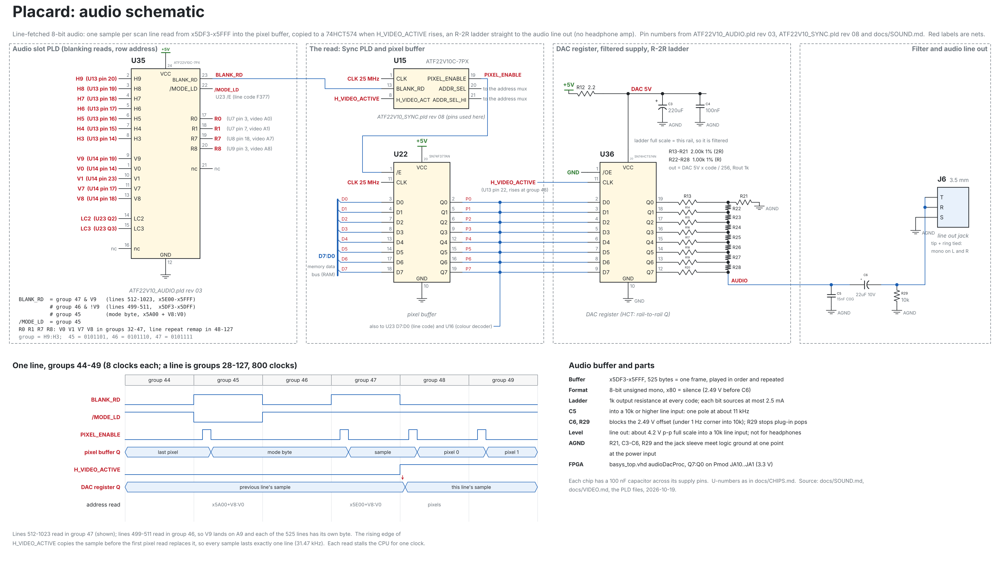

# Sound

Date: 2026-10-22

The video circuit plays sound by itself.  On every scan line it reads one
8-bit sample from RAM, the same way it reads pixels, and a register feeds that
sample to a resistor DAC.  Software only keeps a 525-byte buffer filled.

| | |
|---|---|
| Format | 8-bit unsigned mono, 80h = silence |
| Sample rate | the line rate: 31.469 kHz at 25.175 MHz (31.25 kHz on the FPGA's 25.000 MHz) |
| Buffer | 5DF3h-5FFFh, 525 bytes, one frame, played in address order and repeated (4DF3h-4FFFh until 2026-10-16) |
| Added chips | audio slot PLD (ATF22V10C) and DAC register (SN74HCT574N); the DAC, filter and headphone output are passives |
| CPU cost | one stall clock per line (525 per frame, 0.13 %) |

## Schematic



The drawing is made by `src/scripts/gen_audio_schematic.py` (2026-10-19);
rerun it when the pins change.  It shows the audio slot PLD (U35), the Sync
PLD pins that make the read (U15), the pixel buffer (U22), the DAC register
(U36) with its filtered supply, the R-2R ladder, the filter and the jack (J6),
and the timing of one line around the read.

## How the sample is read

**The read.**  The Sync PLD (revision 06) raises PIXEL_ENABLE for one more
clock per line, in clock 1 of an 8-clock group in horizontal blanking, on all
525 lines including vertical blanking.  It is a video read in every way: the
address mux selects the video address, the Branch PLD stalls the CPU, the
memory control PLD enables the RAM (video reads always read the RAM), and
the pixel buffer (F377) loads the byte.

**The address.**  The video address is H9:H3 on A15:A9 and V8:V0 on A8:A0.
The V counter runs 499-1023, 525 lines, but only 9 bits of it reach the
address, so lines 499-511 and 1011-1023 would read the same 13 bytes and 13
samples would repeat every frame (a 60 Hz buzz).  The audio slot PLD fixes
that by reading in group 46 when V9 = 0 and in group 47 when V9 = 1, which
puts V9 on A9:

| Lines | V9 | Group | H9:H3 | Addresses |
|---|---|---|---|---|
| 499-511 | 0 | 46 | 0101110 | 5C00h + 499..511 = 5DF3h-5DFFh |
| 512-1023 | 1 | 47 | 0101111 | 5E00h + 0..511 = 5E00h-5FFFh |

One frame reads 5DF3h through 5FFFh in order.  The buffer is at the top of
section 2, just below the video memory; the I/O window is 5000h-53FFh
(groups 40-41), where no memory answers.  The row address bits the audio
slot PLD remaps for the line repeat are passed through unchanged in groups
32-47, so the audio read is not affected by a row's mode byte.

**The output.**  The mode byte read (group 45) comes before the audio read,
so the pixel buffer holds the sample until the first pixel read of the line
loads it (end of clock 1 of group 48).  A 74HCT574 clocked by the rising
edge of H_VIDEO_ACTIVE (H counter PLD pin 22, start of group 48) copies it.
So every sample lasts exactly one line (800 clocks), even though the read
itself moves 8 clocks between group 46 and group 47.

**Before 2026-10-16** the sample was read in group 38/39 from 4DF3h-4FFFh
and the DAC register was clocked by HSYNC (end of sync, group 42).  When the
I/O window shrank, the read moved up into 5400h-5FFFh, after HSYNC ends, so
the clock moved to H_VIDEO_ACTIVE, which is registered and can't glitch.

### Audio slot PLD (`ATF22V10_AUDIO.pld`, `audio_pld.vhd`)

Revision 03 (2026-10-16).  It also marks group 45, where the video circuit
reads the line's mode byte (see [VIDEO.md](VIDEO.md#mode-byte)), and makes
four row address bits for the line repeat (see
[VIDEO.md](VIDEO.md#line-repeat)).

    BLANK_RD = !H9 & H8 & !H7 & H6 & H5 &  H4 &  H3 &  V9      /* group 47 */
             # !H9 & H8 & !H7 & H6 & H5 &  H4 & !H3 & !V9      /* group 46 */
             # !H9 & H8 & !H7 & H6 & H5 & !H4 &  H3;           /* group 45 */

    MODE_LD  = !H9 & H8 & !H7 & H6 & H5 & !H4 &  H3;           /* pin 22, active low */

| Pin | Signal | From / to |
|---:|---|---|
| 1 | V0 | V counter PLD pin 14 (Q0) |
| 2-8 | H9, H8, H7, H6, H5, H4, H3 | H counter PLD pins 20, 19, 18, 17, 16, 15, 14 |
| 9 | V9 | V counter PLD pin 19 (Q9) |
| 10, 11, 13 | V1, V7, V8 | V counter PLD pins 23, 17, 18 |
| 14, 15 | LC2, LC3 | Line code register (74HCT377) Q2, Q3 |
| 17-20 | R0, R1, R7, R8 | Address mux video inputs for A0, A1, A7, A8 |
| 22 | /MODE_LD | Line code register (74HCT377) /E |
| 23 | BLANK_RD | Sync PLD pin 13 |
| 16, 21 | unused | |

### Sync PLD change (revision 06)

    PIN 13 = BLANK_RD;     /* AUD_SLOT before revision 07 */

    PIXEL_ENABLE.D = V_VIDEO_ACTIVE & H_VIDEO_ACTIVE & !H2 & !H1 & !H0
                   # BLANK_RD & !H2 & !H1 & !H0;

PIXEL_ENABLE uses 2 of its 16 product terms.  Nothing else in the PLD changes.

### Timing

| Path | Total | Slack at 39.72 ns |
|---|---:|---:|
| BLANK_RD to the Sync register: H counter tCO 5.5, audio PLD tPD 7.5, Sync tS 3.5 | 16.5 ns | +23.2 |
| The audio read: the same path as a pixel read (VIDEO_TIMING.md, option A) | 34.5 ns | +5.2 |
| DAC register data: the pixel buffer is steady from group 46/47 to clock 1 of group 48, and the clock edge (H_VIDEO_ACTIVE, tCO 5.5 ns) is at the start of group 48 | at least 6 clocks before the edge and 2 after | |

### Checked in simulation

**Revision 03** (2026-10-16): the FPGA model ran 860,000 clocks (two frames)
with the same random bytes at 4DF3h-4FFFh and 5DF3h-5FFFh, against the
design before.  The DAC took the same 1068 values in the same order, each
exactly 48 clocks later, and HSYNC, VSYNC and RGB were identical.

**When the audio was added:** the FPGA model was run in GHDL for 36 ms of `cpu_test`, with a ramp
(0, 1, 2, ...) written into 4DF3h-4FFFh, against the sources before this
change:

- 1125 audio reads, exactly one per line, at 4DF3h-4FFFh in order with no
  repeats.
- The DAC register stepped by +1 on every line, and wrapped once per frame
  (from sample 524 back to 0).
- HSYNC and VSYNC were identical clock for clock.
- The CPU made the same RAM writes, with the same addresses and data in the
  same order, about 0.15 % later (the extra stall).
- 439 pixels differed, all on one frame only: a store that lands a few
  clocks later shows up on the next frame instead.  None were still different
  one frame later.

## DAC, filter and headphone output

All passive: the ladder drives headphones directly, so there is no op-amp.

    +5V ──2.2Ω──┬── VCC (pin 20) of the 74HCT574 ("DAC 5V")
                ├── 220µF ── AGND
                └── 100nF ── AGND

    74HCT574 Q7 (MSB) ─ 2k ─┬───────────────── ladder out (Rth = 1k)
    74HCT574 Q6       ─ 2k ─┼ 1k ┐
                             ...  (each node: 2k from its bit,
    74HCT574 Q1       ─ 2k ─┼ 1k ┐  1k to the next node up)
    74HCT574 Q0 (LSB) ─ 2k ─┤
                             └─ 2k ─ AGND   (termination)

    ladder out ──┬── 15nF ── AGND                (filter)
                 └── 22µF ceramic ────────────────┬── jack tip and ring
                                                  └── 10k ── AGND   (bleed)
    jack sleeve ── AGND

### The register

- **74HCT574, not 74HC574 or 74F574.**  HCT inputs read the pixel buffer's
  74F outputs (2.7 V minimum high) correctly, which an HC input (3.5 V
  threshold at 5 V) does not.  HCT outputs swing rail to rail, which the
  ladder needs for even steps; 74F outputs only reach about 3.4 V and differ
  from bit to bit.
- D7:D0 from the pixel buffer Q7:Q0.  CLK from H_VIDEO_ACTIVE (H counter PLD
  pin 22; HSYNC, pin 21, until 2026-10-16).  /OE (pin 1) to ground.
- **Power it from its own filtered rail** (2.2 Ω, 220 µF and 100 nF above).
  The ladder's full scale is this chip's VCC, so any noise on it comes out in
  the audio in proportion to the sample (at silence, 80h, half of it).  The
  chip and ladder draw at most about 5 mA, which drops about 11 mV across the
  2.2 Ω (0.2 % of full scale), less than one step.
- In the FPGA model the register is `audioDacProc` in `basys_top.vhd`, and
  Q7:Q0 come out on Pmod JA (JA10 = Q7 down to JA1 = Q0, 3.3 V full scale).
  The same ladder and output work there, at two thirds of the level.

### The R-2R ladder

| Part | Value | Qty |
|---|---|---:|
| 2R: one per bit, plus the termination | 2.00 kΩ, 1 % metal film | 9 |
| R: between neighboring nodes | 1.00 kΩ, 1 % metal film | 7 |

- Open-circuit output = VCC × code / 256, so 0 V to 4.98 V, 2.49 V at
  silence (80h).  The ladder's output resistance is R (1 kΩ) at every code.
- The low R (1 k instead of a more usual 10 k) is what lets it drive
  headphones without a buffer.  Each bit sources at most about 2.5 mA, well
  inside what a 74HCT574 output can do.
- Linearity: with 1 % parts the steps are even to about 7 bits.  The HCT
  output resistance (roughly 25-50 Ω) against 2 kΩ adds about one step of
  error at the middle of the range.  Neither is audible as distortion in
  sound like this.  For better, use 0.1 % parts for the MSB leg and the two
  legs below it.

### The filter

One capacitor, 15 nF (C0G or film), from the ladder output to AGND.

- Into a high-impedance input (a line-in or amplifier, 10 kΩ or more) it
  forms a single pole with the ladder's 1 kΩ: 10.6 kHz (11.7 kHz with a
  10 kΩ load).  That softens the 31.5 kHz steps.
- Into headphones the load sets the impedance (16-32 Ω), so the pole moves
  far above the audio and the capacitor does nothing.  That is fine: the
  sample-rate steps are at 31.5 kHz, above hearing, the step-hold has a null
  right at 31.5 kHz, and headphone drivers roll off up there anyway.
- A C0G (NP0) or film capacitor, not X7R, whose value moves with voltage.

### The headphone output

| Part | Value | Why |
|---|---|---|
| Coupling capacitor | 22 µF ceramic (X5R/X7R, non-polar), 10 V or more | blocks the 2.49 V offset; low corner about 7 Hz into 16 Ω, under 1 Hz into 10 kΩ |
| Bleed resistor | 10 kΩ, jack side to AGND | holds the jack side at 0 V so plugging in does not pop |
| Jack | 3.5 mm stereo; tip and ring tied together, sleeve to AGND | the same sound in both ears |

- **Level.**  With 32 Ω earpieces in parallel (16 Ω) the full-scale swing at
  the jack is about 80 mV peak to peak (28 mV rms), about 25 µW per ear.  For
  typical headphones (around 100 dB SPL per mW) that is about 84 dB SPL at
  full scale: comfortably loud, not painful.  Higher-impedance headphones get
  more voltage and play louder.  Software sets the volume by scaling the
  samples around 80h.
- **Line-in works too**: into 10 kΩ it gives about 4.5 V peak to peak, which
  most inputs take.  A powered speaker or an LM386 amplifier can plug into
  the same jack.
- **Short circuit** (a plug going in): the 1 kΩ ladder resistance limits the
  current, so nothing is harmed.
- **Power-on.**  At power-up the coupling capacitor charges to 2.49 V, which
  makes one soft thump if headphones are already plugged in.  After that the
  output stays at mid-scale (see the click-free rules), so it happens only
  once.
- **Grounds:** the ladder termination, the 15 nF capacitor, the bleed
  resistor and the jack sleeve all return to an analog ground (AGND) that
  meets the logic ground at one point, at the power input.

## Click-free rules

The hardware never adds a click on its own:

1. **One sample per line, no gaps, no repeats**, on all 525 lines, and every
   update at the same point in the line.
2. **All 8 bits change on one edge** of the 74HCT574, so the ladder never sees
   a half-updated value; the few-ns skew between bits is far above the audio
   band, and the filter removes it.
3. **Silence is 80h**, and the output is AC coupled, so starting and stopping
   never makes a DC step.
4. **Power-up.**  Video reads always come from the RAM (memory control PLD
   revision 04), which is random at power-up, so the output plays noise until
   software fills 5DF3h-5FFFh with 80h; that should be one of the first things
   a program (or the boot loader) does.  The 74HCT574 powers up with a random
   value for one line (32 us), which the filter and coupling capacitor turn
   into nothing worth hearing.

Software has its own part:

- Fade a sound in and out over a few milliseconds; never cut it off mid-wave.
- Leave 80h in the buffer when nothing is playing.
- Keep the buffer filled ahead of playback (next section).  If a program stops
  refilling, the last frame repeats, which is a buzz, so fade to 80h first.

## Software

### The sound driver

The library's sound driver (`src/scripts/placard_snd.asm`, in the library
at `SND_CODE`, ROM xD700-xDBFF) does the buffer work.  A program calls `snd_init` once,
`snd_update` once every frame (from anywhere in the frame; a game loop that
already calls `wait_frames` or `frame_poll` just adds it), and starts sounds
with one call:

```
    (CALL snd_init)             ; once
    ...
    ld   69, ac                 ; A 440 Hz
    (CALL snd_beep)             ; a short note that fades out
    ...
loop:
    (CALL snd_update)           ; every frame
    ...
```

| Routine | In | Does |
|---------|----|------|
| `snd_tone` | R1:R0 = step (frequency in Hz x 1.0413), AC = volume 0-127, R2 = frames (0 = until stopped), R3 = volume taken off each frame | Square wave |
| `snd_note` | AC = MIDI note 0-127 (60 = middle C, 69 = A 440) | R1:R0 = the step for `snd_tone` |
| `snd_beep` | AC = MIDI note | Volume 96, 12 frames, fading by 8 a frame |
| `snd_noise` | AC = volume, R0 = rate 1-128 (128ths of the line rate), R2, R3 as `snd_tone` | Noise (a 16-bit LFSR, the same seed each time) for drums and hits |
| `snd_play` | R1:R0 = samples (RAM or ROM), R3:R2 = count, AC = rate 1-128 (128 = 31.5 kHz, 32 = 7.9 kHz) | 8-bit unsigned samples, 80h = silence |
| `snd_stop` | | Silent within a frame |
| `snd_busy` | | AC = 0 when silent |

One sound plays at a time; starting another replaces it.  The step is a
16-bit phase increment per line (32768 = half a cycle per line), so the
pitch error is under 0.01 % above 100 Hz.

**How `snd_update` keeps up.**  Instead of double buffering it writes just
behind the player: it waits for the line read to change (so it knows the
line exactly, to 4 lines) and writes every sample from where it stopped
last time up to the line now playing.  Sounds start within a frame.  When
the sound is over and the buffer has been all 80h for two laps, it returns
at once.

**Measured CPU time** (`test_snd.py`, about 380,000 usable clocks per frame):

| Sound | Clocks per frame | Share |
|---|---:|---:|
| Silence (buffer clean) | about 90 | 0 % |
| Samples (`snd_play`) | about 18,300 | 5 % |
| Tone | about 26,000 | 7 % |
| Noise | about 42,700 | 11 % |

Plus up to 3,200 clocks waiting for the line read to change.  The driver
uses zero page x90-x9E and T0-T3.  `test_snd.py` checks the buffer against
a Python model of every sound, sample for sample.

### By hand

A program that does not use the driver can fill the buffer itself.

**Playback position.**  The sample playing is line V - 499, and the line read
at 5000h returns V9:V2 (V / 4).

**Double buffering.**  The buffer splits at line 768, which is where the line
read reaches C0h and the address reaches 5F00h:

| Half | Lines | Line read | Bytes | Addresses |
|---|---|---|---|---|
| A | 499-767 | 7Ch-BFh | 269 | 5DF3h-5EFFh |
| B | 768-1023 | C0h-FFh | 256 | 5F00h-5FFFh (one page) |

At least twice per frame (every 8 ms), read the line count and refill the
half that is not playing:

    ld 0x50, y
    ld [y,x], ac          ; line read (V9:V2)
    ; ac >= 0xC0: half B is playing, so refill half A if not done this frame
    ; ac <  0xC0: half A is playing, so refill half B if not done this frame

Each refill has 8 ms to finish, so no exact timing is needed.  If one is
late, the old half plays again (a stutter).

**Other rates.**  Writing each sample twice gives 15.7 kHz, four times
7.9 kHz.  A tone with a whole number of cycles per frame (a multiple of
59.94 Hz) loops with no refills at all.

**CPU time** (estimates from the instruction clock counts in CPU.md, not
measured; about 380,000 CPU clocks per frame):

| Work | Clocks per sample | Per frame |
|---|---:|---:|
| Hardware read (stall) | 1 | 0.14 % |
| Polling the line read twice | | under 0.1 % |
| Silence or a looping tone | 0 | 0 % |
| Copying a stored sound | about 25 | about 3.5 % |
| One generated voice (phase add and wavetable) | about 40 | about 5.5 % |
| Each extra mixed voice | about +25 | about +3.5 % |

## Memory map impact

- 5DF3h-5FFFh is the audio buffer while sound is used.  5A20h-5BFFh holds the
  row mode bytes (see [VIDEO.md](VIDEO.md#mode-byte)).  4000h-4FFFh,
  5400h-5A1Fh and 5C00h-5DF2h are free.
- The video reads the buffer from the RAM whatever the map says.  For the
  CPU to read it back, section 2 (map bit 2) must read RAM.
- The /SND_WR strobe is gone: its I/O decode pin is now the A11 input, and
  page 5100h is expansion port 1.
