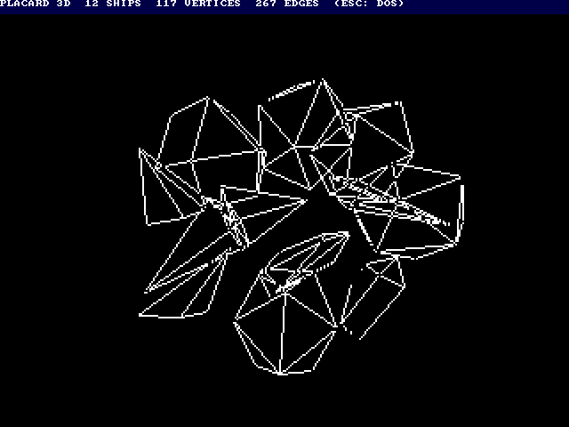

# 3D wireframes (Elite style)

`sdcard/WIRE3D.PLC` is a 3D wireframe demo in the style of the BBC Micro's
Elite: four convex ships (a station, a freighter and two darts) tumbling
and flying in front of a fixed camera, with hidden lines removed.  It is a
library program for the SD card (run it from the DOS's file browser; Esc
goes back), made by `src/scripts/gen_wire3d.py`, and also a benchmark:
`src/scripts/test_wire3d_sim.py` runs it in `placard_sim.py`, checks every
frame pixel for pixel against a Python model of the same integer
arithmetic, and times each part.

Date: 10/28/2026


## The limits

Measured in the simulator with the video stall clocks modeled (25.175 MHz,
2 bpp 2x picture, about 10 % of the clocks lost to video reads), built with
no frame cap (`--pace 0`):

| Ships | Vertices | Faces | Edges | Lines drawn a frame | Pixels drawn a frame | Frames a second |
|------:|---------:|------:|------:|--------------------:|---------------------:|----------------:|
| 4 (the demo) | 37 | 49 | 78 | 50 | 1,130 | 106 |
| 6 | 61 | 89 | 138 | 76 | 2,005 | 62 |
| 8 | 79 | 114 | 177 | 97 | 2,423 | 49 |
| 10 | 98 | 144 | 222 | 118 | 3,012 | 40 |
| 12 | 117 | 174 | 267 | 144 | 3,642 | 33 |

The cost of a frame is close to a sum of four parts:

    clocks a frame ≈ 1,000 a vertex + 700 a face + 930 a line drawn
                     + 104 a pixel drawn + 1,100 a ship

(a pixel is drawn once and erased once the next frame: about 50 clocks each
time, including the record start-up.)  A frame has 1,259k clocks at 20 fps,
1,007k at 25 fps and 839k at 30 fps, so with ships like these:

| Target | Vertices | Lines | Line pixels | Ships like the demo's |
|-------:|---------:|------:|------------:|----------------------:|
| 30 fps | about 130 | about 160 | about 4,000 | about 14 |
| 25 fps | about 155 | about 190 | about 4,800 | about 17 |
| 20 fps | about 190 | about 235 | about 6,000 | about 21 |

If the whole frame went to line drawing, it would be about 8,000 pixels of
lines at 30 fps and 12,000 at 20 fps.  The pixels are what limit it: on the
screen the lines are short because the ships are small and far away; a ship
close to the camera costs mostly pixels.

As a yardstick, Elite's Cobra Mk III (28 vertices, 38 edges, 13 faces)
seen at a middle distance (about 25 lines shown, 40 pixels each) would cost
about 28k + 9k + 23k + 104k = 165k clocks: about 5 at 30 fps, 7 at 20 fps.
The BBC Micro version runs at around 10 frames a second with a few ships.

The program keeps the per-frame tables to 255 vertices, 255 faces and 255
lines, which is more than 20 fps can use.

### Where the time goes (12 ships)

| Part | Share | Per unit |
|------|------:|---------|
| Draw the new lines | 25 % | 35-54 clocks a pixel (below) |
| Erase the old lines (draw them again) | 24 % | the same |
| Line set-up (a record per line) | 17 % | 930 clocks a line, 500 an edge looked at |
| Faces (hidden lines) | 16 % | 717 clocks a face |
| Transform and project | 15 % | 985 clocks a vertex |
| Matrix (14 multiplies) | 1 % | 750 clocks a ship |

The line loops alone (`bench_lines` in the test), clocks a pixel with
stalls: horizontal 33, shallow (1:4) 38, diagonal 51, steep (4:1) 54,
vertical 53.  A line's set-up is about 550 clocks of that 930; the rest is
the edge loop (which faces, which vertices, are they on the picture).

### Headroom

The demo is written plainly; known savings, not done:

- **Faces**: transform the camera into each ship's own space once and
  take a dot product with each face normal (as Elite does): about 200
  clocks a face instead of 717, about 12 % of a frame.
- **Line set-up**: about a third could go (a log of a 9-bit number is two
  look-ups and a page add each time; the records are written field by
  field through Y).
- **Transform**: vertices of a model often share coordinates (mirror
  pairs), so a product can be reused.

Together perhaps 20-30 % more lines at the same rate.  The line loops
themselves are near the floor for a read-XOR-write of a 2 bpp pixel
(9 clocks) plus the error step; erasing by redrawing doubles them, but a
screen clear would cost more (18,500 bytes of picture).

### Filled faces (estimate only)

Not built.  With the 6-clock unrolled byte store (the Boing Ball estimate)
and a span loop nearer 15 clocks a byte at 2 bpp, plus about 80 clocks a
row for the two edge steps and the partial end bytes, a filled ship
covering 3,000 pixels (5 faces, about 25 rows each) is about 21k clocks to
fill and as much to clear: 42k a frame, against about 30k for the same
ship as a wireframe.  A screen-sized filled area (18,500 bytes) would be
about 550k clocks to fill and clear, more than half of a 25 fps frame.  So
filled faces are practical for a few small ships at 20-30 fps, sorted back
to front; without a second picture buffer they flicker more than XOR lines
(a face is blank between its clear and its fill).

## How it works

The BBC Micro Elite way, adapted to the Placard (`gen_wire3d.py` has the
details in its docstring):

- **Picture**: 320 × 240, 2 bpp, 2x line repeat (square pixels), white on
  black; the top 16 screen rows are a 1 bpp text band (title, frames a
  second, lines drawn).  The demo caps itself at 30 fps (`--pace 2`) and
  uses about 30 % of the CPU there.
- **Orientation**: three angles a ship, turned a little each frame; the
  matrix comes from a sine table with 14 multiplies (1.0 = 63).
- **Multiply**: quarter squares, a × b = q(a + b) − q(a − b), with one
  256-byte table a scale.  A product is 8 instructions, 32 clocks (the
  library's `mul8` is about 500).  Vertices are kept within 60 units of the
  centre so a + b fits a signed byte; rotated points come out in half units.
- **Projection**: screen x = 160 + X × K / Z (K = 96) with logarithms: a
  512-entry table of 256 log2(n) + 4096 (so log 0 is far below everything)
  and 8 antilog pages, one per octave of the result.  A divide is a 16-bit
  subtract and two look-ups; Z's log serves both x and y.
- **Hidden lines**: a face is visible when its first three projected
  points turn the right way on the screen (dx1 × dy2 > dy1 × dx2), compared
  by signs and summed logs, so no multiply.  An edge is drawn when either of
  its faces is visible.  The models are convex, so this removes every
  hidden line.
- **Lines**: each visible edge becomes a record (entry address, byte
  column page, row, error, slope, end).  The slope is 256 × minor / major
  from the log tables, so there is no divide.  Unrolled loops, one copy for
  each of the four pixels of a byte, XOR the pixel (load, xor, store):
  x-major left to right (up or down, with a tail copy for the last byte),
  y-major top to bottom (left or right).
- **Erasing**: the next frame runs each ship's old records again, just
  before drawing its new ones, as Elite does: no screen clear and no double
  buffer.  Where two lines cross, or meet at a vertex, the XOR leaves a gap
  of a pixel.
- **Clipping**: a vertex that would project off the picture, or nearer
  than Z = 48, is marked invalid, and its edges are not drawn (Elite clips
  them instead).
- **Memory**: code at x0100-x1EFF and x2000-x22FF, tables and models at
  x2300-x3FFF, line records at x4000-x4FFF (two buffers by frame parity),
  projected vertices and visible faces at x5400-x58FF.  It runs with map FF
  to read the video RAM for the XOR and switches to map 07 only for the
  library (`con_puts`, `con_dec8`, `menu_poll`).

## Files and commands

```
cd src/scripts
python3 gen_wire3d.py                       wire3d.masm, wire3d.asm, ../../sdcard/WIRE3D.PLC
python3 gen_wire3d.py --ships 8 --pace 0 -o /tmp/w8.masm --plc none
python3 test_wire3d_sim.py                  40 frames, no cap: checks and timing
python3 test_wire3d_sim.py --ships 12       a stress run (ships 5-12 are rocks, darts and a freighter)
python3 test_wire3d_sim.py --pace 2 --frames 180 --gif ../../reference/wire3d_sim.gif
python3 test_wire3d_sim.py --rom            the ROM build from power-up
```

For testing on the board without the SD card, `build\wire3d.bat` loads a
temporary 64K development image, `src/scripts/wire3d_rom.asm` (made by
`gen_wire3d.py`): a stub at x6000 copies the program from ROM x8000-xBEFF
into RAM x0100-x3FFF (leaving LIB_RAM alone), sets map 07 as the DOS does
and runs it.  There is no DOS then, so Esc does nothing.


