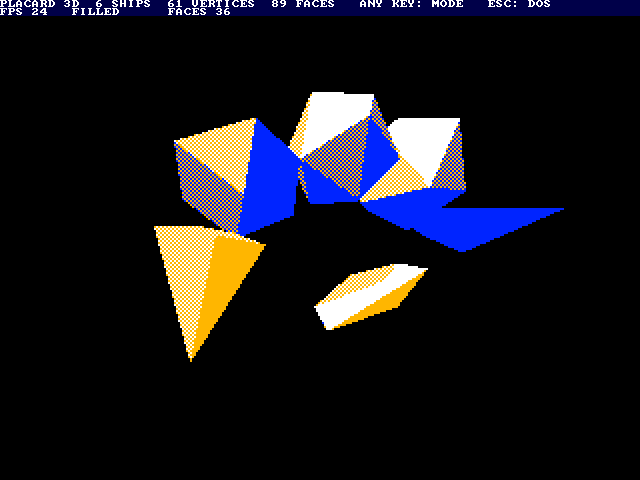

# 3D ships: wireframes and filled faces (Elite style)

`sdcard/WIRE3D.PLC` is a 3D demo in the style of the BBC Micro's Elite:
six convex ships (a station, a freighter, two darts and two rocks) tumbling
and flying in front of a fixed camera.  It switches between two modes
every 10 seconds, or at once when a key is pressed:

- **wireframe**: white lines on black with hidden lines removed;
- **filled**: every face that looks at the camera filled in one of five
  shades by its angle to a light, ships painted far to near so a nearer
  ship hides a farther one.

It is a library program for the SD card (run it from the DOS's file
browser; Esc goes back), made by `src/scripts/gen_wire3d.py`, and also a
benchmark: `src/scripts/test_wire3d_sim.py` runs it in `placard_sim.py`,
checks every frame pixel for pixel against a Python model of the same
integer arithmetic, and times each part.

Date: 10/28/2026




## The limits

Measured in the simulator with the video stall clocks modeled (25.175 MHz,
2 bpp 2x picture, about 10 % of the clocks lost to video reads), built with
no frame cap (`--pace 0`).  "Slowest" is the slowest single frame (5 and 6
ships filled: over 400 frames, a whole cycle of the paths; the others over
40-60 frames).

| Ships | Vertices | Faces | Wireframe fps (slowest) | Filled fps (slowest) |
|------:|---------:|------:|------------------------:|---------------------:|
| 4 | 37 | 49 | 99 (88) | 36 (34) |
| 5 | 49 | 69 | | 29 (24.8) |
| **6 (the demo)** | 61 | 89 | 63 (60) | 23 (20.1) |
| 7 | 68 | 99 | | 21 (20.0) |
| 8 | 79 | 114 | 49 (47) | 18 (17) |

**The demo uses 6 ships.**  Filled mode is what limits it: with 6 ships
its slowest frame over a whole cycle of the ships' paths (400 frames) is
20.1 fps, while 7 ships touch 20.0 fps within the first 40 frames and 8
fall below it.  With 5 ships the slowest frame is 24.8 fps.  Wireframe mode with
the same 6 ships is held at the 30 fps cap with about half the CPU to
spare.  The build caps both modes at 30 fps (`--pace 2`), so filled mode
runs at 20-30 fps as the ships come and go.

Wireframes alone could carry about 12 ships like these at 30 fps (below),
but the program's code space (x0100-x1EFF is nearly full) only fits 8
ships' path code; more would need the paths moved into
data.

### Wireframe cost

    clocks a frame ≈ 860 a vertex + 270 a face + 940 a line drawn
                     + 103 a pixel of line + 8,000 a ship

(a pixel is drawn once and erased once the next frame, about 51 clocks
each time.)  A frame has 1,259k clocks at 20 fps, 1,007k at 25 fps and
839k at 30 fps, so with ships like these:

| Target | Vertices | Lines | Line pixels | Ships like the demo's |
|-------:|---------:|------:|------------:|----------------------:|
| 30 fps | about 125 | about 150 | about 4,200 | about 12 |
| 25 fps | about 150 | about 180 | about 5,000 | about 15 |
| 20 fps | about 190 | about 225 | about 6,300 | about 19 |

Where the time goes with 6 ships:

| Part | Share | Per unit |
|------|------:|---------|
| Draw the new lines | 26 % | 35-54 clocks a pixel |
| Erase the old lines (draw them again) | 26 % | the same |
| Line set-up (a record per line) | 17 % | 940 clocks a line |
| Transform and project | 13 % | 860 clocks a vertex |
| Face product tables | 6 % | about 4,000 clocks a ship |
| Faces (hidden lines) | 6 % | 266 clocks a face |
| Camera in the ship's space | 4 % | about 2,650 clocks a ship |
| Matrix | 1 % | 740 clocks a ship |

The line loops alone (`bench_lines` in the test), clocks a pixel with
stalls: horizontal 33, shallow (1:4) 38, diagonal 51, steep (4:1) 54,
vertical 53.

### Filled cost

Where the time goes with 6 ships (1,059k clocks a frame on average):

| Part | Share | |
|------|------:|---------|
| Fill the faces | 44 % | 6 clocks a whole byte in the unrolled run; the edge steps and masked end bytes of each row cost more than the run on small faces |
| Outline (the rows each ship covers) | 23 % | about 40k clocks a ship |
| Erase (blank the old outline not under the new) | 18 % | about 32k clocks a ship |
| Transform, tables, faces, camera, lights | 13 % | |
| Text band, menu_poll, sort | 3 % | |

The cost goes with the area on the screen: a ship close to the camera
costs mostly fill, and a ship far away mostly its per-ship work.  The
painter's order (every face seen is painted, far ships first) means a
covered face is still painted.

### What was done for speed

- **Faces, the Elite way**: the camera is moved into each ship's own
  space once (9 log multiplies), and a small table of the products of
  each normal component the model has with the camera's coordinates is
  made per ship; a face is then three look-ups, two adds and a compare:
  266 clocks a face instead of 717.
- **Camera as a loop** and the text band's mode bytes as a loop: smaller
  code, room for the filled mode.
- **Spans**: a span routine without the clipping tests (`span_f`) for faces
  whose vertices are all well inside the picture (the edge steps cannot
  then leave it), the clipping one (`span_c`) only for the others; the
  masked end bytes use one mask page each way; whole bytes through an
  unrolled filler at 6 clocks a byte.
- **Outline**: an edge on the outline only moves the side of the row it is
  on (left or right of its face), an edge between two faces seen both.

### Headroom left

- **Outline and erase** are 40 % of a filled frame.  Building the outline
  from the faces' own rows while filling them, or blanking whole old
  rows with the unrolled filler, could save perhaps half of that.
- **Line set-up**: about a third could go (a log of a 9-bit number is two
  look-ups and a page add each time; the records are written field by
  field through Y).
- **Overdraw**: a face fully behind a nearer ship is still painted; a
  coarse test against the nearer ships' outlines would skip it.

Without a second picture buffer the filled ships do not flicker inside
(no pixel inside a ship is ever blanked), but a face being painted over
another shows the old one for part of a frame.

## How it works

The BBC Micro Elite way, adapted to the Placard (`gen_wire3d.py` has the
details in its docstring):

- **Picture**: 320 × 240, 2 bpp, 2x line repeat (square pixels); the top
  16 screen rows are a 1 bpp text band (title, frames a second, mode,
  lines or faces drawn).  The demo caps itself at 30 fps (`--pace 2`).
- **Orientation**: three angles a ship, turned a little each frame; the
  matrix comes from a sine table with 14 multiplies (1.0 = 63).
- **Multiply**: quarter squares, a × b = q(a + b) − q(a − b), with one
  256-byte table a scale.  A product is 8 instructions, 32 clocks (the
  library's `mul8` is about 500).  Vertices of the models come in mirror
  pairs, so a rotated vertex is often the previous one less twice one
  column: 3 subtractions instead of 9 multiplies.
- **Projection**: screen x = 160 + X × K / Z (K = 96) with logarithms: a
  512-entry table of 256 log2(n) + 4096 (so log 0 is far below everything)
  and 8 antilog pages, one per octave of the result.  A divide is a 16-bit
  subtract and two look-ups; Z's log serves both x and y.
- **Hidden faces**: a face looks at the camera when n · c > n · p, with c
  the camera's position in the ship's space (above).  An edge is drawn when
  either of its faces is seen.  The models are convex, so this removes
  every hidden line of a ship.  Ships do not hide each other in wireframe
  mode.
- **Lines**: each visible edge becomes a record (entry address, byte
  column page, row, error, slope, end).  The slope is 256 × minor / major
  from the log tables, so there is no divide.  Unrolled loops, one copy for
  each of the four pixels of a byte, XOR the pixel.  The next frame runs
  each ship's old records again, just before drawing its new ones, as
  Elite does: no screen clear and no double buffer.  Where two lines cross
  the XOR leaves a gap of a pixel.
- **Filled faces**: an edge's x is a 16-bit value (x × 64 + 32) stepped by
  a slope from the log tables.  A face is filled row by row between its
  left and right chains of edges; shared edges are stepped the same way, so
  faces meet without gaps.  Shades: blue, blue/gold, gold, gold/white and
  white (the 2 bpp palette and two dither patterns) by n · light.
- **Erasing filled ships**: each ship keeps its outline of the last frame
  (left and right x of every row, in the even video pages that the 2x
  picture does not show); first every ship blanks the part of its old
  outline that its new one does not cover, then the ships are painted far
  to near (sorted by depth).
- **Clipping**: a vertex that would project off the picture, or nearer
  than Z = 48, is marked invalid; its edges are not drawn, and in filled
  mode the whole ship is left out that frame (Elite clips instead).
- **Mode switch**: on a key (`kbd_getc`) or after 10 seconds the program
  clears the picture, resets each ship's old lines or outline, and builds
  the filled mode's tables (the unrolled filler, masks) when entering it.
- **Memory**: code at x0100-x1EFF and x2000-x22FF, tables and models at
  x2300-x3FFF, line records or the filled mode's pages at x4000-x4FFF,
  projected vertices and visible faces at x5400-x59FF.  It runs with map FF
  to read the video RAM and switches to map 07 only for the library
  (`kbd_scan`, `kbd_getc`, `menu_poll`, `con_puts`, `con_dec8`).

## Files and commands

```
cd src/scripts
python3 gen_wire3d.py                       wire3d.masm, wire3d.asm, ../../sdcard/WIRE3D.PLC, wire3d_rom.asm/.hex
python3 gen_wire3d.py --ships 8 --pace 0 -o /tmp/w8.masm --plc none
python3 test_wire3d_sim.py                  both modes, no cap: checks and timing
python3 test_wire3d_sim.py --mode 1 --ships 7   filled only, 7 ships (1-8 fit)
python3 test_wire3d_sim.py --pace 2 --secs 2 --frames 110 --gif ../../reference/wire3d_sim.gif
python3 test_wire3d_sim.py --rom            the ROM build from power-up
```

For testing on the board without the SD card, `build\wire3d.bat` loads a
temporary 64K development image, `src/scripts/wire3d_rom.asm` (made by
`gen_wire3d.py`): a stub at x6000 copies the program from ROM x8000-xBEFF
into RAM x0100-x3FFF (leaving LIB_RAM alone), sets map 07 as the DOS does
and runs it.  There is no DOS then, so Esc does nothing; any key still
switches the mode.
