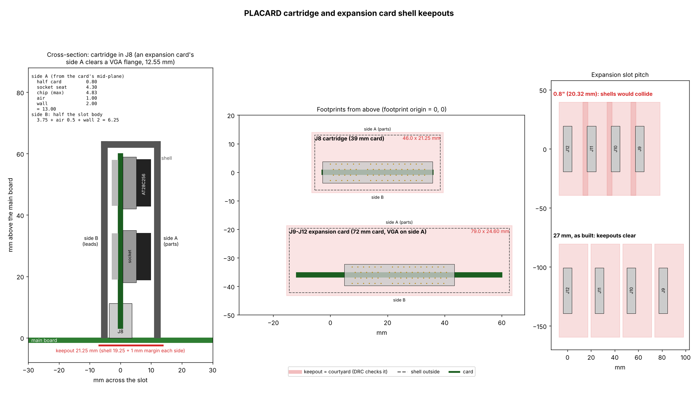
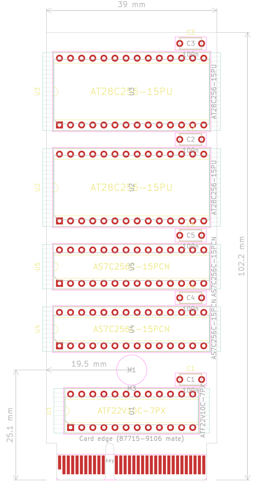
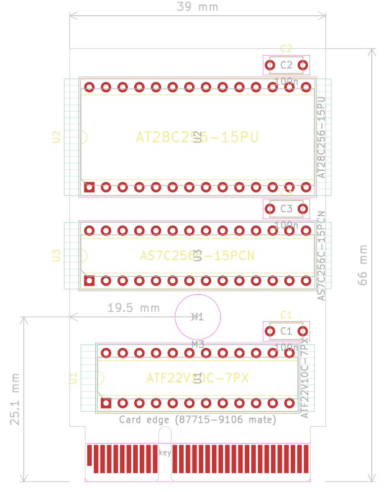

# Expansion slots and ROM cartridge slot

Date: 2026-11-11

The Placard has four expansion slots and one ROM cartridge slot, all the
same keyed 2 x 32, 1.0 mm pitch socket (Molex 87715-9106, "ROM cartridge
slot" below).  The expansion slots stand in a bay at one back corner, front to back at 1.05"
(26.67 mm) pitch or more ("Shell keepouts" below), so a card's outer end can carry its own connector at the back edge,
like a PC card.  Slot 1 (J9) is the one nearest the middle of the board
and slot 4 (J12) the outermost.
The cartridge slot is top loading, inboard.  Board sizes
are in `hardware/pcb_size_estimate.md` (project files).

No chips are added for the slots: they are wired straight to the buses.
Slot 1 can also boot the machine when no cartridge is fitted ("Booting
from slot 1" below).

## Expansion slot addresses

Each slot has its own select, /EXP1 to /EXP4 on contact A16 (I/O decode
PLD revision 07), low for any access to that slot's 128 bytes.  So the same
card works in any slot without a jumper and needs no address decode of its
own.

| Slot | Select | Addresses |
|---|---|---|
| 1 | /EXP1 | x5100-x517F |
| 2 | /EXP2 | x5300-x537F |
| 3 | /EXP3 | x5180-x51FF |
| 4 | /EXP4 | x5380-x53FF |

A card has 128 addresses (A6:A0).  The addresses are the same as before
revision 07, when slots 1 and 3 (and 2 and 4) shared one select and each
card compared A7 with a SEL contact; SEL and its resistors R51-R54 are
gone, and contact A10 carries Q0 instead.

The selects are decoded from the Y register, not from the address bus: an
I/O address is only reached through [Y,X], so the decode takes Y7:Y0, X7
(A7 of [Y,X]) and the address mux selects (PIXEL_ENABLE, PC_ENABLE,
Y_ENABLE), which are all settled when the address is.  /EXPn is valid with
the address (about 13 ns into the clock, 20.5 before revision 07), and it
never glitches while the address mux output settles.  `[Y,D]` to a slot is
not supported (the slot half follows X7, not D7); instruction fetches never
select a slot, so card code runs from RAM (the boot header below).

## Boot code on a card

Like an Apple II card, a card can change the boot.  At power-up the boot
loader (`src/scripts/rom_boot.asm`) looks at slots 4, 3, 2 and 1 before it
starts the program.  A card that wants to run code at boot starts with
this header in its first bytes (offsets from the slot's base address):

| Offset | Holds |
|---|---|
| 00-02 | "PLC" (50 4C 43) |
| 03 | Card ID, 1-255 (pick one; 0 means none) |
| 04 | Boot code length n, 1-90 (0 = no boot code, the card is only named) |
| 05 | Checksum: the sum of the n code bytes, mod 256 |
| 06-5F | The boot code |
| 60-7F | Free for the card's registers |

For each slot whose header and checksum are good, the boot loader copies
the n code bytes to RAM x0100 and calls them with the library's CALL, with
AC = the slot number (1-4), R1:R0 = the slot's base address, SP = FE and
`MAP_SHADOW` = 01 (map 01: the zero page reads RAM, the rest ROM).  The
code may use the library and the I/O drivers; it is built without the
library source, so it calls them through the jump table at xFB00, whose
entries never move ([LIBRARY.md](../software/LIBRARY.md#jump-table)).  It then either:

- **returns**, and the scan goes on with the next slot and then the normal
  boot (a card that only sets itself up, or adds a device), or
- **never returns**, and takes the boot over: it can load a program from
  its own memory or from the SD card (`fs_load`), copy its own ROM, and so
  on.

Its code must keep zero page xFF (the slot being scanned), leave map 01
when it returns, and keep section 7 reading the ROM (the scan runs there).
90 bytes is enough for a loader that reads more of the card through its
registers.  **Holding Esc at power-up skips the cards**, to get past a card
whose code hangs: when the scan finds a valid card it first gives a PS/2
keyboard about a second to send Esc (ROM.md "Boot").

An empty slot fails the "PLC" check: with nothing driving the read bus it
reads FF from the pull-ups below, or, if the bus has not risen yet, the
last byte on it, which is the scan's own `ld [y,x], ac` opcode (09).  A program can find cards later with the
library's `slot_id` (AC = slot 1-4 gives AC = card ID or 0, R1:R0 = base
address).

**Read bus pull-ups.**  D7:D0 get 10k pull-ups to +5 V on the main board
(one 9-pin bussed 10k SIP network; not a chip, no PLD logic), so an empty
slot or an unused I/O address reads FF rather than a floating level.  They
only set the level when nothing drives the bus and do not slow a driven
read.  The simulator reads an empty slot as FF.

## Expansion slot pinout

The slot is the cartridge's connector: 64 contacts,
1.0 mm, through-hole, key between contacts 11 and 12, for a 1.57 mm card
with gold fingers and a bevelled edge.  Side A is the card's component
side.  Contact 1 is at the end nearest the back edge of the main board.

Odd contacts are the two outer rows of the socket's pins, even contacts
the two inner rows.  For easier routing the extra
grounds are on inner contacts and the signals are on outer ones wherever
the cartridge's pinout lets them be: 19 of the 38 signals are outer.  The
cartridge puts its ground on contacts 1, 11, 21 and 31 and its +5 V on 2,
so those stay where they are, and the signals that must match the cartridge
(the address lines, CLK, PIXEL_ENABLE, BT1/STALL_IN, BT3/PC_ENABLE) keep
its contacts, inner or outer.  The others went to the cartridge slot's
spares, outer first.

| # | Side A | Side B |
|--:|---|---|
| 1 | GND | GND |
| 2 | +5 V | +5 V |
| 3 | A14 | A12 |
| 4 | A7 | CLK |
| 5 | A15 | *open* |
| 6 | A13 | *open* |
| 7 | PIXEL_ENABLE | A6 |
| 8 | A8 | BT3 |
| 9 | A9 | A5 |
| 10 | Q0 | *open* |
| 11 | GND | GND |
| | *key* | *key* |
| 12 | GND | BT1 |
| 13 | A11 | D1 |
| 14 | A4 | BT2 |
| 15 | A3 | D2 |
| 16 | /EXP | RW |
| 17 | A2 | D3 |
| 18 | A10 | GND |
| 19 | A1 | D4 |
| 20 | LOAD_IMM | /RESET |
| 21 | GND | GND |
| 22 | A0 | *open* |
| 23 | D0 | D5 |
| 24 | *open* | /WE |
| 25 | *open* | D6 |
| 26 | /HSYNC | GND |
| 27 | *open* | *open* |
| 28 | /VSYNC | BT5 |
| 29 | *open* | D7 |
| 30 | *open* | GND |
| 31 | GND | GND |
| 32 | *open* | GND |

| Signal | Direction | Meaning |
|---|---|---|
| D7:D0 | card drives on its reads | The CPU's read bus (into the D register) |
| BT1-BT3, BT5 | | Boot contacts.  Slot 1: BT1 STALL_IN, BT2 STALL_OUT, BT3 PC_ENABLE, BT5 /CART ("Booting from slot 1").  Slots 2-4: not connected.  An ordinary card leaves all four unconnected |
| A15:A0 | to card | The address bus |
| PIXEL_ENABLE | to card | The video read: high for the one clock in which the video circuit reads a byte (Sync PLD pin 19) |
| /HSYNC, /VSYNC | to card | The sync outputs of the H counter and Sync PLDs, before the 47-ohm VGA resistors R61/R62 |
| /EXP | to card | The slot's own select, /EXP1-/EXP4, address only: low for any access to the slot's 128 bytes (from the Y register, valid with the address) |
| Q0 | to card | State PLD state bit 0 (pin 18): 0 in the LOAD_MEM clock, the clock of every I/O read.  A card's read enable (an SRAM's /OE) |
| RW | to card | 1 = read cycle |
| LOAD_IMM | to card | 1 when the CPU latches the read bus into D (the State PLD's strobe, stall clocks already excluded) |
| /WE | to card | The write pulse, low in the low half of a write clock (about 20 ns).  10k pull-up: the Sync PLD lets go of it while RUN is low, and a boot card in slot 1 drives it then |
| CLK | to card | The 25.175 MHz CPU clock |
| /RESET | to card | RUN from the ROM cartridge: low from power-up until the cartridge has loaded the ROM and lets the CPU run (ROM.md, "Loading the cartridge").  With no cartridge, a boot card in slot 1 drives it |
| +5 V, GND | | 2 power (1.1 A each) and 13 ground contacts: the cartridge's 2 and 8, plus 5 inner grounds (A12, B18, B26, B30, B32) on contacts that are spares in the cartridge slot |
| *open* | | Not connected on the main board; a card leaves them unconnected too |

**A cartridge in an expansion slot, or a card in the cartridge slot, does
no harm.**  The two connectors are the same and keyed alike, so either fits
the other's slot.  So:

- Power and ground are on the same contacts in both pinouts.
- Every contact a cartridge drives (its D7:D0 at A24, A25, A27, A29, A30,
  A32, B22 and B27, STALL_OUT B5, RUN B6, and /CART B10, grounded on the
  cartridge) is *open* in an expansion slot, so it drives nothing.  The
  cartridge's inputs only see expansion signals (B16, the cartridge's
  /CE_HI, carries RW, so a cartridge's chips may turn on, but their
  outputs reach only open contacts).
- Everything an expansion card drives (D7:D0, and a boot card's STALL_OUT,
  /RESET and /WE) is on a contact that is a spare in the cartridge slot,
  so in J8 it drives nothing either.  The 5 extra grounds are on spares
  too.
- The address lines, CLK and PIXEL_ENABLE are on the same contacts as on
  the cartridge.

## Building a card

**The plain card: an SRAM.**  With its own select valid with the address
and Q0 on the slot, a 15 ns SRAM needs no other parts:

    SRAM /CE = /EXPn (A16)     /OE = Q0 (A10)     /WE = /WE (B24)
    SRAM A6:A0 = A6:A0         D7:D0 = D7:D0      unused address pins to GND

It reads in the LOAD_MEM clock (Q0 = 0, /EXPn low) and writes with the
board's /WE in EXEC (Q0 = 1, so its outputs are off).  A card with more
than 128 bytes adds a page register (a 74HC574 written at one of its
addresses, CP from /EXPn and /WE through a gate, or a card PLD) on the
upper address pins.  The card timing below is checked with this card.

**Writes.**  A card's write strobe is `/EXP low and /WE low` (plus any
A6:A0 register select).  Latch D7:D0 on the strobe's rising edge, at the
end of /WE, as the RAM and the main board's devices do.  The board has
one data bus (CPU.md, "One data bus"): in a write the source F541s drive
it, through the 47-ohm series resistors, from the start of EXEC until
about 6.5 to 19.5 ns after the clock edge that ends it, and /WE rises
within 4.5 ns of that edge.

**Reads.**  A read is the LOAD_MEM clock: drive D7:D0 while /EXPn and Q0
are both low.  /EXPn and Q0 are valid early in the clock (13 ns and
about 6 ns plus track), so a card can put an SRAM, a 74F541 or a PLD output
straight on the bus.  A card PLD output that drives the bus directly
(with an output enable term) uses /EXP and Q0 in that same term.  Q0 also
is 0 in FETCH, but /EXPn is high there, so `/EXPn = 0 and Q0 = 0` is a read
of the card and nothing else.  The card keeps driving the bus for its
output-disable time after Q0 rises at the start of EXEC, while the source
F541s turn on through their 47-ohm resistors; the board's own line read
F541 (/OE2 = Q0) does the same.  A card that wants none of that overlap
gates its /OE with CLK (reads then use only the low half of the clock, like
the main RAM: still in time for a 15 ns SRAM with tOE 7 ns).

### Card timing

A card that keeps within these delays, measured at its own edge fingers,
works in every slot at 25.175 MHz, with a 45 to 53 % clock and 0.5 ns to
spare.  The main board's side (its tracks to the slots, the clock skew,
the decode) is held by the router's length budgets
(`src/scripts/router_v4/budgets.py`, checks `slot_*`), so a card designer
only needs this table:

| Card delay, fingers to fingers | Limit | Reference part (AS7C256C-15 SRAM) |
|---|---:|---|
| Read: /EXPn falling to D7:D0 valid | at most 16.0 ns | tACE 15 + 1 ns of card track |
| Read: A7:A0, RW, LOAD_IMM to D7:D0 valid | at most 16.0 ns | tAA 15 + 1 |
| Read: Q0 falling to D7:D0 valid | at most 8.0 ns | tOE 7 + 1 |
| Write: /EXPn, A7:A0, RW to the card's write select ready | at most 13.0 ns before /WE rises | tCW 12 + 1 |
| Write: D7:D0 setup before /WE rises | needs at most 9.0 ns | tDW 8 + 1 |
| Write: D7:D0 hold after /WE rises | needs at most 2.0 ns | tDH 0, 2 ns to spare |
| Write: A7:A0, /EXPn hold after /WE rises | needs at most 2.0 ns | tAH 0, 2 ns to spare |

So the reference card is the plain SRAM of "Building a card":

    SRAM /CE = /EXPn, /OE = Q0, /WE = /WE, A6:A0, D7:D0

and anything at least as fast fits too: a 74F541 or 74F245 read buffer
(enable 9.5 ns), a 74F377 or 74HC574 write register, a 7.5 ns card PLD
between the slot and an SRAM's /CE (16.0 - 7.5 leaves 8.5 ns, so then use a
faster SRAM or read through a register).

Before revision 07 of the I/O decode PLD, /EXP came one PLD pass later
(20.5 ns) and the same SRAM missed by 3.5 to 4.5 ns, so cards had to read
ahead through a register.  A card can still work that way (the SD card,
keyboard and pad ports on the main board do), but it no longer has to.

On the board of 2026-11-03 (I/O decode revision 07, checked with the
plain SRAM card budget) the slot checks are: read +3.41 ns, write select
+12.7 ns, write data setup +4.26 ns, data hold +1.37 ns, select hold
+2.05 ns, the same with a 45 % and a 53 % clock.

**Load.**  The slots are unbuffered and every bus line reaches all four.
Give each line one input (or one 3-state output) on a card, keep traces
short, and keep the card's read buffer close to the edge fingers.

**Reset.**  /RESET is only one clock long.  A card that needs a reset makes
its own: a 22V10's registers clear at power-up, and other parts need an RC
power-on reset or a reset register the software writes.

**Power.**  The two +5 V contacts are rated 1.1 A each, 2.2 A together.
Keep each card well under that, since the four slots share the main
board's supply.

**The card.**  The fingers are those of the cartridge (the
`Card_Edge_87715-9106` footprint, PCI Express x4 card pattern, key notch
between contacts 11 and 12), centred on a card up to 72 mm wide, the width
the 2 x 20 slot gave, so there is room for chips beside the connector.

## Video capture cards

A card can copy the picture, for example to drive an HDMI output: every
byte the video circuit shows is read from the RAM onto D7:D0, and every
slot carries what a card needs to catch it:

- **PIXEL_ENABLE** (A7) is high for the clock of each video read.  Latch
  D7:D0 and A15:A0 on the rising CLK edge at the end of that clock, the
  same edge on which the pixel buffer takes the byte.
- **The address** says which byte it is: A15:A9 = H9:H3, the byte column
  (groups 48-127 are the 80 pixel bytes of a line), A8:A0 = the row
  address (VIDEO.md, "Line repeat").  The mode byte read in group 45 is at x5A00 + V8:V0, not remapped by the line
  repeat, so it also gives the line's number, and its data is the line's
  mode (bpp, line repeat, tint, blank).  The audio sample read follows in group 46 or 47.
- **CLK** is 25.175 MHz, the 640 x 480 pixel clock (800 x 525 per frame),
  so a card can send the same timing over HDMI from a line buffer, with
  the palette of the color decoder (COLORS.md) in a lookup table.
  **/HSYNC** and **/VSYNC** (A26, A28) give it the line and frame edges
  directly.

A card can also follow CPU writes to keep its own copy of the screen
(/WE with A15:A0 and D7:D0).  It reads nothing back, so it needs no read
buffer or /EXP decode.

## Booting from slot 1

With no cartridge in its slot, a **boot card** in slot 1 can load the main
RAM and start the machine.  It works like the cartridge's loader (ROM.md,
"Loading the cartridge"), with the main RAM in place of the cartridge's
SRAM:

1. From power-up the card holds STALL_OUT high at each PC address (FETCH
   and LOAD_IMM, PC_ENABLE high), reads the byte from its EEPROM, puts it
   on D7:D0 and pulses the RAM's **/WE** (the Sync PLD, which makes /WE,
   lets go of it while RUN is low), then releases the CPU for one
   step.  The IR holds 02h, so the CPU only walks the addresses.  The card
   skips the video read clock (PIXEL_ENABLE) and writes nothing in the I/O
   window x5000-x53FF.
2. When the PC wraps from xFFFF to x0000 the card raises **RUN**.  The map
   is then 00 (all ROM), and there is no ROM, so the card keeps stalling
   each PC read and feeding the CPU the EEPROM's byte, without /WE, until
   it sees the CPU's **first write** (/WE low from the Sync
   PLD).
3. The image's first write is the map write: x0000 is the 1-byte `nop`
   (02h) as on the cartridge, and the code from x0001 loads registers
   (immediates only: no memory reads, no ADD/SUB) and writes map = FF, all
   RAM.  The card then lets go, and STALL_OUT follows STALL_IN.  The CPU
   goes on from the same bytes in the RAM.

The load takes about 33 ms, as the cartridge's does.

**Slot 1's boot contacts** (slots 2-4 leave them unconnected):

| Contact | Signal | Direction | Notes |
|---|---|---|---|
| B12 (BT1) | STALL_IN | to card | the Branch PLD's STALL (pin 19), as on cartridge B12 |
| B14 (BT2) | STALL_OUT | from card | to the State PLD and PC PLDs, joined to cartridge B5 (10k pull-up) |
| B8 (BT3) | PC_ENABLE | to card | State PLD pin 15, as on cartridge B8 |
| B28 (BT5) | /CART | to card | cartridge B10: low when a cartridge is fitted (10k pull-up) |

Slot 1 also uses /RESET (RUN, B20) and /WE (B24) as outputs while it boots.

**A cartridge always wins.**  The card drives STALL_OUT, RUN and /WE (and
its EEPROM onto D7:D0) only while /CART is high.  So:

| Cartridge | Boot card in slot 1 | What boots |
|---|---|---|
| fitted | either | the cartridge, as before.  The card is an ordinary card afterwards (a "PLC" header lets the boot's card scan find it) |
| none | fitted | the boot card, from main RAM |
| none | none | nothing: STALL_OUT's pull-up keeps the CPU stalled (or the bring-up jumpers, BRINGUP.md) |

**Building a boot card** (3 chips, nothing designed yet):

- A loader PLD (ATF22V10C-7): the cartridge PLD's equations
  with /CART on every output enable, /WE in place of the SRAM's /WE, the
  I/O window left out of /WE, and the feed of step 2.  PREV15 has no job
  after the wrap, so it can hold the "feed until the first write" flag and
  the design still fits 10 cells.  A -7 part (every PLD is one) leaves
  the STALL path about +7 ns, which covers the longer trace to
  slot 1.  /WE goes back into the PLD through its pin feedback.
- A page counter PLD: A15:A8 for the EEPROM, the wrap and the I/O window
  check, stepped when a copy at A7:A0 = FF ends (the PC walks every
  address in order from x0000).  A7:A0 come from the slot.  A 74HC4040
  ripple counter settles about 130 ns too late at a page boundary.
- An AT28C256: a 32K image, seen in both halves of the RAM.

**No ROM.**  A machine booted this way runs from RAM only, and x6000-xFFFF
is the screen, so a program and its library get about 20 KB (x0100-x4FFF
and the free parts of x5400-x5FFF), less any screen area it leaves unused.
The standard library runs in place from the cartridge ROM at x8000-xFFFF
and can't be used as it is.  A boot card can carry a small program, or a
loader that loads one from the SD card or the card's own hardware.

## ROM cartridge slot

The ROM (two AS7C256C 32K x 8 SRAMs, loaded at power-up from two
AT28C256 EEPROMs on the same cartridge, ROM.md "Loading the cartridge";
one of each on the 32K cartridge) is on a plug-in cartridge.  The cartridge gets the address and data
lines and the same chip selects the ROM chips have on the main board.

The connector is a Molex 87715-9106: 64 contacts (2 x 32) at 1.0 mm
pitch, through-hole, vertical, for a 1.57 mm (0.062") card, the PCI
Express x4 socket.  Its key sits between contacts 11 and 12, so a
cartridge only goes in one way.  Each contact is rated 1.1 A.  The
cartridge needs gold fingers at 1.0 mm pitch, a bevelled edge and the key
notch.  Side A and side B are the two faces of the card; contacts 1-11
are the short section before the key and 12-32 the long one after it, as
on a PCI Express x4 card.

| # | Side A | Side B |
|--:|---|---|
| 1 | GND | GND |
| 2 | +5 V | +5 V |
| 3 | A14 | A12 |
| 4 | A7 | CLK (25.175 MHz board clock, to the cartridge) |
| 5 | /CE_LO (A15 from the address mux: lower chip) | STALL_OUT (from the cartridge to the State and PC PLDs, 10k pull-up on the main board) |
| 6 | A13 | RUN (from the cartridge, pull-down on the main board) |
| 7 | PIXEL_ENABLE (to the cartridge) | A6 |
| 8 | A8 | PC_ENABLE (State PLD, to the cartridge) |
| 9 | A9 | A5 |
| 10 | spare | /CART (GND on the cartridge: one is plugged in) |
| 11 | GND | GND |
| | *key* | *key* |
| 12 | spare | STALL_IN (the branch PLD's STALL, to the cartridge) |
| 13 | A11 | spare |
| 14 | A4 | spare |
| 15 | A3 | spare |
| 16 | /ROM_OE (memory control PLD) | /CE_HI (I/O decode PLD: upper chip) |
| 17 | A2 | spare |
| 18 | A10 | spare |
| 19 | A1 | spare |
| 20 | spare | spare |
| 21 | GND | GND |
| 22 | A0 | D7 |
| 23 | spare | spare |
| 24 | D0 | spare |
| 25 | D6 | spare |
| 26 | spare | spare |
| 27 | D1 | D5 |
| 28 | spare | spare |
| 29 | D2 | spare |
| 30 | D4 | spare |
| 31 | GND | GND |
| 32 | D3 | spare |

Two +5 V contacts (2.2 A together), a GND on each side every ten
contacts (8 in all), 33 signals and 21 spares (A10, A12, B13-B15,
B17-B20, A20, A23, B23-B26, A26, A28, B28-B30, B32), kept for programming
the EEPROMs in place, battery charging, card detection and other
functions (not assigned yet).

The contacts are in the order of the pins they go to on the cartridge,
not in bus order: the cartridge's loader PLD sits right
behind the fingers, and with the address lines in bus order the
autorouter could not get them past it.  Each side's signals now leave the
fingers in the order of the chip pins they reach (side A on the component
side of the card, side B on the solder side), which is what let both
cartridge boards route on four layers.  The main board's J8 uses the same
contact numbers.

- D7:D0 is the memory data bus that the RAM also drives.  The ROM chips'
  timing on the cartridge is the same as on the main board, plus the
  connector, so keep the cartridge's traces short.
- **CLK** is at B4, two contacts from the GND pair at 1 and the +5 V pair
  at 2, so its return path is short.
- **/CART** lets the main board tell an empty slot: with no cartridge, a
  10k pull-up reads high.  It goes to slot 1's BT5, so a boot card there
  only boots the machine with no cartridge ("Booting from slot 1").  With
  neither, STALL_OUT's pull-up keeps the CPU stalled, so the board needs a
  cartridge, a boot card (or the STALL and RUN jumpers, BRINGUP.md) to
  start.
- **The loader** (ROM.md "Loading the cartridge") needs CLK,
  PIXEL_ENABLE, PC_ENABLE, STALL_IN, STALL_OUT and RUN.  The cartridge
  stalls the CPU through STALL_OUT while it copies each byte; the
  instruction register PLD holds 02h (`ld ac, ac`) while RUN is low.
  The cartridge makes its SRAMs' /WE itself.

## Shell keepouts

Cartridges and expansion cards are enclosed in shells whose edges come
down to the main board surface, so nothing else may stand inside a
shell's outline.  The keepout is the courtyard of the slot footprints
(J8 `Molex_87715-9106_PCIe_x4_Vertical`, J9-J12
`Molex_87715-9106_Expansion_Slot`), so KiCad's courtyard check flags any
part, or a neighbouring slot's shell, inside it.  Tracks, vias and copper
pours may run under a shell.  The same box is drawn on User.Eco1 with a
label, beside the chip-puller boxes.  The numbers are constants in
`src/scripts/gen_kicad_connectors.py` (`shell_box()`), and
`src/scripts/gen_shell_keepout.py` draws `docs/hardware/shell_keepout.png`.

**Height of a card** (across the slot, from the card's mid-plane).  The
tallest part is a socketed 28-pin DIP: the AT28C256 ROMs on the
cartridge.  An expansion card may carry its own connector at its outer
end, so its side A clears a right-angle VGA (DE-15) connector instead:
the flange is 12.55 mm tall, taken as standing from the card face, so
side A is 0.8 + 12.55 + 1.0 air + 2.0 wall = 16.35 mm.  Parts go on side
A; side B carries only trimmed leads.

| Side A (parts) | mm | Side B (leads) | mm |
|---|--:|---|--:|
| Half the card (1.6 mm) | 0.8 | Half the slot body (7.5 mm wide, J8 and J9-J12) | 3.75 |
| Socket seat (dual-wipe or machined, chip shoulders rest on it) | 4.3 | (half card 0.8 + leads 2.0 = 2.8 is less) | |
| AT28C256 PDIP-28, max above its seating plane (28P6) | 4.83 | | |
| (socket + chip 9.13, rounded up to 9.2) | 0.07 | | |
| Air over the chips | 1.0 | Air | 0.5 |
| Shell wall | 2.0 | Shell wall | 2.0 |
| **Shell, side A** | **13.0** | **Shell, side B** | **6.25 / 7.45** |

The shell's skirt goes round the slot body, so on side B it is set by the
slot, not the card.  A ZIF socket does not fit; the 100n disc capacitors
are lower than a socketed chip (bend one over if it stands taller).  Each
side of the keepout adds 1 mm for the shell's placement tolerance.

**Length.**  The cartridge's chips lie horizontally (long side along the
fingers), stacked one above another, so the card is as wide as J8's body
(39 mm): the widest courtyard, a 28-pin socket, is 36.25 mm, and the
shell's skirt has to go round the 39 mm slot anyway.  The chip-puller
room at each socket end may hang past the card edge (the shell comes off
to change a chip).  The card is centred on the middle of J8's contacts.
The 64K and 32K cartridges are two boards, placed
by `src/scripts/gen_kicad_cart_pcb.py` in
`kicad/cartridge_64k/cartridge_64k.kicad_pcb` (5 chips, 39 x 102.2 mm)
and `kicad/cartridge_32k/cartridge_32k.kicad_pcb` (3 chips: U1 loader
PLD, U2 EEPROM, U3 SRAM; 39 x 66.0 mm), finger tab included (8.4 mm,
KiCad's PCIe card edge).  Bottom to top: the fingers, U1, the mounting
hole, the SRAMs, the EEPROMs.  An M3 hole (H1) on the card's centre line,
in the row gap right above U1, screws the card to its shell; the gap is
7.9 mm (the hole's 6.9 mm courtyard, room for the screw head or the
shell's boss).  Because everything below the gap is the same on both
boards, H1 is at the same place on both: 19.5 mm from the card's left
edge and 25.1 mm above the finger edge, so one shell design takes either
card (only its height differs).  The boards are 4 layers, 1.57 mm, and routed; the placement
script leaves an existing board file alone unless run with `--force`.  An expansion card is 72 mm
wide (room for chips), with the 39 mm Molex connector's fingers in its
middle.  The footprint `Molex_87715-9106_Expansion_Slot` puts the
connector 7.63 mm from its origin.  The shell adds 0.5 mm
air and a 2 mm wall each end, and the keepout 1 mm more.

| Slot | Shell outside | Keepout (courtyard) | From the footprint origin |
|---|---|---|---|
| J8 cartridge | 44 x 19.25 mm | 46 x 21.25 mm | x -6.5 to 39.5, y -7.25 (side B) to 14 (side A) |
| J9-J12 card | 77 x 22.6 mm | 79 x 24.6 mm | x -15.37 to 63.63, y -7.25 (side B) to 17.35 (side A) |

**Expansion slot pitch.**  A card's keepout is 24.6 mm across, so the
slots need at least 24.6 mm between centres: 1.05" (26.67 mm) or more.  A
card that reaches the board's back edge for its own connector needs that strip kept clear too; the keepout
covers only the shell over the slot.

**Card screw.**  The case's back plate has an M3 hole behind each slot,
15 mm above the main board and centred on the keepout (5.05 mm from the
card's plane, on side A).  A card shell carries an M3 heat-set insert in its
back end there, standing 1 mm proud to meet the plate, so a cable plugged
into the card can't rock it (CASE.md, "Expansion card screws").

## To check

- **Write data from D7:D0.**  Cards now latch the bus side of the source
  series resistors.  Check the hold time at a card's strobe edge (the
  card's PLD delays its strobe after /WE) against the F541s turning off,
  on the first card.
- **STALL_OUT on two connectors.**  STALL_OUT now runs to the cartridge
  slot and slot 1.  Keep the stub to slot 1 short and check it for ringing:
  it is in the STALL path (+7.2 ns from the datasheets, +1.2 on the board).
- **The boot card** is not designed or simulated yet.  tb_cart_load.vhd is
  the starting point (main RAM /WE, the feed until the first write, the
  page counter, /CART).

- **Empty slot reads.**  Through 10k the bus rises in about 0.5 us, much
  longer than the read clock, so an empty slot really reads what the bus
  held (the opcode 09) or something between.  Either fails the header
  check; confirm on the board that an empty-slot boot skips all four slots.

- **Bus overlap after a card read.**  A card read with /OE = Q0 keeps
  driving D7:D0 for its output-disable time after Q0 rises at the start
  of EXEC, while the source F541s turn on (through the 47-ohm series
  resistors).  The main board's line read F541 does the same.  Check the
  bus on a scope with the first SRAM card.
- **Read bus loading.**  Four slots of trace and the cards' 3-state
  outputs add capacitance to D7:D0, which every read uses, and several
  read paths are already short on the routed board (TIMING.md), so measure the read timing with four cards in.
- **Address, PIXEL_ENABLE and sync loading.**  A15:A8, PIXEL_ENABLE,
  /HSYNC and /VSYNC reach all four slots.  A15:A8 now carry the same slot load
  as A7:A0 always have; PIXEL_ENABLE (the mux select) gained three slot
  stubs, in a path with about 9.7 ns of margin (FETCH_TIMING.md).  The
  syncs are taken before the VGA series resistors.  Check them on the
  board with four cards in.
