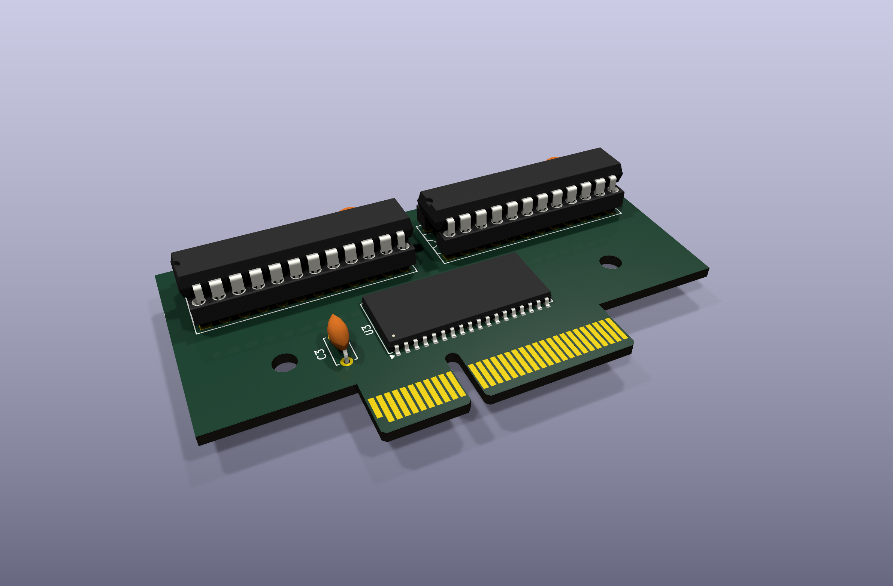
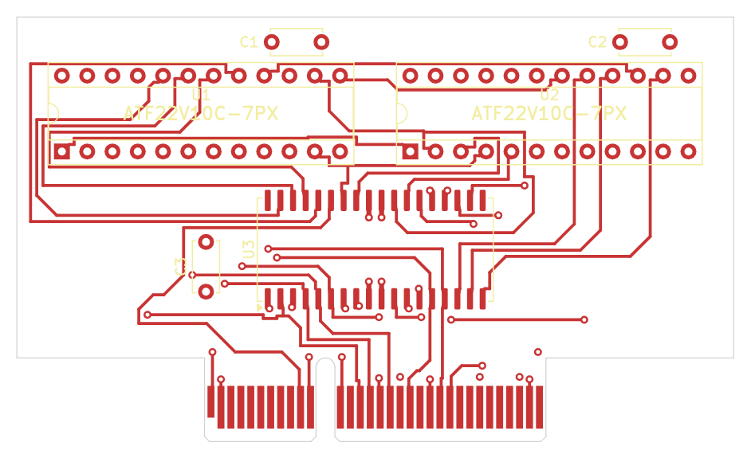
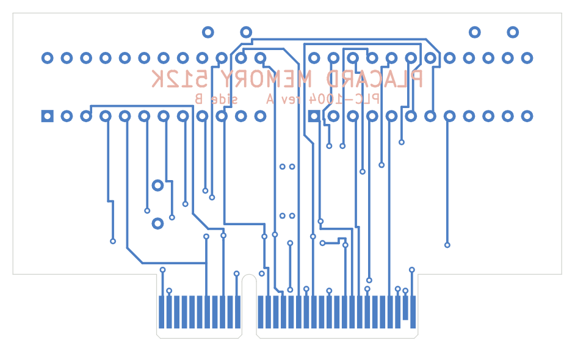
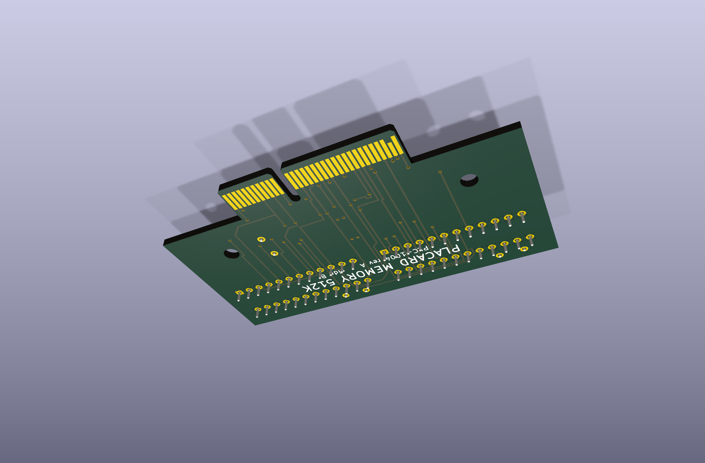
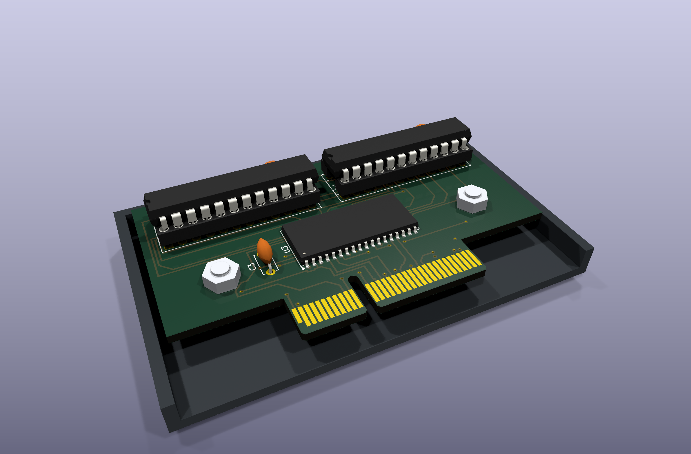
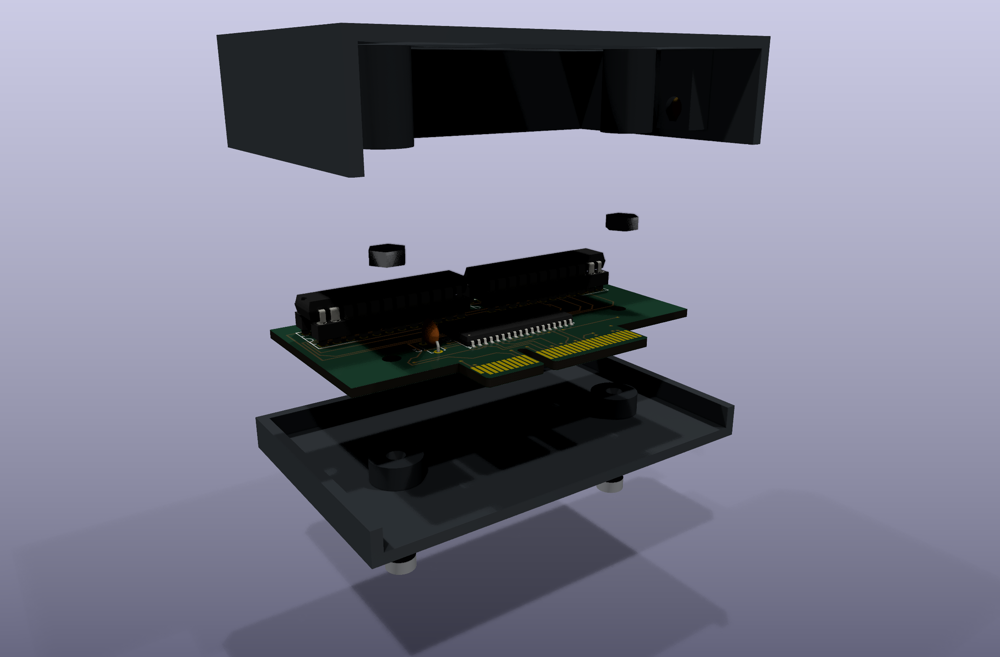
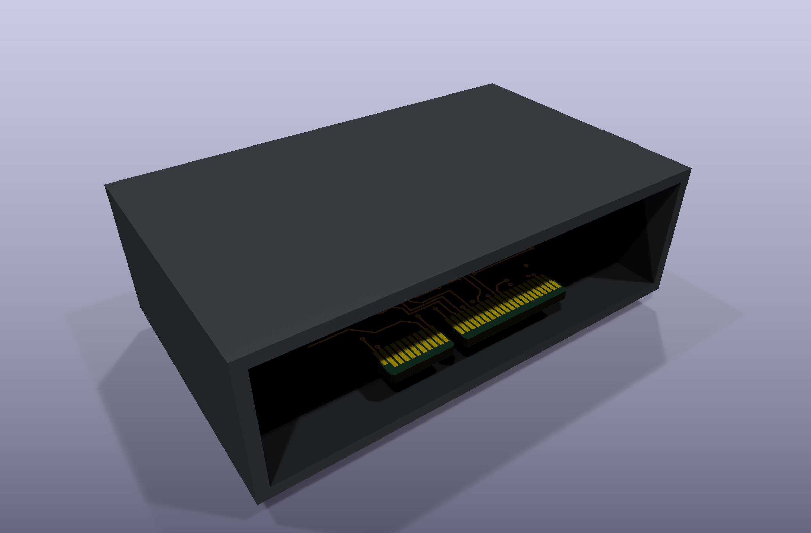
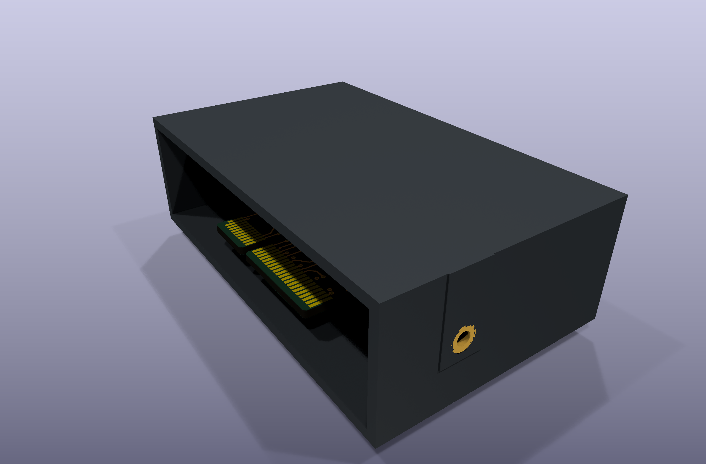

# Memory expansion card, 512K

Date: 2026-11-17

A card for any expansion slot that adds 512K of RAM for data.  It has three
chips:

| | Part | Job |
|---|---|---|
| U1 | ATF22V10C-7PX (`src/pld/ATF22V10_MEMCARD_HI.pld`) | Page high PLD: decodes the two page addresses, holds page bits 11:8 |
| U2 | ATF22V10C-7PX (`src/pld/ATF22V10_MEMCARD_LO.pld`) | Page low PLD: holds page bits 7:0 |
| U3 | AS7C4096A-12JIN, 512K x 8, 12 ns, SOJ-36 | The memory |

plus a 100n capacitor for each (C1-C3).  U3 is the one surface-mount part:
no 5 V SRAM this fast is made in a DIP above 32K.  Its leads are on a
1.27 mm pitch and can be soldered by hand.  The schematic is
`kicad/memory_card/` ([PDF](../../schematics/placard_memory_card.pdf)) and
the parts list is [BOM_MEMORY_CARD.md](../bom/BOM_MEMORY_CARD.md).  The
board is routed and passes KiCad's rule checks, and it has a printed shell ("The board" and
"The shell" below).  The main board needs no change.

## How it works

A slot gives a card 128 addresses ([EXPANSION.md](EXPANSION.md)), and a
program can't run from a card, so the card is storage that a program
reaches 128 bytes at a time.

The SRAM is wired to the slot exactly as the plain card of EXPANSION.md,
"Building a card":

    U3 /CE = /EXP (A16)     /OE = Q0 (A10)     /WE = /WE (B24)
    U3 A6:A0 = slot A6:A0   I/O8:1 = D7:D0

Its upper address, A18:A7, is a 12-bit **page number**: 4096 pages of 128
bytes.  One 22V10 has ten outputs, so the page number is held in two:

- **U1** sees /EXP and A6:A0.  It holds page bits 11:8 and loads them from
  D3:D0 on a write to offset 7F.  It also makes /PGLO, low while the card
  is selected at offset 7E.
- **U2** holds page bits 7:0 and loads them from D7:D0 on a write while
  /PGLO is low.

Both clock on the rising edge of /WE, the end of every write on the board,
and keep their value on any other write.  The shared port PLD on the main
board latches the same way.  Both clear at power-up, so the card starts at
page 0.

Neither PLD is in any of the SRAM's read or write paths, so the card has
the plain card's timing, the reference the slots were checked with.

| Offset in the slot | Read | Write |
|---|---|---|
| 00-7D | the page's byte | the page's byte |
| 7E | not used | **page number, low 8 bits** |
| 7F | not used | **page number, high 4 bits** (D3:D0; D7:D4 ignored) |

**The reserved bytes.**  The SRAM is selected by /EXP alone, so a write
that sets the page also stores that byte in the SRAM, at the same offset
of the page being left.  Offsets 7E and 7F of every page therefore hold
nothing useful, and a page has **126 bytes** (00-7D): 516,096 bytes in
all.  Keeping the SRAM off for those two addresses would put a gate in its
/CE or /WE, and neither works: a PLD in /CE makes the read later than the
slot allows, and a PLD in /WE ends the write up to 7.5 ns after the data
bus may change.

The page number can't be read back; a program keeps a copy of the page it
set.  The SRAM is not cleared at power-up and holds nothing with the power
off.

## Using the card

With the card in slot 1 (x5100; the other slots are x5300, x5180 and
x5380), a program sets Y to the slot's page and uses X as the offset:

    ld   0x51, y
    ld   0x7E, x
    ld   0x34, [y,x]      ; page low
    ld   0x7F, x
    ld   0x02, [y,x]      ; page high: page x234
    ld   0x00, x
    ld   [y,x], ac        ; read byte 0 of page x234
    ld   0x7D, x
    ld   ac, [y,x]        ; and write it to byte 125

A program that stays within 256 pages (32K) sets only the low byte.
Between the two page writes the page number is half old and half new; that
does no harm, because the second write lands on a reserved offset whatever
the page.

Byte n of the card is page n / 126, offset n mod 126.  A program that
would rather shift than divide can use 64 bytes of each page (262,144
bytes in all), or treat the pages as 4096 records of up to 126 bytes.

**Finding the card.**  The card has no "PLC" header (its memory is empty
at power-up), so the boot scan passes over it and `slot_id` reports no
card.  A program looks for it: set page 0 and write A5 to offset 0, set
page 1 and write 5A to offset 0, then go back to each page and read.  A
memory card reads A5 and 5A; an empty slot or any other card does not.
`src/scripts/test_memcard.py` runs this in the simulator, which has the
card as `io_devices.MemoryCard`.

A program can also write a "PLC" header with a card ID and a boot length
of 0 into page 0 once it has found the card, so later `slot_id` calls name
it until the power goes off.

## Timing

Against the card limits of EXPANSION.md, "Card timing", measured at the
edge fingers:

| Card delay | Limit | This card |
|---|---:|---|
| Read: /EXP falling to data valid | 16.0 ns | 13.0: U3 tACE 12 + 1 of track |
| Read: A6:A0 to data valid | 16.0 ns | 13.0: U3 tAA 12 + 1 |
| Read: Q0 falling to data valid | 8.0 ns | 7.0: U3 tOE 6 + 1 |
| Write: select ready before /WE rises | 13.0 ns | 12.0: U1 makes /PGLO in 7.5, U2 needs it 3.5 before the clock, + 1.  U3 needs 9.0 (tCW 8 + 1), U1 itself 4.5 |
| Write: data setup before /WE rises | 9.0 ns | 7.0: U3 tDW 6 + 1.  U1 and U2 need 3.5 + 1 |
| Write: data hold after /WE rises | 2.0 ns | 0: all three need 0 |
| Write: A6:A0, /EXP hold after /WE rises | 2.0 ns | 0: U3 and U1 need 0; /PGLO holds at least 3 ns longer for U2 |

Every line has more room than the plain 15 ns card, which the routed
rev A board passes with 3.4 ns to spare on the read and 1.4 ns or more on
the holds.  The tightest line is the /PGLO path into U2, with 1.0 ns to
the limit.

**Changing the page.**  The PLD outputs move 2 to 5.5 ns after /WE has
risen.  The SRAM's write has ended by then (its address hold is 0 ns), so
the page write lands in the old page.  If the two ever overlapped, the
stray byte would fall on the same reserved offset of the new page.  The
new page is settled long before the next access of the card, which is at
least one instruction later.

**Load.**  EXPANSION.md asks for one input on each slot line.  Here
D3:D0 and /WE each have three (U3, U1, U2), about 20 pF together; D7:D4
(U3, U2), A6:A0 and /EXP (U3, U1) have two, about 13 pF; Q0 has one.
That is the price of three chips, and it is one of the things to measure
on the first board.

**Checks made.**  `src/sim/tb_memcard.vhd` runs the two PLDs' VHDL
(`src/hdl/memcard_hi_pld.vhd`, `src/hdl/memcard_lo_pld.vhd`) with a 512K
SRAM model on a slot with these times in GHDL: all 4096 pages keep their
bytes, only writes to 7E and 7F move the page, and the SRAM's address
never moves during a write.  The PLD sources have not been compiled in
WinCUPL yet.

## The board

`kicad/memory_card/memory_card.kicad_pcb` (PCB PLC-1004) is 72 x 42.7 mm
with the finger tab, 4 layers (signals on the outside, a GND plane and a
+5V plane inside), 1.57 mm.  It is routed: 31 signal nets, 1.31 m of
0.3 mm track, 23 signal vias and 14 plane vias.  KiCad 9's design rule
check, with the schematic parity test, finds no violation and nothing
unconnected, and the schematic's rule check is clean too.

- U3 lies 2.6 mm above the fingers' shoulder, pin 1 at the left, so the
  bus stubs to the SRAM are short and still have room to fan out.
- U1 and U2 lie side by side above it in sockets, each with its 100n at
  the top edge.
- H1 and H2 are M3 holes 11 mm in from each end and 16.5 mm above the
  finger edge.  The shell's screws go through them.  No track passes
  between a hole and the card's edge.
- Side A's corner at the back end, 5 mm along the card and 8 mm up from
  the shoulder, is kept clear for the shell's insert block.

**How it was laid out.**  The project's own tools did it
(`src/scripts/router_v4/`, README section "Memory card"):

1. `gen_kicad_memcard_pcb.py` places the parts from a small table and takes
   the nets from the schematic.  `placeguide.py` scored thirteen placements
   and each was routed to check the score.  The one kept needs 32
   vias after one tidy pass where the first placement (U3 right on the
   fingers) needed 44; the full tidy brings it to 23.
2. `placeguide.py pinswap` chose which pin each net uses, where the pins
   can trade: any SRAM address pin for another, any data pin for another,
   and the PLDs' inputs and outputs within their own limits.  45 pins
   moved.  The schematic, the two `.pld` files and their VHDL carry the
   chosen pins, so the card's byte order inside the SRAM is the layout's
   choice; software never sees it.
3. `powerstubs.py` gives the GND and +5V fingers and U3's four power pins
   a via each to the planes.
4. `mroute4.py` routes, `ladder.py` trades tracks for fewer vias,
   `snapends.py` lands every track end on its pad's centre, and
   `finish_memcard_pcb.py` adds the planes.

/WE reaches U3 after 17 mm of track, U2 after 30 mm and U1 after 67 mm,
so the SRAM sees the end of a write before the page PLDs clock.  Eight
signal vias sit half on the end of an SOJ pad; they are covered by solder
mask.  Pad teardrops are not added yet.

## The shell

Two printed halves round the card and the slot's body, 78.6 x 24.2 mm
across and 48.2 mm tall.  That is the slot's keepout (EXPANSION.md, "Shell
keepouts") less 0.2 mm all round.  The opening for the slot in the case's
top is the keepout, so the shell fills it in place of the slot's cover,
and its back end reaches the back plate.  They are split at the card's side B face
(`src/scripts/gen_memcard_shell.py`, CadQuery; `case/memcard_shell_front`
and `_back`, .stl and .step).

- **Front half** (side A, over the parts): two bosses reach down to the
  card at H1 and H2.  Each has a hex pocket in its end for an M3 nut, which
  the card closes.  A block in the back end holds an M3 x 5.7 heat-set
  insert, 15 mm above the main board and 5.05 mm from the card's plane,
  where the case's back plate has its card screw (CASE.md, "Expansion card
  screws").  Its pad stands 0.2 mm proud to meet the plate.
- **Back half** (side B): a shallow lid with two pads and counterbored
  holes.
- **Screws.**  Two M3 x 8 pan head screws go through the back half and the
  card into the nuts, so the same two screws hold the halves together and
  the card in place.  Plus the two M3 nuts and the one insert.

**Printing** (Ender 3, 0.2 mm layers, no supports).  Print each half with
its large outside face on the bed; the STL files are already in that
pose.  Every wall, boss and block stands on the bed face.  The back half's
screw-head counterbores are on the bed face, so each has a slot layer and
a square layer under the round hole.  The insert hole lies sideways in the
front half and is a teardrop with a 1.6 mm flat top.  Checked on the STLs:

| Check | Front half | Back half |
|---|---|---|
| Mesh | watertight, one body | watertight, one body |
| Downward faces above the bed | the insert hole's flat top, a 1.6 mm bridge | the two counterbores' helper layers, bridges up to 6.5 mm |
| Collision with the card, its parts, the slot, the screws, the back plate | none | none |

The shell is a first design: it has not been printed, and it carries no
label or grip yet.

## Why this part

A slot read needs a 15 ns memory, and the fast 5 V SRAMs above 32K come
only in surface-mount packages.  The AS7C4096A is a current Alliance part
in a 400 mil SOJ-36, the easiest of those packages to solder by hand.  A
through-hole 512K card is possible with the 55 ns AS6C4008 DIP, but the
slot can't wait for it, so the card would latch the whole address, read
through a buffer and time its own write pulse: five chips, and
four bus writes for each byte stored.

## Still to do

- **Board.**  Before ordering: check the U3 pin numbers in the symbol
  against the pin drawing in the Alliance datasheet (they were taken from
  the datasheet's text), add pad teardrops, and plot the fab files.
- **WinCUPL.**  Compile both `.pld` files (revision 02, the pins the
  layout chose) and keep the .jed files.
- **Shell.**  Print one and try it on the first card and in the case.
- **Library.**  No routines yet.  Candidates: find the card, copy a block
  between the card and main memory.
- **On the first card.**  Scope D7:D0 at the end of a card read (the bus
  overlap noted in EXPANSION.md) and check a read with all four slots full.
