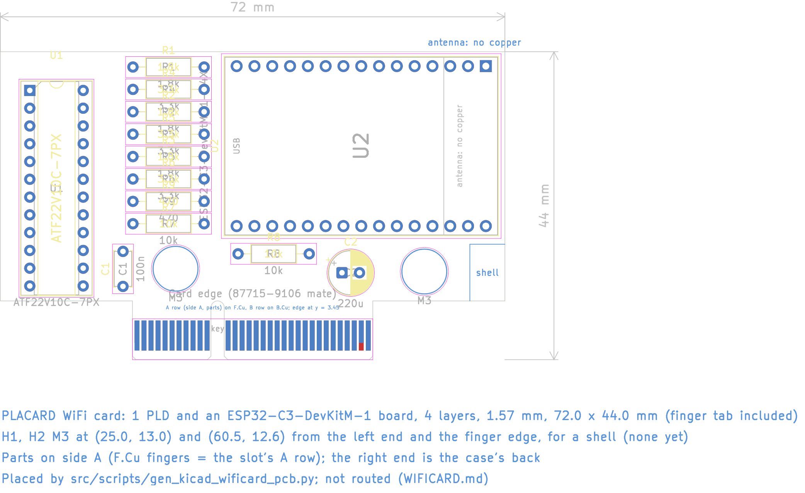

# WiFi expansion card

Date: 2026-11-22

A card for any expansion slot that puts the Placard on a WiFi network: it
joins a network, opens a TCP connection (plain or TLS), sends and receives
bytes, and reads the time of day.  Its module also does a web browser's
work for the Placard ([WEB.md](../software/WEB.md)).  It has one chip and
one module:

| | Part | Job |
|---|---|---|
| U1 | ATF22V10C-7PX (`src/pld/ATF22V10_WIFI.pld`) | SPI port PLD: one output register and one read address, like the SD card's port on the main board |
| U2 | Espressif ESP32-C3-DevKitM-1-N4X, a small board on two rows of 15 pins | The WiFi module: radio, antenna, network software, its own 3.3 V regulator and a USB socket for loading its firmware |

plus nine resistors and two capacitors, all through-hole.  The module is
bought assembled and is soldered in on its own pin headers, so the card has
no surface-mount soldering.  The schematic is `kicad/wifi_card/`
([PDF](../../schematics/placard_wifi_card.pdf)) and the parts list is
[BOM_WIFI_CARD.md](../bom/BOM_WIFI_CARD.md).  The main board needs no
change.

**Where it stands.**  The logic, the driver, the demo program and the
browser pass in simulation.  Nothing has been built: the PLD is not compiled in WinCUPL,
the module's firmware is not compiled or tried on a module, and the board
is placed but not routed.  "Still to do" at the end lists what is open.

## How it works

A program can't run from a card and a slot gives a card 128 addresses
([EXPANSION.md](EXPANSION.md)), so the card is a port.  All the network
software (WiFi, TCP/IP, TLS, the clock) runs inside the module.  The
Placard sends it short commands and gets short replies over SPI, and it
clocks the SPI lines itself, one bit at a time, as it does for the SD card
(`spi_byte` in the library).

**U1** is the main board's shared port PLD (`ATF22V10_PORT.pld`) cut down
to one job.  It answers at offsets 60h-7Fh of its slot, the area
EXPANSION.md gives to a card's registers:

| Offset in the slot | Read | Write |
|---|---|---|
| 00-5F | nothing (the card does not drive the bus) | ignored |
| 60-7F, even | D7 MISO, D6 READY, D5:D2 = 1010 | the output register |
| 60-7F, odd | D7 MISO, D6 READY, D5:D2 = 0101 | the output register |

The output register:

| Bit | Line | |
|---|---|---|
| 0 | SCK | the SPI clock, high at rest (mode 3) |
| 1 | MOSI | data to the module |
| 2 | /CS | low selects the module; a transfer is /CS low to /CS high |
| 3 | run | 1 = the module runs, 0 = the module is held in reset |
| 7:4 | | not stored |

The register clocks on the rising edge of /WE, the end of every write on
the board, and keeps its value on any write that is not to the card.  It
powers up as if 0F had been written: clock and data high, module not
selected and running.

On a read D1 and D0 are not driven, so a program masks them.  D5:D2 are
fixed bits that differ between an even and an odd offset, which is how a
program finds the card (below).  MISO is the module's data out and READY
is a handshake line from the module: high when the module has something to
do with a transfer, low while it works.

**Reset.**  The module's RST pin has its own pull-up and capacitor, and its
USB port pulls it low too.  U1's pin 17 therefore only pulls low (its
output is on while bit 3 is 0 and off otherwise), through R9, 470 ohms.
Holding the module in reset also takes its current off the supply.

## Levels and power

The module runs at 3.3 V from its own regulator, fed from the slot's +5V
on its 5V pins.  Its pins must not see 5 V:

- **To the module.**  SCK, MOSI and /CS each go through a divider, 1.8k
  in series (R1-R3) and 3.3k to ground (R4-R6), the SD card's values: a
  PLD high of 3.9 to 5 V arrives as 2.5 to 3.2 V.
- **From the module.**  MISO and READY go straight to PLD inputs, which
  read anything over 2.0 V as high.  Each has 10k to ground (R7, R8), so
  both read 0 while the module is in reset or not selected.
- **Reset.**  U1 only pulls the line low, so no divider is needed.

So the levels cost resistors, not a chip.  The dividers are fine at the
speed software can clock them (well under 1 MHz).

The module draws about 0.1 A on average with the radio on and peaks near
0.35 A while it sends.  C2 (220u) at its 5V pins carries the peaks.  The
main board alone is estimated at about 2.8 A of the supply's 3 A, so the
card's current is one of the things to measure on the first one; a program
can switch the module off with bit 3.

## The link

A **transfer** is everything between /CS going low and going high.  Bytes
go most significant bit first.  The Placard starts a transfer only while
READY is high.

**Request** (Placard to module): the command, a count n, then n bytes
(0 to 255).  The module's first byte in this transfer is 52h ("R").
Command 00 does nothing and has no reply.

**Reply** (the next transfer, when READY is high again): 41h ("A"), a
status, a count m, then m bytes.  The Placard sends 00 bytes to clock it
out.

| Status | |
|---|---|
| 00 | done |
| 01 | can't (see the command) |
| 02 | no network joined |
| 03 | no connection, or the other end closed it |
| FF | unknown command |
| FE | from the driver: the module was not ready in time |
| FD | from the driver: what came back was not a reply |

| Command | Request bytes | Reply bytes |
|---|---|---|
| 01 INFO | | the firmware's name as text, "PLACARD WIFI 1.1" (1.0 has no browser) |
| 02 JOIN | network name, 00, password, 00.  With no bytes: join the network the module kept (status 01 if it has none) | |
| 03 STATE | | state (0 off, 1 joining, 2 joined, 3 failed), the IPv4 address (4 bytes), the signal strength as -dBm |
| 04 LEAVE | | |
| 10 OPEN | flags (bit 0: TLS), port high, port low, host name | |
| 11 SEND | the bytes to send | |
| 12 RECV | the most bytes wanted | the bytes that have arrived, none if nothing has yet |
| 13 CLOSE | | |
| 20 TIME | | year - 2000, month, day, hour, minute, second, weekday, UTC (status 01 until the module has the time) |

JOIN returns at once and the join goes on by itself; a program asks with
STATE until the state is 2 or 3.  The module keeps the last network that
worked in its flash, so the name and password are typed once.  There is
one connection at a time.  A TLS connection is encrypted, but the firmware
does not check the server's certificate.

## The browser's commands

Firmware 1.1 adds the commands the browser (`WEB.PLC`,
[WEB.md](../software/WEB.md)) is made of.  The module fetches a page and
keeps it as lines of text for the Placard's screen; the Placard asks for
the lines it shows.  They answer status 02 until a network is joined.
Numbers of two bytes are low byte first, except a link's number inside a
line of text.

| Command | Request bytes | Reply bytes |
|---|---|---|
| 30 VIEW | columns (20-80), pixel rows a line (8-16), flags (bit 0: fetch the page's pictures) | |
| 31 GO | the top line of the page being left (2), then the address or the words typed | the page (below) |
| 32 LINK | the link's number (2), the top line of the page being left (2) | the page |
| 33 BACK | | the page before, with the top line it was left at (01: there is none) |
| 34 RELOAD | the top line to come back to (2) | the page |
| 35 INFO | 0 the title, 1 the address, 2 why the page could not be shown | text |
| 36 ROW | the line (2), the part (0, or the next part of a picture's strip) | a line (below) |
| 37 IMGLOAD | | fetches the next picture of the page: pictures still to come, the line it went in at (2), the lines it added (2), the page's lines now (2) |
| 38 LINKINFO | a link's number (2) | its address, text |
| 39 PICTURE | a link's number (2), 0 for 80 across or 1 for 160 | fetches it for showing alone: the width in bytes, 240.  01: the reason, text |
| 3A PICDATA | a column | that column's 240 color bytes, top to bottom |
| 3B PICEND | | the picture's memory is given back |

**The page** reply is 6 bytes: flags (bit 0: pictures still to come, bit
1: the address is a picture, bit 2: the page is the module's own "can't
be shown", bit 3: there is a page to go back to), the page's lines (2),
the pictures to come, and the line to put at the top (2).  A page that
could not be fetched is still a page: a few lines that say why.

**A line** is one of two things.  First byte 0: text, the line's
characters (ASCII 20-7E) with marks among them: 01 and two bytes, high
first, where a link starts (its number); 02 where it ends; 03 and 04
where bold starts and ends.  A link that goes on in the next line starts
again there.  First byte 1: a strip of a picture: the first byte column
of this part, its byte columns, 1 if it is the strip's last part, then
for each byte column the strip's pixel rows top to bottom, 1 bit a
pixel, bit 0 the left pixel, 1 = white: the 1 bpp screen's own bytes.  A
part is at most 250 bytes.

**Link numbers.**  0 and up are the page's links.  8000 and up are its
pictures (PICTURE shows one alone).  FFFE is "more of this page": a long
page comes in parts of about 1,200 lines, and LINK FFFE fetches the next.
FFFF is the page's own address, when that is a picture.

GO, LINK, BACK and RELOAD answer when the page is in: up to 20 seconds
for a site that is slow, longer through redirects.  IMGLOAD and PICTURE
take up to 12 seconds.  The Placard waits on READY, so its driver's wait
is set longer for these (`wf_tmo` in `web.masm`).

The same code runs in the simulators: `src/firmware/wifi_card/host/`
builds it for the computer, `io_devices.WifiCard(browser=...)` and the
emulator core's `WifiCard` hand it commands 30-3B, and `test_web.py`
checks the two sides together.

## Using the card

`src/scripts/wifi.masm` holds the driver and a demo, built as
`sdcard/WIFI.PLC` (`asm_expand.py`, then `gen_plc.py`).  The driver is four
routines a program can copy:

| Routine | |
|---|---|
| `wf_find` | looks in slots 1-4 for the card; leaves its address in `wf_y`, `wf_x` |
| `wf_ready` | waits until READY is high, or gives up after about 15 s |
| `wf_byte` | one byte out and one byte in, as `spi_byte` |
| `wf_xfer` | one request and its reply: the command in AC, request bytes at x4000, reply bytes at x4100, status in `wf_st`, count in `wf_len` |

**Finding the card.**  The card has no "PLC" header, so the boot scan
passes over it and `slot_id` reports no card.  `wf_find` reads offsets 60h
and 61h of each slot and keeps bits 5:2: the card answers 1010 at the even
address and 0101 at the odd one.  An empty slot reads the same at both.

**The demo.**  `WIFI.PLC` finds the card and shows the firmware's name,
asks for a network name and password (Enter alone uses the network the
module kept), joins, shows the address and the time, then asks for a web
site, fetches its front page with a plain HTTP GET and prints it as text.
Esc leaves.

The simulator has the card as `io_devices.WifiCard`, a model of the PLD and
of the firmware's side of the link with made-up networks and hosts.
`src/scripts/test_wifi.py` runs `WIFI.PLC` against it.

## Timing

Against the card limits of EXPANSION.md, "Card timing", measured at the
edge fingers.  U1 is a 7.5 ns part: setup 3.5 ns, hold 0 ns, output enable
7.5 ns.

| Card delay | Limit | This card |
|---|---:|---|
| Read: /EXP falling to data valid | 16.0 ns | 8.5: U1 turns its outputs on in 7.5 + 1 of track |
| Read: A6:A0 to data valid | 16.0 ns | 8.5 |
| Read: Q0 falling to data valid | 8.0 ns | **7.5 + the track**: see below |
| Write: select ready before /WE rises | 13.0 ns | 4.5: setup 3.5 + 1 |
| Write: data setup before /WE rises | 9.0 ns | 4.5 |
| Write: data hold after /WE rises | 2.0 ns | 0 |
| Write: A6:A0, /EXP hold after /WE rises | 2.0 ns | 0 |

**The Q0 line is the tight one.**  The outputs turn on through one PLD
pass from Q0, where the plain SRAM card has a 7 ns output enable.  With
the 1 ns of track the other lines allow it would be 8.5 ns, 0.5 ns over
the limit.  The limit holds if Q0's track to U1 and the longest data track
back add up to no more than about 70 mm (0.5 ns), which is why U1 has to
sit close to the fingers when the board is routed; as placed, U1 is at the
far left end and this is not yet met for certain.  The main board's own
port PLD reads the SD card through the same kind of path, and the routed
rev A board has 3.4 ns to spare on a slot read, so this is expected to
work, but it is the line to check on the routed card and on the first one
built.

MISO and READY are not timed against the bus: software sets the clock and
reads the data in separate instructions, microseconds apart.

**Load.**  One input or output on every slot line, as EXPANSION.md asks
(D3 and D2 are one pin each, used both ways).

**Checks made.**  `src/sim/tb_wifi.vhd` runs the PLD's VHDL
(`src/hdl/wifi_pld.vhd`) in GHDL on a slot with these times and an SPI
slave that echoes: the register loads only on writes to 60h-7Fh, holds on
other writes, the bus is driven only on reads of 60h-7Fh, the fixed bits
and the reset pin behave as above, and whole bytes go out and come back.
`test_wifi.py` runs the demo program in the emulator through eight cases:
the card found in slot 3 and in slot 2, the join, a page fetched and
printed, Esc, the kept network, a wrong password with no network kept, a
reply left unread by an earlier program, and no card (a memory card is
not taken for a WiFi card).

## The board

`kicad/wifi_card/wifi_card.kicad_pcb` (PCB PLC-1005, assembly PLC-2005) is
72 x 44.0 mm with the finger tab, 4 layers like the memory card.  The parts
are **placed, not routed** (`src/scripts/gen_kicad_wificard_pcb.py`; the
placement check finds no overlap and all 26 nets are on the board).

- U1 stands at the left end in a socket with C1 beside it.
- U2 lies along the top: its antenna at the right end, toward the case's
  back, with no copper under it on any layer, and its USB socket toward
  the PLD.
- The nine resistors stand in a column between the two; C2 and the M3
  holes H1 and H2 are under the module.
- The corner the memory card keeps clear for its shell's insert block is
  kept clear here too.

The card is 1.3 mm taller than the memory card (44.0 against 42.7 mm), and
the module stands about 12 mm off side A on its headers.  It has no shell,
and the memory card's shell does not fit it.

**The module's footprint is drawn from memory of Espressif's drawing**
(25.4 x 38.9 mm, two rows 22.86 mm apart, which end has the antenna, which
row is J1).  Check it against a real module before a board is ordered.

## The module's firmware

`src/firmware/wifi_card/wifi_card.ino` is an Arduino sketch for the
"esp32" boards package, version 3.x, board "ESP32C3 Dev Module".  It is an
SPI slave on IO6 (SCK), IO7 (MOSI), IO5 (MISO) and IO10 (/CS), with READY
on IO4.  It has **not been compiled or run**; it is written against the
package's documented calls and will need a pass on a real module.

The browser's part (`browser.cpp`, `html.cpp`, `image.cpp`, with their
headers, in the same folder) is plain C++ with no Arduino calls, and the
Arduino build takes it in with the sketch.  That part is tested, as the
program in `host/` that the simulators run; what the sketch adds to it,
its `EspNet` (a connection through `WiFiClient` or `WiFiClientSecure`),
is not.  The browser keeps about 75 KB while it is used (a page's lines,
its links, 32 KB of picture pixels, 8 addresses to go back to), up to
40 KB more while a picture is decoded and 38 KB for a picture shown
alone at 160 across, beside what the radio and a TLS connection take.
The ESP32-C3 has 400 KB of RAM; whether all of that fits at once on a
real module is the first thing to measure.

Load it through the module's USB socket **with the card out of the
machine**: the module's 5V pin and its USB socket must not both be
powered.

## Why this part

- **One chip.**  The module does the level of work a whole network card
  would, and the Placard's side is the same port PLD the SD card uses.
  A UART module would need a UART chip or a PLD that shifts by itself;
  SPI clocked by software needs neither, and the module, as the slave,
  never has to wait on the Placard's timing.
- **Through-hole.**  The bare ESP32 modules are surface-mount with pads
  under the can.  The DevKitM-1 board carries one with its regulator, USB
  and reset parts on 2.54 mm pins.
- **Active.**  The plain ESP32-C3-DevKitM-1 is marked obsolete at Mouser.
  The -N4X version that replaces it is active and in stock there
  (356-ESP32C3DVKTM1N4X, read 2026-11-21).

## Still to do

- **WinCUPL.**  Compile `ATF22V10_WIFI.pld` and keep the .jed.
- **Firmware.**  Compile it, load a module and try the link on a bench
  before a board is ordered.  Then the browser: free memory with a large
  HTTPS page and its pictures in, and how long real sites take.
- **Module footprint.**  Check the pin rows, the outline and the antenna
  end against a real module, and how deep the no-copper area must be.
- **Board.**  Route it with U1 near the fingers (the Q0 line above), tidy
  the reference text, add teardrops, plot the fab files.
- **Power.**  Measure the machine's 5 V current with the card sending.
- **Shell.**  None yet.
- **Software.**  The driver lives in the demo and in the browser; nothing
  is in the library or BASIC yet.  The US price of the module was not read (the
  parts list has an estimate).
