# Case

Date: 2026-11-17

This is a concept for the PLACARD case. The case is black powder-coated
aluminium, strong on the bottom and sides, with a clear acrylic top so the
board shows through. Each expansion slot (J9-J12) and the cartridge slot (J8)
has its own removable 3D-printed cover, held on by snap tabs that click through
small slots in the acrylic. A cover that is out parks under the case, upside down: its tabs
click into slots in the floor, right below where it fits on the top. The case
stands on 10 mm feet, so the parked covers clear the desk.

The aluminium is a tray (the floor with the front and right walls) and two
flat plates for the back and left walls. Only the back and left have
connectors that reach through the wall (VGA, audio, power and reset), so the
board drops straight down into the tray. Each plate then slides onto its
connectors from outside and screws to the floor, and the acrylic top holds
the tops of all four walls. Every connector opening is a single clean hole
in one part, and no seam runs through any of them.

There is no built-in keyboard; the computer takes a PS/2 keyboard on J5.

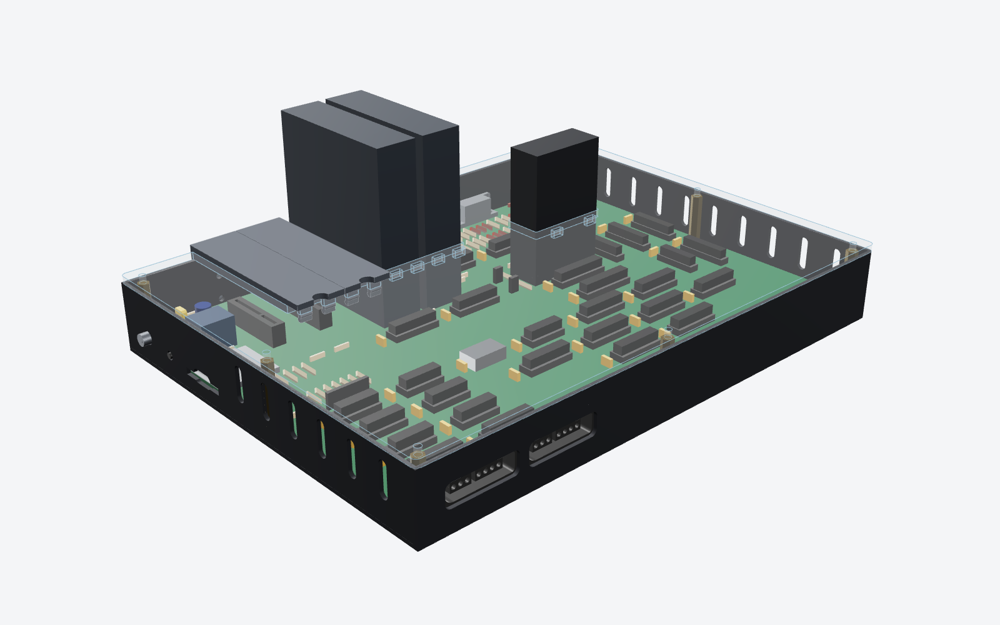

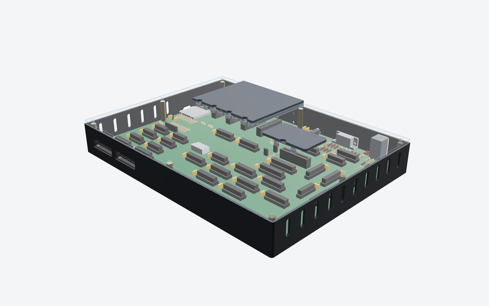

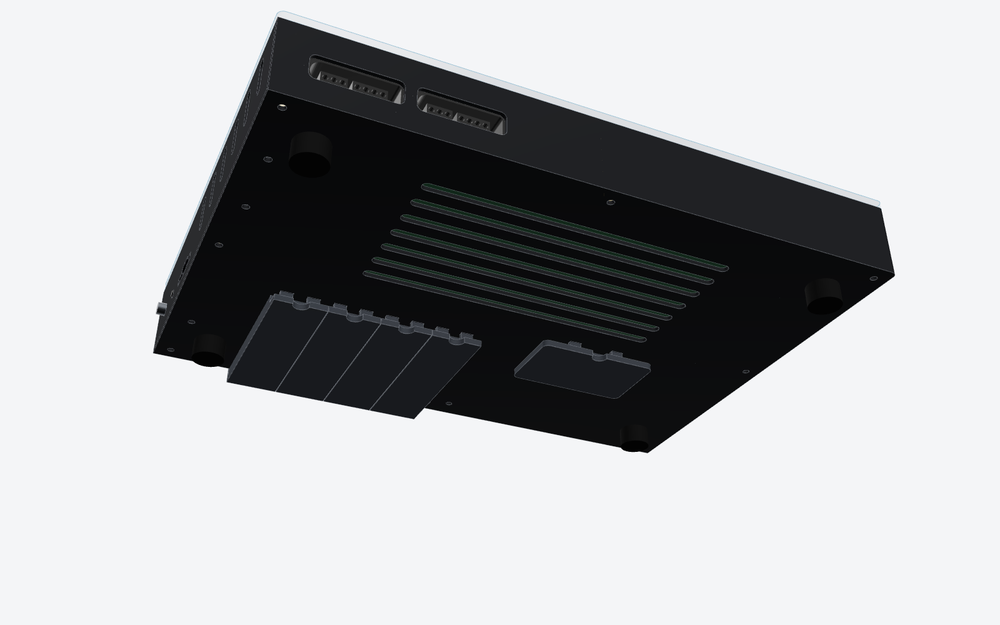

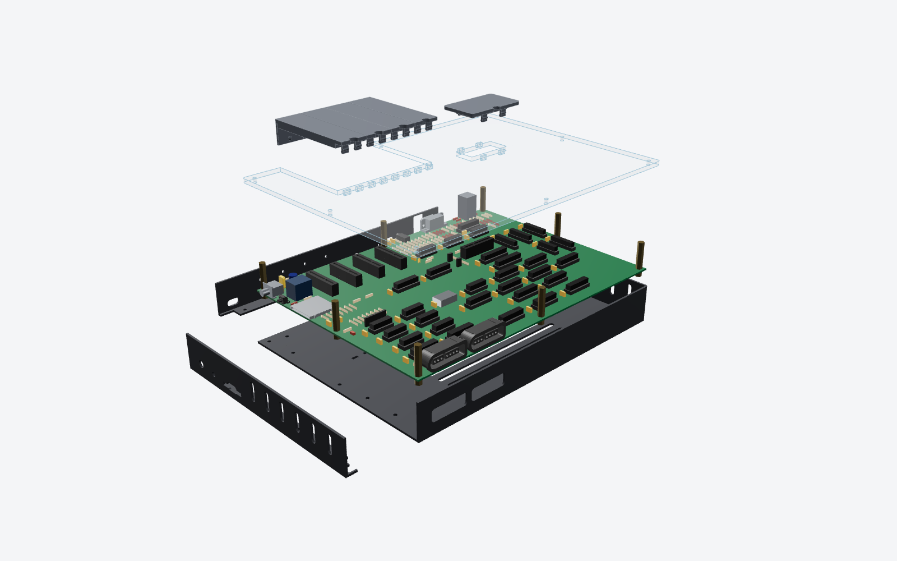

Everything here is made by `src/scripts/gen_case.py` from the board file, so
the cut-outs follow the connectors when they move. The script reads each
wall connector's position from `kicad/placard.kicad_pcb`, and where the
connector's 3D model (`kicad/lib/placard.3dshapes`) meets the wall. The board
file is only read, never written. The files in `case/` and these drawings
were made from the 290 x 215 mm board.

## Size

| | mm | in |
|---|--:|--:|
| Outside, width x depth | 295 x 220 | 11.6 x 8.7 |
| Height, desk to the acrylic top | 50.6 | 1.99 |
| Height of the case itself, without the feet | 40.6 | 1.60 |
| Feet | 10 | 0.39 |

The case is the board plus 0.5 mm all round and the 2 mm walls. Its height is
set by the stacked PS/2 socket J5, which is 25 mm tall; the acrylic top,
lying on the walls, clears it by 2 mm. The feet are as tall as a parked cover (7 mm) plus 3 mm.

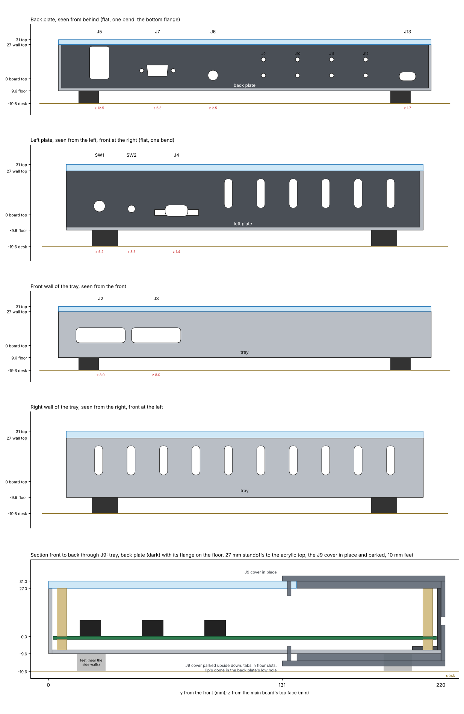

## Parts

| Part | Qty | Material and finish | Made by |
|---|--:|---|---|
| Tray | 1 | 2.0 mm 5052-H32 aluminium, two bends (inside radius 2 mm, open front-right corner with a relief): the floor, to the case's outside edges, with the front wall (SNES cut-outs) and the right wall up to the acrylic, with vent slots in the floor and 10 in the right wall, 10 small parking slots for the covers' tabs and 14 countersunk M3 holes (8 at the board holes H1-H8 for the floor standoffs' screws, 6 for the plate screws), plus 4 plain 3.4 mm holes at the feet for optional screw-on feet. Black powder coat | Sheet metal service: laser cut, bend, countersink, powder coat |
| Back plate | 1 | 2.0 mm 5052-H32, standing on the floor, with a 14 mm flange bent in along the bottom: USB-C, audio, VGA and PS/2 cut-outs, an M3 screw hole behind each expansion slot (J9-J12) with a parking hole for that slot's cover 12.6 mm below it, 3 plain 3.4 mm screw holes in the flange (loose M3 hex nuts on top), the flange notched round the floor standoffs and J7's pins | Same |
| Left plate | 1 | Same: power switch, reset and SD cut-outs, 6 vent slots, 3 screw holes | Same |
| Acrylic top | 1 | 4 mm clear cast acrylic, 295 x 220 mm, laser cut, with 14 small slots (6.4 x 2.2 mm) for the covers' tabs | Laser cutting service |
| Slot cover | 4 | 3D printed in one piece, PETG (black): plug, cap, two snap tabs, back lip with a dome (`case/slot_cover.stl`) | The builder or kitter prints them |
| Cartridge cover | 1 | Same, sized for J8, four snap tabs (`case/cart_cover.stl`) | Same |
| M3 male-female hex standoff, 6 mm, 6 mm stud | 8 | On the floor under board holes H1-H8, screwed down from below; its stud goes up through the board | |
| M3 female-female hex standoff, 27 mm | 8 | On the 6 mm standoffs' studs, board top to the acrylic top; clamps the board | Ettinger and others sell 1 mm steps; or 25 mm + a 2 mm spacer |
| M3 x 8 button head screw, black or stainless | 8 | Acrylic top | |
| M3 x 6 countersunk screw | 14 | Up through the floor, flush under the case: 8 into the floor standoffs, 6 through the plates' flanges into hex nuts | |
| M3 hex nut, ISO 4032 (5.5 across flats, 2.4 mm) | 6 | On top of the plates' flanges, under the board's edge. The screw goes 2 mm into it, so its tip stays 2 mm under the board; the parts nearest (SW2's and K1's leads, R1/R2, F1) are clear of it | |
| M3 x 6 button head screw, black | 4 | Through the back plate into each expansion card's shell (one per card fitted) | |
| Rubber feet, 16 mm across, 10 mm tall, self-adhesive | 4 | 24 mm in from each corner, clear of the corner standoffs and the parked covers. Each sticks on over the floor's foot hole | Or screw-on feet, see "Screw-on feet" below |

The VGA connector's 4-40 jackscrews pass through the back plate and hold it
to J7 as well.

All three metal parts are powder coated the same stock black, the cheapest
finish (Justin, 2026-10-27). There is no printing or engraving on the case.

STEP models of every part are in `case/`, and the DXF cutting file for the
acrylic top is in `case/dxf/`. The covers print from `case/slot_cover.stl`
(print 4) and `case/cart_cover.stl`, turned cap face down for the bed.
Sheet metal services (Protocase, JLCCNC, PCBWay, Xometry) quote bent parts
from STEP. SendCutSend wants a flat pattern, which their own tool or any CAD
program unfolds from the STEP.

## How it goes together

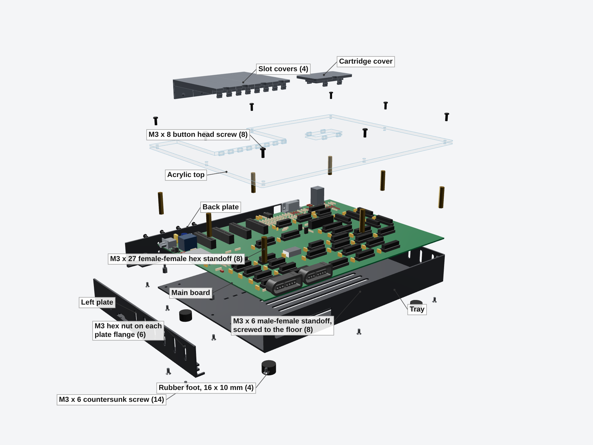

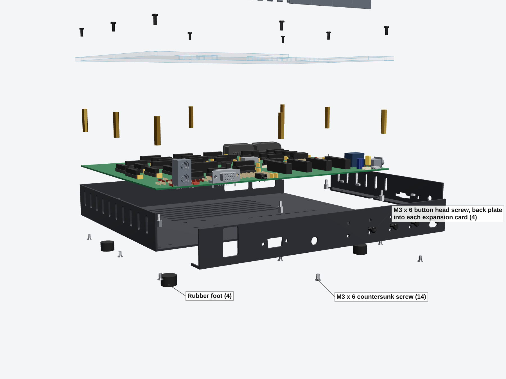

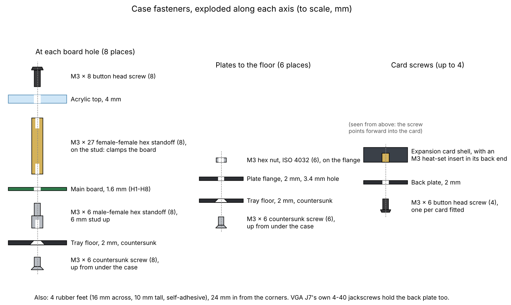

The hardware meshes and the stack drawing come from
`src/scripts/case_render/gen_case_hardware.py` (run after `gen_case.py --mesh`;
views `exploded_hw` and `exploded_hw_rear`).

1. The sheet metal service powder coats the tray and plates. There is no
   PEM hardware in any part.
2. Screw the eight 6 mm male-female standoffs to the floor, stud up, with
   countersunk screws from below. Screw-on feet, if used, go on now too
   (nuts on top of the floor).
3. Lower the board straight down onto the studs, which come up through
   H1-H8 and locate it. The SNES ports only touch the front wall's inside
   face, so nothing has to be threaded through a hole.
4. Screw the 27 mm female-female standoffs onto the studs. This clamps the
   board.
5. Slide the back plate forward onto USB-C, audio, VGA and PS/2. Its flange
   slides over the floor, under the board; open notches let it past the
   floor standoffs and J7's pins, and it clears the rest of the board. Fit three countersunk screws
   up through the floor and the flange, each into an M3 hex nut on top of
   the flange.
   The flange is only 4 mm under the board there, too little for fingers,
   so before sliding the plate in, stick each nut over its hole with a small
   square of Kapton tape (or a drop of glue at one corner). The screw pulls
   it down and holds it; a 5.5 mm nut driver or tweezers works if one
   drops.
6. Slide the left plate on over the power switch, reset and SD in the same
   way, three screws and nuts.
7. Lay the acrylic top on and fit its eight screws into the standoffs. It
   lies on all four walls and holds the plates' tops.
8. Stick the four feet on, then fit the VGA jackscrews and click the covers
   on ("Covers and parking" below).
9. Fit each expansion card, then one M3 screw through the back plate into
   its shell ("Expansion card screws" below).

To open it, take out the top's eight screws and lift the top off. The board
comes out once the six plate screws are out and the plates are slid off.

## The connector plates

The tray and plates were chosen by how far each connector reaches past the
board's edge (from the 3D models):

| Wall | Connector | Past the board edge | Through the wall? |
|---|---|--:|---|
| back | J13 USB-C | 0 mm | no, flush |
| back | J6 audio | 2.5 mm | yes |
| back | J7 VGA | 6.4 mm | yes |
| back | J5 PS/2 | 0.5 mm | no, touches the inside face |
| left | SW1 power toggle | 6.5 mm | yes |
| left | SW2 reset | 3.1 mm | yes |
| left | J4 SD | 0 mm | no, flush |
| front | J2, J3 SNES | 0.5 mm | no, touches the inside face |

The board is 0.5 mm from each wall's inside face. Nothing reaches into the
front or right walls, so those are bent up from the floor and the board
drops in past them. The back and left walls are flat plates that slide on
afterwards. Each plate is one flat laser-cut part with one bend, so its holes
are accurate to about 0.1 mm. If a connector moves, only that plate changes,
not the bent tray.

## Expansion card screws

The back plate has an M3 clearance hole (3.4 mm) behind each expansion slot,
15 mm above the board and centred on the slot's shell keepout, like the
screw on a PC card's bracket. A card that carries its own connector is held
by it, so plugging and unplugging a cable can't rock the card in its slot.

- The card's shell needs an M3 heat-set insert in its back end at that spot,
  on a pad that meets the plate's inside face (the shell itself stops 0.2 mm
  short of the plate).
- The hole is 5.05 mm from the card's plane, on side A, and 12 to 20 mm above
  the main board, so a card keeps its parts clear of the insert at that
  corner.
- The card's own connector has to sit above the case top (31 mm), where the
  back plate stops.
- The screw holds the shell and the shell holds the card at H1, so a card
  and its shell come out together once the screw is out. Take the card
  screws out before sliding the back plate off.

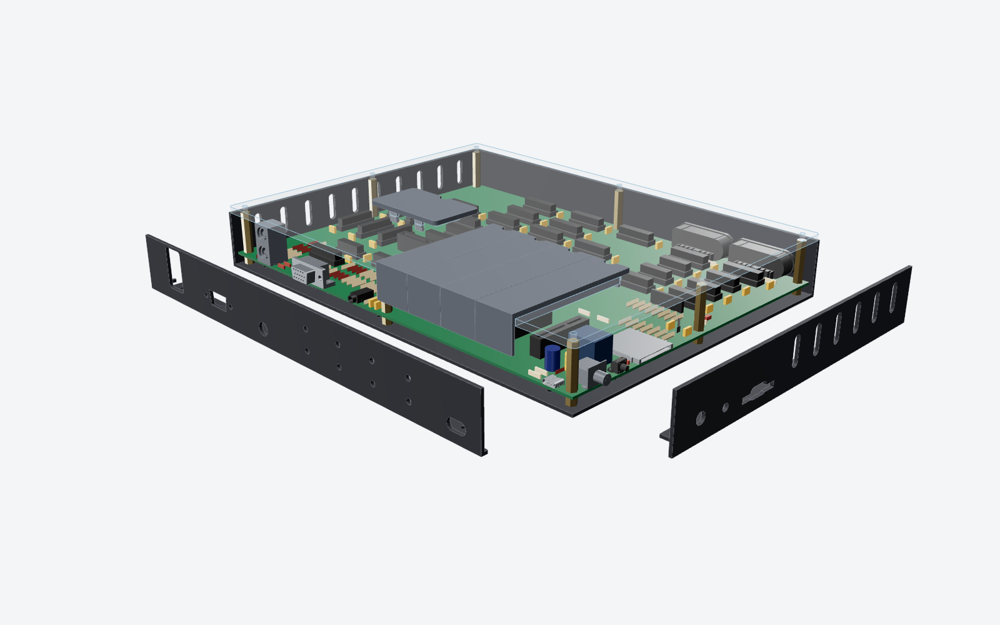

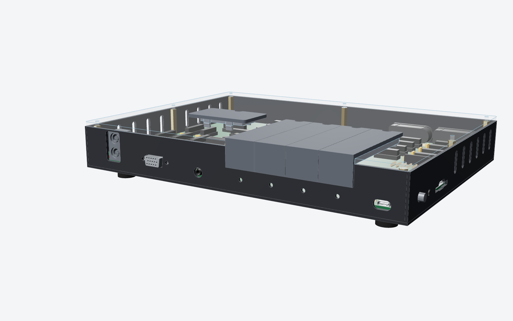

Cut-outs (u = mm along the wall from the case's left or front corner; z = mm
above the board's top face):

| Ref | Wall | u | Centre z | Cut-out | Notes |
|---|---|--:|--:|---|---|
| J13 | back | 18.5 | 1.7 | slot 13 x 7 | USB-C power.  The receptacle is flush with the board edge, so its mouth is 2.5 mm behind the outside face; the cut-out fits a USB-C plug's overmould (12.4 x 6.5 typical) |
| J6 | back | 172.5 | 2.5 | 8 mm hole | Audio line out |
| J7 | back | 216.5 | 6.3 | DE-15 D cut-out (wide side up) + two 3.2 mm holes at 25 mm | VGA.  The connector's flange sits 0.5 mm inside the wall; its jackscrews go through.  |
| J5 | back | 262.5 | 12.5 | 15.5 x 26 rounded | Stacked PS/2 (keyboard and mouse), both ports in one opening |
| SW1 | left | 199.5 | 5.2 | 7 mm hole | Power toggle bushing; the lever stands out of the wall |
| SW2 | left | 179.7 | 3.5 | 4.5 mm hole | Reset.  The actuator stands 0.6 mm proud of the wall (a press has to be held 0.5 s, so a knock is harmless) |
| J4 | left | 152.0 | 1.4 | 27 x 3.6 slot + 14 x 7 thumb notch | SD card, push-push (Hirose DM1AA-SF-PEJ(82)) |
| J2 | front | 33.5 | 8.0 | 39 x 12 rounded | SNES port 1, on the front left of centre. The plug outline (37 x 10) plus 0.5-1 mm; the jack's 42 x 16 flange bears on the wall's inside face |
| J3 | front | 77.5 | 8.0 | 39 x 12 rounded | SNES port 2 |

The connector models are drawn from typical dimensions (see
`gen_kicad_3d_models.py`). Check the cut-outs against the real parts, or the
makers' STEP files, before ordering metal.

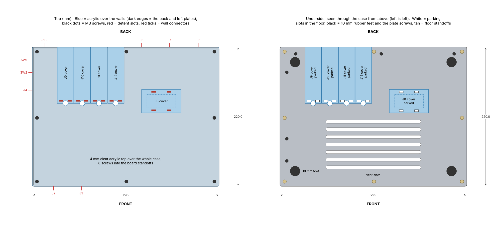

## Screw-on feet

The floor has a plain 3.4 mm hole at each foot, 24 mm in from each corner.
The stick-on feet cover them. A builder who wants feet that can't peel
off can screw on a recessed rubber bumper there instead:

| Part | Qty | Notes |
|---|--:|---|
| Keystone 722 recessed bumper (Mouser 534-722), 18.2 mm across, 11.1 mm tall, black rubber, #4/M3 hole | 4 | About $0.98 each, $0.77 at 10+ |
| M3 x 10 socket head screw | 4 | Up through the bumper's recess and the floor |
| M3 nylon-insert lock nut, ISO 10511 | 4 | On top of the floor, so the screw can't back out of the soft rubber |

The screw's tip stands about 3 mm above the floor, 3 mm under the board,
and no board pad is within 8 mm of a foot hole. The nuts are clear of the
plates' flanges. Fit them before the board goes in. The case sits 1.1 mm
higher on these, and the parked covers clear the desk by 4.1 mm.

## Covers and parking

The covers are 3D-printed with pull-off detents. There is nothing to glue,
and the whole cover is one print.

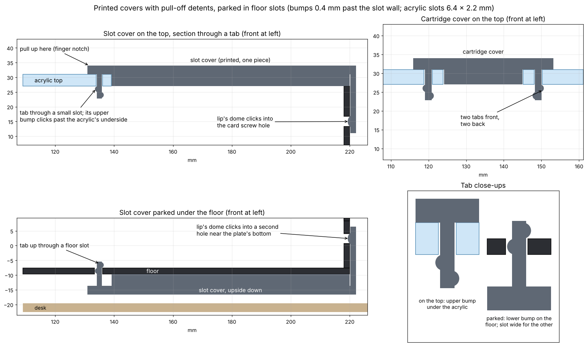

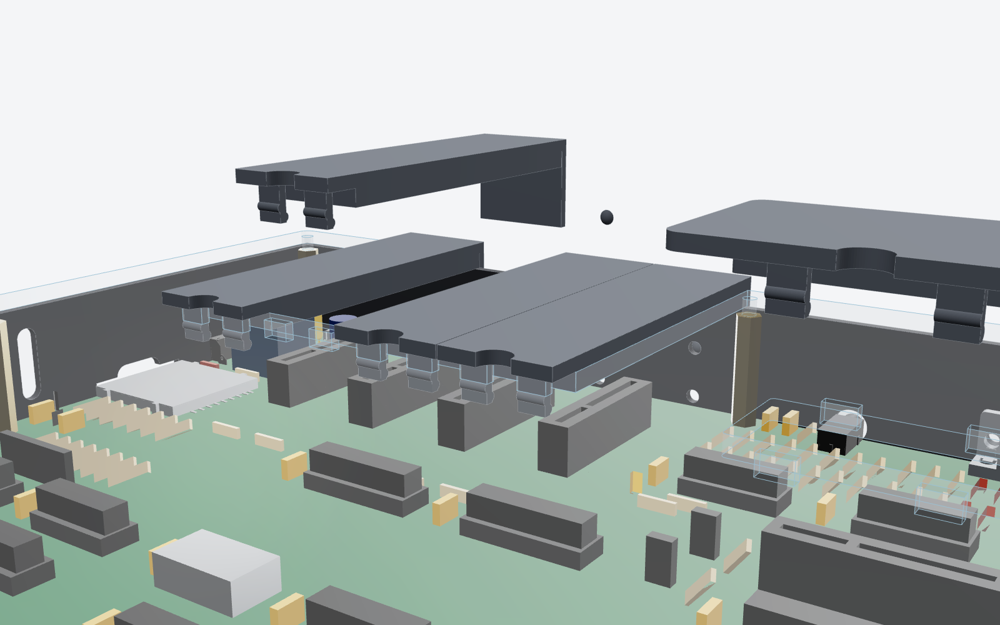

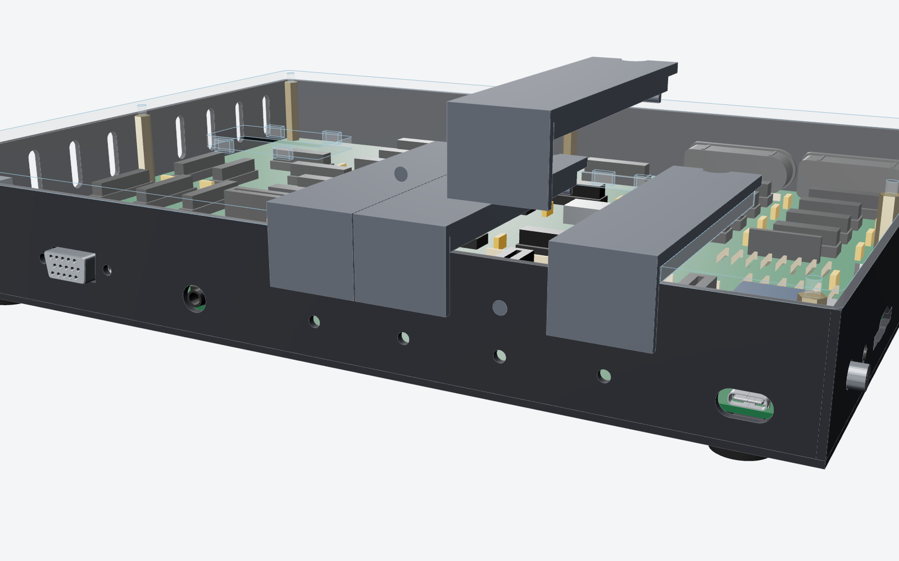

- **Openings.**
  - The acrylic top has one opening for the four expansion slots and one for
    the cartridge. Each is the slot's shell keepout (the footprint
    courtyard), so an installed card's shell has 1 mm all round.
  - The four expansion slots are 27 mm apart, but their shells are only
    1.2 mm apart. That's too close for acrylic between them, so they share
    one opening and the four covers tile it, one per slot.
- **Covers.**
  - Each cover is printed in one piece: a 4 mm plug that fills its share of
    the opening and a 3 mm cap on top. The cap laps 8 mm onto the acrylic in
    front (all round for the cartridge).
  - The expansion covers' plugs rest on the back wall's top edge at the
    back, and their caps carry on over it into a 2 mm lip down the back
    plate's outside face.
  - An 8 mm thumb notch in the cap's front edge lifts each cover out.
  - Print them cap face down, in PETG (it flexes without cracking; PLA works
    but its tabs are stiffer and more brittle). The STL files are already
    turned over for the bed.
- **Snap tabs.**
  - Under each cap's lap, a tab 6 mm wide and 1.8 mm thick drops through a
    6.4 x 2.2 mm slot in the acrylic. A rounded bump on the tab clicks past
    the acrylic's underside, standing 0.4 mm past the slot wall. That's
    enough to hold the cover, and a little pull lifts it off, because the
    bump's sloped top pushes the tab aside. The bump's top is a 45 degree
    ramp, so it prints without support when the cover lies cap down.
  - Slot covers have two tabs in the front lap. The cartridge cover has two
    in the front lap and two in the back lap, 12 mm either side of the
    middle, clear of the thumb notch.
  - At the back, where there is no acrylic, a slot cover's lip has a small
    dome (a blunt cone, so it prints without support) that clicks into the
    slot's card screw hole in the back plate. With
    a card fitted, the card's screw is in that hole and the cover is off.
  - Everything is put on and taken off from above. Nothing has to be reached
    from under the top.
- **Parking.**
  - A cover that is out goes under the case upside down, plug against the
    floor, in the same spot it covers on the top. Its tabs click up into
    two slots in the floor.
  - The floor is 2 mm thick, not 4 mm like the acrylic, so each tab has a
    second bump 2 mm further down, on its other face. On the top that bump
    hangs free below the acrylic. Parked, it catches on the floor's top
    face, and the floor slot is wider on the first bump's side, so that bump
    passes straight through.
  - Upside down, a slot cover's lip points up the back plate. Its dome
    clicks into a second hole 12.6 mm below the card screw hole, so the
    cover's back end can't sag (Justin's catch).
  - The four slot covers lie side by side and reach toward the front from
    the back edge. The cartridge cover parks under the cartridge slot.
  - A parked cover hangs 7 mm below the floor, and the 10 mm feet leave
    3 mm to the desk. Its tabs reach 2.2 mm above the floor's top face,
    under the board, clear of every part's leads.
  - Nothing parks inside the case, so a dropped cover never means opening it.

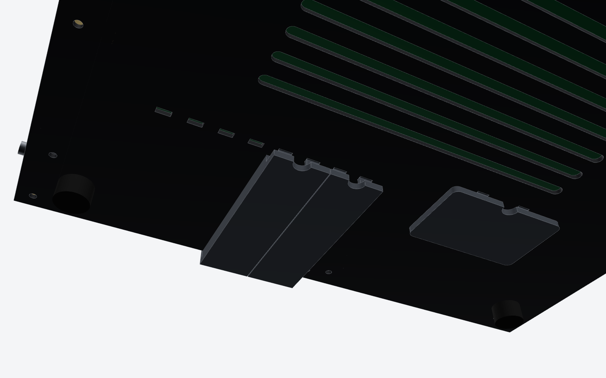

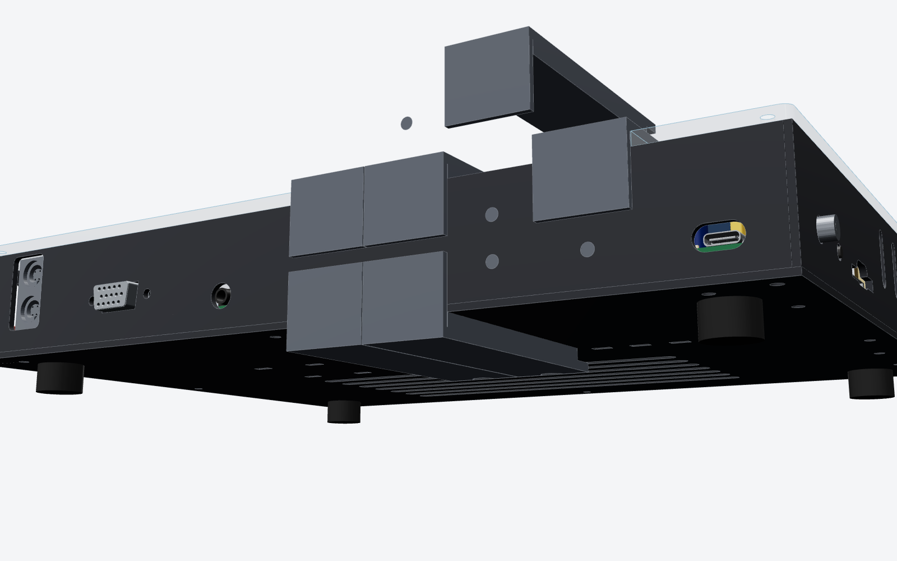

The drawings come from `src/scripts/gen_case_covers.py`. The renders use the
bent metal from `gen_case_quote.py --mesh` (views `bends` and `bends_rear`).

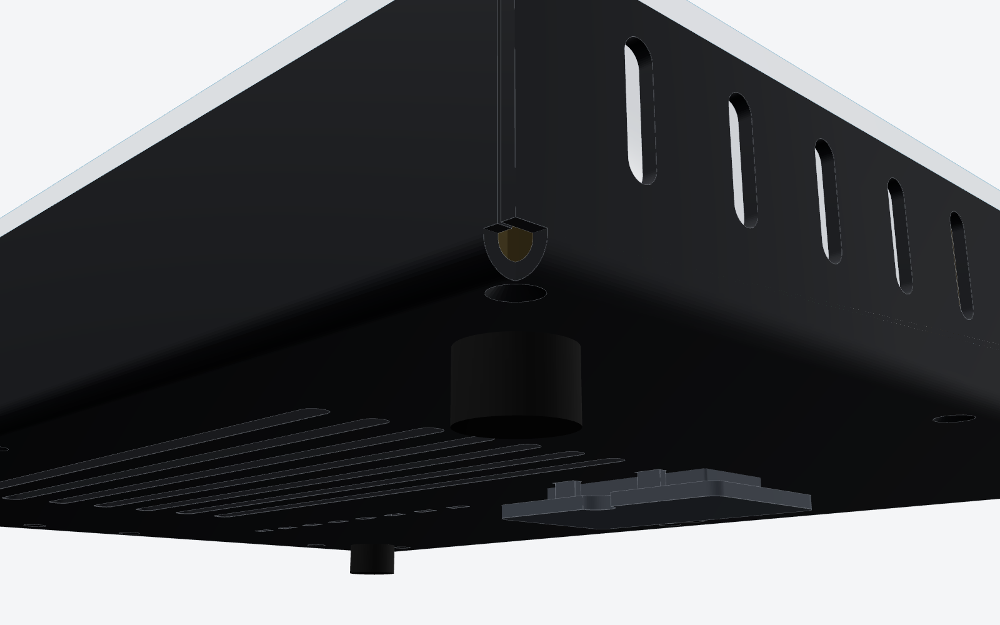

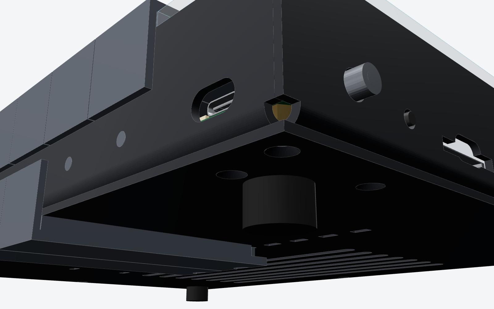

## Other details

- **Card shells at the back.** J9-J12's shell keepouts reach the board's
  back edge, so the expansion opening in the acrylic runs back to the back
  plate's inside face, and the slot covers' plugs rest on its top edge.
- **Ventilation.** Seven slots run across the floor's front half, in front of
  the parked covers. The side walls have a row of upright slots, 5 x 18 mm at
  20 mm pitch, from 4 to 22 mm above the board (over the chips): 10 along the
  right wall and 6 in the left plate's front half (the black metal case sheds most of the 14 W through its own
  surface, so the slots only need to let warm air out) (the switches and the SD
  slot take its back half; each slot stays 6 mm from a cut-out). Cool air
  comes in through the floor, and warm air leaves through the side slots,
  round the covers and through the connector openings; a draught or a desk
  fan blows straight through side to side. The 10 mm feet leave a clear air
  gap under the floor. The board draws about 14 W (20 PLDs at about 0.5 W
  each), so no fan or heat sinks are needed. Check the temperature with the
  top on during bring-up.
- **Finish.**
  - Black powder coat, in a stock color, is the cheapest finish the sheet
    metal services offer (anodize and printing cost more). It is about
    0.08 mm thick; the cut-outs allow for it. The plate screw countersinks
    are masked.
  - Powder coat insulates, so the case isn't grounded through the
    standoffs. Nothing needs it to be.
  - 5052 is the usual alloy for bent parts (6061 cracks on tight bends).
  - The tray's one bent corner (front right) has a small open gap (bend
    relief, about 0.5-1 mm). Welding and grinding closes it at extra cost.
    The other three corners are where the plates butt against the tray and
    each other.

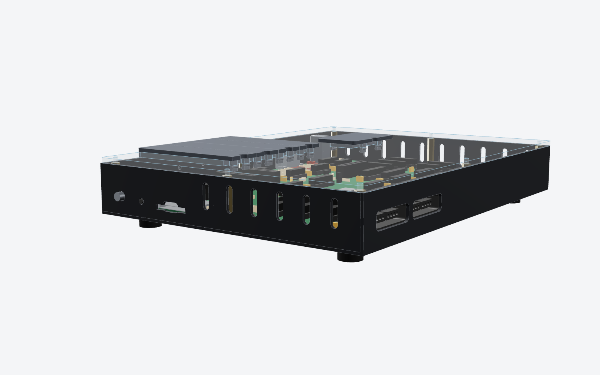

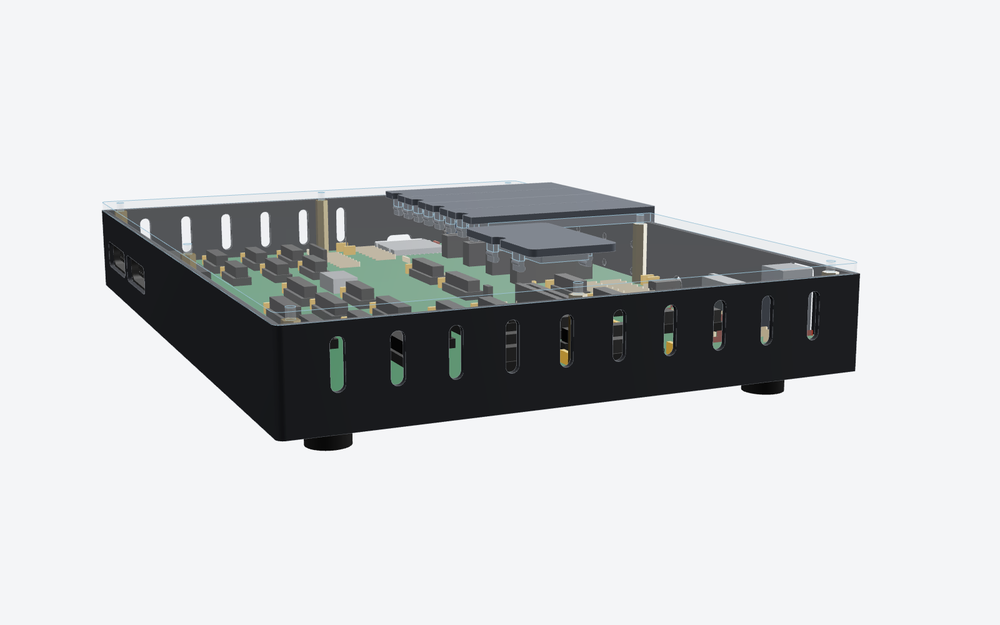

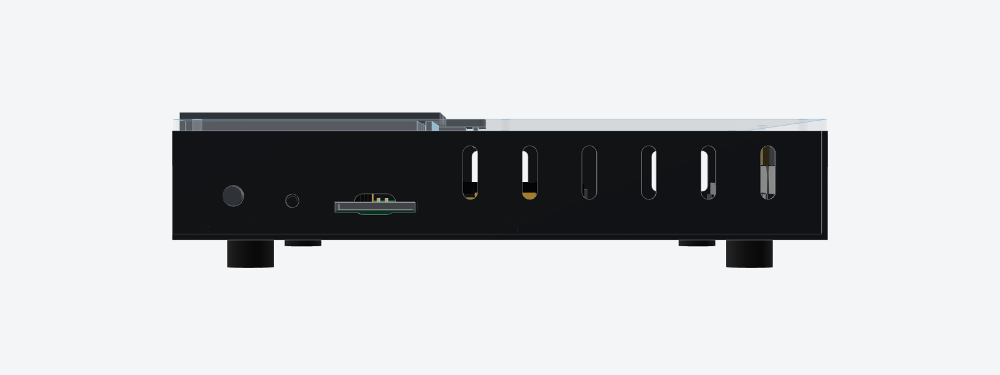

## 3D-printed version

The whole case can also be printed on a 220 x 220 mm bed (Creality Ender 3).
It goes together with dovetail seams and 41 M3 screws, 25 of them into
nuts. There is no glue, no heat-set insert and no thread cut in plastic.
`src/scripts/gen_case_print.py` makes it from the same board file. It has
the same outside size, connector cut-outs, top openings and covers as the
aluminium case, which stays as it is. Every part is designed to print flat,
without supports.

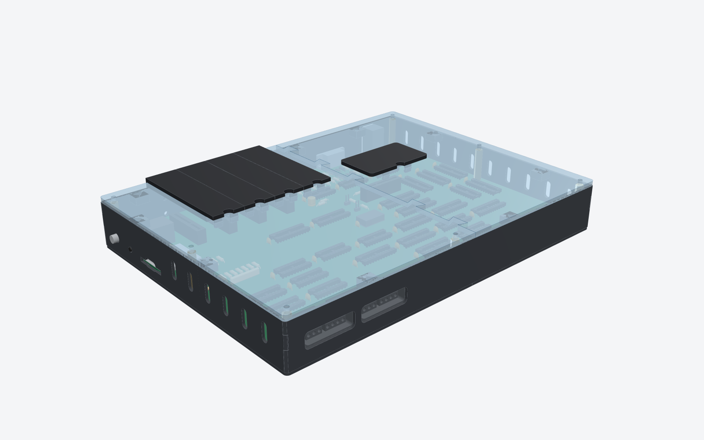

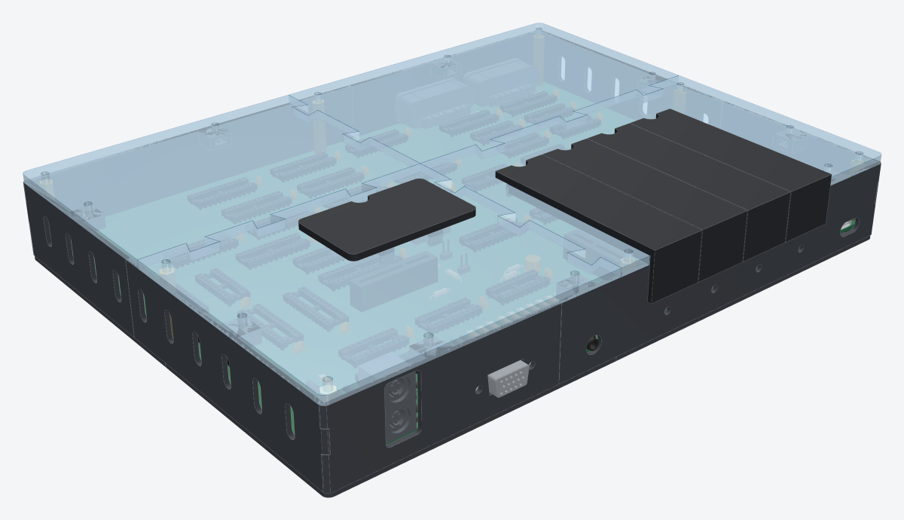

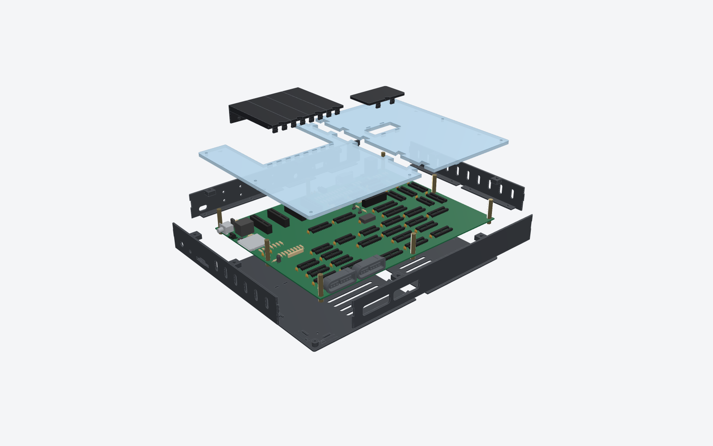

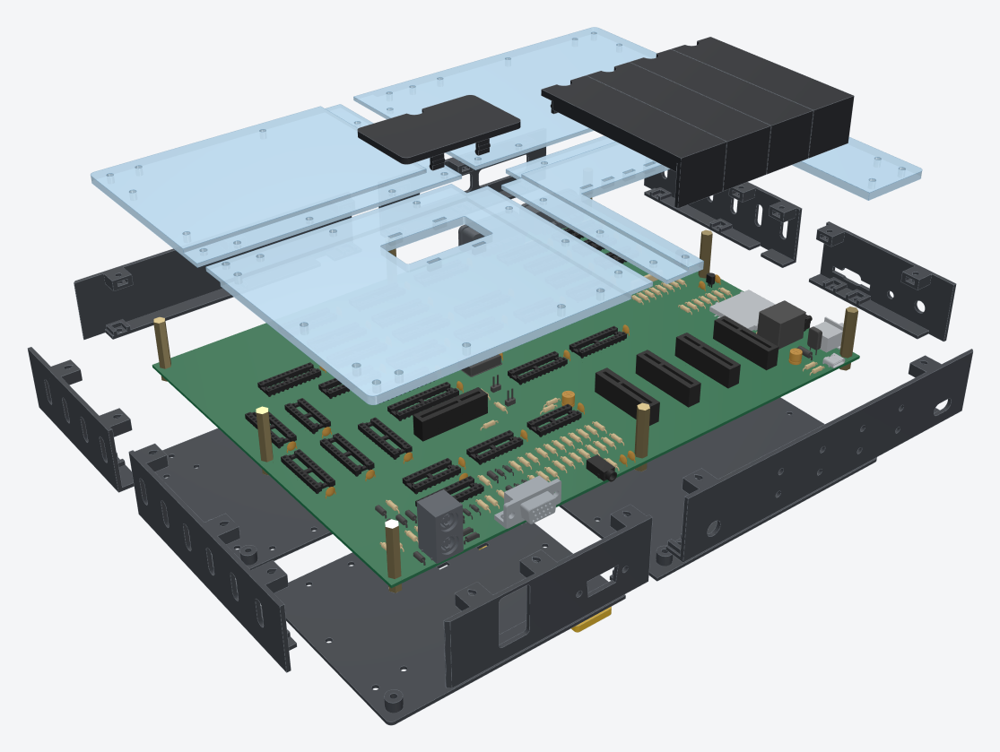

### How it is joined

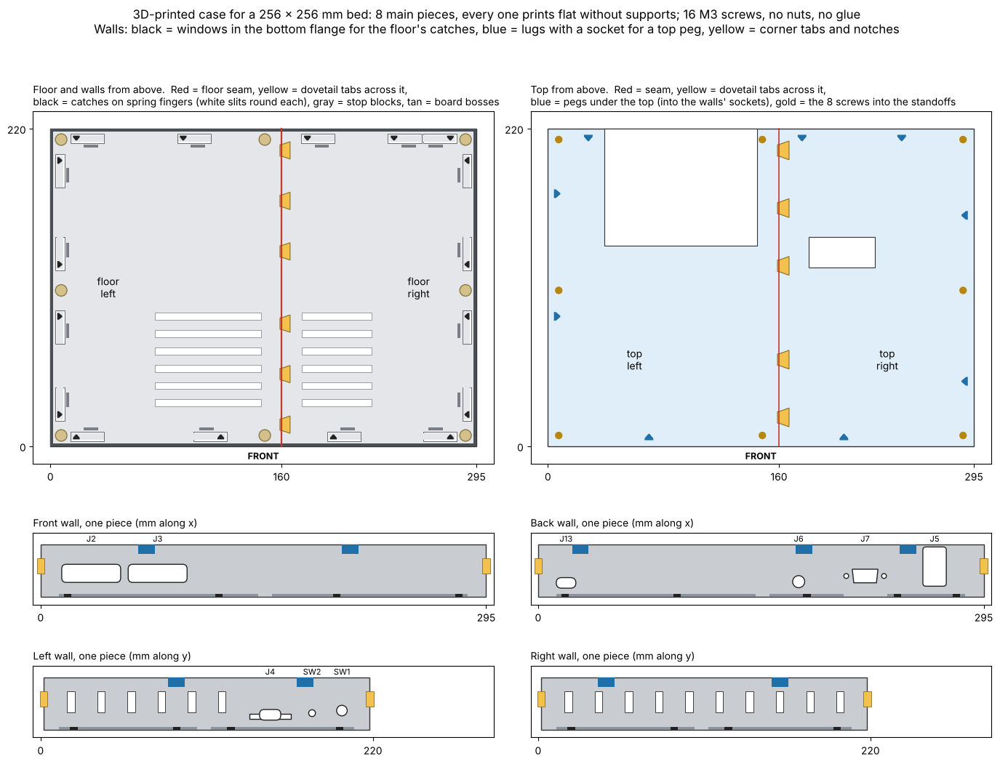

- **Floor.** Four flat pieces, with a boss under each board hole (H1-H8).
  The seams are at x 160 and y 114, clear of the parked covers.
- **Dovetail seams.** Flared tabs along one piece's edge drop into matching
  sockets in the next piece, so the pieces can't pull apart sideways. The
  floor has 12 tabs and the top has 11. There is 0.2 mm of clearance all
  round each tab. The pieces go together from above, one dropped into the
  next, and nothing holds them up or down at the seam itself: the wall
  screws and standoffs do that.
- **Walls.** Four flat panels, 2 mm thick, each in two pieces. The front and
  back walls run the full width and the side walls fit between them. Each
  panel stands on the floor.
  - A 9 mm flange along the bottom lies on the floor, under the board's
    edge. It carries open **nut seats**: two ribs and a stop that hold an M3
    nut so it can't turn. A screw comes up through the floor into each one.
    Every wall piece has two, one near each end.
  - A **nut lug** under the top edge of every wall piece (two on the long
    back left piece). A nut slides into a slot in the lug from inside the
    case, and one of the top's screws comes down into it.
  - The flange has gaps round the bosses and round the VGA socket's pins,
    so each panel slides straight in from outside, over its connectors.
  - **Corner tabs.** Each end of a side wall has a 10 mm tall tab that
    reaches through a notch in the end of the front or back wall. It lines
    the two walls up and stops the side wall's end leaning in. The corners
    have no screw, because the corner standoffs are in the way.
  - A wall's seam is never in line with a floor or top seam, so every seam
    is bridged by the part next to it.
- **Top.** Four pieces, 4 mm thick, with dovetail seams at x 160 and y 100,
  between the expansion bay and the cartridge cover. The top screws to the
  walls' nut lugs and to the eight standoffs.
- **Covers.** The same printed snap covers as the aluminium case.

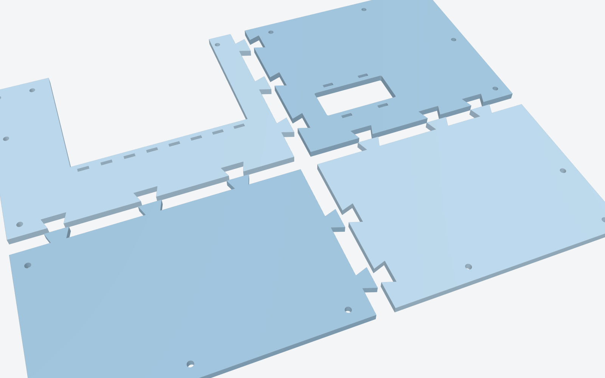

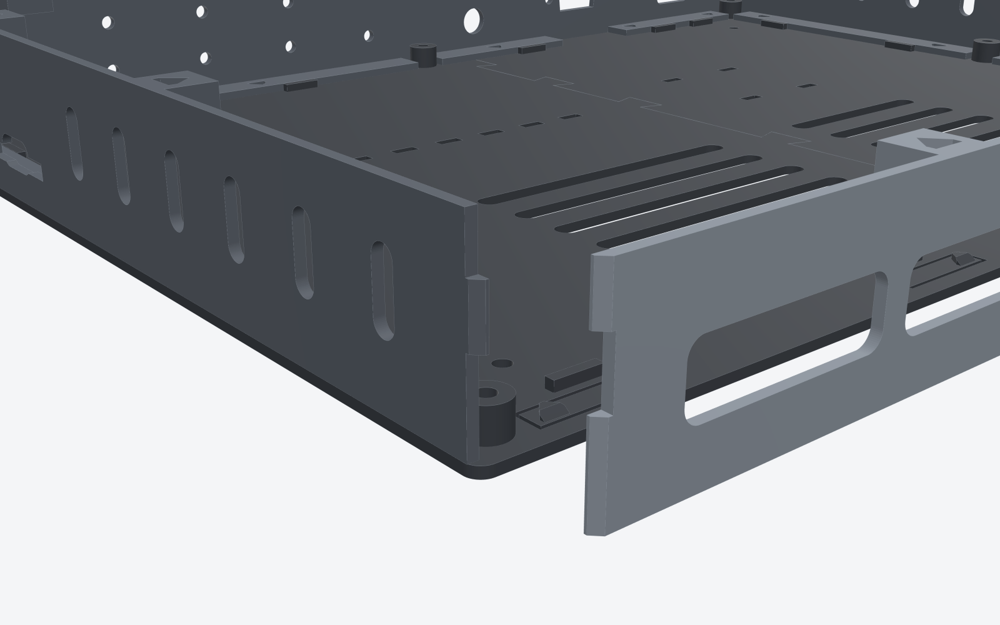

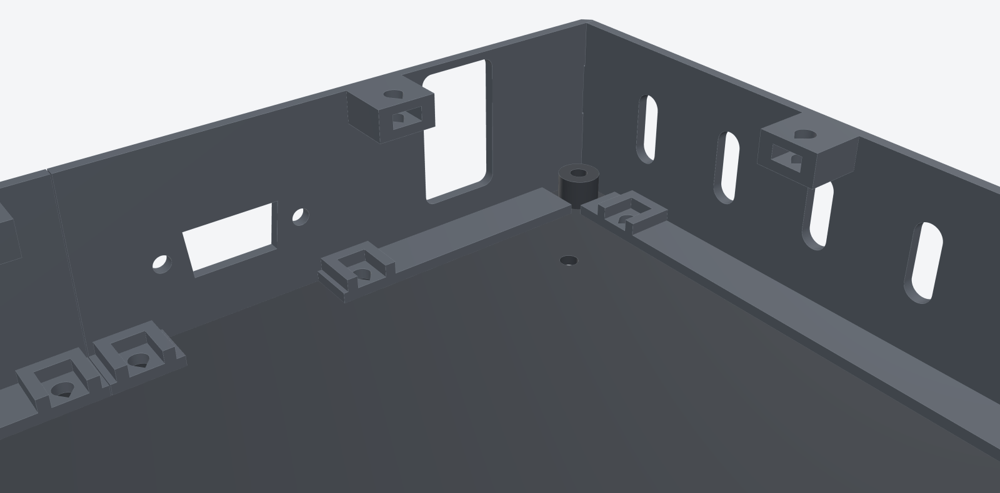

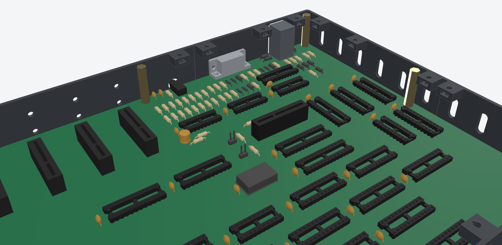

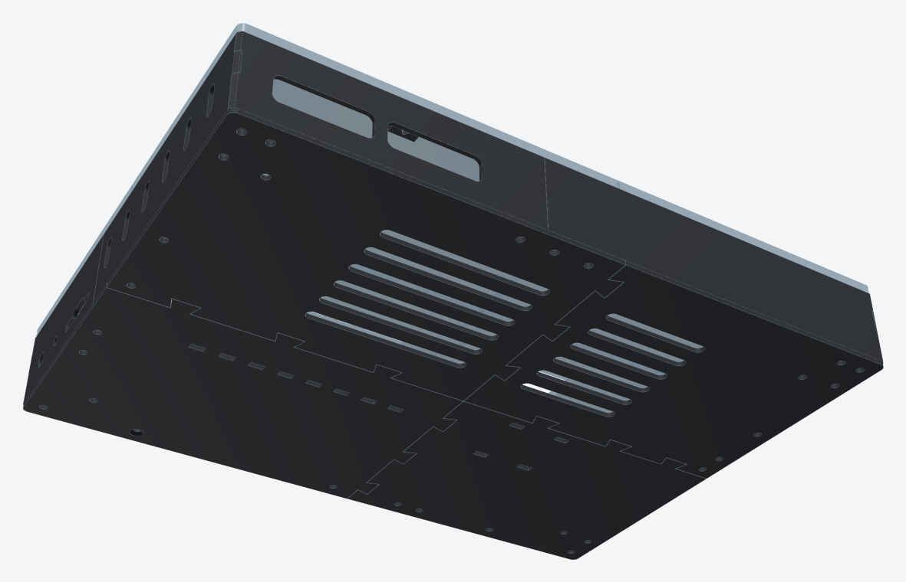

### Pieces and print orientation

The STL files in `case/print/` are already turned the way they print, with
the flat side on the bed at z = 0. None needs supports.

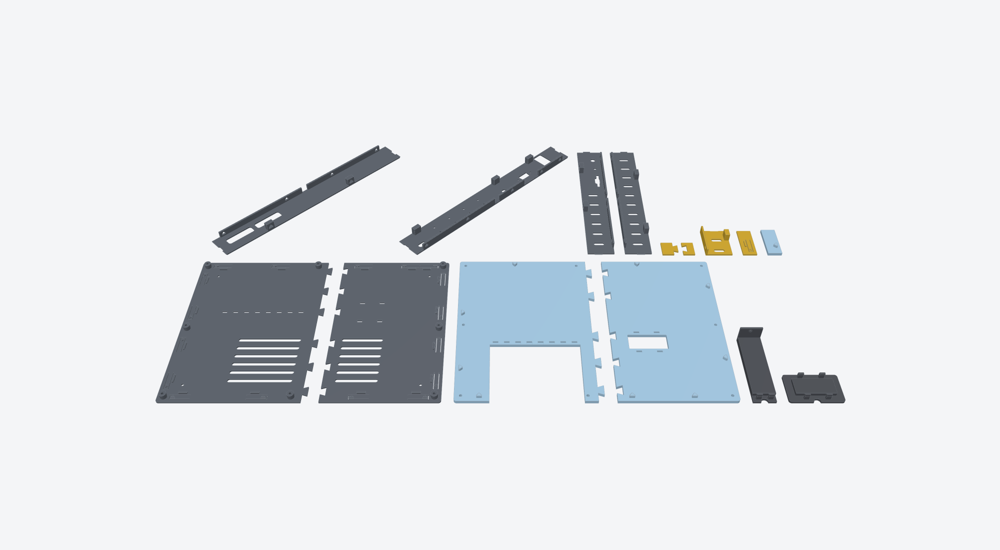

| File | Print | Size on the bed (mm) | Orientation |
|---|--:|---|---|
| `floor_front_left` | 1 | 166.0 x 113.9 x 8.0 | Underside down, bosses up |
| `floor_front_right` | 1 | 134.9 x 113.9 x 8.0 | Underside down, bosses up |
| `floor_back_left` | 1 | 166.0 x 112.0 x 8.0 | Underside down, bosses up |
| `floor_back_right` | 1 | 134.9 x 112.0 x 8.0 | Underside down, bosses up |
| `wall_front_left` | 1 | 124.9 x 34.6 x 12.0 | Outside face down, flange and lugs up |
| `wall_front_right` | 1 | 169.9 x 34.6 x 12.0 | Outside face down, flange and lugs up |
| `wall_back_left` | 1 | 189.9 x 34.6 x 12.0 | Outside face down, flange and lugs up |
| `wall_back_right` | 1 | 104.9 x 34.6 x 12.0 | Outside face down, flange and lugs up |
| `wall_left_front` | 1 | 34.6 x 129.9 x 12.0 | Outside face down, flange and lugs up |
| `wall_left_back` | 1 | 34.6 x 89.9 x 12.0 | Outside face down, flange and lugs up |
| `wall_right_front` | 1 | 34.6 x 89.9 x 12.0 | Outside face down, flange and lugs up |
| `wall_right_back` | 1 | 34.6 x 129.9 x 12.0 | Outside face down, flange and lugs up |
| `top_front_left` | 1 | 167.0 x 107.0 x 4.0 | Underside down |
| `top_front_right` | 1 | 134.9 x 107.0 x 4.0 | Underside down |
| `top_back_left` | 1 | 167.0 x 119.9 x 4.0 | Underside down |
| `top_back_right` | 1 | 134.9 x 119.9 x 4.0 | Underside down |
| `slot_cover` | 4 | 26.0 x 91.2 x 23.0 | Cap face down |
| `cart_cover` | 1 | 62.0 x 37.2 x 11.2 | Cap face down |
| `dovetail_test` | 1 | 42.0 x 22.0 x 2.0 | Flat (optional fit test) |

- **Print `dovetail_test` first.** It is a small pair of plates with one
  floor-size dovetail at the same 0.2 mm clearance. The two halves should
  press together by hand and not rattle. If they are too tight or too
  loose, change `DOVE_CLEAR` in `gen_case_print.py` and remake the files.
- Use a 0.4 mm nozzle and 0.2 mm layers.
- Print the floor and wall pieces solid (100 % infill, or 5 perimeters).
  They are only 2 mm thick.
- Use PETG. PLA works, but it softens from about 55 C, and the inside of a
  closed case gets warm.
- Print these slowly: the wall panels' nut seat ribs and corner tabs
  (2 mm) and the covers' tabs (1.8 mm).
- A first layer that spreads (elephant's foot) tightens the dovetails. If
  the test piece only binds at the bottom, add elephant's foot
  compensation in the slicer.
- The largest piece is 167 x 120 mm, so there is room for a brim on every
  piece.
- All the pieces together are about 507 cm3, which is about
  0.64 kg of PETG.
- A clear top: clear (natural) PETG at 100 % infill, printed hot and slow,
  comes out like frosted glass. The seams will show.

How the parts were made printable:

- A dovetail's flare is in the flat direction, so the tabs and sockets
  have straight vertical sides and no overhang.
- Every hole that lies on its side when printed (the screw holes through
  the flanges and lugs) is a teardrop with a peaked roof, 39 degrees from
  vertical.
- Nut seats and lug slots are open toward the top of the print, so nothing
  bridges over a nut.
- No screw head is recessed, except one countersink on the floor's bed
  face, where a parked slot cover lies against the floor. A countersink is
  a 45 degree cone, so it has no ceiling to bridge.
- The covers' bumps have a 45 degree ramp on the cap side, and the slot
  cover's back lip has a blunt cone where it had a dome, so nothing on a
  cover overhangs when it prints cap down.

### Checks

`gen_case_print.py` runs a fit check on the assembled case, and
`src/scripts/case_print_check.py` checks each STL file as it lies on the bed.

| Check | Result |
|---|---|
| Fit: no printed part cuts into the board, any part on it, a standoff or another printed part | Pass |
| Fit: no nut seat within 1.5 mm of a through-hole pad (a seat's top is 1.6 mm under the board) | Pass |
| Watertight: every edge shared by exactly two triangles | 21 of 21 files |
| Bed: footprint within 215 x 215 mm | 21 of 21 files |
| Overhangs: no downward face above the bed steeper than 45 degrees | 21 of 21 files, none found |
| Islands: every layer rests on the layer below (sliced every 0.2 mm) | 21 of 21 files, none found |

The 21 files are the 19 in `case/print/` and the two cover files in `case/`.
The overhang and island checks were tried on two pieces turned upside down,
and they failed both, as they should. The case has not been printed yet, so
the dovetail fit is from the model only.

### Hardware

| Part | Qty | Where |
|---|--:|---|
| M3 x 6 button head screw | 15 | Up through the floor into the walls' nut seats |
| M3 x 6 countersunk screw | 1 | The floor screw under the parked slot covers (back wall), flush |
| M3 x 8 button head screw | 17 | Top: 9 into the walls' nut lugs, 8 into the standoffs |
| M3 x 12 button head screw | 8 | Up through the floor bosses and the board into the standoffs |
| M3 hex nut, ISO 4032 | 25 | One in each nut seat and nut lug |
| M3 female-female hex standoff, 27 mm | 8 | Board to the top |
| Rubber feet, 16 mm across, 10 mm tall, self-adhesive | 4 | As on the aluminium case |

Black screws look best on the top.

### Putting it together

1. **Floor.** On a flat table, drop the four floor pieces into each other
   along the dovetail seams.
2. **Board.** Set the board on the eight bosses. Put an M3 x 12 screw up
   through each boss and the board, and spin a 27 mm standoff onto it.
   This also ties the four floor pieces to the board.
3. **Nuts.** Put an M3 nut in every nut seat on the walls' flanges (it
   drops in from above) and slide one into every lug slot.
4. **Walls.** Slide each wall piece in from outside, flat on the floor: the
   back pieces over USB-C, audio, VGA and PS/2, the left pieces over the
   power switch, reset and SD. The side walls' corner tabs go into the
   front and back walls' notches. Screw each piece down from below with
   two M3 x 6 screws. The one hole under the expansion bay is countersunk
   for the flat head screw.
5. **Top.** Drop the four top pieces into each other on the table, then
   lift the top on in one piece, with a hand under the middle. Fit the 9
   screws into the wall lugs and the 8 into the standoffs.
6. Stick the feet on, fit the VGA jackscrews and click the covers on.

To open the case, take out the top's 17 screws and lift the top off.

## Getting a quote

`case/quote/` (zipped as `case/quote.zip`) is the package to send to a sheet
metal service and a laser cutter. `src/scripts/gen_case_quote.py` makes it
from the same parts:

- `step/`: the tray and both plates as bent parts with real 2 mm inside bend
  radii and corner and end reliefs, and the acrylic top flat.
- `dxf/`: flat patterns of the bent parts, with layer CUT for the outline and
  holes and layer BEND for the bend lines (K = 0.44). There is also the
  cutting file for the acrylic top. The covers are printed, so they are not
  in the package.
- `pdf/`: an A3 drawing per part, with the flat pattern, overall sizes,
  bends, holes, hardware, material, finish and tolerances.
- `PARTS.csv` and `README.md`: quantities, materials, finishes and notes
  for the vendor. No part has PEM hardware.

SendCutSend takes the STEP for bent parts. PCBWay sheet metal, Xometry and
Protocase take the STEP plus the PDF. Ask for 1, 10 and 100 sets.

The plates' flanges are 14 mm, with open notches round the floor standoffs
that stop at the bend; the notches are 8 mm wide for the standoffs' hex
corners. The plates stand on the floor, which runs to the outside edges.
Each plate screw sits 9 mm from the plate's inside face. The flange holes
are plain 3.4 mm, with a loose M3 hex nut on top.

The README lists two cut-outs that sit close to a bend, for the vendor to
check: USB-C and the SD slot.

## Cost estimate

These are rough per-unit prices in US dollars, before shipping, tax and
tariffs (35 % is assumed elsewhere for China-made parts), from typical 2026
vendor pricing. **No quotes were requested**, so treat each number as plus or
minus 40 % until the STEP and DXF files are uploaded to a quoting site. The
metal is one bent tray and two flat plates with one bend each, in black
powder coat with no brushing.

| Item | 1 | 10 | 100 | 1,000 |
|---|--:|--:|--:|--:|
| Tray + back and left plates, 5052, black powder coat (US: SendCutSend, Protocase) | $140-230 | $88-148 | $47-81 | - |
| Same, China (JLCCNC, PCBWay sheet metal) | $74-120 | $46-78 | $28-46 | $19-32 |
| Welded and ground front-right corner of the tray | +$15-30 | +$10-20 | +$5-15 | +$4-10 |
| Acrylic top (laser cut) | $30-50 | $18-28 | $8-14 | $4-8 |
| Printed covers: 4 slot + 1 cartridge, about 70 g PETG (filament; printed by the builder or kitter) | $2-5 | $2-4 | $2-4 | $2-3 |
| Hardware: standoffs, screws, 10 mm feet | $11-15 | $9-12 | $6-8 | $4-6 |
| **Case, China sheet metal, open corner** | **$116-188** | **$76-124** | **$44-71** | **$29-49** |
| **Case, US sheet metal, open corner** | **$182-298** | **$118-194** | **$63-108** | - |

Weight: about 0.65 kg of aluminium, 0.25 kg of acrylic and 70 g of printed
covers.

## Not decided

- An open or welded tray corner.
- Whether the stacked PS/2 stays. It sets the case's height.

## Remaking the files

```
pip install cadquery
python3 src/scripts/gen_case.py                       # STEP + DXF + cover STL in case/, drawings in docs/case/
python3 src/scripts/gen_case.py --pcb other.kicad_pcb # from another copy of the board
python3 src/scripts/gen_case.py --mesh src/scripts/case_render/mesh   # also STL meshes for the renders
python3 src/scripts/gen_case_print.py                 # 3D-printed pieces in case/print/, docs/case/case_print_pieces.png, fit check
python3 src/scripts/case_print_check.py case/print/*.stl   # watertight, bed, overhang and island checks
python3 src/scripts/gen_case_print.py --mesh src/scripts/case_render/mesh   # also the pieces in place, for the renders
python3 src/scripts/gen_case_quote.py                 # quote package in case/quote/ and case/quote.zip
python3 src/scripts/gen_case_quote.py --mesh src/scripts/case_render/mesh   # also the bent metal for the renders
python3 src/scripts/gen_case_covers.py                # docs/case/case_cover_detents.png
python3 src/scripts/case_render/gen_case_hardware.py  # screws, standoffs, nuts for the renders
```

The renders use three.js in headless Chromium (`src/scripts/case_render/`).
Make the meshes as above, then run `npm install three@0.160.0` in
`case_render/web`. Serve `case_render/` on port 8765, then run
`node shoot_case.js [view ...]`. The views are in `views.json`. The
cartridge in the renders is the short 32K one (39 x 66 mm board). The
printed case's renders come from `node shoot_print.js [view ...]`, which
needs both scripts' meshes.
