# Bring-up: build order and a test for each chip

Date: 2026-11-12

This is the order to put the chips in, with a quick test after each one.
Every test needs only a multimeter with DC volts and a frequency counter
(and a VGA monitor from step 5 on).  These are assembly checks: they find a part that is
missing, wrong, reversed or badly soldered, and they take the design
itself as proven.  The power input goes in
first, alone, so a wiring or polarity fault there can't reach a chip.  The
video section comes next because it runs with no software.  The CPU comes next: it runs a known
pattern with no ROM at all (the "nop run"), and then the bring-up
cartridge goes in with the bring-up test ROM, and the rest of the CPU
chips follow one at a time: the ROM waits at a numbered "gate" until each
chip works, and the gate number reads straight off the program counter
(see [The chip gates](#the-chip-gates)).  With the last one in, the ROM
tests the memory by itself and draws a status screen.  The I/O and
the audio go in last, and the ROM shows their state on that screen.

Every part is named by its reference designator on the schematic.  The
chips' U numbers are their numbers in [CHIPS.md](../architecture/CHIPS.md); a part on the
cartridge is called "cartridge Un".  The expected
readings come from `src/scripts/bringup_signals.py`, a clock-by-clock model
of the PLD equations as they are wired at each step.  The test ROM is made
by `src/scripts/gen_bringup.py` and checked by
`src/scripts/test_bringup_sim.py` (see [The bring-up ROM](#the-bring-up-rom)).

Where a step changes the picture on the monitor, an example of what you
should see follows it.  The pictures are made by
`src/scripts/gen_bringup_screens.py` from the same model, pixel by pixel
(steps 5-11), and from the bring-up ROM running in the simulator (steps
22-24).  RAM powers up random, so a picture with RAM in it shows the kind
of pattern to expect, not the exact one.

Each step's parts table is followed by a picture of the board, seen from
the component side with the back edge (the connectors) at the top: the
parts to fit in that step are orange, a socket that is fitted but left
empty for now is blue (pale blue in later steps, until its chip goes in),
the parts already fitted are gray and the rest
are outlined.  The temporary straps are drawn in green from pin to pin
for as long as they stay in, and the step that puts them in has a
close-up of the socket with every pin numbered.
`src/scripts/gen_bringup_boards.py` draws them from the parts tables, the
strap descriptions and the board layout.

## Before you start

**Sockets.**  Put every chip in a socket.  Each step fits only the
sockets for its own chips, each with its 100 nF decoupler (Cn sits beside
Un), and checks them before a chip goes in: power on, +5 V on the
socket's power pin and 0 V on its ground pin (24-pin PLDs pins 24 and 12;
20-pin chips (F377, F541, ACT273, HC574, HCT574) 20 and 10; the 28-pin
RAMs 28 and 14).  A few sockets go in a step or more early, empty,
because a temporary resistor ("strap") plugs into
them; the step says so.  Each strap is described in the step that puts
it in and the step that takes it out.  The steps add chips one at a
time, and nothing is taken out again.

**Two kinds of 377.**  The board has six octal D flip-flops with enable
of two types that share a pinout: five 74F377 (U18-U22, marked
SN74F377AN) and one 74HCT377 (U23 only, marked CD74HCT377E).  The
silkscreen above each socket says which one goes there.  Read the marking
on the chip before you insert it.  A swap damages nothing, but an HCT377
in U18-U22 is too slow for the CPU and video, and an F377 in U23 makes
the row tint weak.

**Two kinds of diode.**  The Schottky diodes (D1-D6, D8-D11, D19) are
1N5817s in a black body; the six 1N4148s (D12-D17, row tint) are glass.
Don't swap them: a 1N4148 in a PS/2 place leaves the line too high to
read as low, and the row tint's clamp needs the Schottky's low drop.

**Programming.**  Each PLD and EEPROM is programmed in the step that
fits it, just before it goes in, not all at the start.  So a chip always
carries the equations current when it is fitted, and a fault found in one
step is fixed in the source before the later chips are made.  You need a
programmer that handles the ATF22V10C (every PLD is an ATF22V10C-7PX) and
the AT28C256 EEPROM.  Each PLD's JED file is the one WinCUPL makes from
its `.pld` file in `src/pld`; each step names the file and its revision.
For every chip:

1. Program it.
2. Verify it (the programmer reads it back and compares).
3. Label it with its reference designator and the revision (a sticker on
   top), so chips that share a file (U3/U4, U5/U6, U7-U10) stay apart
   from the others.
4. With the power switch off, insert it into its socket, then turn the
   power switch on to measure.

**Without the cartridge.**  The main board's STALL_OUT pull-up keeps the
CPU stalled until a cartridge lets it go, and RUN's pull-down keeps the
ROM off and the instruction register PLD at 02h.  Two jumpers stand in
for the cartridge before it is built.  JP1 joins STALL_IN to STALL_OUT
(the Branch PLD's STALL reaches the State and PC PLDs directly), so the
CPU runs; its shunt is on for steps 13-16, the nop run.  JP2 ties RUN to
+5 V; its shunt is on only for the write check in step 12.  Both shunts
are off when the cartridge goes in.  The clock runs from power-up either
way.

**Reset.**  Reset is a power cycle.  SW1 (on/off toggle) and relay K1's
normally closed contact sit in series in the 5 V input after the
polyfuse.  SW2 (reset, a small tactile button) pulls in K1, so holding SW2
cuts the power and letting go powers the board up again.  K1's
COM contact carries the board rail: holding SW2 swings it onto the NO
contact, where R64 (22 Ω) drains +5V to 0 V in a few milliseconds, so even a
short press resets cleanly.  The bulk 220 µF C41 sits on +5V after K1, so it
carries the board through the NC contact's bounce when SW2 lets go.
At power-up the ATF22V10C registers
start at 0, so the CPU starts in FETCH at x0000.  The cartridge stalls
the CPU while it loads its SRAM (about 33 ms; the video runs and shows
the random RAM), and RUN holds the map register clear (all ROM) until it
hands off at x0000, which holds a nop.  To
restart, press SW2 or switch SW1 off and on.

**Floating inputs.**  An ATF22V10C holds an input that nothing drives at
its last level (a weak pin keeper), and an F-series input that floats reads
high.  So a missing chip is harmless unless a level matters, and those
places get a temporary resistor (a strap, from step 6 on).

**The data bus pull-ups.**  The 10k SIP on D7:D0 goes in at step 8.
With nothing driving it, the bus reads FF.  After a chip drives it and lets
go, the bus keeps that byte for about 0.5 µs (the 10k and the bus
capacitance), so "an empty bus reads FF" holds only when nothing has driven
it for a while.  No step relies on either: the nop run of steps 13-16
ignores the bus, and from step 17 on a chip always drives it.

**Meter readings.**  The frequency is what the counter shows; the DC
average is what the volts range shows for a signal that toggles faster
than the meter can follow (the duty cycle times 5 V).  Many meters count
only up to about 10 MHz, so the fastest signals (the 25.175 MHz clock,
H0 at 12.59 MHz) may read wrong or zero; the slower bits next to them show
the same thing.  In steps 13-16 the CPU's speed depends on what the RAM
powered up with, so those readings are given as a range.

## Power

### Step 1: the power input, on/off switch and reset

**Parts for this step:**

| Ref | Part | Value or part number | Note |
|---|---|---|---|
| J13 | USB-C receptacle (power only) | GCT USB4125-GF-A-0190 |  |
| R1, R2 | Resistor | 5.1k | CC1 and CC2 to GND; without them a USB-C supply gives no 5 V |
| F1 | Polyfuse, 3 A hold | Bourns MF-RG300-0 | not polarised |
| D7 | TVS diode, fused VBUS (VFUSE) to GND | Littelfuse SA5.0A | band (cathode) to VFUSE |
| SW1 | Toggle switch, on/off | CIT ANT11TFHQE |  |
| C41 | Electrolytic capacitor, on +5V (after K1) | 220 µF (Rubycon 25YXJ220M6.3X11) | + to +5V, stripe to GND |
| K1 | Relay | CIT J1071CS5VDC.36 | COM (pin 1) = +5V, NC (pin 4) = VON, NO (pin 3) = R64 |
| R64 | Resistor, K1's NO contact to GND | 22 Ω | drains +5V while reset is held |
| SW2 | Tactile reset button, VON to the coil (KCOIL) | C&K PTS645VL58-2 LFS |  |
| D8 | Schottky diode, across K1's coil | 1N5817 (black) | band (cathode) to KCOIL |
| R59 | Resistor, power LED | 1k |  |
| D18 | Power LED, red 5 mm, +5V (after K1) to GND | Kingbright WP7113ID | long lead (anode) to R59, flat side (cathode) to GND |
| TP1, TP2 | Test point loop, GND | Keystone 5011 (black) | clip points for the ground test lead |
| TP3 | Test point loop, +5V (after K1) | Keystone 5010 (red) |  |

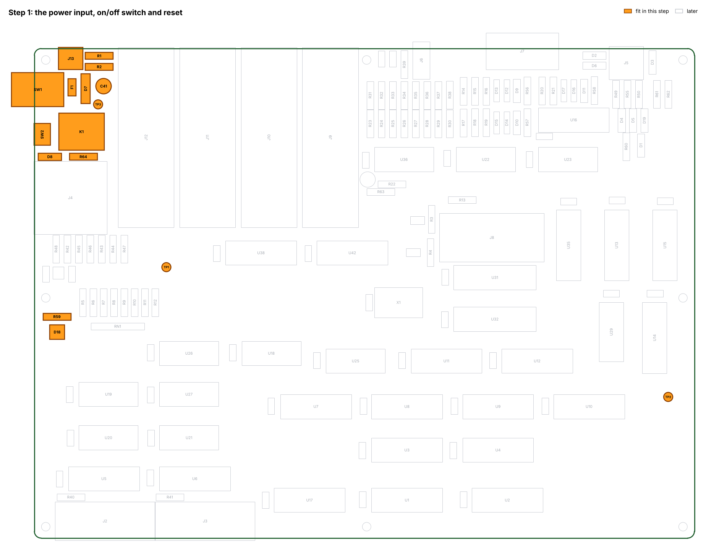

Fit only these power input parts on the bare board (power sheet).
Leave U40, C40 and C47 (the 3.3 V regulator) for step 23, with the SD card.

**Before power** (meter on ohms and diode test, no supply plugged in):

- VBUS (F1's input) to GND and +5V (TP3) to GND: open, not a short.
- D7 on diode test from GND to VFUSE: about 0.6 V forward, open the other
  way.  Reversed, it shorts the supply and F1 trips.
- D8 on diode test from GND to KCOIL: about 0.3 V forward.  Reversed, it
  shorts VON as soon as SW2 is pressed.
- C41's + lead goes to +5V (K1's COM side).

**Checks.**  Plug in a 5 V USB-C supply (3 A).  TP1 and TP2 are GND
and TP3 is +5V: clip the black test lead to TP1 for the meter's ground.

| Check | SW1 | SW2 | Expect |
|---|---|---|---|
| VBUS and VFUSE | off | up | 4.75-5.25 V; stop if above 5.5 V |
| VON, +5V | off | up | 0 V |
| VON and +5V | on | up | the same as VFUSE, within 0.05 V |
| D18 (power LED) | on | up | lit |
| +5V | on | held | 0 V; K1 clicks, D18 goes dark |
| VON | on | held | still 5 V |
| +5V | on | let go | back to 5 V, D18 lit |

Pass when every row above reads as listed.

## Video

### Step 2: the oscillator (X1)

**Parts for this step:**

| Ref | Part | Value or part number | Note |
|---|---|---|---|
| X1 | Oscillator, 25.175 MHz, full-size DIP-14 can | ECS ECS-100A-251.7 | no socket: solder it in, pin 1 (dot or square corner) on the footprint's pin 1 |
| C43 | Capacitor, beside X1 | 100 nF ceramic (TDK FG28X7R1H104KNT00) |  |

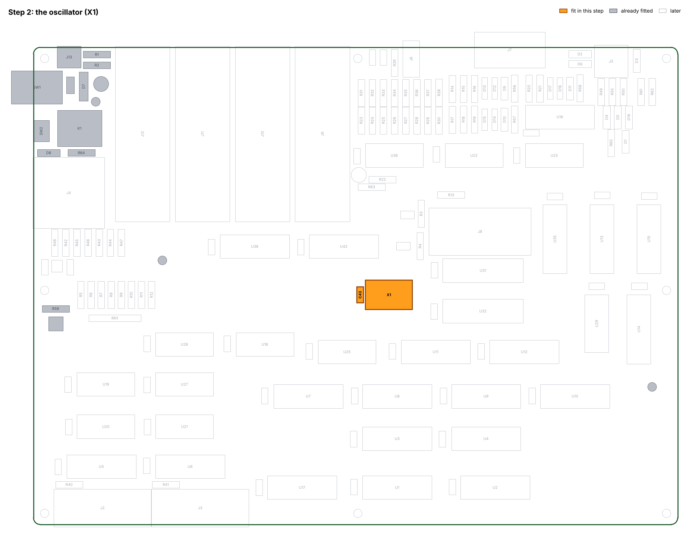

Fit only the 25.175 MHz oscillator X1 and its decoupler C43 (100 nF);
every other part goes in with the step that first needs it.  X1 has no
socket: solder it in, with the can's dot or square corner (pin 1) on
the footprint's pin 1.

X1's pins are under the can, so probe at U15's bare pads (the Sync PLD;
its socket isn't in until step 3):

- Power on: +5 V on U15 pin 24 and 0 V on pin 12.
- X1's output (CLK) reads **25.175 MHz**, 2.5 V average, at U15 pin 1.  If the meter doesn't reach that, skip it: step 3 shows the
  clock divided down.

### Step 3: Sync PLD (U15)

**Parts for this step:**

| Ref | Part | Value or part number | Note |
|---|---|---|---|
| U15 | PLD, Sync | ATF22V10C-7PX, programmed from `ATF22V10_SYNC.pld` |  |
| U15 socket | IC socket | DIP-24 0.3" (On Shore ED241DT) |  |
| C15 | Capacitor | 100 nF ceramic (TDK FG28X7R1H104KNT00) |  |

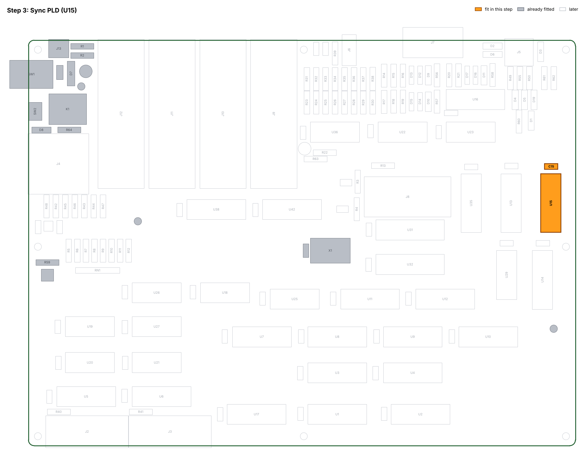

**Program first:** U15 Sync from `ATF22V10_SYNC.pld` (rev 12); verify
and label it.

Turn off the power switch.  Insert U15 into its socket.  Turn on the
power switch.  The Sync PLD's H2:H0 count the clock by themselves.

| Pin | Frequency | Duty | DC average |
|---|---|---|---|
| H0 (pin 14) | 12.59 MHz | 50 % | 2.50 V |
| H1 (pin 15) | 6.294 MHz | 50 % | 2.50 V |
| H2 (pin 16) | 3.147 MHz | 50 % | 2.50 V |
| CLK_E (pin 9, input) | 25.175 MHz | 50 % | 2.50 V |
| /WE (pin 20) | 0 | | 5 V (output off while RUN is low, pull-up R63) |

CLK_E is the clock straight from X1, before the long track that takes it
to every other chip (CPU.md, "RAM write timing"); U15 makes the RAM's
/WE from it, but lets go of the pin while RUN (pin 11) is low,
which R4 holds it at until step 12.

### Step 4: H counter PLD (U13)

**Parts for this step:**

| Ref | Part | Value or part number | Note |
|---|---|---|---|
| U13 | PLD, H counter | ATF22V10C-7PX, programmed from `ATF22V10_HCOUNT.pld` |  |
| U13 socket | IC socket | DIP-24 0.3" (On Shore ED241DT) |  |
| C13 | Capacitor | 100 nF ceramic (TDK FG28X7R1H104KNT00) |  |

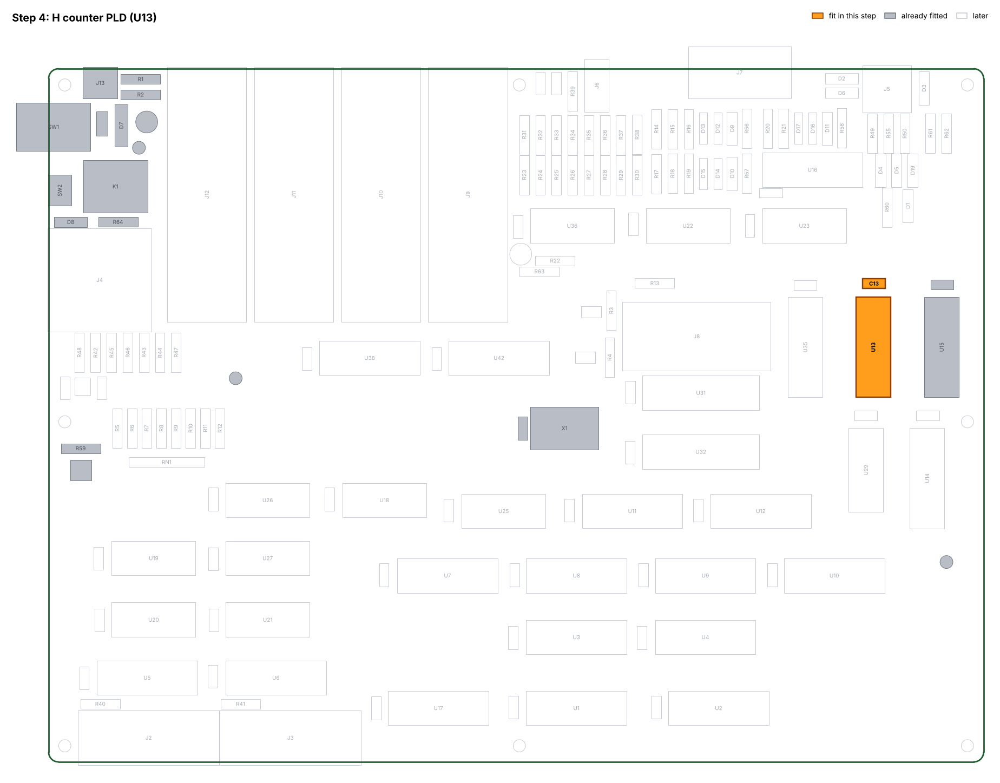

**Program first:** U13 H counter from `ATF22V10_HCOUNT.pld` (rev 08);
verify and label it.

Turn off the power switch.  Insert U13 into its socket.  Turn on the
power switch.  H9:H3 count groups of 8 clocks, 28-127, 800 clocks a line.

| Pin | Frequency | Duty | DC average |
|---|---|---|---|
| H3 (pin 14) | 1.573 MHz | 50.0 % | 2.50 V |
| H4 (pin 15) | 786.7 kHz | 50.0 % | 2.50 V |
| H5 (pin 16) | 377.6 kHz | 52.0 % | 2.60 V |
| H6 (pin 17) | 188.8 kHz | 52.0 % | 2.60 V |
| H7 (pin 18) | 94.41 kHz | 52.0 % | 2.60 V |
| H8 (pin 19) | 62.94 kHz | 64.0 % | 3.20 V |
| H9 (pin 20) | 31.47 kHz | 64.0 % | 3.20 V |

### Step 5: V counter PLD (U14)

**Parts for this step:**

| Ref | Part | Value or part number | Note |
|---|---|---|---|
| U14 | PLD, V counter | ATF22V10C-7PX, programmed from `ATF22V10_VCOUNT.pld` |  |
| U14 socket | IC socket | DIP-24 0.3" (On Shore ED241DT) |  |
| C14 | Capacitor | 100 nF ceramic (TDK FG28X7R1H104KNT00) |  |
| J7 | VGA connector, DE-15 | Assmann A-HDF 15 A-KG/T |  |
| R61, R62 | Resistor, sync series (beside U13 and U15) | 47 ohm |  |

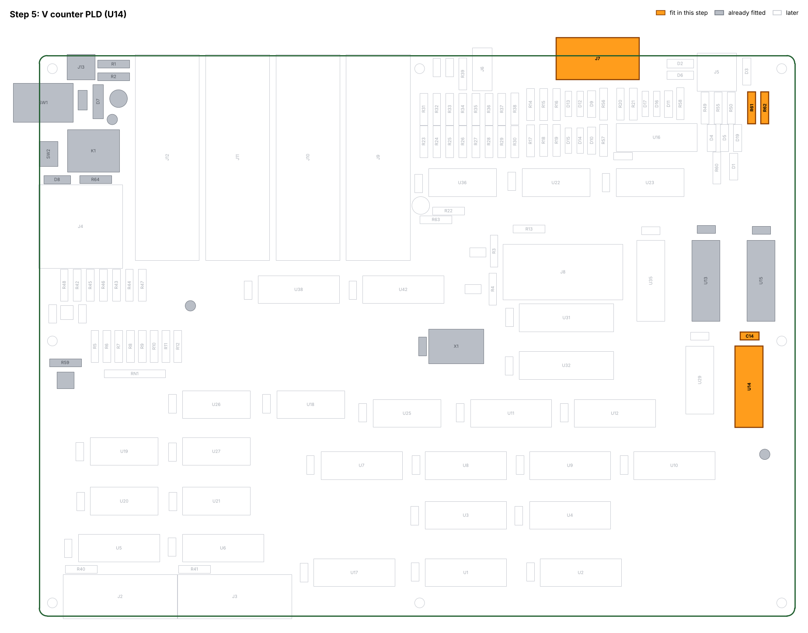

**Program first:** U14 V counter from `ATF22V10_VCOUNT.pld` (rev 03);
verify and label it.

Turn off the power switch.  Insert U14 into its socket, and connect a VGA
monitor.  Turn on the power switch.  V9:V0 count lines, 499-1023, 525
lines a frame.  The monitor should now lock to 640 x 480 at 60 Hz and show a **black screen** (the
color decoder isn't in yet).

*Step 5: the monitor locks and shows black.  A "no signal" message
instead means the sync isn't right.*

| Pin | Frequency | Duty | DC average |
|---|---|---|---|
| V0 (pin 14) | 15.7 kHz | 50.1 % | 2.50 V |
| V1 (pin 23) | 7.852 kHz | 50.1 % | 2.50 V |
| V2 (pin 22) | 3.956 kHz | 50.3 % | 2.51 V |
| V3 (pin 15) | 1.978 kHz | 50.3 % | 2.51 V |
| V4 (pin 16) | 959 Hz | 51.2 % | 2.56 V |
| V5 (pin 21) | 479.5 Hz | 51.2 % | 2.56 V |
| V6 (pin 20) | 239.8 Hz | 51.2 % | 2.56 V |
| V7 (pin 17) | 119.9 Hz | 51.2 % | 2.56 V |
| V8 (pin 18) | 59.94 Hz | 51.2 % | 2.56 V |
| V9 (pin 19) | 59.94 Hz | 97.5 % | 4.88 V |

### Step 6: color decoder (U16)

**Parts for this step:**

| Ref | Part | Value or part number | Note |
|---|---|---|---|
| U16 | PLD, color decoder | ATF22V10C-7PX, programmed from `ATF22V10_COLORDECODER.pld` |  |
| U16 socket | IC socket | DIP-24 0.3" (On Shore ED241DT) |  |
| C16 | Capacitor | 100 nF ceramic (TDK FG28X7R1H104KNT00) |  |
| R14, R17 | Resistor, color | 3.3k |  |
| R15, R18 | Resistor, color | 1.6k |  |
| R16, R19 | Resistor, color | 820 ohm |  |
| R20 | Resistor, color | 1.43k |  |
| R21 | Resistor, color | 715 ohm |  |
| U23 socket | IC socket | DIP-20 0.3" (On Shore ED20DT) | empty for now, holds straps S1 and S2 |
| C23 | Capacitor | 100 nF ceramic (TDK FG28X7R1H104KNT00) |  |
| S1 | Strap (temporary), in U23's socket | 10k | out at step 11 |
| S2 | Strap (temporary), in U23's socket | 10k | out at step 11 |
| (leads) | Test leads, 2: a clip on one end, a probe tip on the other | in the kit | one for ground, one for power |

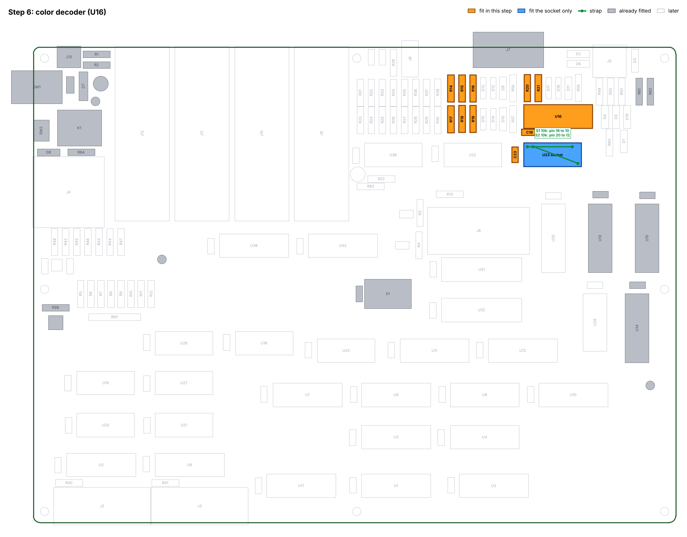

**Program first:** U16 color decoder from `ATF22V10_COLORDECODER.pld`
(rev 07); verify and label it.

**Straps.**  A strap is a 10k resistor (or a wire link, where the step says so) with its leads in an empty
socket's pins (or soldered to a spare socket that plugs in), holding a
control line whose driver isn't in yet.  The H counter reads the line
code's Q7 as "blank line", so turn off the power switch and put in:

- **S1**, in U23 (line code): pin 19 (Q7) to pin 10 (GND).  Holds LC7
  low, so every line is a video line.  Out at step 11.
- **S2**, in U23 (line code): pin 20 (+5 V) to pin 12 (Q4, which goes
  only to the tint resistor R56, not fitted until step 11).  A 10k high
  source for the power test lead.  Out at step 11.

**Test leads.**  The color decoder's pixel inputs D0-D7 (pins 2-9) and
mode inputs MODE0, MODE1 (pins 10, 11) have no driver yet (the pixel
buffer U22 and the line code register U23 come later).  Each one holds
the last level it was touched to (the pin keeper), so you set them by
touching them through the straps' 10k, which keeps a slip onto a wrong
pin harmless.  With the power still off, clip on both test leads, so
nothing needs clipping while the board is powered:

- **Ground lead:** clip it to strap S1's lead at U23's pin 19 (10k to GND).
- **Power lead:** clip it to strap S2's lead at U23's pin 12 (10k to +5 V).

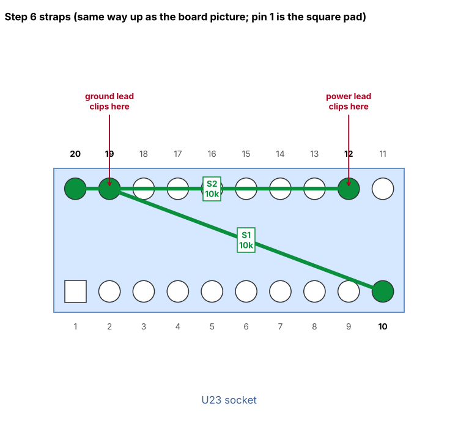

Insert U16 into its socket, and connect the monitor and USB power cable.
Turn on the power switch.  The screen shows a random color at first (the
inputs power up at no particular level).  These are the pins to touch:

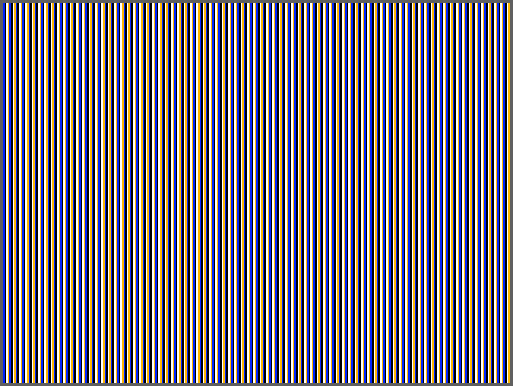

*Step 6 at power-up, an example (here 2 bpp, pixel pins 6C): one color
or fine vertical stripes that repeat every 8 pixels.  Yours will differ.*

| U16 pin | Input | What it sets |
|---|---|---|
| 2 | D0 | pixel bit 0 (8 bpp: RED1, pin 15) |
| 3 | D1 | pixel bit 1 (8 bpp: RED2, pin 16) |
| 4 | D2 | pixel bit 2 (8 bpp: RED3, pin 21) |
| 5 | D3 | pixel bit 3 (8 bpp: BLU2, pin 22) |
| 6 | D4 | pixel bit 4 (8 bpp: BLU3, pin 18) |
| 7 | D5 | pixel bit 5 (8 bpp: GRN1, pin 17) |
| 8 | D6 | pixel bit 6 (8 bpp: GRN2, pin 20) |
| 9 | D7 | pixel bit 7 (8 bpp: GRN3, pin 19) |
| 10 | MODE0 | color mode, with MODE1 |
| 11 | MODE1 | color mode: MODE1 MODE0 = 00 1 bpp, 01 2 bpp, 10 4 bpp, 11 8 bpp |

1. Touch the ground probe to each of these pins in turn: the screen
   turns **black** (1 bpp, every pixel 0), and every output (pins 15-22)
   reads 0 V.
2. Touch the power probe to each of them in turn: the screen turns
   **white** with a black border (8 bpp, every pixel FF), and every
   output reads 28.77 kHz, 73.1 %, 3.66 V.

| 1. Every pin grounded | 2. Every pin at power |
|---|---|
|  |  |

You'll see each touch change the picture along the way.  Feel free to
touch any of these pins with either the power or ground probe in any
order to explore the different colors and color modes.  In 8 bpp
(MODE0 and MODE1 high) each pixel pin drives the one output named in the
table, which drops to 0 V when that pin is low.

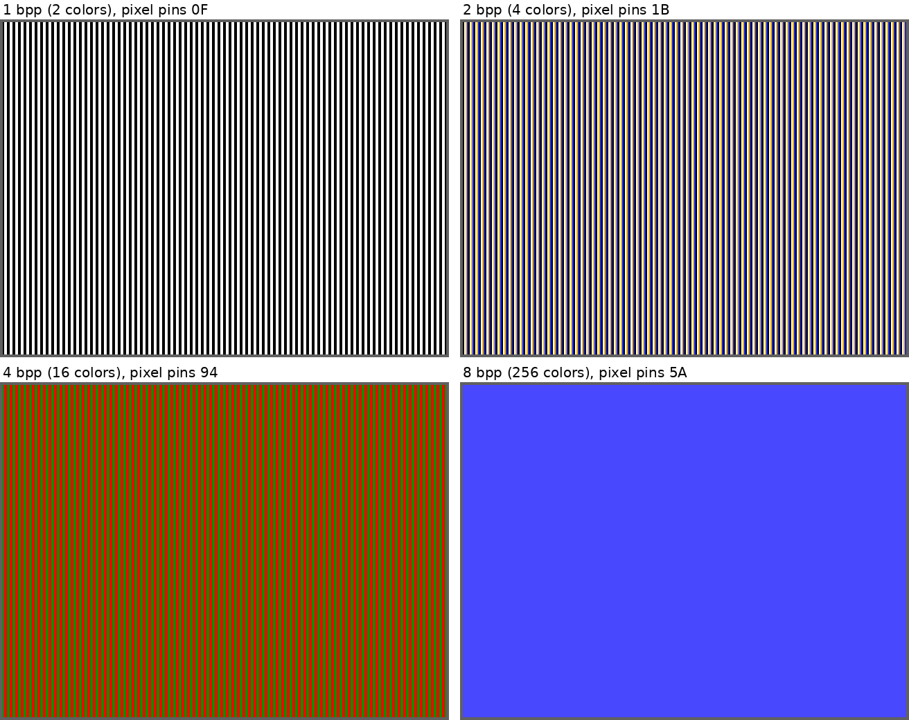

*Step 6, exploring: one example in each color mode.  The pixel pins never
change during a line, so every picture is a solid color (8 bpp) or
vertical stripes that repeat every 8 pixels.*

A color output that stays at 0 V when it should toggle, or toggles when it
should be 0 V, points at that pin's wiring or the color resistors
(R14-R21).  Turn off the power switch and unclip both test leads; S1 and
S2 stay until step 11.

### Step 7: address muxes (U7-U10)

**Parts for this step:**

| Ref | Part | Value or part number | Note |
|---|---|---|---|
| U7-U10 | PLD, address mux | ATF22V10C-7PX, programmed from `ATF22V10_QUAD_MUX.pld` |  |
| U7-U10 sockets | IC socket | DIP-24 0.3" (On Shore ED241DT) |  |
| C7-C10 | Capacitor | 100 nF ceramic (TDK FG28X7R1H104KNT00) |  |

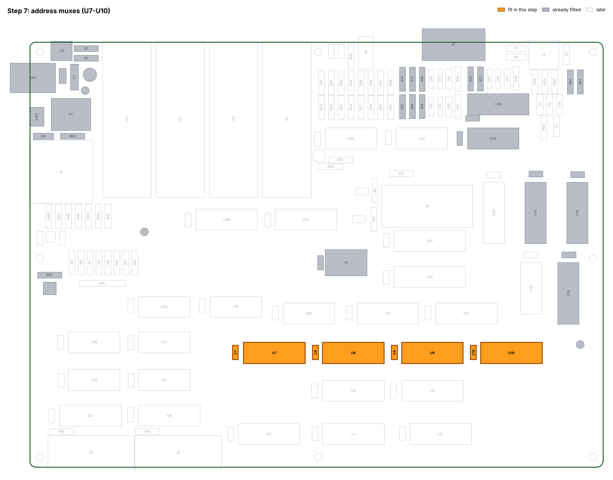

**Program first:** U7, U8, U9 and U10 address muxes, four copies of
`ATF22V10_QUAD_MUX.pld` (rev 02); verify and label them.

The mux selects are PIXEL_ENABLE from the Sync PLD and PC_ENABLE,
X_ENABLE and Y_ENABLE from the State PLD.  On a video read PIXEL_ENABLE picks the video address
whatever the missing State PLD's enables float at, so the muxes need no
straps.  The rest of the time they pass the CPU side's
address, which holds still while PC, D, X and Y are missing (each mux
input keeps whatever level it powered up at).  Turn off the power switch.
Insert U7-U10 into their sockets.  Turn on the power switch.

Measure A15:A0 at the mux outputs, pins 20-23 (LO0, LO1, HI0, HI1) of
each mux: U7 gives A0, A1, A8, A9; U8 A2, A3, A10, A11; U9 A4, A5, A12,
A13; and U10 A6, A7, A14, A15.  The exact readings depend on
the levels the CPU side came up at, so look only for a toggling signal:

| Address bits | Video read gives | Reading |
|---|---|---|
| A15:A9 | H9:H3 (the byte column) | toggling: a frequency, DC average between 0 and 5 V |
| A6:A2 | V6:V2 (the line) | toggling |
| A8, A7, A1, A0 | row bits from the audio PLD U35 (not in yet) | may sit at 0 V or 5 V until step 11 |

A bit in the first two rows that sits still at 0 V or 5 V points at that
mux's wiring or its H or V input.

### Step 8: RAM (U31), pixel buffer (U22)

**Parts for this step:**

| Ref | Part | Value or part number | Note |
|---|---|---|---|
| U31 | SRAM, 32K x 8 (lower half) | Alliance AS7C256C-15PCN |  |
| U22 | Pixel buffer, octal D flip-flop | TI SN74F377AN |  |
| U31 socket | IC socket | DIP-28 0.3" (On Shore ED281DT) |  |
| U22 socket | IC socket | DIP-20 0.3" (On Shore ED20DT) |  |
| C31, C22 | Capacitor | 100 nF ceramic (TDK FG28X7R1H104KNT00) |  |
| RN1 | Resistor network, 8 bussed, SIP-9 (data bus pull-ups) | 10k (Bourns 4609X-101-103LF) | dot (pin 1, common) to +5V |
| R63 | Resistor, /WE pull-up | 10k |  |
| U2 socket | IC socket | DIP-24 0.3" (On Shore ED241DT) | empty for now, holds strap S3 |
| C2 | Capacitor | 100 nF ceramic (TDK FG28X7R1H104KNT00) |  |
| U11 socket | IC socket | DIP-24 0.3" (On Shore ED241DT) | empty for now, holds strap S4 |
| C11 | Capacitor | 100 nF ceramic (TDK FG28X7R1H104KNT00) |  |
| S3 | Strap (temporary), in U2's socket | wire link | out at step 9 |
| S4 | Strap (temporary), in U11's socket | 10k | out at step 12 |

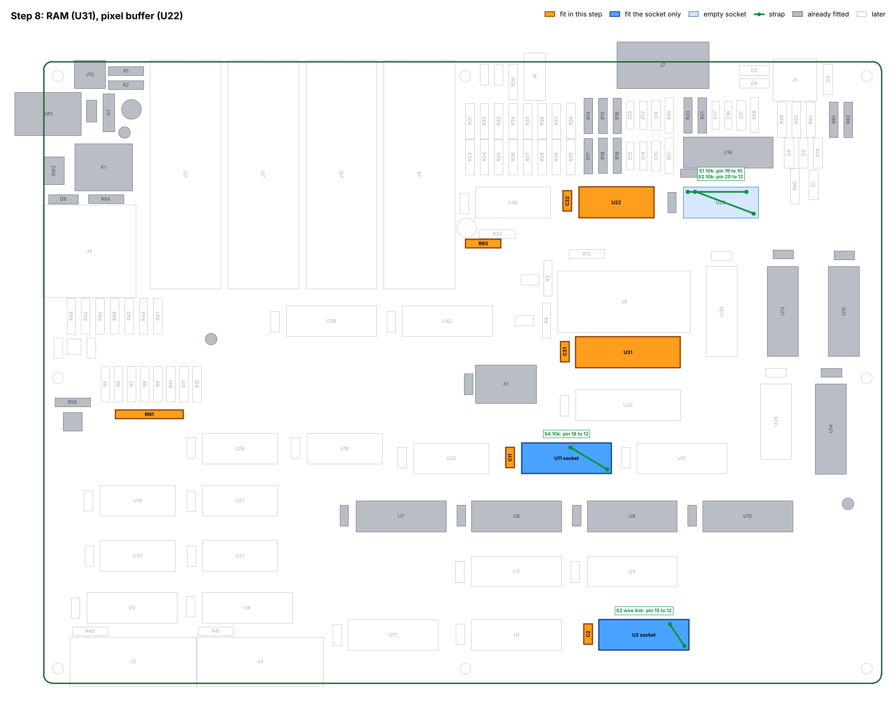

U31 and U22 need no programming.  U22 must be marked SN74F377AN (the
silkscreen above its socket says 74F377), not the CD74HCT377E that goes
in U23.

The video now reads the RAM.  Nothing writes it:
U15 lets go of /WE while RUN is low, so R63 holds it high.  The pixel
buffer's load strobe /PIX_LD and the RAM's /OE come from PLDs that aren't
in yet, so turn off the power switch and put in:

- **S3**, in U2 (Branch): a wire link from pin 15 (/PIX_LD) to pin 12
  (GND).  The pixel buffer loads the data bus every clock.  A wire, not
  a 10k: an F377 input needs more current to pull low than 10k passes.
  Out at step 9.
- **S4**, in U11 (memory control): 10k from pin 18 (/RAM_OE) to pin 12
  (GND).  The RAM drives the bus all the time.  Out at step 12.

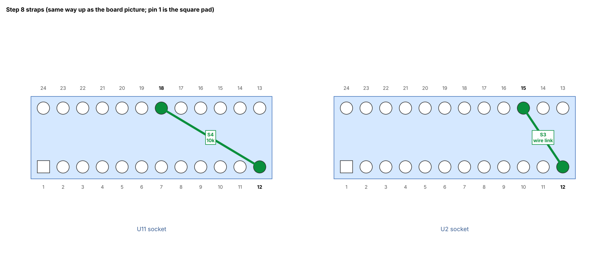

Insert U31 and U22 into their sockets.  Turn on the power switch.

The monitor shows **one byte over and over**, with a thin stripe in every
8 pixels.  In 7 clocks of every 8 the muxes point at the CPU side's
address, which stays put while PC, D, X and Y are missing, and the pixel
buffer loads that one byte; in the eighth, the video read, the byte from
the video address shows through.  Only U31 is in, so only the left 16 byte
columns (A15 = 0) read the RAM; the other 64 read FF from RN1.

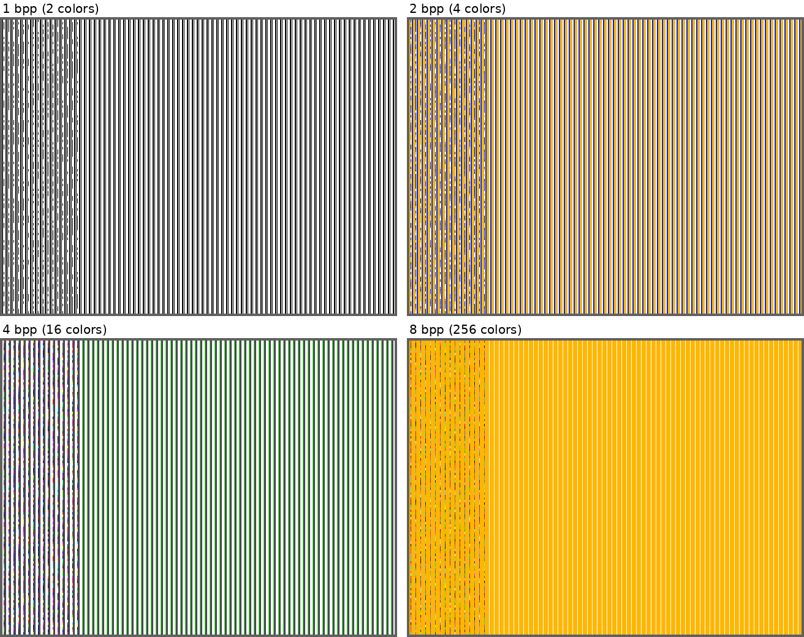

*Step 8, an example in each color mode (you see the one MODE1:MODE0 came
up in).  The repeated byte makes the stripes or the solid color; the thin
stripe in every 8 pixels is steady (FF) in the right 64 columns and
speckled with RAM data in the left 16.  Your byte and colors will differ.
Open the image full size to see the single-pixel stripes.*

The color mode is wherever MODE1:MODE0 came up.  To try other modes, clip
the test leads on as in step 6 before you turn the power on and touch
only MODE0 and MODE1 (pins 10, 11); the pixel pins are driven by U22 now.

### Step 9: Branch PLD (U2)

**Parts for this step:**

| Ref | Part | Value or part number | Note |
|---|---|---|---|
| U2 | PLD, Branch | ATF22V10C-7PX, programmed from `ATF22V10_BRANCH.pld` | socket fitted at step 8 |

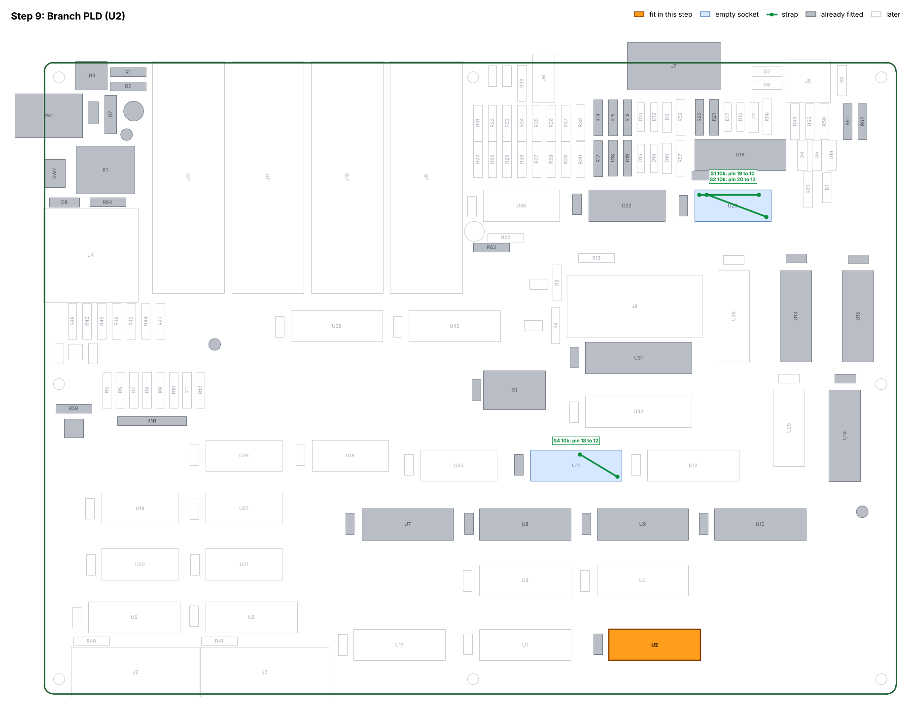

**Program first:** U2 Branch from `ATF22V10_BRANCH.pld` (rev 15); verify
and label it.

The Branch PLD goes in now only for /PIX_LD (pin 15), which is just
PIXEL_ENABLE inverted; the rest of it waits for the CPU, and it needs no
straps.  Turn off the power switch.  Take strap S3 (U2 pin 15 to pin 12)
out, then insert U2 into its socket.  Turn on the power switch.

The pixel buffer now loads only on the video read, and the left 16 byte
columns show **random RAM** in the color mode on MODE1:MODE0.  Rows
repeat in bands (the audio slot PLD U35 isn't in, so four of the row
address bits are stuck).  The other 64 columns read FF (white in 1 bpp
and 8 bpp).

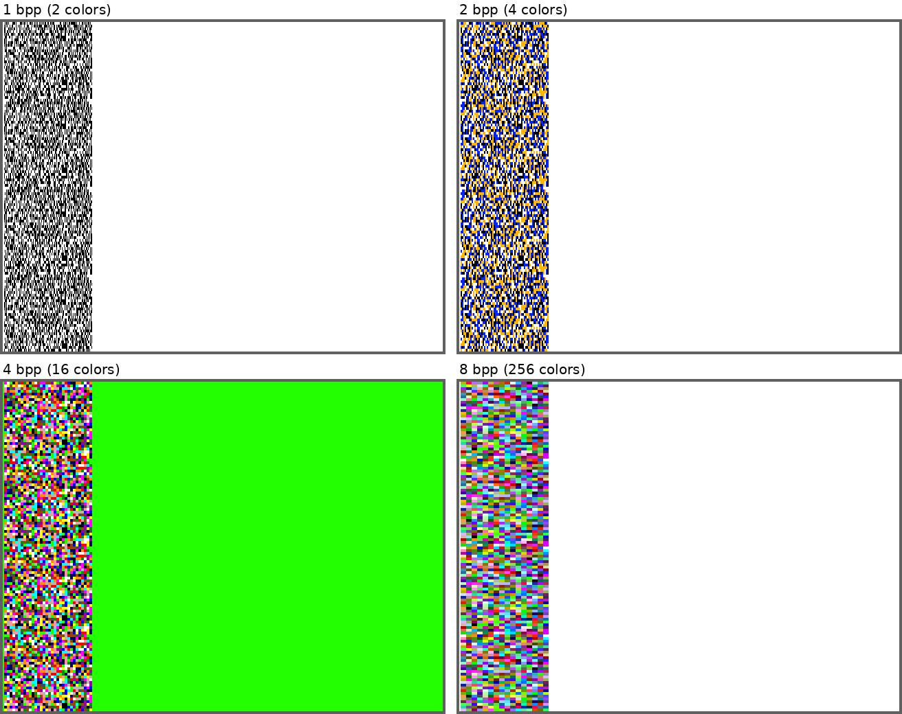

*Step 9, an example in each color mode.  The noise is in bands 4 lines
tall, and the pattern repeats down the screen every 128 lines.  FF is
white in 1, 2 and 8 bpp and bright green (color 15) in 4 bpp.*

### Step 10: RAM (U32) and I/O decode (U12)

**Parts for this step:**

| Ref | Part | Value or part number | Note |
|---|---|---|---|
| U32 | SRAM, 32K x 8 (upper half) | Alliance AS7C256C-15PCN |  |
| U12 | PLD, I/O decode | ATF22V10C-7PX, programmed from `ATF22V10_IO_DECODE.pld` |  |
| U32 socket | IC socket | DIP-28 0.3" (On Shore ED281DT) |  |
| U12 socket | IC socket | DIP-24 0.3" (On Shore ED241DT) |  |
| C32, C12 | Capacitor | 100 nF ceramic (TDK FG28X7R1H104KNT00) |  |

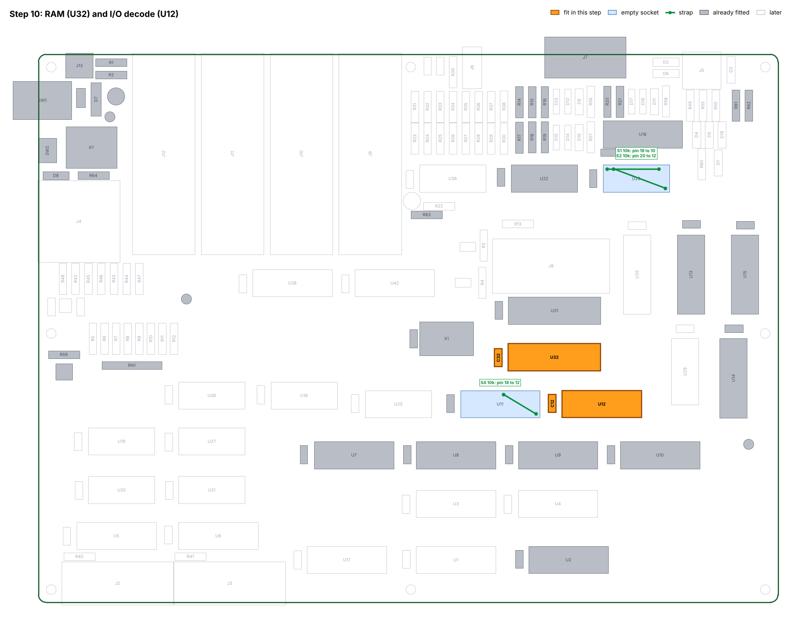

**Program first:** U12 I/O decode from `ATF22V10_IO_DECODE.pld`
(rev 07); verify and label it.

U32's chip enable /CE_HI (U12 pin 15) is low when A15 is 1; on a video
read A15 is H9.  Turn off the power switch.  Insert U32 and U12 into their
sockets.  Turn on the power switch.  All 80 byte columns now show
**random RAM**.

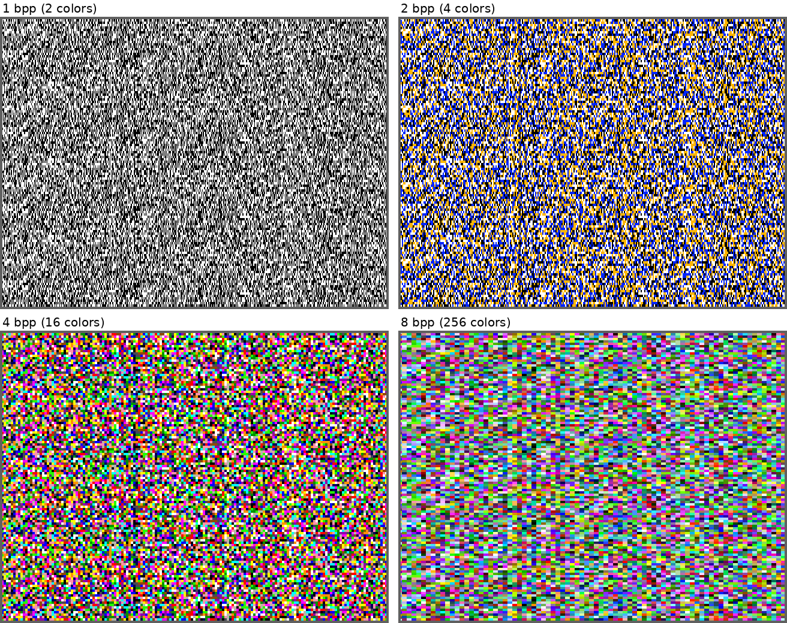

*Step 10, an example in each color mode: the same banded noise as step 9,
now across the whole screen.*

### Step 11: audio and mode slot PLD (U35), line code (U23)

**Parts for this step:**

| Ref | Part | Value or part number | Note |
|---|---|---|---|
| U35 | PLD, audio and mode slots | ATF22V10C-7PX, programmed from `ATF22V10_AUDIO.pld` |  |
| U23 | Line code register, octal D flip-flop | TI CD74HCT377E | socket fitted at step 6 |
| U35 socket | IC socket | DIP-24 0.3" (On Shore ED241DT) |  |
| C35 | Capacitor | 100 nF ceramic (TDK FG28X7R1H104KNT00) |  |
| R56-R58 | Resistor, row tint | 910 ohm |  |
| D9-D11 | Schottky diode, row tint | 1N5817 (black) | band (cathode) as on the silkscreen |
| D12-D17 | Diode, row tint | 1N4148 | band (cathode) as on the silkscreen |

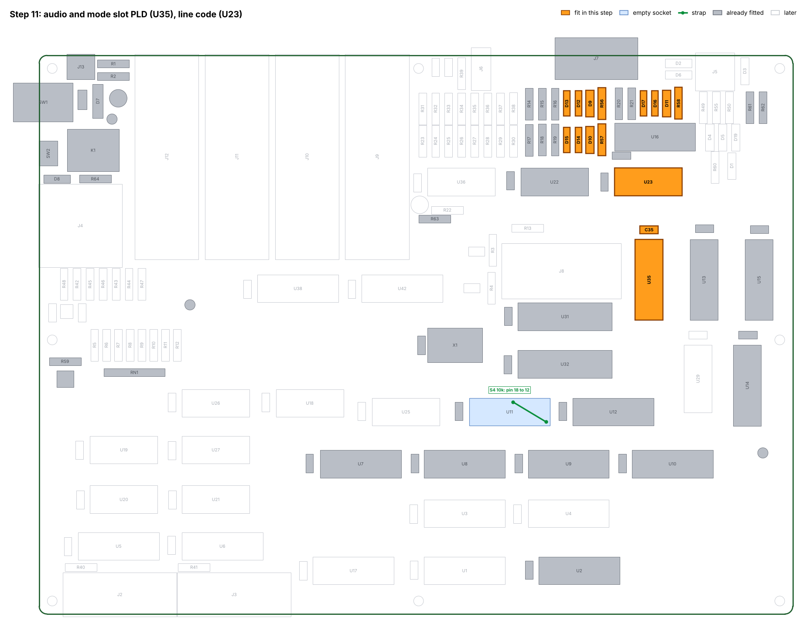

**Program first:** U35 audio and mode slots from `ATF22V10_AUDIO.pld`
(rev 04); verify and label it.  U23 needs no programming; it is the
one CD74HCT377E (the silkscreen above its socket says 74HCT377).

Turn off the power switch.  Take straps S1 (U23 pin 19 to pin 10) and S2
(pin 20 to pin 12) out, then insert U35 and U23 into their sockets.  Turn
on the power switch.  BLANK_RD now picks group 45 (mode byte) and group
46 or 47 (audio sample) on every line, and the line code register loads
each line's mode byte.  The RAM is random, so the monitor shows **random
colored noise** in a mix of modes, line repeats and row tints, with about
half the lines black (bit 7 of a random mode byte blanks the line).
Nothing writes the RAM (R63 holds /WE high), so the picture holds still.  Power off and on: a
different picture.

*Step 11, an example: each line has its own random mode byte, so color
modes, tints and line repeats change from line to line and about half the
lines are black.*

| Pin | Frequency | Duty | DC average |
|---|---|---|---|
| BLANK_RD (pin 23) | 62.16 kHz | 2.0 % | 0.10 V |
| /MODE_LD (pin 22) | 31.47 kHz | 99.0 % | 4.95 V |

### Step 12: memory control (U11) and map register (U25)

**Parts for this step:**

| Ref | Part | Value or part number | Note |
|---|---|---|---|
| U11 | PLD, memory control | ATF22V10C-7PX, programmed from `ATF22V10_MEM_CTRL.pld` | socket fitted at step 8 |
| U25 | Map register, octal D flip-flop with clear | TI CD74ACT273E |  |
| U25 socket | IC socket | DIP-20 0.3" (On Shore ED20DT) |  |
| C25 | Capacitor | 100 nF ceramic (TDK FG28X7R1H104KNT00) |  |
| R4 | Resistor, RUN pull-down | 10k |  |
| JP2 | Pin header, 1 x 2 (bring-up jumper) | Sullins PREC002SAAN-RC | RUN to +5 V |
| JP2 shunt | Jumper shunt | Sullins QPC02SXGN-RC | on only for the write check |

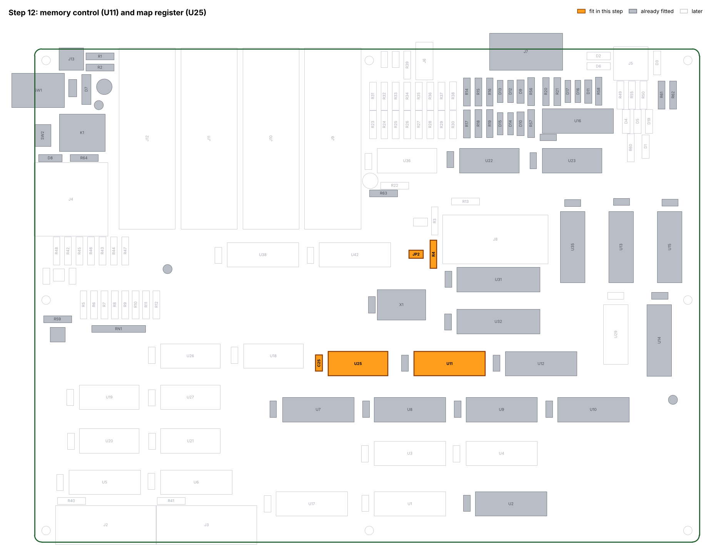

**Program first:** U11 memory control from `ATF22V10_MEM_CTRL.pld`
(rev 10); verify and label it.  U25 needs no programming.

With no cartridge and no JP2 shunt, R4 holds RUN low.  That keeps the
ROM off, holds the map register clear and keeps U15's /WE output off, so
R63 still stops any writes.  Turn off the power switch.  Take
strap S4 (U11 pin 18 to pin 12) out, then insert U11 and U25 into their
sockets and solder the JP2 header (leave its shunt off).  Turn on the
power switch.

**Reads.**  U11 now drives /RAM_OE low for the low half of each video
read and high the rest of the time (the map is clear, so no CPU read is
of RAM).  The picture is the same as in step 11.  If the RAM were never
enabled, the screen would go white or blank; if it were enabled all the
time, pin 18 would still read 0 V, as it did with S4.  /RAM_OE must read
the same frequency as PIXEL_ENABLE.  The readings below are for a screen
with no blank lines; random mode bytes may blank some lines, which lowers
both frequencies alike.

| Pin | Frequency | Duty | DC average |
|---|---|---|---|
| Sync PIXEL_ENABLE (pin 19) | 2.365 MHz | 9.4 % | 0.47 V |
| Mem ctrl /RAM_OE (pin 18) | 2.365 MHz | 95.3 % | 4.77 V |
| Mem ctrl RUN (pin 17, input) | 0 | | 0 V |
| Sync /WE (U15 pin 20) | 0 | | 5 V (output off, pull-up) |
| Mem ctrl /ROM_OE (pin 19) | 0 | | 5 V |
| Map register Q0-Q7 (pins 2, 5, 6, 9, 12, 15, 16, 19) | 0 | | 0 V (held clear by RUN) |

**Writes.**  Turn off the power switch, put the shunt on JP2 (RUN to
+5 V) and turn the power on.  One end of R4 is RUN and now reads 5 V;
the other end is GND.
Clip the ground test lead to TP1 (GND) and touch its tip to
U15 pin 10 (RW, a store; the State PLD that drives it isn't in yet; the
same net is U11 pin 14).  The pin keepers in U11 and U15 hold RW low
after you lift the tip.  U15 now drives /WE low for the low half of
every clock that isn't a video read:

| Pin | Frequency | Duty | DC average |
|---|---|---|---|
| Sync /WE (U15 pin 20), RUN high, RW low | 22.81 MHz | 54.7 % | 2.73 V |

Each of these stores writes FF (the bus pull-ups) to the one CPU-side
address the muxes point at, so one byte of the picture may change; that
is harmless.  Turn off the power switch, unclip the lead and take the
shunt off JP2.  Turn the power on: /WE reads a steady 5 V again.

## CPU

The RAM stays in for the whole CPU section; nothing is taken out again.

### The nop run

With no cartridge, R4 holds RUN low, and while RUN is low the instruction
register PLD (U17) holds 02h whatever is on the data bus.  02h is
`ld ac, ac`: it never branches and never writes, so it is the nop.  With
the JP1 shunt on, the CPU isn't stalled, so it runs that one instruction
over and over and the program counter simply counts up through all 64K
addresses, again and again.  That exercises the State, Branch,
instruction register and PC chips with no ROM and no software, and with
the RAM in.

The readings come as a range, not one number.  The State PLD picks each
instruction's path (2, 3 or 4 clocks) from the data bus, not from the
instruction register, and with no ROM the only thing on the bus is the
RAM byte of the last video read, fading back to FF.  So how fast the PC
counts depends on what the RAM powered up with.  What does not vary: a
counter bit is high half the time, so every PC bit averages 2.5 V, and
each bit toggles at half the frequency of the bit below it.

### Step 13: State PLD (U1) and instruction register PLD (U17)

**Parts for this step:**

| Ref | Part | Value or part number | Note |
|---|---|---|---|
| U1 | PLD, State | ATF22V10C-7PX, programmed from `ATF22V10_STATE.pld` |  |
| U17 | PLD, instruction register | ATF22V10C-7PX, programmed from `ATF22V10_IR.pld` |  |
| U1, U17 sockets | IC socket | DIP-24 0.3" (On Shore ED241DT) |  |
| C1, C17 | Capacitor | 100 nF ceramic (TDK FG28X7R1H104KNT00) |  |
| R3 | Resistor, STALL_OUT pull-up | 10k |  |
| JP1 | Pin header, 1 x 2 (bring-up jumper) | Sullins PREC002SAAN-RC | STALL_IN to STALL_OUT |
| JP1 shunt | Jumper shunt | Sullins QPC02SXGN-RC | on; the JP2 shunt stays off (see "Without the cartridge") |

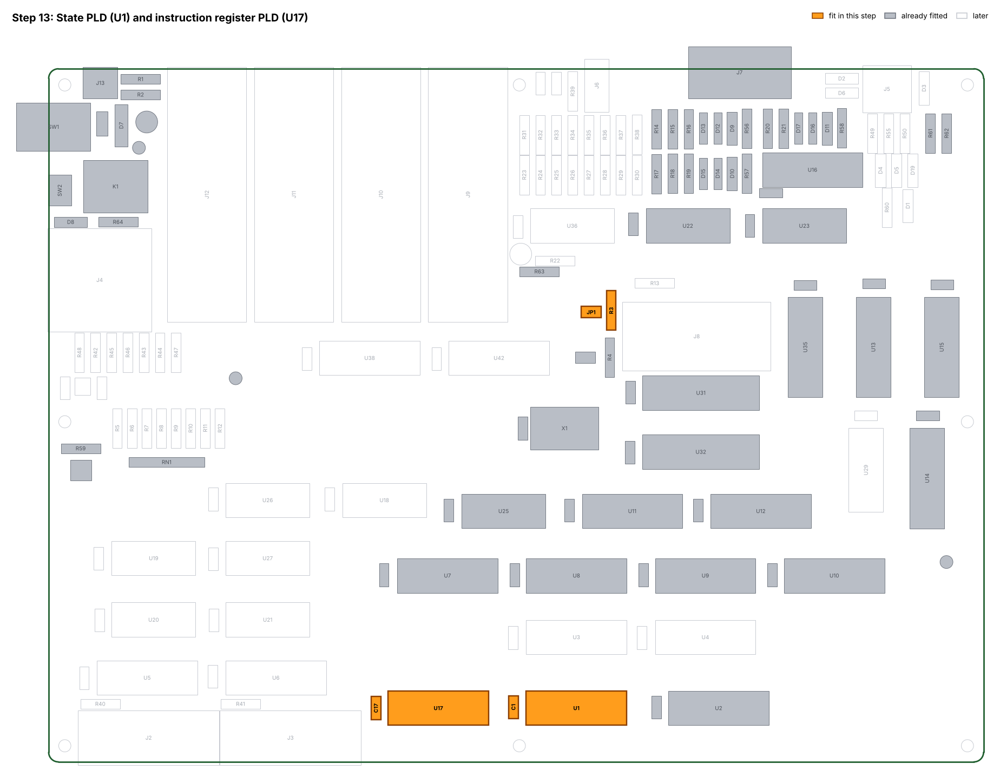

**Program first:** U1 State from `ATF22V10_STATE.pld` (rev 15) and U17
instruction register from `ATF22V10_IR.pld` (rev 01); verify and label
them.

Turn off the power switch.  Put the shunt on JP1 and check the JP2 shunt
is off, then insert the State PLD U1 and the instruction register U17
into their sockets.  Turn on the power switch.  The picture is the same
as in step 12.  The instruction register holds 02h and the State PLD
cycles:

| Pin | Frequency | DC average |
|---|---|---|
| Instruction register I1 (U17 pin 15) | 0 | 5 V |
| Instruction register I0, I2-I7 (U17 pins 14, 16-21) | 0 | 0 V |
| State Q0 (pin 18) | 8 to 9.3 MHz | 1.7 to 2.6 V |
| State PC_ENABLE (pin 15) | 8 to 9.3 MHz | 1.7 to 2.6 V |
| State /LOAD_INSTR (pin 14) | 8 to 9.3 MHz | 3.2 to 3.4 V |
| State /LOAD_IMM (pin 19) | 5.4 to 8 MHz | 3.4 to 3.9 V |
| State /LOAD_AC (pin 22) | 8 to 9.3 MHz | 3.2 to 3.4 V |
| State /LOAD_X, /LOAD_Y (pins 20, 21) | 0 | 5 V |
| State R/W (pin 23) | 0 | 5 V |
| State X_ENABLE, Y_ENABLE (pins 16, 17) | 0 to 320 kHz | 1.3 to 5 V |
| Branch STALL (pin 19) | 1.2 to 1.3 MHz | 0.2 to 0.3 V |
| Branch /SRC_EN (pin 16) | 8 to 9.3 MHz | 3.2 to 3.4 V |
| Branch LOAD_PC_LOW, LOAD_PC_HIGH (pins 21, 22) | 0 | 0 V |
| Branch BRANCH_BLOCK (pin 23) | 0 | 0 V |
| Branch ALU_DONE (pin 18) | 0 | 0 V |
| Audio /AC_SEL (pin 21) | 0 | 0 V (instruction bit 1 is 1) |

The steady pins are the firm part of this check: the instruction
register at 02h, no register loads but AC, no writes and no PC loads.
(STALL can read lower if the RAM's random mode bytes blank many lines.)

### Step 14: PC low (U3)

**Parts for this step:**

| Ref | Part | Value or part number | Note |
|---|---|---|---|
| U3 | PLD, PC low | ATF22V10C-7PX, programmed from `ATF22V10_PC_COUNTER8.pld` |  |
| U3 socket | IC socket | DIP-24 0.3" (On Shore ED241DT) |  |
| C3 | Capacitor | 100 nF ceramic (TDK FG28X7R1H104KNT00) |  |

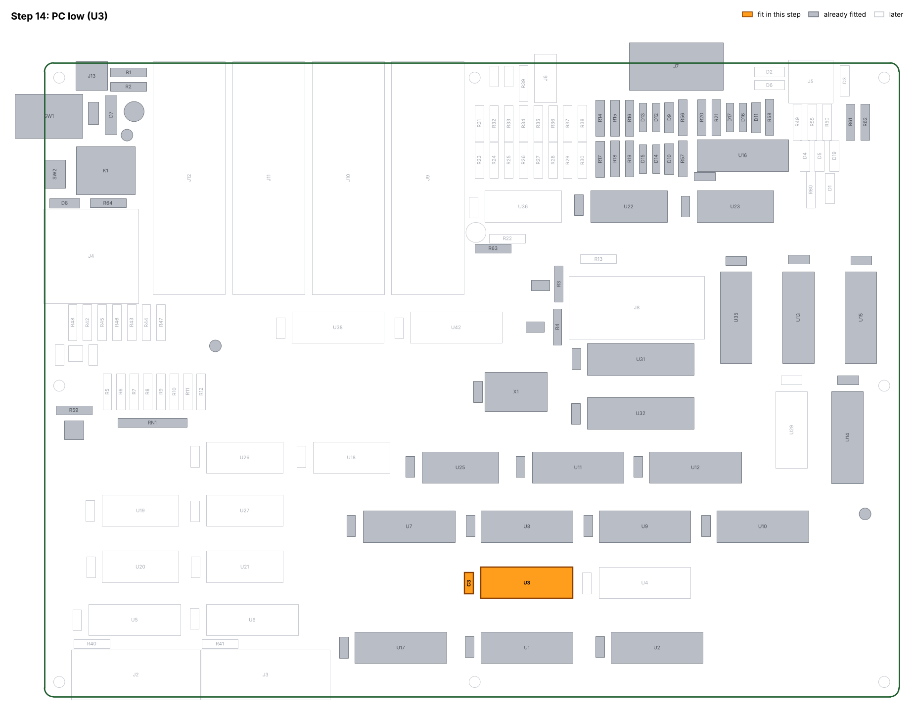

**Program first:** U3 PC low from `ATF22V10_PC_COUNTER8.pld` (rev 02);
verify and label it.

Turn off the power switch.  Insert U3 into its socket.  Turn on the
power switch.  PC low is a binary counter: every bit reads 2.5 V and each
bit's frequency is half that of the bit below.

| Pin | Frequency | DC average |
|---|---|---|
| Q0 (pin 15) | 4 to 6.3 MHz | 2.5 V |
| Q1 (pin 22) | 2 to 3.2 MHz | 2.5 V |
| Q2 (pin 21) | 1 to 1.6 MHz | 2.5 V |
| Q3 (pin 16) | 500 to 790 kHz | 2.5 V |
| Q4 (pin 20) | 250 to 400 kHz | 2.5 V |
| Q5 (pin 17) | 120 to 200 kHz | 2.5 V |
| Q6 (pin 19) | 62 to 99 kHz | 2.5 V |
| Q7 (pin 18) | 31 to 49 kHz | 2.5 V |

Measure Q0 first and halve it down the column: the ratios are exact even
though the first number depends on the RAM.  A bit that reads 0 V or 5 V,
or the same frequency as its neighbor, points at that pin.

### Step 15: PC high (U4)

**Parts for this step:**

| Ref | Part | Value or part number | Note |
|---|---|---|---|
| U4 | PLD, PC high | ATF22V10C-7PX, programmed from `ATF22V10_PC_COUNTER8.pld` |  |
| U4 socket | IC socket | DIP-24 0.3" (On Shore ED241DT) |  |
| C4 | Capacitor | 100 nF ceramic (TDK FG28X7R1H104KNT00) |  |

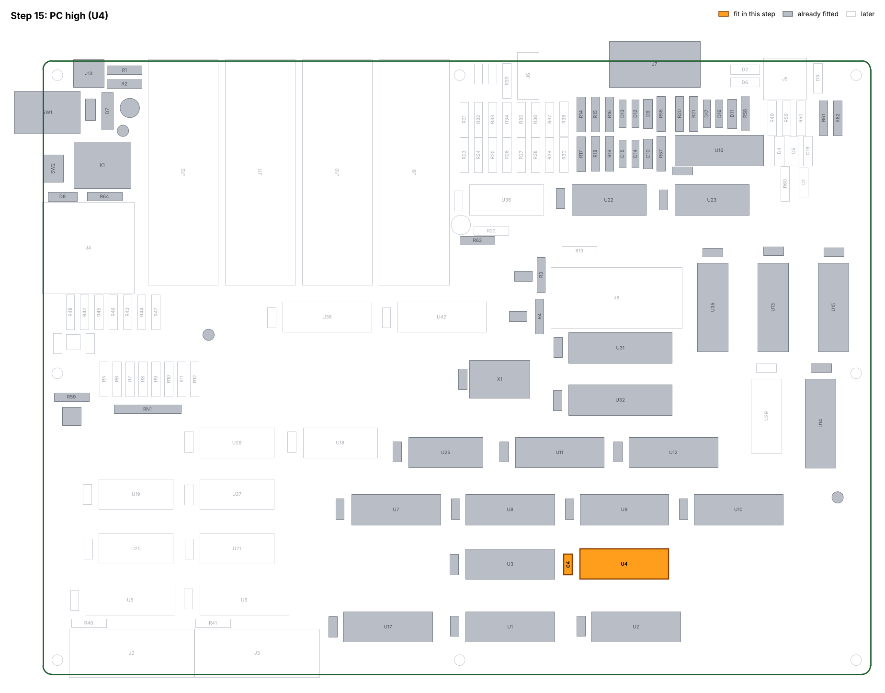

**Program first:** U4 PC high from `ATF22V10_PC_COUNTER8.pld` (rev 02),
the same file as U3; verify and label it.

Turn off the power switch.  Insert U4 into its socket.  Turn on the
power switch.  PC high carries on from PC low: Q0 is half of PC low's Q7,
and each bit is half the one below.

| Pin | Frequency | DC average |
|---|---|---|
| Q0 = A8 (pin 15) | 16 to 25 kHz | 2.5 V |
| Q1 = A9 (pin 22) | 7.8 to 12 kHz | 2.5 V |
| Q2 = A10 (pin 21) | 3.9 to 6.2 kHz | 2.5 V |
| Q3 = A11 (pin 16) | 1.9 to 3.1 kHz | 2.5 V |
| Q4 = A12 (pin 20) | 980 Hz to 1.5 kHz | 2.5 V |
| Q5 = A13 (pin 17) | 490 to 770 Hz | 2.5 V |
| Q6 = A14 (pin 19) | 240 to 390 Hz | 2.5 V |
| Q7 = A15 (pin 18) | 120 to 190 Hz | 2.5 V |

### Step 16: D register (U18) and D source buffer (U26)

**Parts for this step:**

| Ref | Part | Value or part number | Note |
|---|---|---|---|
| U18 | D register, octal D flip-flop | TI SN74F377AN |  |
| U26 | D source buffer, octal 3-state buffer | TI SN74F541N |  |
| U18, U26 sockets | IC socket | DIP-20 0.3" (On Shore ED20DT) |  |
| C18, C26 | Capacitor | 100 nF ceramic (TDK FG28X7R1H104KNT00) |  |
| R5-R12 | Resistor, source buffers to the data bus | 47 ohm |  |

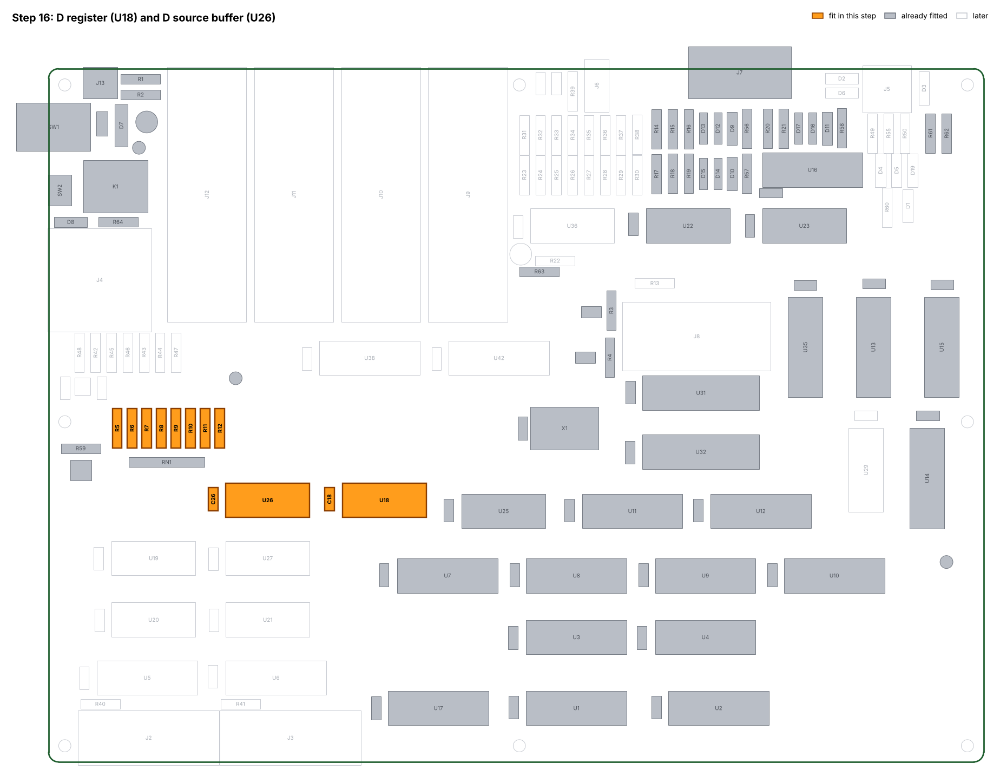

These two carry every constant and every branch target, so the ROM can't
even stop in a loop without them.  They go in together, ahead of the
cartridge, and the cartridge step is their test.

Check U18 is marked SN74F377AN and U26 SN74F541N.  Turn off the power
switch.  Solder R5-R12 and insert U18 and U26 into their sockets.  Turn
on the power switch.  The nop never selects the D source buffer (its /OE2
is instruction bit 1, which is 1), so **nothing may change**: check the
instruction register still reads 02h (step 13) and PC high still counts
(step 15).  If they changed, U26 is driving the bus when it shouldn't:
check its /OE1 (Branch /SRC_EN, pin 16) and /OE2 (instruction register
PLD I1, pin 15).

### The chip gates

From here on the cartridge is in, with the bring-up ROM on it, and the
rest of the CPU chips go in one at a time.  The first seven pages of the
ROM are seven **gates**.  Each gate is a short test that uses only the
chips fitted so far plus the one it is waiting for.  While that chip is
missing or not working, the CPU stops in a tight loop inside the gate's
own page.  Once the chip works, the test passes and the CPU runs on into
the next gate, where it stops again.  So after every step the CPU must
stop further on, and **PC high is the number of the gate it is waiting
in**.

Read the gate number on PC high (U4) with the multimeter.  The pins are
steady, 0 V or 5 V:

| Gate | Waits for | U4 Q2 (pin 21) | U4 Q1 (pin 22) | U4 Q0 (pin 15) |
|--:|---|---|---|---|
| 1 | accumulator U19, ALU U5 and U6 | 0 V | 0 V | 5 V |
| 2 | AC source buffer U27 | 0 V | 5 V | 0 V |
| 3 | Y register U21 | 0 V | 5 V | 5 V |
| 4 | X register U20 | 5 V | 0 V | 0 V |
| 5 | (D source buffer U26, checked again) | 5 V | 0 V | 5 V |
| 6 | (RAM U31, U32) | 5 V | 5 V | 0 V |
| 7 | line read buffer U29 | 5 V | 5 V | 5 V |

Gates 5 and 6 test chips that are already in, so a good board goes
straight from gate 4 to gate 7; a stop in 5 or 6 is a fault.  U4 Q3-Q7
(pins 16, 20, 17, 19, 18) are 0 V in every gate.  On PC low (U3) the top
bits are steady and Q1, Q0 toggle (the stop is a 3-clock branch to
itself).  A gate takes well under a second, so the reading is there as
soon as you can measure it.

What each reading means after a step:

- **The expected gate:** the chip you just fitted works.  Go on.
- **The gate before it** (the same reading as before the step): the new
  chip isn't doing its job.  Check that it is the right part, the right
  way round and fully seated, then its solder joints and the pins the
  step lists.
- **An earlier gate, or 00:** the new chip is upsetting something that
  worked: usually a solder bridge at its socket, or the chip driving the
  bus when it shouldn't.  Pull it and check the reading goes back.
- **PC high pins not steady** (a frequency, or a DC level between 0 V
  and 5 V): the CPU is lost.  Treat it like the line above.

The gates are careful about what they use.  There are no jumps until the
Y register has passed its gate (a jump loads PC high from Y): the code
gets from one gate to the next by running off the end of the page.  Every
unused byte of a gate page is a branch to that page's stop loop, so a PC
that lands anywhere in the page ends in the loop.

The picture on the monitor stays as it was in step 12 until step 22: the
gates don't touch the RAM (gate 6 changes two bytes).

### Step 17: the cartridge with the bring-up ROM (J8)

**Parts for this step:**

| Ref | Part | Value or part number | Note |
|---|---|---|---|
| J8 | Cartridge slot, card edge, 64 contacts | Molex 87715-9106 |  |
| R13 | Resistor, /CART pull-up | 10k |  |
| cartridge PCB | 32K cartridge board |  |  |
| cartridge U1 | PLD, cartridge loader | ATF22V10C-7PX, programmed from `ATF22V10_CART.pld` |  |
| cartridge U2 | EEPROM, 32K x 8 | Microchip AT28C256-15PU, programmed with `bringup.bin` |  |
| cartridge U3 | SRAM, 32K x 8 | Alliance AS7C256C-15PCN |  |
| cartridge U1 socket | IC socket | DIP-24 0.3" (On Shore ED241DT) |  |
| cartridge U2 socket | IC socket | DIP-28 0.6" (On Shore ED28DT) |  |
| cartridge U3 socket | IC socket | DIP-28 0.3" (On Shore ED281DT) |  |
| cartridge C1-C3 | Capacitor | 100 nF ceramic (TDK FG28X7R1H104KNT00) |  |

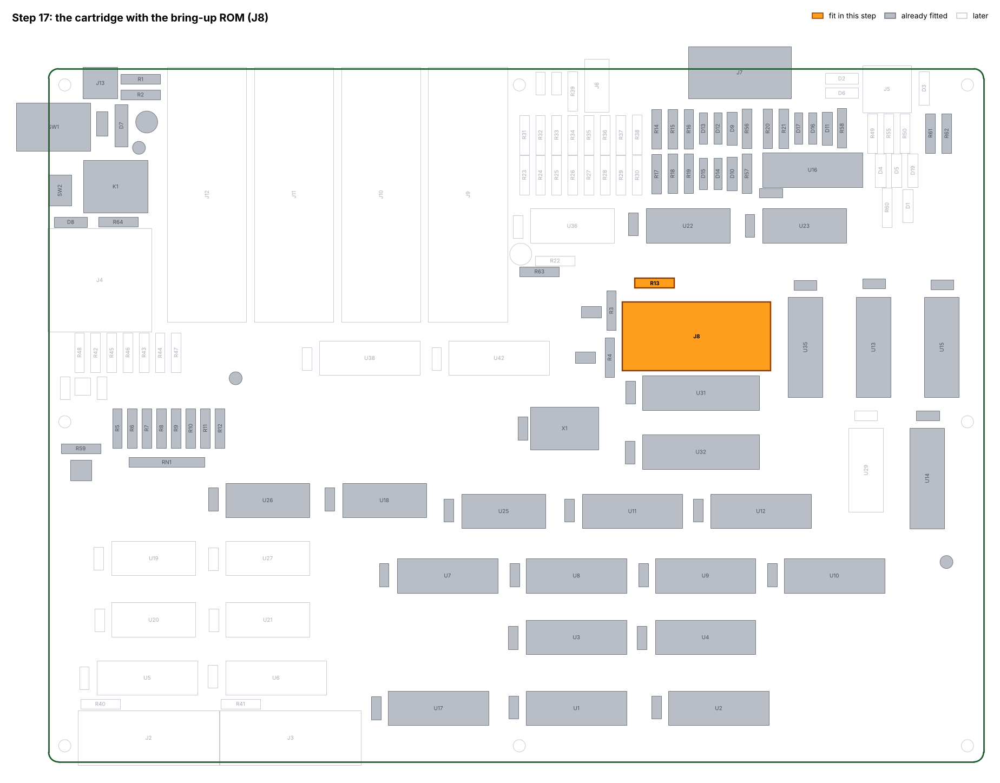

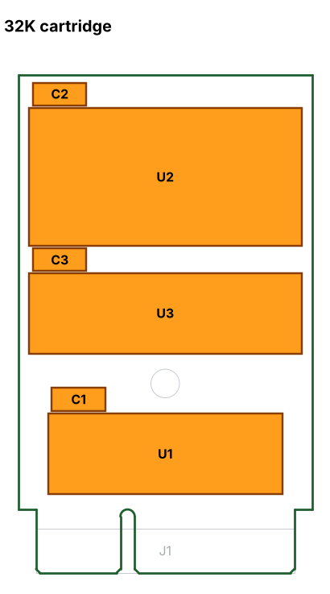

Build the 32K cartridge: sockets and C1-C3 (100 nF) first, then program
and insert its chips into their sockets one at a time:

1. **Loader PLD.**  Program cartridge U1 from `ATF22V10_CART.pld`
   (rev 04), verify, label and insert it into its socket.
2. **EEPROM.**  Make the bring-up ROM image: `python3 test_bringup_sim.py
   --bin` in `src/scripts` writes `bringup.bin` (32 KB).  It is a complete
   image with its own reset code, so it replaces the normal ROM (boot
   loader and library) until the board works.  Program cartridge U2 (the
   AT28C256) with `bringup.bin`, verify, label it and insert it into its
   socket.  The cartridge copies it into its SRAM at power-up
   ([ROM.md](../architecture/ROM.md#loading-the-cartridge)) and shows the
   same 32 KB in both halves of the ROM, x0000-x7FFF and x8000-xFFFF.
3. **SRAM.**  Insert cartridge U3 into its socket (no programming).

Turn off the power switch.  Solder J8 and R13.  Take the shunt off JP1
(the cartridge drives STALL_IN and RUN now; the JP2 shunt is already
off) and plug the cartridge into J8.  Turn on the power switch.

The CPU runs a few instructions in page 0 that need none of the missing
chips and then meets gate 1, which needs the accumulator and the ALU.
They aren't in, so it stops there:

| Pin | Reading |
|---|---|
| U4 Q0 (pin 15) | 5 V |
| U4 Q1-Q7 (pins 22, 21, 16, 20, 17, 19, 18) | 0 V |

**Gate 1** (PC high = 01).  This one steady reading is the test for the
cartridge and for U18 and U26 from step 16.  If it is anything else:

- **PC high still counts as in step 15** (every pin 2.5 V at the same
  frequencies): the instruction register is still held at 02h, so RUN
  isn't going high.  Check the cartridge is seated, J8's solder joints
  and cartridge U1.
- **PC high and PC low all 0 V, nothing toggles:** the CPU is stalled.
  Check cartridge U1 and R13, and that the JP1 shunt is off.
- **PC high not steady, or steady at some other value:** the CPU is
  running the ROM but its constants or branch targets arrive wrong.
  First check cartridge U2 was programmed and verified.  Then it is U18
  or U26: without them the stop loop can't hold and the PC drifts from
  page to page.  Check U18's /E (State /LOAD_IMM, pin 19), U18's Q pins
  to U26's inputs, U26's /OE1 and /OE2 as in step 16, and R5-R12.

### Step 18: accumulator (U19), ALU low (U5), ALU high (U6)

**Parts for this step:**

| Ref | Part | Value or part number | Note |
|---|---|---|---|
| U5, U6 | PLD, ALU low, ALU high | ATF22V10C-7PX, programmed from `ALU_SHR.pld` |  |
| U19 | Accumulator, octal D flip-flop | TI SN74F377AN |  |
| U5, U6 sockets | IC socket | DIP-24 0.3" (On Shore ED241DT) |  |
| U19 socket | IC socket | DIP-20 0.3" (On Shore ED20DT) |  |
| C5, C6, C19 | Capacitor | 100 nF ceramic (TDK FG28X7R1H104KNT00) |  |

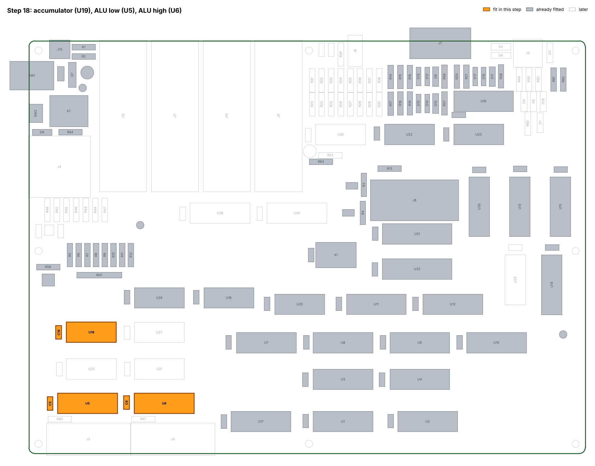

**Program first:** U5 ALU low and U6 ALU high, two copies of
`ALU_SHR.pld` (rev 07); verify and label them.

Turn off the power switch.  Insert U19, U5 and U6 into their sockets.
Turn on the power switch.  Gate 1 loads constants into the accumulator
and checks them with the flags and every ALU function, passes, and the
CPU stops in gate 2, which needs the AC source buffer:

| Pin | Reading |
|---|---|
| U4 Q1 (pin 22) | 5 V |
| U4 Q0, Q2 (pins 15, 21) | 0 V |

**Gate 2** (PC high = 02).  If it is still in gate 1, PC low (U3) tells
which check failed.  Q7, Q6, Q5 (pins 18, 19, 17) are 5 V and Q4
(pin 20) is 0 V; read Q3 (pin 16) and Q2 (pin 21):

| U3 Q3 | U3 Q2 | Failed check | Look at |
|---|---|---|---|
| 0 V | 0 V | zero and sign flags | each ALU's Z (pin 14) to the Branch PLD U2 pins 7 and 13, the high ALU's F3 (pin 21) to U2 pin 8, /LOAD_AC (State pin 22) to U19 |
| 0 V | 5 V | a data bit, AND, OR or XOR | the ALU F outputs (pins 17, 20, 16, 21) to U19's D pins, U19's Q pins to the ALU A inputs, the D register U18 to the ALU B inputs |
| 5 V | 0 V | ADD, SUB or the carry flag | the carry from the low ALU to the high ALU, the high ALU's COUT (pin 18) to U2 pin 14, U2's ALU_DONE (pin 18) |
| 5 V | 5 V | shift right | the shift-in wiring (SHIFT_RIGHT_IN, pin 23) |

(Q4 at 5 V with Q3 and Q2 at 5 V is the page's catch-all stop: the CPU
got lost inside the gate, so start with the first row.)

### Step 19: AC source buffer (U27)

**Parts for this step:**

| Ref | Part | Value or part number | Note |
|---|---|---|---|
| U27 | AC source buffer, octal 3-state buffer | TI SN74F541N |  |
| U27 socket | IC socket | DIP-20 0.3" (On Shore ED20DT) |  |
| C27 | Capacitor | 100 nF ceramic (TDK FG28X7R1H104KNT00) |  |

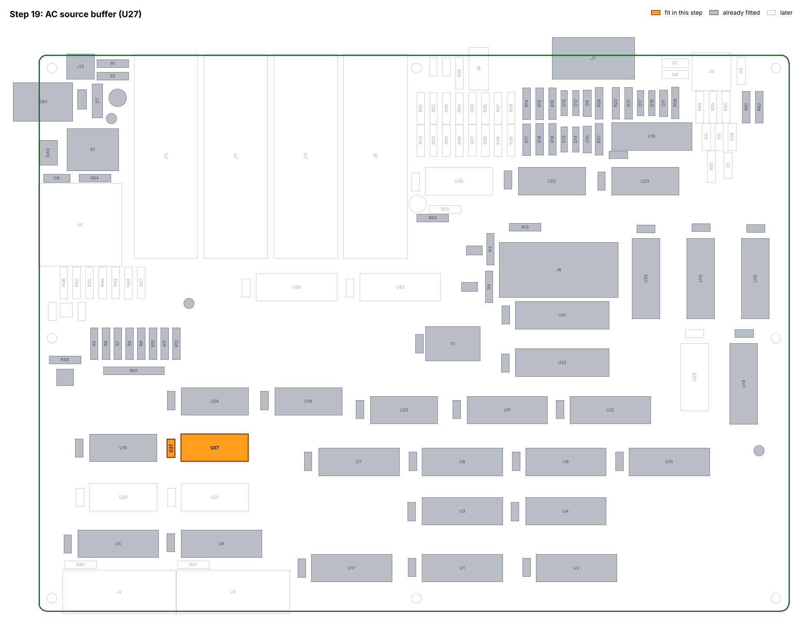

Turn off the power switch.  Insert U27 into its socket.  Turn on the
power switch.  Gate 2 clears and shifts the accumulator, which puts AC on
the bus through U27, then branches to an address held in AC.  It passes,
and the CPU stops in gate 3, which needs the Y register:

| Pin | Reading |
|---|---|
| U4 Q0, Q1 (pins 15, 22) | 5 V |
| U4 Q2 (pin 21) | 0 V |

**Gate 3** (PC high = 03).  If it is still in gate 2: U27's /OE1 (Branch
/SRC_EN, pin 16), its /OE2 (/AC_SEL, audio PLD U35 pin 21), and U19's Q
pins to U27's inputs.

### Step 20: Y register (U21)

**Parts for this step:**

| Ref | Part | Value or part number | Note |
|---|---|---|---|
| U21 | Y register, octal D flip-flop | TI SN74F377AN |  |
| U21 socket | IC socket | DIP-20 0.3" (On Shore ED20DT) |  |
| C21 | Capacitor | 100 nF ceramic (TDK FG28X7R1H104KNT00) |  |

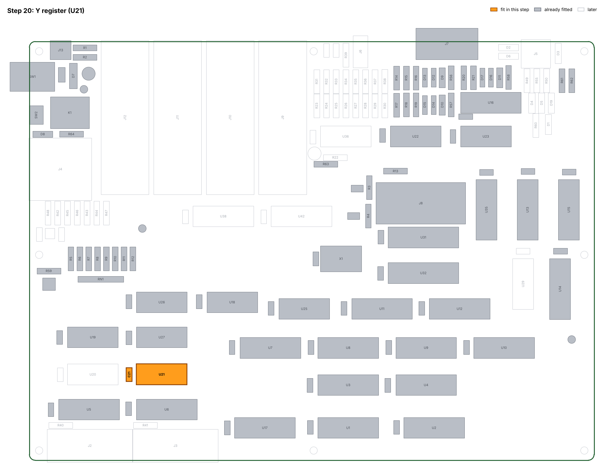

Turn off the power switch.  Insert U21 into its socket.  Turn on the
power switch.  Gate 3 loads Y with four page numbers and reads a byte
from each page of the ROM (each of those pages is filled with its own
number).  It passes, and the CPU stops in gate 4, which needs the X
register:

| Pin | Reading |
|---|---|
| U4 Q2 (pin 21) | 5 V |
| U4 Q0, Q1 (pins 15, 22) | 0 V |

**Gate 4** (PC high = 04).  If it is still in gate 3: /LOAD_Y (State
pin 21) and Y_ENABLE (State pin 17), the ALU F outputs to U21's D pins,
and U21's Q pins to the high address muxes U9 and U10.

### Step 21: X register (U20)

**Parts for this step:**

| Ref | Part | Value or part number | Note |
|---|---|---|---|
| U20 | X register, octal D flip-flop | TI SN74F377AN |  |
| U20 socket | IC socket | DIP-20 0.3" (On Shore ED20DT) |  |
| C20 | Capacitor | 100 nF ceramic (TDK FG28X7R1H104KNT00) |  |

Turn off the power switch.  Insert U20 into its socket.  Turn on the
power switch.  Gate 4 loads X with a walking bit and reads a ROM table
in which every byte holds its own address.  It passes.  Gates 5 and 6
pass at once: gate 5 loads and checks 15 constants several thousand
times through U26, and gate 6 writes and reads back a byte in each RAM
chip.  The ROM then goes on to its full tests (see
[The bring-up ROM](#the-bring-up-rom)) and stops at the last one, the
video line read, which needs U29:

| Pin | Reading |
|---|---|
| U4 Q0, Q1, Q2 (pins 15, 22, 21) | 5 V |
| U4 Q3-Q7 (pins 16, 20, 17, 19, 18) | 0 V |

**Gate 7** (PC high = 07).  Anything else:

- **04:** the X register.  Check /LOAD_X (State pin 20) and X_ENABLE
  (State pin 16), the ALU F outputs to U20's D pins, and U20's Q pins to
  the low address muxes U7 and U8.
- **05:** the D source buffer fails under load.  Check U26 and R5-R12.
- **06:** the RAM.  Check U31 and U32 are seated (a bent data pin stops
  here too), then /WE, /RAM_OE and the map register U25 (gate 6 sets map
  bits 1 and 4 to reach one byte in each chip).
- **00 with PC low Q7 (pin 18) at 5 V:** one of the ROM's full tests
  failed; read its number as in [The bring-up ROM](#the-bring-up-rom).

### Step 22: line read buffer (U29)

**Parts for this step:**

| Ref | Part | Value or part number | Note |
|---|---|---|---|
| U29 | Line read buffer, octal 3-state buffer | TI SN74F541N |  |
| U29 socket | IC socket | DIP-20 0.3" (On Shore ED20DT) |  |
| C29 | Capacitor | 100 nF ceramic (TDK FG28X7R1H104KNT00) |  |

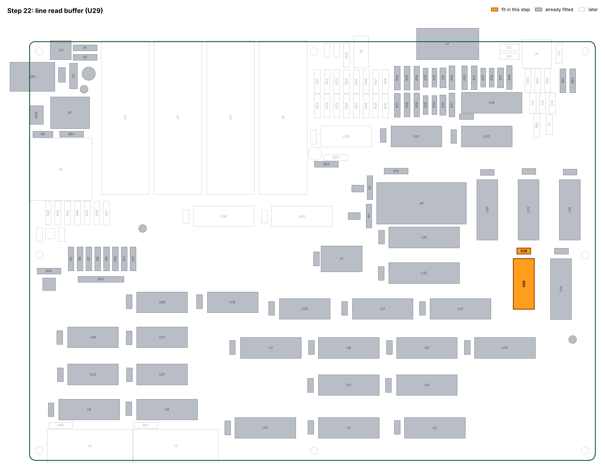

Turn off the power switch.  Insert U29 into its socket.  Turn on the
power switch.  The last gate opens: within about half a second the
screen shows the bring-up ROM's status screen
([below](#the-bring-up-rom)).  If it is still in gate 7, check U29's
enable (/P0, I/O decode U12) and its inputs from the V counter.

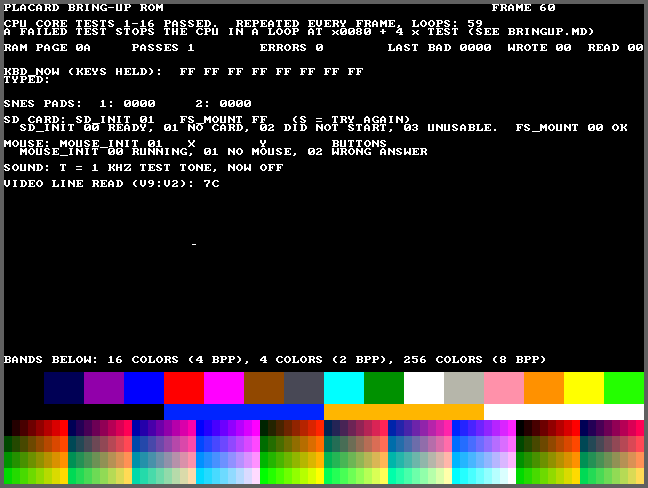

*Step 22, about a second after power-on.  The shared port isn't in until
step 23, so the keyboard, pad, SD card and mouse rows show nothing
attached (SD_INIT 01, MOUSE_INIT 01; their exact values don't matter
yet).  FRAME, LOOPS and PASSES count up; ERRORS stays 0.*

## The bring-up ROM

The ROM starts with the seven [chip gates](#the-chip-gates) of steps
17-22, in pages x01 to x07:

| Gate | Page | Tests | Stops at |
|--:|---|---|---|
| 1 | x01 | AC and the ALU: the Z and sign flags, each data bit, AND, OR, XOR, ADD, SUB, the carry flag, SHR | x01E0 flags, x01E4 bits, x01E8 carry, x01EC shift |
| 2 | x02 | the AC source buffer: clear and shift left (AC is the ALU's second input), then a branch to the address in AC | x02FC |
| 3 | x03 | the Y register: read pages x39, x5E, x11 and x0F, each filled with its own number | x03FC |
| 4 | x04 | the X register: a walking bit from an immediate and two values from AC, read back from the table at x3F00 | x04FC |
| 5 | x05 | the D source buffer: 15 constants loaded and compared, 256 times, twice | x0500 |
| 6 | x06 | the RAM: map bits 1 and 4 set, then A5 and 5A written and read at x2010 (U31) and x9010 (U32), so every data bit is seen both ways | x06FC |
| 7 | x07 | the video line read: where test 16 below goes when it fails | x07FC |

Gates 5 and 6 test chips that are in before the cartridge, so on a good
board they pass at once.  Gate 5 is a soak test of U26 that the earlier
gates can't do (it needs AC, X and Y), and its stop uses only the AC
source, so it holds even when U26 can't be trusted: it clears AC and
branches to the address in AC, x0500, where a one-byte branch-if-zero
loops on itself.

After gate 6 the ROM runs these tests, using only the CPU, the ROM,
the RAM and the map register:

| N | Test | What it needs |
|--:|---|---|
| 1 | Branches on AC: BEQ, BNE, BLT, BLE | Branch PLD, ALU Z (pin 14) and F3 (sign) to the Branch PLD pins 7, 13, 8 |
| 2 | AND | ALU PLDs, AC, D register, D source buffer |
| 3 | OR | as 2 |
| 4 | XOR | as 2 |
| 5 | ADD | as 2, the carry between the ALU PLDs, the Branch PLD's ALU wait clock |
| 6 | SUB | as 5 |
| 7 | Carry flag: BCS, BCC | high ALU COUT (pin 18) to Branch pin 14, Branch CARRY (pin 20) |
| 8 | SHR | the ALU's shift-in wiring (SHIFT_RIGHT_IN, pin 23) |
| 9 | AC to X, immediate to X, read back through [Y,X] from the ROM table at x3F00 | X register, AC source buffer and /AC_SEL (audio PLD pin 21); X can't be a source, so this also needs the address path of tests 10-12 |
| 10 | Y as the address high byte, bits 14-8 (the 32K cartridge's ROM has no bit 15; tests 13-15 check it through the RAM) | Y register, the high address muxes (U9, U10), Y_ENABLE |
| 11 | X as the address low byte | the low address muxes (U7, U8), X_ENABLE |
| 12 | ROM data (a 256-byte table) | the cartridge's data and low address pins, /ROM_OE |
| 13 | RAM data: [0,D], [0,X], [Y,X] in both chips | RAM data pins, /WE, /RAM_OE, the source buffers on a store, the series resistors, map bits 0 and 4 |
| 14 | Map register, all 8 bits | ACT273 (U25), /MAP_WR (Sync PLD U15 pin 22), RUN, memory control RAMSEL pins |
| 15 | RAM address lines, both chips | RAM A14:A0, the lower chip's /CE (A15) and /CE_HI |
| 16 | Video line read (x5000) | line read buffer (U29), /P0 and Q0 |

**A failed test 1-15 stops the CPU in a loop of its own at ROM x0080 + 4N.**
(Test 16 at power-up stops in gate 7 instead, so that step 21 ends on a
gate like the steps before it.)
Read N off the PC with the meter:

- PC high (U4) Q0-Q7 all **0 V**
- PC low (U3) Q7 (pin 18) **5 V**; Q6:Q2 (pins 19, 17, 20, 16, 21) are N
  in binary, 5 V for a 1 (Q6 is the high bit); Q1 and Q0 toggle (the loop
  is a 3-clock branch, PC low goes F, F+1, F+2)

For example test 13 = 01101: Q6 0 V, Q5 5 V, Q4 5 V, Q3 0 V, Q2 5 V.

The gates have already proved the registers, the ALU and both source
buffers by the time these tests run, so a fail loop here points at the
memory side: the address muxes, the RAM, the map register and memory
control.  A stuck ALU output or flag never gets this far; it stops in
gate 1.  A PC that keeps moving with no status screen means the CPU is
lost: go back through the gates (pull the RAM, then U26 and the chips
after it in reverse order, and check each step's gate number again).

When all pass, the ROM sets up the library, draws the status screen and
runs a loop once a frame:

| Row | Shows |
|---|---|
| 0 | title, FRAME (counts 60 a second) |
| 2-3 | the core tests (1-14) run again every frame; LOOPS counts them |
| 5 | RAM page test: one 256-byte page a frame with 6 patterns, over the 49 pages programs use (x0100-x1EFF, x4000-x4CFF, x5400-x59FF); PASSES, ERRORS, the last bad address, what was written and what was read |
| 8-9 | keyboard: the 8 bytes of `KBD_NOW` (FF = no key held; a held key clears its bit) and the typed keys (echoed) |
| 12 | SNES pads 1 and 2 (pad_read, 0000 = no button) |
| 14-15 | SD card: SD_INIT and FS_MOUNT results (S tries again) |
| 17-18 | mouse: MOUSE_INIT result, X (0-639), Y (0-479) and buttons |
| 20 | sound: T toggles a 1 kHz test tone |
| 22 | the video line read (V9:V2), changes every read |
| 44 | legend for the color bands below it: rows 368-399 16 colors (4 bpp), 400-415 4 colors (2 bpp), 416-479 256 colors (8 bpp) |

A good board: FRAME and LOOPS count up together, PASSES goes up about
every 0.8 s and ERRORS stays 0.  If a core test fails later, the CPU stops
in its fail loop as above and the screen freezes.

The source is `src/scripts/gen_bringup.py`, which writes `bringup.asm`.
`python3 test_bringup_sim.py` runs it in the simulator three ways.
First with chips missing, as in steps 17-22: for each step it leaves out
the chips not yet fitted, lets their pins float (many random runs) and
checks that the CPU stops in that step's gate and in no other; and with
U26 missing at the cartridge step, that it never settles in gate 1.  Then on a good machine (screen, counters, keys, tone, SD retry).
Then with faults: an ALU output stuck (gate 1), a RAM data bit stuck
(gate 6), a map register bit stuck (gate 6 for bit 1, which gate 6 uses,
fail 14 for the others), a RAM address line stuck (15), a line read bit
stuck (gate 7), and a RAM bit that goes bad after
start-up (counted by the page test).  It takes about 20 minutes.

## I/O and audio

### Step 23: shared port: port PLD (U38) and PS/2 receiver PLD (U42)

**Parts for this step:**

| Ref | Part | Value or part number | Note |
|---|---|---|---|
| U38 | PLD, shared port | ATF22V10C-7PX, programmed from `ATF22V10_PORT.pld` |  |
| U42 | PLD, PS/2 receiver | ATF22V10C-7PX, programmed from `ATF22V10_PS2.pld` |  |
| U38, U42 sockets | IC socket | DIP-24 0.3" (On Shore ED241DT) |  |
| C38, C42 | Capacitor | 100 nF ceramic (TDK FG28X7R1H104KNT00) |  |
| U40 | 3.3 V regulator, TO-92 | Microchip MCP1700-3302E/TO | flat face as on the silkscreen |
| C40, C47 | Capacitor, regulator input and output | 1 µF ceramic (KEMET C330C105K5R5TA) |  |
| J2, J3 | SNES controller socket, 7 pin |  |  |
| R40, R41 | Resistor, SNES data pull-ups | 10k |  |
| J5 | PS/2 stacked dual mini-DIN-6 | Kycon KMDGX-6S/6S-S4N | mouse top, keyboard bottom |
| R49, R50, R55 | Resistor, PS/2 clock and DATA pull-ups | 4.7k |  |
| D1-D6, D19 | Schottky diode, PS/2 hold, inhibit and RXCLK | 1N5817 (black) | band (cathode) as on the silkscreen |
| R60 | Resistor, RXCLK pull-down | 22k |  |
| J4 | SD card socket | Hirose DM1AA-SF-PEJ(82) |  |
| R42-R44 | Resistor, SD dividers | 1.8k |  |
| R45-R47 | Resistor, SD dividers | 3.3k |  |
| R48 | Resistor, MISO pull-up to 3.3 V | 10k |  |

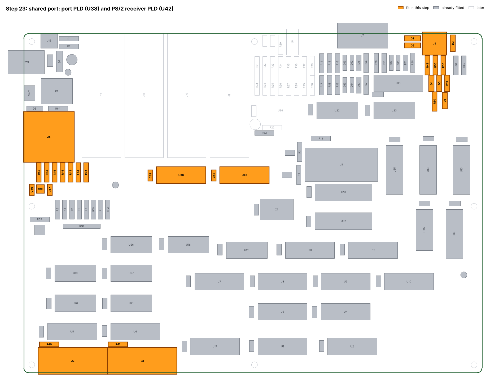

**Program first:** U38 shared port from `ATF22V10_PORT.pld` (rev 05) and
U42 PS/2 receiver from `ATF22V10_PS2.pld` (rev 03); verify and label
them.

Turn off the power switch.  Insert the two PLDs U38 and U42 into their
sockets and fit their parts ([IO.md](../architecture/IO.md)):

- The 3.3 V regulator U40, with C40 on its input and C47 on its output
  (1 µF each).
- SNES pads: J2 and J3 with R40 and R41 (10k data pull-ups).
- PS/2: J5 with R49, R50 and R55 (4.7k pull-ups on the two clocks and
  DATA); the hold diodes D2 (/CS to the mouse CLK), D3 (DATA) and D6 (K0
  to the keyboard CLK); the receiver's inhibit diodes D5 (mouse CLK) and
  D19 (keyboard CLK) from U42 pin 14; and the RXCLK diode-OR D1
  (keyboard CLK), D4 (mouse CLK) with its 22k pull-down R60 (all 1N5817).
- SD card: J4, the dividers R42-R44 (1.8k) and R45-R47 (3.3k) and R48
  (10k MISO pull-up to 3.3 V; MISO goes straight to U38 pin 13).
  Turn on the power switch and, before plugging the SD card in, check 3.2-3.4 V at
U40's output and at the SD socket's pin 4.

- **Port PLD high level.**  The port register drives the pads' CLOCK and
  LATCH (CMOS, high at least 3.5 V) and the SD dividers; the ATF22V10C
  only promises 2.4 V at 4 mA.  With a pad and a card plugged in, measure
  U38 pins 20 (SCK) and 19 (MOSI) at rest: expect close to 5 V.  Under
  3.5 V the pads will misread; a 4.7k pull-up on each would fix it.
- **The port rests at EB** (the register clears at power-up): U38 pin 16
  (K0) 0 V, pin 17 (DATA hold) 5 V, pin 18 (/CS) 0 V, pins 19 and 20 5 V.
  Both PS/2 clock lines are held low at the socket (J5 pin 5 of each half)
  and RXCLK (U38 pin 11, U42 pin 1) is 0 V.  Once the bring-up ROM's
  driver runs with no mouse, it lets the keyboard CLK go (latch FB) so
  that a keyboard can be heard: the keyboard CLK and RXCLK are then high.
- With no key down row 8 shows FF in every byte; hold a key and its byte
  loses a bit.  Typed keys echo on row 9.
- Press buttons on a SNES pad: row 12 changes.  While the pads are read
  the mouse's clock is let go for about 30 us (after a 100 us hold): a
  scope on J5's mouse CLK pin shows the short high pulse once a frame.
- With no card SD_INIT is 01; with a card it should be 00, and FS_MOUNT 00
  on a FAT16 or FAT32 card.  Press S to try again after changing cards.
- With the power switch off, plug the mouse in, then turn the power switch on: MOUSE_INIT 00, and moving it changes X
  and Y (buttons in the last column).  The mouse is started once, at
  power-up.
- The keyboard and mouse are not hot-pluggable: always plug them in with
  the power switch off.  One plugged in while the machine runs is not
  recognized until the machine is reset (SW2).
- PS/2 keyboard socket (J5 bottom): with the power switch off, plug a PS/2 keyboard in, then turn the power switch on:
  `port_init` finds it (its lights flash once as the driver sets them),
  typed keys echo, and Caps Lock lights its Caps Lock light.  Check
  typing with the mouse plugged in too, and that both keep working
  together (they share DATA, and take turns frame by frame).
- **RXCLK and the receiver** (scope, two channels: the device's CLK at
  J5 and RXCLK at U42 pin 1).  A byte is 11 clock pulses; RXCLK follows
  the free device's clock with a high of about 3.9 V (pull-up, diode,
  22k).  Check that each pulse is one clean edge at U42 (no double
  clocking: the PLD's clock input has no hysteresis, and the PS/2 edges
  are slow); the fix would be a smaller pull-down (10k) or 100 pF from
  RXCLK to ground.  After the 11th rising edge U42 pin 14 goes low and
  the device's CLK stays low until the CPU takes the byte (within a
  frame), then the line is let go and the next byte follows.  A device
  that sends the same byte twice in a row points at the inhibit coming
  too early (it should fall after the 11th pulse, not the 10th).
- **Holding mid-byte.**  Type while a SNES pad is being read (row 12
  changes every frame): nothing should be lost or doubled.  `ps2_pause`
  holds both clocks for at least 100 us before a pad read, so a device
  caught in the middle of a byte gives it up and sends its chunk again;
  a keyboard whose keys double up on the display points at a hold the
  keyboard does not see (it should be 100 us or more on the scope).

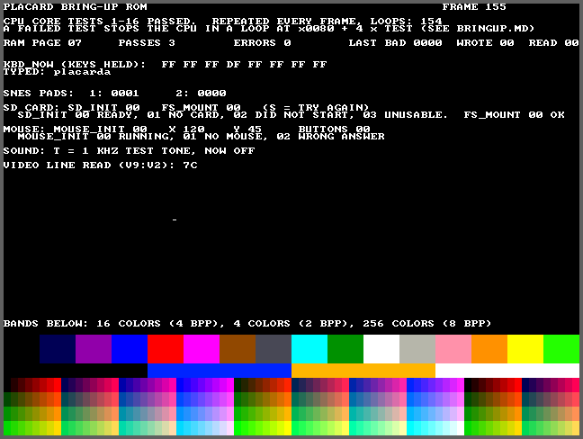

*Step 23, an example: "placard" typed and A held (one KBD_NOW byte reads
DF), B held on pad 1 (0001), a FAT card in (SD_INIT 00, FS_MOUNT 00) and
the mouse moved (MOUSE_INIT 00, X 120, Y 45).*

### Step 24: audio DAC (U36)

**Parts for this step:**

| Ref | Part | Value or part number | Note |
|---|---|---|---|
| U36 | DAC register, octal D flip-flop, 3-state | TI SN74HCT574N |  |
| U36 socket | IC socket | DIP-20 0.3" (On Shore ED20DT) |  |
| C36 | Capacitor | 100 nF ceramic (TDK FG28X7R1H104KNT00) |  |
| R22 | Resistor, DAC supply filter | 2.2 ohm |  |
| C44 | Electrolytic capacitor, DAC supply filter | 220 µF (Rubycon 25YXJ220M6.3X11) | + to DAC_5V (R22's DAC end), stripe to GNDA |
| R23-R31 | Resistor, R-2R ladder | 2k |  |
| R32-R38 | Resistor, R-2R ladder | 1k |  |
| C45 | Capacitor, output filter | 15 nF C0G (TDK FG24C0G1H153JNT06) |  |
| C46 | Capacitor, output coupling | 22 µF ceramic (TDK FG22X7R1E226MRT06) |  |
| R39 | Resistor, output | 10k |  |
| J6 | Audio line out jack, 3.5 mm TRRS | Tensility 54-00174 |  |

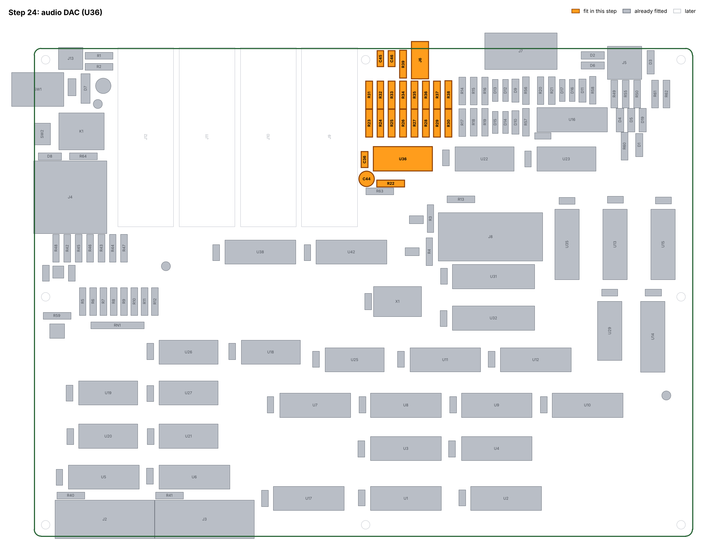

Turn off the power switch.  Insert the DAC register U36 into its socket
and fit its supply
filter R22 (2.2 ohm) and C44 (220 µF), the R-2R ladder R23-R31 (2k) and
R32-R38 (1k), the output filter C45 (15 nF) and C46 (22 µF), R39 (10k)
and the jack J6 ([SOUND.md](../sound/SOUND.md)).  Turn on the power switch.
With no sound playing the sample is 80h:

| DAC pin | Silent | With T (1 kHz tone, 80h ± 48 = B0h / 50h) |
|---|---|---|
| Q7 (pin 12) | 5 V | about 1 kHz, 2.5 V |
| Q6, Q5 (pins 13, 14) | 0 V | about 1 kHz, 2.5 V |
| Q4 (pin 15) | 0 V | 5 V |
| Q3-Q0 (pins 16-19) | 0 V | 0 V |

The ladder output sits at about 2.5 V when silent.  Press T: a 1 kHz tone
from the line out (into an amplifier or powered speakers); T again stops it.

*Step 24: after T the SOUND row ends in ON.*

When everything passes, load the normal ROM image: take cartridge U2
out, program it with the 32K ROM (`rom_32k.bin`, written by
`build\rom32.bat` or `gen_rom.tcl`, [ROM.md](../architecture/ROM.md)), verify, relabel and insert it into its socket again.

## Expansion slots

**Parts:**

| Ref | Part | Value or part number | Note |
|---|---|---|---|
| J9-J12 | Expansion slot, Molex 87715-9106 as the cartridge slot (optional) | Molex 87715-9106 | fit only the ones a card will use |

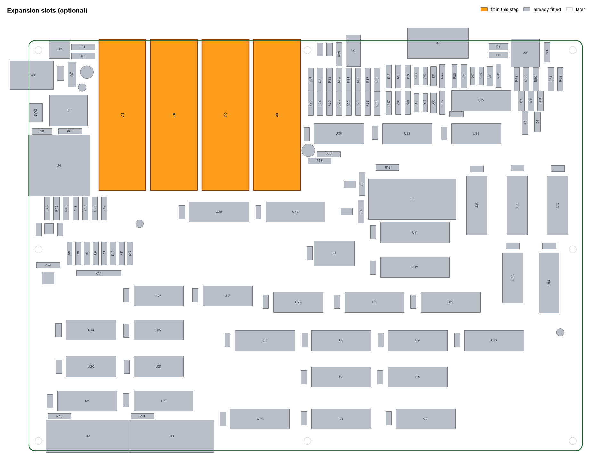

The slots J9-J12 are optional: fit only the ones a card will use (each has
its own select, /EXP1-/EXP4; the SEL resistors R51-R54 went with I/O decode
PLD revision 07).  With a
card in, the boot ROM finds it ([EXPANSION.md](../architecture/EXPANSION.md)).
