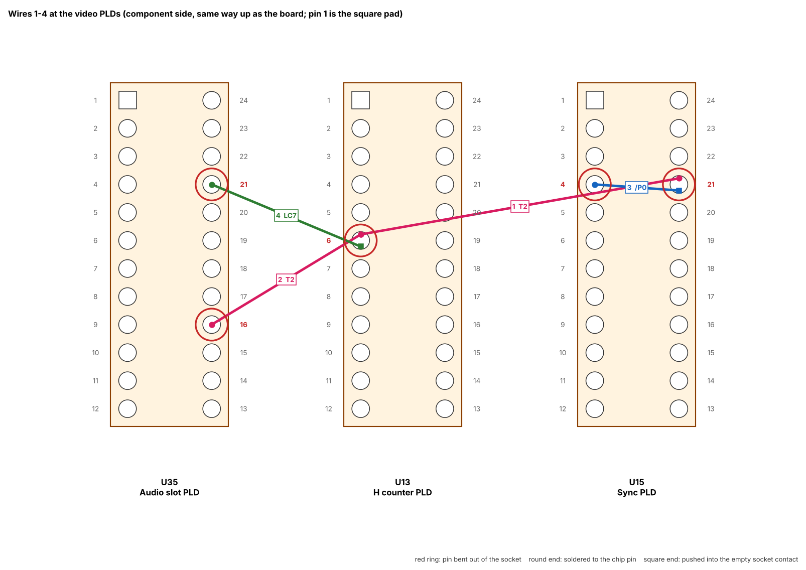

# Making a rev A board work like rev B

Date: 2026-11-17

A hand modification that gives a rev A main board (PLC-1001 rev A) the
160-read lines of rev B ([HIRES.md](../video/HIRES.md)): 160 across in 256
colors, 320 in 16 and 640 in 4.  Five PLD pins are kept out of their sockets,
five wires go in, and five PLDs get the rev B program.  No trace is cut and
nothing is soldered to the board or to a PLD: the bent pins and the solder
joints are on carrier sockets, so every PLD can still go back in the
programmer, and the board goes back to rev A by taking the carriers out.

**Do this only on a board that already works as rev A**
([BRINGUP.md](BRINGUP.md)), so that anything wrong afterwards is the
modification.

Status: worked out from the difference between the rev A and rev B
netlists (the same seven nets as in [RELEASES.md](RELEASES.md)), and the
rev B PLDs pass their simulations.  It has not been tried on a board.

## What you need

| | |
|---|---|
| Four carrier sockets | 24-pin, 0.3 in wide, turned-pin (machined): one each for U13, U15, U17 and U35.  A chip plugs into its carrier and the carrier plugs into the board's socket.  The pins are bent and soldered on the carrier, never on the chip.  Turned-pin sockets because their round pins fit a socket and take solder well |
| Five ATF22V10C-7PX (optional) | a second set for U13, U15, U16, U17 and U35 lets the rev A set stay programmed, so going back is a swap.  With one set, reprogram the five chips each way |
| Wire | thin insulated solid wire, 24 to 26 AWG (0.4 to 0.5 mm): it has to hold in a socket contact |
| Tools | soldering iron, fine pliers, multimeter |

The carriers lift those four chips about 4 mm.  Check the room under the
case top before closing it.

## 1. Program the five rev B PLDs

Compile the sources in `src/pld/rev_b/` in WinCUPL (device g22v10) and
program one chip from each.  Label them "B".

| Chip | Source | Revision | Checksum of the 2026-11-17 compile |
|---|---|---|---|
| U13 H counter | `ATF22V10_HCOUNT.pld` | 09 | A925 |
| U15 Sync | `ATF22V10_SYNC.pld` | 13 | EBEF |
| U16 Color decoder | `ATF22V10_COLORDECODER.pld` | 09 | 154A |
| U17 IR | `ATF22V10_IR.pld` | 02 | 9B03 |
| U35 Audio slot | `ATF22V10_AUDIO.pld` | 06 | B957 |

All five go in together.  A rev A and a rev B chip do not work side by side.

## 2. Bend out five carrier pins

On the empty carrier sockets, bend these pins straight out sideways so they
stay out of the board's socket when the carrier is pushed in.  Mark each
carrier with its chip number.

| Chip | Pin | Rev A trace it leaves | What the pin is on rev B |
|---|---|---|---|
| U15 Sync | 4 | V4 | /P0 in |
| U15 Sync | 21 | /P0 | T2 out |
| U13 H counter | 6 | LC7 | T2 in |
| U35 Audio slot | 16 | I1 | T2 in |
| U35 Audio slot | 21 | /AC_SEL | LC7 in |

U17's carrier keeps all its pins (it is there for the solder joint of wire 5).
U16 has no carrier.

## 3. Fit the wires, the carriers and the chips

Power off.  Take out the rev A U13, U15, U16, U17 and U35 and keep them
together.

In the tables and pictures, "pin" always means the carrier's pin for U13,
U15, U17 and U35.

- A wire end marked **pin** (SOLDER on the pictures) is soldered to the
  carrier's pin: on the bent pins out at the tip, on U17's carrier at the
  pin's shoulder.  At U27, which is not a PLD, it is soldered to the chip's
  own pin 19 at the shoulder.
- A wire end marked **hole** (HOLE on the pictures) is stripped 4 mm and
  pushed into the board socket's contact that a bent carrier pin leaves
  empty: that contact is the board's trace.

Order: solder the wires to the carriers on the bench, push the two hole ends
(wires 3 and 4) into the board's sockets, seat the carriers, then plug the
rev B chips into the carriers and U16 into its own socket.

| Wire | Signal | From | To | Length |
|---|---|---|---|---|
| 1 | T2 | U15 pin 21 (pin) | U13 pin 6 (pin) | 30 mm |
| 2 | T2 | U13 pin 6 (pin) | U35 pin 16 (pin) | 16 mm |
| 3 | /P0 | U15 socket contact 21 (hole) | U15 pin 4 (pin) | 25 mm, around the pin 1 end of the carrier (8 mm straight across) |
| 4 | LC7 | U13 socket contact 6 (hole) | U35 pin 21 (pin) | 15 mm |
| 5 | /AC_SEL | U17 pin 22 (pin) | U27 pin 19 (pin) | 70 mm |

On the pictures every wire end is tagged **SOLDER** (round end, on the carrier's
pin) or **HOLE** (square end, in the empty socket contact), and the list
under each drawing says the same in words.

Notes:

- U15 pin 21 and U13 pin 6 each have a wire on the bent carrier pin and
  another in the board contact below it.  Keep the two apart: they are different signals.
- U17 pin 22 goes to nothing on a rev A board, so it stays in its socket.
- U27 keeps driving from the same pin 19 (/OE2).  Its old source, U35
  socket contact 21, is left empty.  Solder wire 5 with U27 out of its
  socket if the iron is hard to get in, and keep the joint high on the pin.
- Lengths are straight-line; add what the routing needs.  The pictures draw
  every wire straight; wire 3 really goes around the end of U15's carrier,
  because the chip sits on top.  Keep wire 5 away
  from the crystal oscillator X1.

## 4. Check with the meter, power off

| Check | Reading |
|---|---|
| U15 pin 21 to U13 pin 6 to U35 pin 16 | 0 ohm (T2) |
| U15 pin 4 to U12 pin 17 | 0 ohm (/P0) |
| U35 pin 21 to U23 pin 19 | 0 ohm (LC7) |
| U17 pin 22 to U27 pin 19 | 0 ohm (/AC_SEL) |
| U15 pin 21 to U15 pin 4 | open (T2 and /P0 apart) |
| U13 pin 6 to U35 pin 21 | open (T2 and LC7 apart) |
| each bent pin to the pins next to it | open |

Measure on the chip pins, not on the wire ends, so the joints and the
carrier contacts are in the reading.

## 5. Power on

1. The monitor locks and the usual boot screen comes up.  VSYNC is on
   different lines than on rev A, so the picture may sit a little higher
   or lower until the monitor adjusts.
2. Programs that never set bit 7 of a mode byte look and run as on rev A.
3. A row with bit 7 set is a 160-read row.  Run the text demo
   (`TEXT.PLC`, Video test in the menu) and press H: the same
   picture comes back with smoother letters, round dots and a rounder ring
   ([MENU.md](../software/MENU.md#the-text-demo-on-the-card) has the
   picture; the emulators show the same with `placard_sim.py --rev b`, or
   Board: rev B on the web page).

If the screen is wrong:

| What you see | Look at |
|---|---|
| No sync, or the monitor reports a wrong mode | wires 1 and 2 (T2 is part of the H counter's count), U13 or U15 still rev A |
| Picture of random RAM, the CPU does not start | wire 5 (/AC_SEL: U27 never drives, or always drives), U17 still rev A |
| Starts, then stops when the ROM/RAM map should change | wire 3 (/P0: the Sync PLD makes the map register's clock from it) |
| Rows with bit 7 look like normal rows, or every row is a 160-read row | wire 4 (LC7), U35 still rev A |

A rev A U16 left in by mistake is hard to see: only the five blended grays
are a little off on 160-read rows.

## What is different on a modified board

- Bit 7 of a mode byte is the 160-read line, not the blank line.  Programs
  that blank rows for speed (pi, Mandelbrot, the CPU test) show those rows
  as 160-read rows and lose the speed gain.
- Mode bytes x5A00-x5A1F must stay 0.
- The timing of the new nets has only been worked out on paper, with
  plenty of slack (16.5 ns used of 39.7 ns on the tightest), and not with
  these wires.  /AC_SEL gets faster, because it no longer passes through
  the audio slot PLD.

## Going back to rev A

Power off.  Pull the chips out of the carriers, pull wire ends 3 and 4 out
of the board's sockets, lift the four carriers out with their wires
(unsolder wire 5 at U27, or leave U27 on the end of it), and put the five
rev A chips straight into the board's sockets.  The carriers and their
wires stay together as a set for the next time.

The pictures are drawn by `src/scripts/gen_revb_mod.py`, which also checks
the pin and wire tables against the net changes.
