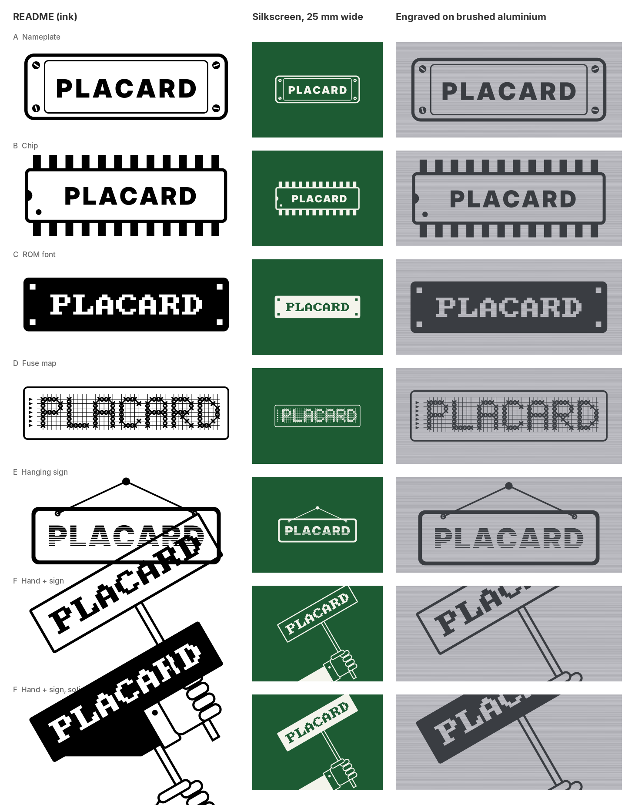

# PLACARD logo concepts

Six candidate logos, drawn by `src/scripts/gen_logo.py`.  None is used on
the board, case or README yet; pick one (or a mix) first.

| Concept | Files | Idea | Small silkscreen |
|---|---|---|---|
| A Nameplate | `a_plaque.svg`, `a_plaque_inverse.svg`, `a_plaque_brass.svg` | a screwed-on plate, the literal placard | good |
| B Chip | `b_chip.svg` | the name on a 24-pin DIP, the ATF22V10C package | good |
| C ROM font | `c_pixel.svg`, `c_pixel_line.svg` | the name in the machine's own 8x8 console font | good |
| D Fuse map | `d_fusemap.svg` | letters made of "X" fuses in a PLA AND array | README / large only (grid lines are 0.07 mm at 25 mm wide) |
| F Hand + sign | `f_hand.svg`, `f_hand_solid.svg` | a hand holding up a picket sign tilted 30°, PLACARD in the ROM font | good; pure black filled shapes (no white fills, no strokes), ready for KiCad SVG import |
| E Hanging sign | `e_raster.svg` | a sign on a nail, letters cut by video scan lines | fair; uses a clipPath, which KiCad's SVG import may drop |

All SVGs are one colour (black) with the lettering already turned into
outlines, so they open anywhere without fonts.  Change `fill="#000000"`
to recolour.  The PNGs are 1200 px wide previews.

The comparison sheet shows each concept as README art, as white
silkscreen 25 mm wide, and engraved on brushed aluminium.
