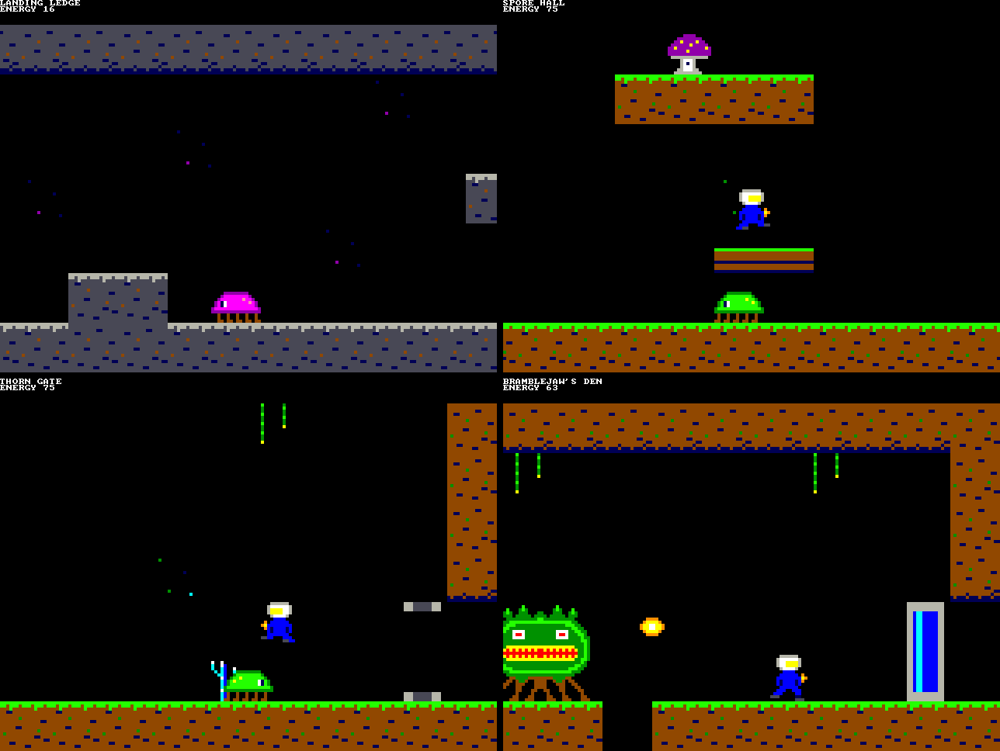
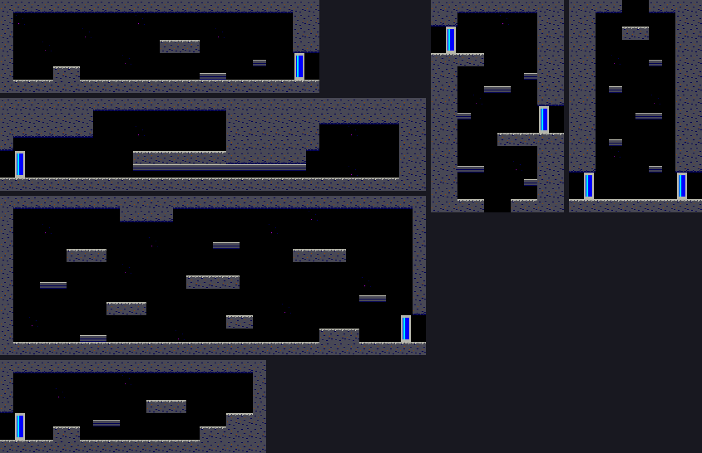
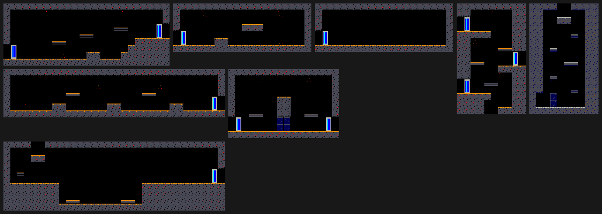

# Lamplighter

`sdcard/LAMP.PLC` is an exploration platform game for the Placard: rooms
that scroll sideways and up and down, joined into a world that branches
from a central shaft, doors that a shot opens, creatures, a boss for each
area, and power-ups that must be found and that make the way through it
shorter and safer.  It is a
library program for the SD card (run it from the DOS's file browser; Esc
goes back), made by `src/scripts/gen_lamp.py` from
`src/scripts/lamp_code.masm`.  Everything it reads after it starts is in
the card's `LAMP/` folder.

Date: 11/13/2026

The game, its world, its names, its art and its map are original, written
for the Placard.  It is in the exploration-platformer genre.

## The game

The hollow moon Cairn carried the great lamp that ships steered by.  The
lamp has gone dark.  Wick, a beacon keeper, lands on the crust and climbs
down the Wellshaft to find out why, with a lantern that throws sparks.

- **Controls:** arrow keys or SNES pad 1 Left / Right to walk, Z, Space
  or pad B / A to jump (hold the key for a higher jump), X or pad Y / X to
  fire, with Up held to fire upward, Down to crawl (once the Burrow Rig is
  found).  With the Kiln Charge, holding fire for 0.75 s and letting go
  throws a blast.  Esc goes back to the DOS.
- **Rooms** are up to 32 × 16 tiles (the screen shows 10 × 7) and scroll
  both ways.  Walking off a room's open edge, or jumping or falling
  through a gap in its ceiling or floor, leads into the next room.
- **Doors** open to a shot and shut again after 2.5 s.  The door on the
  far side of a room's edge opens as Wick comes through.
- **Crawling** takes Wick through ducts half a tile high.
- **Jumping** reaches 3 tiles; a room above is reached from a ledge under
  the gap.
- **Energy** is the number on the second text line: 30 at the start, of
  the 50 the lantern holds.  A creature's touch or its bolt takes some and
  Wick blinks for a second, safe.  At 0 the lantern goes out and Wick is
  back on the Landing Ledge with 30, keeping everything he found.
- **Creatures** take one to four sparks; a blast counts as four.  Every other one leaves an ember
  (5 energy).  They are back when Wick comes into the room again.
- **Items** stay found.  An Oil Flask makes the lantern hold 25 more, and
  every item fills it.  A boss leaves its item where it fell.

### The world so far

| Area | Rooms | Creatures | To find |
|---|---|---|---|
| The Wellshaft (the hub) | Landing Ledge, the Wellshaft (upper, lower, deep), Keeper's Duct, West Gallery, East Gate | Mite (walks), Moth (flies), Drip (falls from the ceiling) | The Burrow Rig, two Oil Flasks |
| The Glasswort Gardens | Glasswort Gate, the Conservatory, Frond Walk, Spore Hall, Bellows Nook, Root Cellar, Thorn Gate, Bramblejaw's Den | Mossback, Lumen Gnat, Sporecap (sits and spits), Drip; the boss Bramblejaw | The Updraft Bellows, an Oil Flask, the Ash Sail (Bramblejaw's) |
| The Slagworks | Slag Stair, Flue Hall, Kiln Loft, Cinder Run (hot), Slag Lake, Soot Lock, Clinker's Forge | Cinderhop (hops toward Wick), Emberwing, Flue (sits and spits), Slagback; the boss Clinker | The Kiln Charge, an Oil Flask, the Cinder Coat (Clinker's) |

**Every boss can be reached and beaten with nothing collected.**  A
power-up is never a key: it is a shorter or a safer way.

| Place | With nothing | With the power-up |
|---|---|---|
| Into the Gardens (West Gallery) | Up the ledges to the opening high in the west wall | The Burrow Rig: the duct at the gallery's foot |
| Thorn Gate, East Gate (walls 4 tiles high) | From the small ledge beside the wall, a full jump, with the Sporecap on the Thorn Gate's wall shot first | The Updraft Bellows: over from the floor |
| Slag Lake (a pit 12 tiles wide, Cinderhops in it) | Down into the pit and out by its ledges | The Ash Sail: a jump and a slow fall across the top |
| Soot Lock (sooted blocks in the passage) | Over the wall above, past the Flue that sits on it | The Kiln Charge: a blast breaks the block it hits and a sooted block right over it |
| Cinder Run (a hot room: 1 energy every quarter second) | In and out fast for its flask | The Cinder Coat: no harm |

The Keeper's Duct (a flask) needs the Rig, and the flask at the foot of
the deep Wellshaft is behind soot: extras, not on a boss's way.

**Bramblejaw** paces its side of the den and spits a bolt every half
second, two at Wick's height and then two over his head.  A pit in the
floor stops it.  It takes 32 sparks.  The test's bot beats it with the
lantern alone and 30 energy, losing none, by standing off, jumping the low
bolts and firing; the Bellows make the jumps easier and the flasks leave
more room for mistakes.

**Clinker** is a furnace that floats under the roof of its forge, follows
Wick at two thirds of his pace and drops a bolt from its middle every
quarter second.  It takes 40 sparks, fired upward.  The bot beats it with
the lantern alone by keeping a few pixels off its middle, under its body,
and changing sides at a wall just after a bolt has left; the Kiln Charge's
blasts are worth four sparks each and the Cinder Coat (its own prize, for
the areas after) halves every hit.

### The plan

The game is built in stages, each merged when it passes its test.

| Stage | What | State |
|---|---|---|
| 1 | The engine: two-way scrolling rooms from the card, the hero, shots, doors, crawling; six rooms of the Wellshaft | Done |
| 2 | Creatures, energy and damage, items; the first area (the Glasswort Gardens), the first three power-ups, the first boss | Done |
| 3a | The deep Wellshaft, the Slagworks, the Kiln Charge and the Cinder Coat, the second boss; a way to every boss that needs no power-up | Done |
| 3b | The Brine Vaults, the Ballast Boots, the Wide Flame, the third boss | |
| 3c | The Orrery and the last boss | |
| 4 | Music, the title and the ending, saving to the card at save lamps | |

The world is a hub, the Wellshaft (a tall shaft of rooms one above the
other, with passages off it at different depths), and four areas: the
Glasswort Gardens, the Slagworks, the Brine Vaults and the Orrery, which
the bosses of the other three open.  The power-ups: the Burrow Rig
(crawling), the Updraft Bellows (a second
jump in the air), the Ash Sail (a slow fall with the jump key held), the Kiln
Charge (hold fire for a blast that breaks sooted blocks), the Wide Flame (a
three-way shot), the Cinder Coat (half the damage, and no harm from hot
rooms), the Ballast Boots (walking as usual under water) and Oil Flasks
(more energy).  Every boss can be reached and beaten with the lantern
alone; the power-ups make it much easier.

## What the Placard changes

| A console of the genre | Here | Why |
|---|---|---|
| 256 × 240, 16 × 15 tiles on the screen | 160 × 112, 10 × 7 tiles | The 4 bpp 4x mode is the one a frame can redraw |
| Scroll registers and hardware sprites | The whole playfield drawn again every frame, and the sprites over it | The Placard has neither; see "How it draws" |
| Corridors and shafts many screens long | Rooms of up to 3.2 × 2.3 screens, joined at their edges | Positions fit in a byte, which keeps the rules small and fast; a long shaft is rooms one above the other |
| The whole map in the cartridge | A room is a 1 KB file read as Wick enters it (a tenth of a second) | The RAM holds one room; the card is fast |
| One set of tiles and sprites in the cartridge | A tile set and a sprite set for each area, read when the area changes (about half a second); a boss's den has a set of its own | Tiles and sprites are code (below); a set has 25 KB of free video RAM, enough for the tiles, Wick, the items and four kinds of creature, or a boss |
| Dozens of sprites, 8 on a line | Wick, 3 sparks and 6 things in a room (creatures, bolts, items, embers); a boss is 2 sprites side by side | The drawing has to be done before the beam is back |
| A password | Saving to the card (stage 4) | The card can be written |

## The screen

| Rows | Mode | What |
|---|---|---|
| 0-31 | 1 bpp, 1x | Four lines of 80-column text: the room's name, the energy, what was just found |
| 32-479 | 4 bpp, 4x | The playfield, 160 × 112 pixels of 4 × 4, 16 colors |

## How it draws

The method is `gen_skyward.py`'s and `gen_scroller.py`'s (unrolled code
that stores a tile's bytes with immediates, compiled sprites), changed so
the picture can also move up and down:

1. **Wait for the beam** to be 20 lines above the playfield's last tile
   row (the line counter read through `frame_poll`, value 235).  After a
   room was read from the card the beam may be past that line: then the
   wait is for the next time round.
2. **Draw the playfield, tile row by tile row from the top** (8,960 to
   10,240 bytes).  A tile row takes about as long to draw as the beam
   takes for 16 lines, a quarter of a tile row, so the beam is below every
   row as it is drawn and has left the playfield before the last one is:
   nothing tears.  For a
   tile row the 16 video offsets of its cells go into the zero page
   (`ROWT`; cells above or below the playfield get an offset nothing
   shows).  Then each tile of the row is one jump: its routine stores its
   8 byte columns one after the other through `ROWT`, steps the column's
   video page by 2 after each, and comes back at the tile's end or when
   the page passes column 79 (the add's carry).  So a tile costs one map
   lookup, whatever the scroll.
   A tile whose byte columns are all the same (the empty tile, a ledge) is
   one routine that loops; a run of three or more equal bytes is stored
   from AC.
3. **Draw the sprites** over it with the blitter (each sprite frame is
   compiled code as well, 16 pixels wide and 16 or 32 high).  Each is done
   before the beam is back at its first row; the test measures by how
   much.
4. **Sound, pads, keyboard, the rules, the sprite list, the text** while
   the beam draws the playfield.

Starting at the vertical blanking, as the Skyward engine does, would draw
the sprites of the top rows after the beam has passed them.  Starting near
the last tile row gives the drawing the rest of the frame and the blanking,
and the rules the time the beam spends on the picture.

## Memory and files

| Where | What |
|---|---|
| x0100-x02FF | `ROWX` and `VPG`: video offset of a cell, video page of a byte column |
| x0300-x1EFF, x2000-x3FFF | The program (7 KB in stage 3a) |
| x4000-x45FF | The area's tables: tile routine addresses (2 pages), tile attributes, sprite routine addresses, the area's kinds of things, a spare page |
| x4600-x47FF | The room's tile map, 32 × 16 bytes (tile number × 8) |
| x4800-x48FF | The room's header: size, camera limits, exits, things, name |
| x5400 | The sprite list |
| x5500 | The room's 6 things: kind, place, direction, timer, hits left, item |
| x5600 | The items found (a byte each, 1-31) |
| x6000-xFFFF, offsets x040-x17F of each byte column | The area's tile routines and sprite routines (the 4x playfield and the text rows leave these bytes free) |

| File | What |
|---|---|
| `LAMP/An.TS` | Area n: the 6 pages of tables, then a straight image of the RAM from x6000 |
| `LAMP/Rnn.RM` | Room nn (hex): the tile map, the header, a spare page |

A tile has attribute bits: solid in its upper half, solid in its lower half
(both: a wall; one: a ledge or a duct's roof), a door, a door's lower
tile.  Tiles 0-4 are the same in every area: empty, and a door's two
tiles, shut and open.  A fifth bit marks a sooted block, and a room's
header has a flag for a hot room.

A room is rows of letters in `gen_lamp.py` (`ROOMS`) with its exits: the
side, the tiles of the edge it covers, the room it leads to and how far
along the edge Wick comes in.  `check_rooms` checks that every exit is
open, has an exit back and lands in the open.  A rock letter becomes one
of three rock tiles by what is above and below it.

### Things

A room has up to 6 things.  Its header lists the ones it starts with: a
kind, a place and, for an item or a creature that guards one, the item
(type × 32 + number).  A thing whose item is found is not put in the room.
What a kind is comes from the area's table (`SPEC`): what it does, its
first frame, the hits it takes, the harm it does, its size, how often it
spits and whether it is 32 pixels wide.

| It does | |
|---|---|
| Item | Waits for Wick: sets its flag, gives its power-up or 25 more energy, fills the lantern |
| Ember | 5 energy; gone after 4 s |
| Puff | Where a creature was shot; then the item it guarded, or every other time an ember |
| Bolt | 2 byte columns a frame until a wall or Wick |
| Walker | A step every other frame, turning at walls and at the end of its floor |
| Flyer | A step sideways every other frame, turning at walls; up for 16 frames, down for 16 |
| Sitter | Faces Wick |
| Dropper | Hangs until Wick is under it, falls, bursts on the floor |
| Hopper | Rests, then hops toward Wick |
| Hoverer | Stays at its height and follows Wick sideways, a step every other frame |

A kind that spits (a Sporecap, a Flue, Bramblejaw) puts a bolt in the
first free place, toward Wick; Clinker's kind aims down instead.  Bramblejaw is a walker 32 × 32 pixels that spits.
Positions are bytes, so the tests for touching are two subtractions and
two compares.

## Testing

`python3 src/scripts/test_lamp_sim.py` boots the 32K ROM in
`placard_sim.py` from a card with `BOOT.CFG` = `LAMP.PLC` and plays the
game through pad 1 with a bot.  `gen_lamp.py` has the rules a second time,
in Python (`Model`).  The bot plans each leg of its route by searching
that model (which buttons, 4 frames at a time, reach the next room or
place), so the route needs no hand-written key presses and the program is
compared with the model on every frame: the hero, his energy and what he
has found, the camera, the shots, the door, the room, its things and the
tile map.  For every frame it also checks the playfield byte for byte
against the model's picture, before and after the sprites, and that each
tile row is drawn behind the beam and each sprite is done before the beam
is back at it.  At the end: that the bot got through its route, that the
routines in the video RAM are unchanged and that Esc brings the DOS back.

First, on the model alone, it shows that every boss can be reached and
beaten with nothing collected: a run from the Landing Ledge to Bramblejaw
(2,291 frames, no energy lost in the fight) and one to Clinker (1,726
frames, 24 energy left of the 30 Wick starts with), in which the search
may not pick anything up.

Then the long route in the simulator, through all 22 rooms: the bot first
lets a Mite take all its energy (and starts again), shoots creatures,
takes the Burrow Rig, crawls to the Gardens, takes the flask and the
Updraft Bellows, crosses the Thorn Gate, beats Bramblejaw and takes the
Ash Sail; in the Slagworks it takes the Kiln Charge, blasts the Soot
Lock open, beats Clinker, takes the Cinder Coat and the hot room's flask;
it blasts its way to the deep Wellshaft's flask and climbs all the way
back to the Landing Ledge by way of the Keeper's Duct.  The fights are
played by rules (Bramblejaw: stand off, jump a bolt that is near and at
Wick's height, fire; Clinker: keep just off its middle and fire up), a
blast by holding the key; the rest is planned.  It is 10,964 frames and
takes about 45 minutes, most of it the planning.  In it the drawing is
never less than 55 screen rows behind the beam, and a sprite is done at
least 30 screen rows before the beam is at it.

`python3 src/scripts/gen_lamp.py --preview DIR` draws every room.
