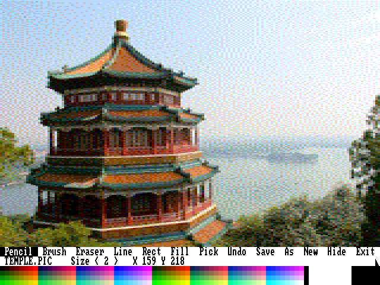
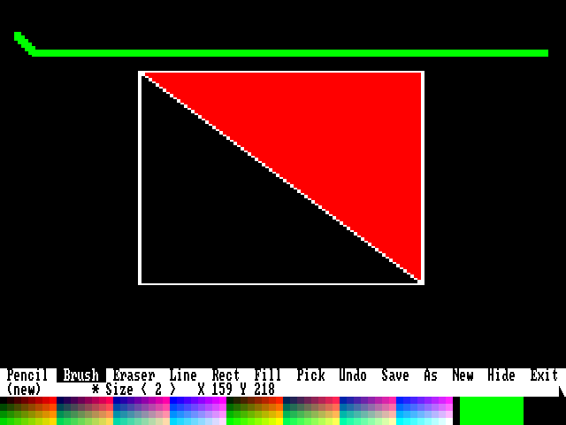

# Photo viewer and picture editor (`PHOTO.PLC`)

Date: 2026-11-23

`sdcard/PHOTO.PLC` (`src/scripts/photo.masm`) shows the pictures in the
card's `PHOTOS` folder: photographs at 160 x 240 pixels in 256 colors, on a
screen of 160-read rows with 2x line repeat.  That is a rev B video mode
([HIRES.md](../video/HIRES.md)); on a rev A board the same files show 80
pixels across.

The screens above are the emulator's (`placard_sim.py`, rev B) after the
viewer loaded each file from a card image.  A pixel is 4 screen pixels wide
and 2 tall.

## Keys

| Key | Does |
|---|---|
| H | at the start: 160 across (rev B board).  Any other key: 80 across (any board).  While a picture shows: changes between the two |
| Space, Right, Enter | the next picture (after the last, the first) |
| Left, Backspace | the picture before |
| S | slide show on or off: the next picture by itself about every 9 seconds |
| E | the [picture editor](#the-picture-editor), on the picture that shows |
| Esc | back to the DOS, or to Pinboard |

The program asks at the start because a rev A board shows a 160-read row
as a blank line: the screen would stay black.  With 80 across (mode byte
x07, a normal 8 bpp row with 2x repeat) the board reads the odd byte
columns of the same picture, so one file serves both boards.

## The picture editor

E while a picture shows starts the editor on it (`src/scripts/photo_edit.masm`,
part of `PHOTO.PLC`).  From Pinboard: Enter on a `.PIC` file in the Files
card, then E.  It draws straight into the picture on the screen, with the
PS/2 mouse or with the keys alone.

The bar covers the picture's last 32 rows: the tools and commands, a
status row (the file's name with a `*` when it is changed, the brush size,
the pointer's pixel and row, a message), and the 256 colors with the ink
and the paper at their right.  The picture under the bar is kept and is
saved with the rest.

| Key | In the bar | Does |
|---|---|---|
| P | Pencil | one pixel, and a line of them while the button is held |
| B | Brush | the same with a brush of size 1 to 4 |
| E | Eraser | the brush in the paper color |
| L | Line | hold the button from one end to the other; the line follows the pointer |
| R | Rect | a rectangle's outline, pulled the same way |
| F | Fill | the area of one color under the pointer becomes the ink |
| K | Pick | the ink becomes the color under the pointer |
| U | Undo | takes back the last thing drawn (one step) |
| S | Save | writes the picture to its file; a new picture is named first |
| A | As | asks a name (8 letters or digits) and saves to `NAME.PIC` in the same folder |
| N | New | the whole picture in the paper color, with no name yet |
| H, Tab | Hide | the bar away, and back |
| M | | the bar to the top of the screen, and back to the bottom |
| [ and ] | `<` and `>` | brush size |
| X, Esc | Exit | back to the viewer; a changed picture asks "Discard the changes?" first |
| arrows | | move the pointer: a pixel a press, faster when held |
| Space | | the left mouse button |
| Enter | | the right mouse button |

The left button draws on the picture and chooses in the bar; on a color it
sets the ink.  The right button on a color sets the paper, and on the
picture it takes the bar away or brings it back (so the rows under it can
be drawn on).  The ink starts white and the paper black.

**The two widths.**  In 160 across (rev B) a pixel is one byte of the file.
In 80 across (any board) the screen shows the odd byte columns, and the
editor writes each pixel to the odd column and the even one before it, so
a picture drawn on a rev A board is right on a rev B board too.  Drawing in
80 across on a photograph made for 160 halves its detail where it draws,
nowhere else.

**Undo** goes back one step.  Each tool notes what it changes as it draws
(1,536 notes: a pixel each, or for a fill a run of pixels in a row).  A
step that changes more than that, a long stroke with a big brush or a fill
of a very ragged area, cannot be undone, and Undo says so.  In 80 across,
undoing a fill gives both byte columns the old color.

**How it fits.**  The whole video RAM is the picture, so the bar is drawn
over it: 16 picture rows as two 1 bpp text rows of 80 characters in the
ROM's font (mode byte x04) and 16 as 8 bpp rows for the colors (x07).  The
3,840 picture bytes under it are kept in RAM and put back when the bar
goes, and into the sectors when the picture is saved.  Reading the video
RAM needs every memory section mapped to RAM, which takes the library's
ROM away, so the drawing code runs between two map writes and calls
nothing in the ROM.  Saving copies each sector to a buffer below x6000 and
gives it to the DOS's FAT writer (`fs_create`, `fs_write`, `fs_close`,
[DOS.md](DOS.md#the-fat-writer)): 80 sectors, about a second.

`src/scripts/test_photo_edit.py` runs the editor in the web emulator's core
on both boards: every tool, undo, the bar hidden and moved, the keyboard
alone, the saved file byte for byte, and leaving with and without saving.

Not tried on hardware.

## From Pinboard

In [Pinboard](PINBOARD.md)'s Files card, Enter on a `.PIC` file runs the
viewer on that picture.  The pictures are then those of the file's folder,
which need not be `PHOTOS`, and Esc goes back to Pinboard in that folder.  E edits the picture.
The viewer skips its first screen when it knows the width: Pinboard in a
color mode means a rev B board (160 across), and an answer given once is
kept until power-off.  Pinboard leaves the folder's first cluster, the
picture's number among the folder's `.PIC` files and the mark "V" in the
menu block (x5D19-x5D1F, `placard_menu.asm`); run from the DOS, the viewer
finds no mark and shows the `PHOTOS` folder as before.

## Picture files

Any file in `PHOTOS` whose name ends in `.PIC` is a picture; they show in
the order they are in the folder (255 at most).  A `.PIC` file is the video
RAM x6000-xFFFF as it is, 40,960 bytes (80 sectors), which the viewer reads
straight to the screen with `fs_read`.  A picture takes about 0.6 seconds
and comes in from the left.

    byte column c (0-159), picture row r (0-239), v = 32 + 2r:
    offset in the file = c * 256 + ((v & xFE) | (v >> 8))
    byte = GGG BB RRR (docs/video/COLORS.md, 8-bit color mode)

The 16 bytes of every 256 that the mode never shows are 00.

`src/scripts/gen_photos.py` makes the files from the photographs in
`src/photos/`: it cuts each to 4:3, squeezes it to 160 x 240, and picks the
colors by error diffusion (Floyd-Steinberg in linear light, the nearest
color chosen in Oklab).  The five codes that color decoder revision 08
blends into grays are not used, so a picture is the same on every decoder
revision.  To add a picture, put the photograph in `src/photos/`, add a
line to `PHOTOS` in the script and run it (`--png DIR` also writes each
picture as a PNG).

`src/scripts/test_photo.py` boots a card with the viewer in `placard_sim.py`
as a rev B board and checks the count, every key, both widths, the slide
show, that the video RAM is each file byte for byte, and the message for a
card without the folder.

Not tried on hardware.

## The photographs

| File | Photograph | By | License |
|---|---|---|---|
| `TULIPS.PIC` | [tulips over grape hyacinths](https://www.flickr.com/photos/comunicati/3502685880/) | Michela Simoncini | CC BY 2.0 |
| `SUNFLOWR.PIC` | [sunflowers](https://www.flickr.com/photos/paraflyer/23204123212/) | Tobias Haase | CC BY 2.0 |
| `PURPLE.PIC` | [purple tulips](https://www.flickr.com/photos/jeepersmedia/12916135413/) | Mike Mozart | CC BY 2.0 |
| `TEMPLE.PIC` | [the Tower of Buddhist Incense, Summer Palace, Beijing](https://www.flickr.com/photos/danielbuechele/6061409035/) | Daniel Büchele | CC BY 2.0 |
| `ASTRONAU.PIC` | astronaut Eileen Collins | NASA | public domain |

The three flower photographs are from the TensorFlow flower photos set, the
temple from scikit-learn's sample images and the astronaut from
scikit-image's.  All were cut, resized and reduced to the board's colors
for the card.  [CC BY 2.0](https://creativecommons.org/licenses/by/2.0/).
