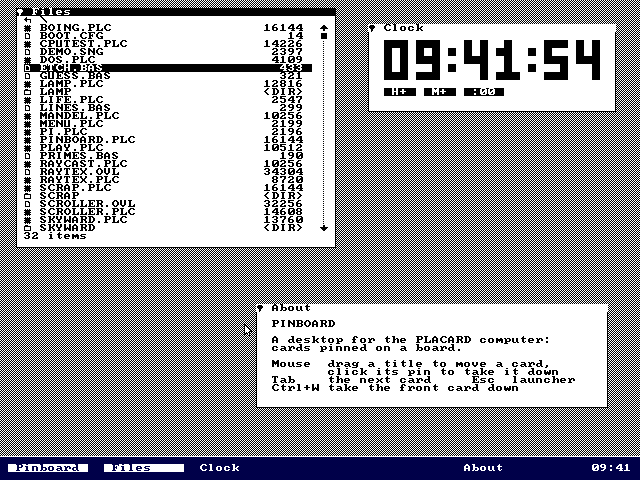
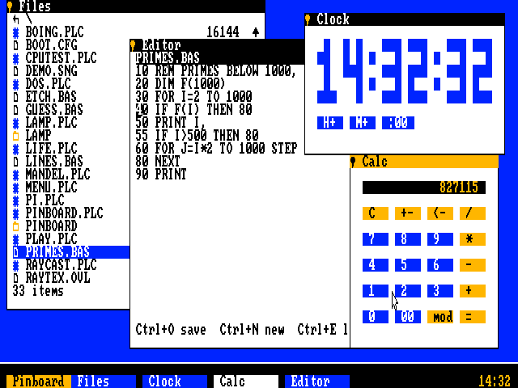
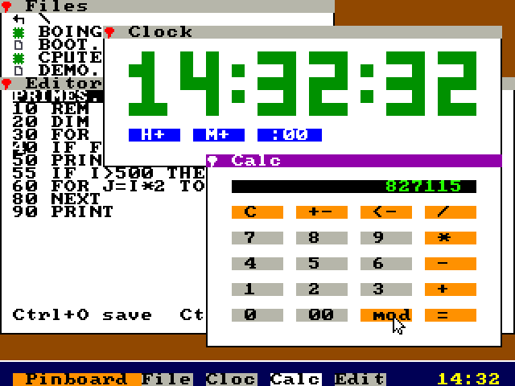

# Pinboard

Pinboard is a windowed desktop for the Placard: a program on the SD card,
`PINBOARD.PLC` (`src/scripts/pinboard.masm` and `pinboard.vm`, built by
`gen_pinboard.py`).  Its windows are **cards** pinned on a board.  A card
shows the card's files and runs programs from it; others are a clock, a
calculator and a text editor.  It works with the PS/2 mouse, the keyboard, or both,
in 2 colors on any board and in 4 or 16 colors on a rev B board
([Display](#display)).

Date: 11/17/2026

## Starting it

Run `PINBOARD.PLC` from the DOS's file browser, or make it the program the
machine starts with: choose it in the DOS and press **B**, which writes
`BOOT.CFG` ([DOS.md](DOS.md#at-power-up)).

Plug in the mouse before turning the machine on.  With no mouse there is
no pointer and everything is done with the keys.

## The board

The screen is 80 x 60 character cells of the 640 x 480, 1 bpp mode
(the color modes have fewer: [Display](#display)).  The
woven board fills the top 57 rows and the **rail** the bottom three, in
blue.  The rail holds the launcher's button, a tab for every card that is
up (the front one in white) and the time.  The tabs share the room: with
many cards up on a narrow screen their names are cut short.

| Mouse | Does |
|-------|------|
| click on a card | brings it to the front |
| drag a card's title | moves the card: its outline follows the pointer |
| click the pin at the left of a title | takes the card down |
| click a card's tab on the rail | brings it to the front |
| click `Pinboard` on the rail | opens the launcher |

| Key | Does |
|-----|------|
| Tab | the next card to the front |
| Ctrl+W | takes the front card down |
| Esc | the launcher: Up, Down and Enter, Esc closes it |
| any other | goes to the front card |

The launcher puts up Files, Clock, Calculator, Editor, About or Display,
starts BASIC, or goes back to the DOS.

## Files

The Files card lists the folder: a picture for a folder, a program
(`.PLC`) or another file, the name, and the size.  The line under the
title names the folder; the last line counts the entries or says why
something did not work.

| Key | Mouse | Does |
|-----|-------|------|
| Up, Down | click a row | moves the bar; the list scrolls |
| Enter | click the chosen row again | runs the program, opens the folder, or opens another file in the [Editor](#editor) |
| Backspace | click the arrow by the folder's name | the folder above |
| | click the scroll bar, above or below its middle | scrolls 5 rows |

A program runs as it does from the DOS, with the whole machine.  When it
ends (Esc in most), Pinboard comes back with the same folder entry chosen
and the clock's time kept.

- A program started from a folder below the root comes back to the DOS,
  not to Pinboard: the loader looks for the program to come back to in the
  folder it is in.
- A program that can't be loaded brings up the DOS, which says why.
- A folder shows its first 96 entries.

## Clock

The machine has no clock chip, so the Clock counts frames (59.94 a
second) from 00:00:00 when Pinboard starts, and you set it: **H+** and
**M+** (keys H and M) add an hour and a minute, **:00** (S or 0) clears the
seconds.  The rail shows the hours and minutes.  The time is kept while a
program runs, but not counted.

## Calc

The calculator works in whole numbers up to 2,147,483,647 either side of
0.  Click its buttons or type:

| Key | Button | Does |
|-----|--------|------|
| 0-9 | 0-9, 00 | the number, up to 9 digits |
| + - * / | the same | add, subtract, multiply, divide (the whole part) |
| % or M | mod | what is left over from a division, with the sign of the first number |
| = or Enter | = | the answer |
| N | +- | changes the sign |
| Backspace | <- | takes the last digit back |
| C or Del | C | clears everything |

The operation that is waiting for its second number shows at the left of
the display.  An answer that is too big, or a division by 0, shows
"Error" until C.  The numbers are kept as a sign and 32 bits, and the
arithmetic is done 16 bits at a time in the bytecode: a multiply or a
divide is 32 shift and add steps, about a twentieth of a second.

## Editor

The Editor holds one text: a file opened from the Files card (Enter on
any file that is not a program, a BASIC program for one), or a new one.

| Key | Does |
|-----|------|
| the arrows | move the cursor; the text scrolls up, down and sideways |
| Home, Ctrl+E | the start and the end of the line |
| Enter | a new line |
| Backspace, Del | take out the character before or under the cursor; at a line's edge they join two lines |
| Ctrl+O | saves the text (write it Out).  A new text asks for its name first: type it and Enter, or Esc |
| Ctrl+N | a new, empty text.  With unsaved changes it asks once more |

A click puts the cursor on the character clicked.  The top line shows
the file's name, with a `*` while there are changes that are not saved.

- The text is in memory, 2,815 characters at most, and a file to open
  2,560 bytes at most.  A bigger file, or one that is not text, is not
  opened and the Files card says why.
- Lines are saved with the ends the file had (CR LF or LF); a new text
  gets CR LF.  Tabs become spaces.
- A new text is saved in the folder the Files card shows; an opened one
  goes back to its own folder.
- Unsaved text keeps Pinboard from leaving for a program, BASIC or the
  DOS: the Editor comes to the front and says so.
- Ctrl+S can't be the save key: the keyboard driver gives the Left arrow
  the same code (13h).

## Display

The Display card chooses the screen's mode: press **1**, **2** or **3**,
or click the line.

| | Mode | Cells | Needs |
|---|------|-------|-------|
| 1 | 640 x 480, 2 colors | 80 x 60 | any board |
| 2 | 640 x 240, 4 colors: black, blue, gold, white | 80 x 30 (a cell is twice as tall as wide) | rev B |
| 3 | 320 x 240, 16 colors | 40 x 30 | rev B |

The two color modes are the rev B board's 160-read rows
([HIRES.md](../video/HIRES.md)).  On a rev A board those rows are blank,
so a color mode has to be kept: press **Y** or Enter, or click, within 10
seconds, or the mode before comes back.

- The cards go back to their first places when the mode changes, in the
  sizes that fit it: the Files list is 26, 20 or 18 rows, the Editor's
  text 42 x 26, 42 x 20 or 38 x 16.
- Each mode has a driver, a file in the card's `PINBOARD` folder
  (`MONO.DRV`, `COLOR4.DRV`, `COLOR16.DRV`).  Without the folder the mode
  stays as it is and the card says so.
- The mode is kept while a program runs and until the power goes off;
  Pinboard starts in 2 colors.
- In the color modes the board is one color (it is quicker to draw), and
  everything is redrawn in about 0.4 s instead of 0.3 s.

## How it is built

Pinboard is written in the Forth-like language of BASIC's interpreter
([BASIC.md](BASIC.md)): `pinboard.vm` compiles (`vmc.py`) to bytecode for
a stack machine, a copy of BASIC's inner interpreter that `pinboard.masm`
carries so it does not depend on where BASIC is in the ROM.  A call in the
bytecode is two bytes; `vmc.py`'s `RAMCALLS` sets bit 7 of the first so
that addresses in RAM, x0100-x3FFF, can't be taken for a primitive's
number.  The core of the desktop, most of it bytecode, is 10.8 KB of the
11.3 KB it has; a display driver is another 4.5 KB.

**The display driver** is the bytes x2E00-x3FFF: the code that draws
characters and the pointer for one mode of the screen, with that mode's
font, pointer, colors and the cards' first places.  The core (the rest)
is the same bytes under every driver; it reaches the driver through five
entries at x2E00 and reads its tables.  `PINBOARD.PLC` holds the 2-color
driver.  Choosing a mode reads another driver's file over it
(`pinboard.vm`: `DRV-LOAD`), calls its `d_init` (the screen cleared, the
rows' mode bytes set) and draws everything again.

| Source | Is |
|--------|----|
| `pinboard.masm`, `pinboard.vm` | the core |
| `pinboard_hdr.masm` | the constants and macros the core and the drivers share |
| `pinboard_drv_mono.masm` | the 2-color driver |
| `pinboard_drv_color.masm` | the 4-color and the 16-color driver: lines marked `@4` or `@16` are for one only |
| `gen_pinboard.py` | the drivers' tables (colors, sizes, fonts, pointers) and the build |

In the color modes a character is drawn with a **pen**, two colors: one
for the pixels a 2-color screen shows white and one for the black ones.
`n PEN` in the bytecode chooses pen n of the driver's 24
(`gen_pinboard.py`: `PENS4`, `PENS16`); the 2-color driver takes no
notice.  A space is one color and takes a quicker way.

Machine code does what has to be quick:

| Primitive | Does |
|-----------|------|
| `EMIT`, `GTYPE`, `HFILL` | draw characters: 8 stores a cell (16 in 4 colors, 32 in 16), straight into the video RAM, clipped to the card being painted |
| `INVC` | turns a cell over (the outline of a card being dragged) |
| `PTR` | hides or shows the pointer: it saves the bytes under it (2 x 12; 3 x 12 and 5 x 12 in the color modes) |
| `POLL` | waits for the next frame, reads the keyboard and the mouse, moves the pointer |
| `SCAN` | finds the end of a line of the Editor's text |

- **The font** is Pinboard's own table (`gen_pinboard.py`): the library's
  characters at 20-7E, the board, the card edges, the pin, the arrows and
  the file pictures at 01-11, and all of them again in inverse video at
  80-FF, which is what a white card with black ink uses.  The color
  drivers' font has every row as two bytes of a 2 bpp row instead; the 16
  color one makes its 4 bytes from those through two tables.
- **Painting** goes back to front: every card is drawn whole, clipped to
  the part that changed.  A full screen with every card up takes about 17
  frames (21 to 23 in the color modes), a moved bar 2.  There is no saved copy of what a card covers.
- **The pointer** is drawn by the program: it is taken off before
  anything is drawn and put back after.
- **Long repaints** count the frames (`frame_poll`) and take the mouse's
  bytes as they come (`ps2_poll`) once per string, so the clock stays right
  and a click during a repaint is not lost.
- **Leaving** for a program, BASIC or the DOS waits until every key is up,
  so the key's release does not land in the next program.

| Memory | Holds |
|--------|-------|
| zero page x20-x52 | the interpreter, drawing and pointer state (the data stack is x53-x8F) |
| zero page x90-x9F | the desktop's variables (the sound driver's bytes: Pinboard makes no sound) |
| x0100-x2DFF | the core: machine code and bytecode |
| x2E00-x35FF | the display driver: entries, pens, sizes, code |
| x3600-x37FF | the driver's pointer, shifted: mask and picture |
| x3800-x3FFF | the driver's font, a page per pixel row |
| x4000-x4AFF | the Editor's text |
| x4B00-x4BFF | the bytes under the pointer, the cards' table and order, the clock, the calculator's numbers, the Editor's state |
| x4C00-x4CFF | the interpreter's return stack |
| x5400-x59FF | the folder: 96 entries of 16 bytes |
| x5D15-x5D18 | the time and the display's mode, kept in the menu block while a program runs |

A card is a row of four tables in `pinboard.vm`: its title and the words
that draw it (`DRAWTAB`), take a key (`KEYTAB`) and take a click
(`CLICKTAB`); and its first place and size in every driver
(`gen_pinboard.py`: `DRIVERS`).

## Testing

`src/scripts/test_pinboard.py` runs Pinboard in the emulator's core
(`web/placard_emu.js`, under node, through `pinboard_emu.py`) with the
ROM, a card image of `sdcard/`, a PS/2 keyboard and a mouse, and reads the
screen back as characters: power-up, the keys, the pointer, the launcher,
setting the clock, dragging, Tab, the pin, Ctrl+W, running `PI.PLC` and
coming back, running with no mouse, going back to the DOS, the
calculator's sums by clicks and by keys, and the Editor: opening, typing,
joining lines, a click, scrolling both ways, saving with the file's line
ends (read back from the card image), a new text saved under a typed
name, the files it won't open and the unsaved text that keeps Pinboard
from leaving; and the Display card on a rev B board: both color modes
(read back by color), the pointer, a click, a drag and a sum in them, a
mode not kept, the mode kept over a program's run, and a rev A board,
where the 2-color screen comes back.
`--png folder` saves each step's screen.
