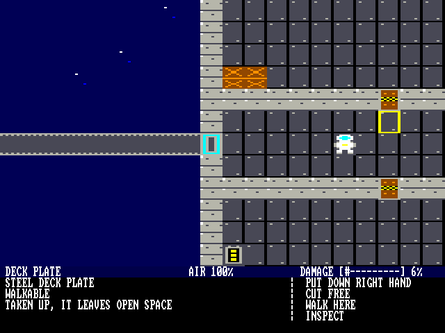
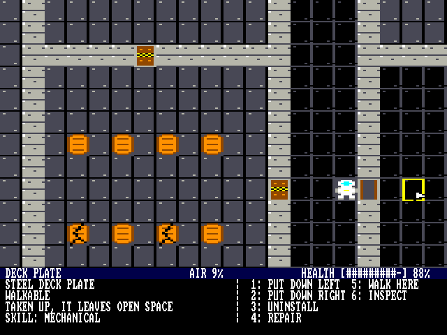
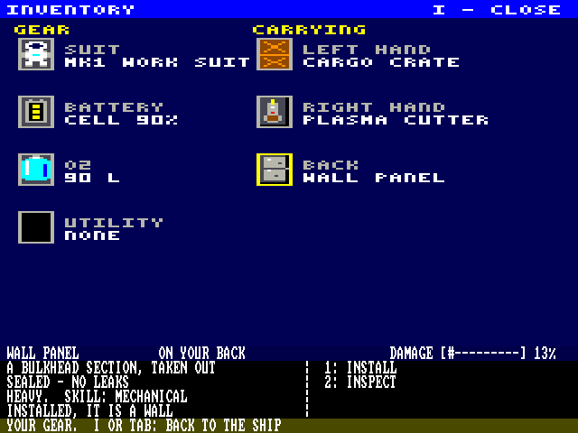

# SCRAPWRIGHT

`SCRAP.PLC` (`src/scripts/scrap.masm`, with `SCRAP.OVL`) is SCRAPWRIGHT,
an original top-down salvage game: you fly a small tug out to derelict
ships, walk through them in a suit, take out what is worth having, haul it
back, and build it into your own ship.  It is not in the demo menu: pick
it in the DOS's file browser and press Enter ([DOS.md](DOS.md)), or set
`BOOT.CFG` = `SCRAP.PLC` to run it at power-up.

Date: 2026-11-09

The design (proposal, phases, mock-ups) is the SCRAPWRIGHT design doc.
This is **phase 3**: the walkable wreck with the mouse panel (phase 2),
plus salvage, building the tug, air, skills and taking the suit off, and
the navigation mode's first steps: flying the tug and the sector map
(see **Flying**).  Power, hazards, enemies, the docking approach, radar,
comms and other ships come in later steps.







## Playing

You start in your tug's cabin, docked to the KESTREL 9.  The tug is
small (8 x 8 cells, `gen_scrap.TUG_PLAN`): a cockpit and engine room
(helm, reactor, battery, two nitrogen tanks) above a cabin (air
scrubber, O2 tank and its pump, bunks, lockers), one door between them.
Docked, the tug's airlock is right next to the wreck's, side by side:
always aligned, so you step from one into the other, and the air of the
cabin and the wreck's corridor is shared through them.

| Input | What it does |
|-------|--------------|
| Arrows, WASD, or the SNES pad | walk one cell (held: a step every 7 frames), on decks and out on open space too (a spacewalk, on suit air: to repair the outside and build).  Walking into a closed door opens it, and it closes behind you unless it is held open.  A door under 50 % health is jammed as it is: a jammed shut door stops you until you repair it to 50 % |
| Mouse over a cell | an arrow pointer and a yellow frame on the cell, and the panel shows it: name, health bar, info on the left, actions on the right |
| Mouse over yourself | your suit, battery, hands and pack |
| Left click on a cell | locks the panel on it, so the mouse can go down to the actions.  Another left click on a part it is locked on shows the deck or conduit under the part, and back |
| Left click on an action, or keys **1-8** | does it (see below); the menu is two columns of four, each action with its key to its left, `1:` to `8:` |
| Right click | unlocks the panel (and cancels picking a cell to install on) |
| **I** or **Tab** | the inventory screen, and back (see **The inventory**) |
| **V** | the power view, and back (see **Power**) |
| Esc | back to the DOS |

The actions, on the cell the panel shows (all but WALK HERE and INSPECT
need you next to it, diagonals count):

| Action | What it does |
|--------|--------------|
| OPEN / CLOSE | a door (not while you stand in it).  An opened door closes again once you have walked through it.  Not a jammed door (under 50 % health): `THE DOOR IS JAMMED - REPAIR IT TO 50% HEALTH FIRST.` |
| HOLD OPEN | opens a door and keeps it open: it stays open behind you (the panel says HELD OPEN) until you CLOSE it.  The doors that start open are held open |
| WALK HERE | walks toward the cell, across first, then up or down |
| INSPECT | a line about it on the message row |
| UNINSTALL | a part INSTALLED in the wreck: the cutter does it, in 1.5 s and 5 % of the suit battery, and needs a working cutter in a hand.  Walking away stops it.  The wreck's walls, decks and doors uninstall the same way, into a wall panel, a door kit or a deck plate.  INSTALLED in the tug: 1 s by hand (no cutter).  Either way it is LOOSE then.  On the tug the walls, decks and doors uninstall too (not the cell you stand on): a wall leaves a WALL PANEL lying on the deck, a door a PRESSURE DOOR kit, and a deck goes into a free carry slot as a SPARE PLATE, leaving open space.  A power conduit uninstalls into a loose CONDUIT SECTION lying on the deck |
| INSTALL | a LOOSE ship part lying on a deck, in the tug or in a wreck (O2 tank, scrubber, battery, nitrogen tank, air pump, gas intake, helm, bunk, locker, radar): 1 s, then it is INSTALLED (on the tug's cells it is part of the tug).  A wall panel installs as a wall, a door kit as a closed door, a conduit section as a power conduit in the deck.  Cargo and the cutter can't be installed.  Carried parts install from the inventory (below) |
| LAY DECK PLATE | open space next to you, with a deck plate in a carry slot: it is a deck now |
| REPAIR | a damaged part, wall, deck or door next to you: 0.25 s a damage step at full speed (see **Skills**), its health bar rising a step at a time (no job bar), until it is at 100 %.  Walking away stops it, and the steps done stay done.  A wall or door repaired to 50 % stops leaking |
| SKILLS | on yourself: your six skill levels on the message row |
| TAKE OFF SUIT / PUT ON SUIT | on yourself: the suit goes into a free carry slot, or back on from its slot (see **The suit**) |
| PICK UP | a LOOSE part goes into the first free carry slot: left hand, right hand, back |
| PUT DOWN LEFT / RIGHT / BACK | from that carry slot onto a deck or a power conduit next to you, at 50 % health or more: `THE DECK IS BROKEN - REPAIR IT TO 50% HEALTH FIRST.` |
| REFILL SUIT | a full O2 tank fills the suit (11 L less for each damage step) and is empty after |
| TURN | an antenna, a radar array or a thruster next to you, installed or loose: turns it to its next facing (up, right, down, left), so it sits flat on the hull on whichever side it is.  Each facing is its own kind in the code (`gen_scrap.FACE_PARTS`; up and left have their own art, down and right are drawn turned by `dc_face`), with the same name, worth and text; picked up, it is the plain part again |
| NAVIGATE | a working helm (50 % health or more) installed on the tug: the navigation screen (see **Flying**) |

You carry three things at most, one in each hand and one on your back,
and you start with the plasma cutter in your right hand.  Each part you
carry (the cutter is light) makes a step 4 frames slower.

A part that is not installed (LOOSE) is drawn in a brown crate frame,
so you can see at a glance what is fitted and what is lying about.

**The inventory.**  I or Tab swaps the view
for the inventory screen: a title bar, GEAR on the left (your suit, its
battery, its O2, a utility slot for later) and CARRYING on the right
(left hand, right hand, back), each slot the part's cell art in a frame,
with its label and what is in it in a small 3 x 5 font.  The space under
CARRYING is kept for an open bag (bags of up to 16 slots come later;
one open at a time).  Walking stops while it is up, but the game goes
on (air, jobs).  An arrow pointer (black with a white inside) shows
where the mouse is.  The mouse over a slot frames it in yellow and shows it
in the panel, with its menu as on the ship: a carried part (`IN YOUR
LEFT HAND` and so on) has INSPECT, PUT ON SUIT for the suit and INSTALL
for a part that installs; the gear slots show you (SKILLS, TAKE OFF
SUIT, ...).  INSTALL goes back to the ship and asks you to click the cell
next to you where it goes (right click cancels); a cell of the wrong
kind says where it goes instead.  Then it is a normal install job (its
time from the part's skills), in the tug or in a wreck alike:

| Part | Goes on |
|------|---------|
| O2 tank, scrubber, battery, nitrogen tank, helm, bunk, locker | a deck or a power conduit |
| air pump | a deck or a power conduit next to an O2 tank |
| gas intake | a deck or a power conduit next to a nitrogen tank |
| conduit section (a power conduit) | a deck, a wall, or under a part standing on a deck, where there is no conduit yet: `THERE IS A CONDUIT THERE ALREADY.` |
| wall panel (a wall), pressure door (a closed door) | a deck, a power conduit or open space |
| spare deck plate (a deck), thruster, comms antenna, radar array | open space |

A thruster, an antenna or a radar uninstalls too (in a wreck with the cutter): it
goes straight into a free carry slot and leaves open space, like a deck
plate.

**What is under a part.**  A part stands on a deck (or a power conduit
in one), all but those that go on open space (a thruster, an antenna,
a radar) and the wall turret.  A part can't be put down or installed on a broken
deck (under 50 % health), so the deck under a part is never broken and
its damage is not kept.  The map holds one type a cell, so a conduit is
a bit a cell of its own (`cb_get`): it can run under any part on a deck
and in any wall, and picking a part up lays the conduit again where the
bit is set (off any other part you find a whole bare deck).  A wall or
door taken out leaves its conduit in the deck under the panel or kit.
A bare deck's conduit shows on the view; one under a part or in a wall
shows in the power view.  Clicking a part the panel is already on
(left click a second time) shows what is under it: the deck or the
POWER CONDUIT, at 100 % health, with INSPECT; another click goes back to
the part.  If a deck ever breaks under a part (nothing in the game
breaks a deck yet), the part on it is destroyed.

**Power.**  **V** turns the power view on and off.  Over the view, every
conduit is a line drawn on the fly: to each side with a conduit, and
into each powered part beside it that is installed, so it looks plugged
in (the reactor, batteries, helm, turret, thrusters, scrubber, antenna,
radar, air pump and gas intake take or give power: `gen_scrap.POWERED`).
A powered part beside a conduit gets the line's other half, into its
own cell.  A conduit network is live when a working reactor or an
installed battery (under 50 % damage) is on one of its cells or beside
one: its lines are yellow; a network with none is orange.  The lines go
over the parts in the power view only.  The tug is wired through its
hull walls (`gen_scrap.TUG_WIRE`), the reactor and battery beside the
top wall, so all of it is live at the start; the KESTREL 9's engine
room conduits are dark (its reactor is broken).  Power is only shown so
far: a part works the same plugged in or not.

**Comms.**  To communicate you need a working comms antenna (50 % health
or more) installed outside the tug, on open space in its cells.  The
game keeps whether you have one (`N_ANT`, worked out each second); comms
show on the navigation station's display in the next game mode, for
getting between derelicts and stations.  The tug's own antenna, above
its hull, starts working, barely (56 %), so you can head out at once;
under 50 % it stops.  The KESTREL 9 has a working one on its top hull.

**Skills.**  You have six skills, 0-99, all starting at 10: MECHANICAL,
ELECTRICAL, NUCLEAR, COMPUTERS, HYDRAULICS and SUIT.  Each part needs one
or two of the first five (its info lines say which: a thruster needs
MECHANICAL and HYDRAULICS, a helm COMPUTERS and ELECTRICAL, a wall
MECHANICAL), and they set how fast you uninstall, install and repair it.
A job is 16 work units a frame of its time at full speed (install and
uninstall 1 s, the cutter 1.5 s, a repair 0.25 s a damage step), and you
do 2 + a quarter of the needed skills' average a frame (16 is full
speed).  In the suit you do half that, plus an eighth of your SUIT skill
(never more than without it).  So at the start an install takes 4 s
without the suit and 5.3 s in it.  Each job done raises the skills it
used, and SUIT when you wore it: 2 (120 - level) of 256 toward the next
level, so about a level a job at the start and slower as you get good.  While an install, uninstall or cut runs, the message row shows its bar
after the message, `[########--------] 50%`, filling a 16th at a time; a
repair shows in the part's health bar instead.

**The suit.**  TAKE OFF SUIT puts your suit in a free carry slot (it
keeps its O2, and you can put it down like any part).  Out of it you are drawn
without it: bare head, blue work clothes.  Without it you
work quicker but breathe the room's air: in a room under 60 you black
out at once and have 10 seconds to get air or PUT ON SUIT again.  Mind
the airlock.

**The tug.**  A part is part of the tug once it is installed on one of
the tug's cells: a part you put down there is loose, and does nothing
until you INSTALL it.  Hovering yourself shows the tug's worth (each
installed part's value, less with damage; its hull fittings too) and
whether it has air: it needs a working O2 tank with a working air pump
installed next to it, and a scrubber.
With air, the tug tops up its rooms and fills your suit (3 L a second),
and with a battery installed it charges your suit.  Uninstall its O2
tank (or its pump) and the tug has no air until you install one again.

**Nitrogen.**  The thrusters burn nitrogen.  A nitrogen tank feeds them
through a working gas intake installed next to it (a side, not a
corner), and the fuel the navigation mode will have is the nitrogen in
the tanks with a working intake by them.  The tug starts with two
nitrogen tanks, an intake by one, a pump by its O2 tank and a dented
radar array and eight thrusters on its hull; the KESTREL 9 has a pump by its O2 row
and intakes in its nitrogen room.  The radar does nothing yet: it is for
a later step of the navigation mode.

**Flying.**  NAVIGATE at the tug's helm opens the navigation screen
(`SCRAP.NAV`, read from the card into the inventory's place each time,
`SCRAP.NV2` over the actions table and the cell art, which `SCRAP.ART`
puts back when the screen closes, and `SCRAP.NV3` in the file system's
buffer).  The view is the sector map in 2 bpp (black, blue, gold,
white; square pixels, 256 across and 192 down, framed in the middle of
the screen so a position on it is a byte; 184 down under the status row),
with the tug in the middle on a dotted blue grid that is fixed in space
(lines every 64 pixels, moving as the tug moves): the tug a white triangle (about 9 by 11 pixels) with a notch in its
back, drawn at every one of its 32 headings (headings 0-4 are stored, the
rest are mirrors and quarter turns of those), three gold dots the way it
drifts, and the sector's objects (`gen_scrap.SECTOR`, the file
`SCRAP/K3A`): the HALVARD ROCK station on its asteroid as a white circle
of its size, and the derelicts as gold asterisks until you have docked
with one (visited), then diamonds.  The target has gold corners round
it.  The view's mode bytes go to 2 bpp as the screen opens and back to
4 bpp as it closes.

The status row at the top (row 0, 1 bpp) has the ship's date and time
(05-07-2175 08:00:00 at the start, a second each second, also while you
walk the ship), the nitrogen (kg), the delta-v it gives (m/s) and the
working batteries (there is no ship power to drain them yet).

The panel is a control panel: three boxed blocks with inverse titles.
FLIGHT has the heading (degrees, 0 east, clockwise) and DOCKED or FREE
FLIGHT (no speed: a speed means something only against something else,
so it is in TARGET); PROPULSION the nitrogen left, the tug's mass and
its working thrusters; TARGET the target's name, what it is, its
registry, its range (to its edge: the larger of the two distances, less
its size), its radar return (its size over the range, 99 % at most),
visited or not, and the tug's speed TOWARD it (under 0 moving away) and
ACROSS. The keys are on the row under it as inverse caps.

| Key | What it does |
|-----|--------------|
| Left / Right (A, D) | spin the tug up, left or right: the spin goes up by 1/256 of a heading step (11.25 degrees, 32 a turn) a frame while held, to at most a step every 8 frames (a turn in 4.3 s), and it keeps spinning when you let go (also off the map, while you walk the ship: it is worked out when the map opens). No turning while docked |
| R | stops the spin (1/256 a frame less until it is 0) |
| Up / Down (W, S) | thrust forward, or back at half the thrust, while held (not while docked) |
| Q / E | thrust sideways, left or right of the heading, at half the thrust, while held |
| + (or =) and - | zoom in and out in doubling steps: 4 to 512 m a pixel, 1 to 128 km across the view (1.024 km << the zoom; the key row shows it in whole km) |
| Tab, a click on an object | the target: the next object, or the one clicked |
| C | the docking and comms screen (below): hailing, docking, undocking |
| Esc | back to the ship |

**Docking.**  C on the map opens the docking and comms screen (`SCRAP.DCK`,
read in over the map screen's code, with `SCRAP.DK2`, `SCRAP.DK4` and `SCRAP.DK3`; the
map comes back when it closes).  The whole view is 1 bpp, in two boxes.
DOCKING, on the left, has the readouts (the RANGE to the KESTREL 9's port
in metres and the CLOSE speed toward it, the tug's SIDE offset from the
port's line, right +, and UP, with their DRIFT speeds, in m/s) over two
rings: the tug's, white and thick with a dashed cross, fixed in the
middle, and the port's, thin, which sits where the port is: off to the
side by the sideways offset, up or down by the height (a height of its
own: the sector map is flat), and bigger as you close in (960 / (16 +
the range in half metres) line pairs: 3 dots far off, the tug's ring's
size at 2 m, 60 at the port).  It drifts: every 16 frames a small random
push goes to the sideways speed and the height's, so you keep it
centred.  The tug's turn comes with it from the map: its yaw is the
map's heading (the port's line is east) turning at the map's spin, and
it pitches too, starting level and turning at half the spin, up or down
(the map is flat; this is its other part).  The angles move the port's
ring off the middle as well (a heading step, 11.25 degrees, moves it as
2 m to the side would): turned right the ring is to the left, pitched up
it is lower.  So the pilot stops the turning and lines the rings up at
the same time; forward thrust goes the way the tug points.  Back on the
map the heading and the spin are the yaw's (the pitch is not kept).
CLEAR TO CLAMP flashes under the rings when the clamps would hold:
docking declared, under 3.5 m to go, the ring within 0.75 m of the
middle each way (the angles in it), not turning, and every speed
(closing, sideways, up / down) under 0.7 m/s.  Clamping lines the tug up
(heading east, level, no turning).

COMMS CONTROL, on the right, has the target, its port, the status, and
five buttons (click one, or press its number; the one under the mouse is
in normal video, the rest inverse):

| Button | What it does |
|--------|--------------|
| 1 HAIL | calls the KESTREL 9 on the tug's antenna (a working one, `N_ANT`, or NO COMMS): no reply, it is a derelict |
| 2 REQUEST DOCKING | once hailed, declares the docking (a derelict cannot answer, but it must be declared) |
| 3 REQUEST UNDOCK | docked and hailed: declares the undocking |
| 4 CLAMP | declared and clear to clamp: docked (CLAMPS MISSED otherwise); docked, RELEASE CLAMPS: only once undocking is declared (CLAMPS LOCKED), then 5 m/s away from the port (west) |
| 5 BACK TO THE MAP | the map screen again (Esc too) |

| Key (docking screen) | What it does |
|-----|--------------|
| W / S | thrust forward (the way the tug points) or back, while held |
| Q / E | thrust sideways, at half the thrust |
| Z / X | thrust up or down (the height), at half the thrust, the same nitrogen |
| Left / Right (A / D) | turn (yaw), as the map's spin: faster while held, it keeps turning |
| Up / Down | pitch up or down, the same way |
| R | stops the turning (both) |
| 1-5 | the buttons |
| Esc | back to the map |

The tug's mass is every cell of it but loose parts, each kind a set mass
(`gen_scrap.MASS`, in 100 kg; the hull is aluminum: a deck 100 kg, a
wall 200, a reactor 6 t, a thruster 1.5 t): it starts at 33.7 t.  Each
working thruster (under 50 % damage) gives 20 kN, so with the eight it
starts with the tug speeds up by 4.7 m/s each second.  The nitrogen is 400 kg for each nitrogen tank with a working gas
intake by it, less what is burnt: a kg a second a thruster (so a kg is
20 kN s, and the delta-v is kg x 20 kN s / the mass), and no
thrust once it is gone.  It is worked out again with the tug's parts
each second, so a tank or intake taken out takes its nitrogen with it.

The flight goes on when you leave the screen: you walk round the tug
while it cruises, and NAVIGATE again to steer.  Undocked, the tug's
airlock is a closed door and the KESTREL 9's a wall (no air between
them), and the wreck is out of sight: its side of the map (x 30 on) is
open space for the view, the panel and walking.  It stays in the RAM as
it was.  Every 8 frames the game looks at the KESTREL 9: closing within
300 m is PROXIMITY, and within 10 s of its hull IMPACT IN 10 S, on the
message row in red (on the ship's screen too).  Flying into the hull
stops the tug where it was last clear, and damages it by the speed:

| Speed | Damage |
|-------|--------|
| under 2 m/s | a bump, none |
| 2-20 m/s | 4 cells of the tug, 1-2 damage steps |
| 20-100 m/s | 16 cells, 4-11 steps |
| over 100 m/s | 24 cells, broken |

The cells are picked at random in the tug's area, and only parts,
walls, decks and doors take damage.  Docking again (4 CLAMP on the
docking screen) puts the tug at the port, stopped and lined up, and
joins the airlocks.

**Building.**  The tug is the cells x 0-29, y 18-46: its hull and the
space round it, so it can grow there.  Take walls out to join rooms, lay
deck plates on open space and put walls and doors round them to add
rooms.  Every change to a wall, deck or door works the rooms out again.
There are 31 rooms at most on the map (vacuum is room 0 and costs none);
for now a 32nd and later room shares room 31's air (a later phase
refuses the build instead).  Stations will keep to about 16 rooms, so
your ship has room to grow.

**Air.**  Each room (the cells joined side by side) has a pressure of
0-100.  `rooms_build` works the rooms out at the start and after every
change to the ship, in the same order as `gen_scrap.py`'s `rooms()`: a
new room's pressure is the average of its cells' old ones (a cell that
was not air brings none).  Every 8 frames, each open door and the
airlocks share their two rooms' air (the average), and the tug tops up
its own rooms (working the rooms out takes about 0.3 s, a short pause in the game).  A room next to vacuum (open space where a
deck or wall was taken out, the edge of the map) loses an eighth of its
air, and one more.  A wall or a closed door at 50 % damage or worse leaks:
a unit a tick to the room on its other side when that has less; with
vacuum on its other side it is a hull breach, an eighth and one more.  The KESTREL 9's vented section has a hull breach: two broken
hull wall segments (100 % damage) and a cracked one (63 %).
A deck in a room under 40 is drawn frosted.  In a room under 60 your suit
uses its own O2, 1 L every 7 seconds (90 L last 10.5 minutes).  The
warnings show on the message row in red, and a worse one shows at once:

| Suit O2 | Time left | Warning |
|---------|-----------|---------|
| under 45 L | about 5 min | CAUTION |
| under 23 L | about 2.5 min | WARNING |
| under 9 L | about 1 min | CRITICAL |
| 0 | | YOU ARE BLACKING OUT: 10 seconds to get air |
| then | | YOU SUFFOCATED: Enter starts the game again |

The KESTREL 9's aft section lost its air through a breach; its doors are
shut.  Open one and the air of the rooms beyond it goes too, until you
close it again.

The camera moves one cell when you come within 4 cells of the view's
side (3 of its top or bottom) and redraws the view (no smooth scroll).  An arrow pointer (black, white
inside) shows the mouse over the view and the inventory, with the frame
on the cell under it; over the panel the inverse action row shows it.

## The screen

- Lines 0-383: 4 bpp, 2x line repeat, 20 x 12 cells.  A cell is 8 x 16
  pixels of art (32 x 32 on the monitor), 64 bytes.
- Lines 384-479: 1 bpp, 2x, the panel (text rows 24-29, 80 columns).
  - Row 24: the name, tinted blue, INSTALLED or LOOSE for a part, the air
    of its room, and the health bar, `HEALTH [########--] 81%` (on yourself:
    the tug's worth and air).
  - Rows 25-28: the info on the left (40 columns), the action menu after
    the bar from column 42: two columns of four, actions 1-4 then 5-8.
  - Row 29: messages, tinted gold, cleared after 4 seconds; a warning,
    tinted red, while there is no message.

Every item has a damage score of 0-15 (6.25 % a step).  Its output falls
from full at 0 % to nothing at 50 %, and from step 8 (50 %) on it is
broken: the info line says `WORKS AT nn%` or `BROKEN - NEEDS REPAIR`.  A wall or door (and a wall
panel or door kit) has no partial output: it holds its air fully up to
50 % damage (`SEALED - NO LEAKS`) and leaks from there (`LEAKS AIR -
NEEDS REPAIR`).  Anything broken (step 8 on: a part, a wall, a deck, a
door) is drawn with a crack through its art, on the ship view and in the
inventory's slots, so you can see what needs repair; a repair takes the
crack off.  The panel shows health, the other way round: 100 % undamaged,
falling 6.25 % a damage step.  The KESTREL 9 has a few broken deck plates,
a jammed shut armory door and a jammed open med bay door.

## Memory

| Address | What |
|---------|------|
| x0100-x31FF | the program (asm_expand.py pages it) |
| even pages xC0-xFE | more of the program: code and strings that `SCRAP.OVL` brings in after the map (asm_expand.py's overlay region, as in the tracker) |
| x3200-x36FF | tables (gen_scrap.py), a page each: the doors (x32); damage bars, health strings and the rooms (x33); flags, names and values (x34); the skills each kind needs and the action strings (x35); the actions of each kind (x36).  They are placed down from the art, so each new kind of part can move them a page lower (gen_scrap.py works the pages out; the test checks the program's region still ends at them) |
| x35E0-x35ED | the skill levels (6, x35E0) and their progress (6, x35E8) |
| x35E6, x35E7, x35FF | the ship's clock (`CLK_0`-`CLK_2`): seconds from 05-07-2175 00:00:00, 24 bits, 08:00:00 at the start, a second on in `second_tick` |
| x35F0-x35FE | the panel's actions (8), the job's bar (its 16th, the 16ths done, the work left at the next), the O2 tank sum, `N_ANT`, which part text is loaded (`PRT_K`) |
| x3700-x3FFF | the cell art, 4 kinds a page, the last kind at the top (kind t at x4000 - 64 (n - t) for the n = `NART` kinds with art of their own, rounded up to 4; the down and right facings have none).  While the navigation screen is up x3600-x3FFF (the actions of each kind and the art) is `SCRAP.NV2`, more of its code (5 sectors); `SCRAP.ART` (the same bytes as the program's) puts them back |
| x4000-x401F, x4040-x405F | each room's pressure, and whether it is cold (32 rooms) |
| x4020-x403F, x4060-x407F | the flight (`scrap_fl.masm`): docked, heading, thrust, mass, thrusters, nitrogen, the alarm, the position (16.16 m) and velocity (1/2^24 m a frame) and the navigation screen's state |
| x4080-x4CFF | `rooms_build`'s work space: each room's sums, the links to check, a bit a cell for the fill, its stack |
| x4100-x44FF | at the start: `SCRAP.INI` (`scrap_pwr.masm`'s end: the start's code, `fl_init`, `game_init`, `screen_init`, `cb_init` and the conduits at the start), read in by `start`, which then works out the rooms over it |
| x4700-x4CFF | `SCRAP.PWR` (`scrap_pwr.masm`, `#overlay4`: the power view), read in when the power view draws after `rooms_build` or a swap file has been over it (`PW_ST` bit 1 off; `V` turning it on works it out again too); `power_build`'s live conduits are the fill's bits (x4300-x46FF), its stack x4100-x42FF |
| x4100-x4CFF | while the inventory is up: `SCRAP.INV` (`scrap_inv.masm`: its screen, font, pointer and routines; 6 sectors at most), read from the card each time it opens; a rebuild of the rooms waits until it closes |
| x4080-x40FF | while the navigation screen is up: its state (the target, the object being drawn and its 10 bytes, the pixels of each object for the mouse) |
| x4100-x4CFF | while the navigation screen is up: `SCRAP.NAV` (`scrap_nav.masm`; 6 sectors at most, packed largest chunk first: `.region ..., pack`), read in the same way; the points it drew (to rub out) go in the screen bytes no line shows (offsets 0-30 even of the odd pages x61-x9F) |
| x40BA-x40BE | the spin (1/256 heading steps a frame), the heading's 1/256 steps, the frame counter when the spin was last worked out, R's stop (`FL_SPN` ... `FL_STP`; `fl_init` clears x4080-x40BF) |
| x40D0-x40FF | while the docking screen is up: its state (declared, the height and its speed, the ring drawn, the pointer, the yaw and pitch and their rates, the up and down thrust, the ring's offsets; x40FF `FL_GO`, the next screen) |
| x4100-x4CFF | while the docking screen is up: `SCRAP.DCK` (`scrap_dck.masm`, `#overlay3`; `dock_main` a `.page` chunk at x4100), read in by `nav_action` when C closes the map; it reads `SCRAP.DK2` over x3600-x3FFF, `SCRAP.DK4` into x5400 and `SCRAP.DK3` into x4E00 |
| x4E00-x4FFF | the file system's buffer; while the navigation screen is up `SCRAP.NV3`, the last of its code (1 sector), read in by `nav_main` after its last card read (and `SCRAP.DK3` while the docking screen is up) |
| x5400-x55FF | sector buffer for loading `SCRAP.OVL`, then the part text of the panel's kind (two kinds, one sector of `SCRAP/Kxy`); while the navigation screen is up the sector file `SCRAP/K3A` ("kinds" 96-97): the objects (x, y, size, shape, their strings, the radar factor), their names, registries and kinds, and some of the screen's strings (`gen_scrap.SECTOR_STRS`); while the docking screen is up `SCRAP.DK4`, more of its code (1 sector; `PRT_K` is set to none, so the part text is read again) |
| x5600-x59FF | more of the program: `SCRAP.OVL`'s pages after xFE, the mouse pointer (its art, what is under it), a repair's steps and what overflows |
| x5C00-x5CFF, x5D70-x5DF2 | more of the program (`SCRAP.OVL`'s next 2 pages; the start of the audio buffer, x5DF3-x5DFF, is set to silence again after the load): the library calls the flight makes under map 07 (`l_mul8`, `l_div16`, `l_rand8`, a `.page` chunk: they must be below x6000), then what overflows |
| x5D00-x5D6F | the DOS's menu block (`placard_menu.asm`): `ovl_load` leaves it alone, so Esc goes back to the DOS (the test checks nothing is placed there) |
| even pages x60-xBE | the map: 96 x 64 cells in 24 chunks of 16 x 16 |
| odd pages x61-xFF | the screen (2x repeat leaves the even pages free); the conduits are in the bytes no line shows of pages xA1-xFF: cell x, y is bit x & 7 at page xA1 + (x & xF8) + 2 (y >> 4), offset 2 (y & 15) (768 bytes; `screen_init` clears them, `cb_init` sets the start's) |

Chunk k (k = 6 (y / 16) + x / 16) is page x60 + 4k (the cell types) and
x62 + 4k (the flags).  A type byte is the kind (bits 5-0, 64 kinds), bit 4 of
the cell's room (at 6) and bit 7 (a part: installed; an open door: held open); a flag byte is the damage
(bits 3-0) and bits 3-0 of the room (at 7-4).  A link (a door, an airlock
or a broken wall) has the room of one side; `rooms_build` lists the links
(64 at most) with the rooms on both sides, 0 for vacuum.  `SCRAP.OVL` is those 48
pages in order (12 KB), then the program's pages for xC0 up and the
pages x56-x59 and x5C-x5D, read
straight from the card.  A later phase pages
bigger maps from the card a chunk at a time.

Like the tracker, the program runs with the map at FF (every section RAM)
to reach the video RAM and its map, and calls the library through `l_*`
stubs that switch to map 07 around the call.

## Building

```
cd src\scripts
python gen_scrap.py                              scrap_types.asm, scrap_data.masm, scrap_map.bin
python asm_expand.py scrap.masm                  scrap.asm
python gen_plc.py scrap.asm -o ..\..\sdcard\SCRAP.PLC --overlay 0xC000,2 --overlay-tail 0x5600,0x5A00,1 --overlay-tail 0x5C00,0x5E00,1 --overlay-head scrap_map.bin --swap 0x4100,0x4D00,INV --swap 0x4100,0x4D00,NAV,2 --swap 0x3600,0x4000,NV2,2 --swap 0x4E00,0x5000,NV3,2 --swap 0x4100,0x4D00,DCK,3 --swap 0x3600,0x4000,DK2,3 --swap 0x4E00,0x5000,DK3,3 --swap 0x5400,0x5600,DK4,3 --swap 0x3600,0x4000,ART,0 --swap 0x4700,0x4D00,PWR,4 --swap 0x4100,0x4500,INI,4
                                                 SCRAP.PLC, SCRAP.OVL (the map, then the code), SCRAP.INV, SCRAP.NAV, SCRAP.NV2, SCRAP.NV3, SCRAP.DCK, SCRAP.DK2, SCRAP.DK3, SCRAP.DK4, SCRAP.ART, SCRAP.PWR, SCRAP.INI
python test_scrap_sim.py --png scrap.png         SCRAP.PLC in placard_sim (also scrap_air.png; --power: only the conduits and the power view, quick)
```

`gen_scrap.py` holds the cell art, the item types (names, info lines,
actions, inspect text) and the map generator.  It also writes the part
text to the card, `sdcard/SCRAP/K0A`, `K0B` ...: file `Kxy` (x = '0' +
k / 16, y = 'A' + k mod 16) holds kinds 2k and 2k + 1, 256 bytes each
(info line i at 48 i, 40 characters at most; the INSPECT line at 192).
The panel reads the sector it needs (`prt_load`, about 0.3 s from the
SCRAP folder) when it shows a kind from another pair, so the program
keeps no text for the parts and there is room for 64 kinds.  `test_scrap_sim.py` boots
the card in `placard_sim.py` with a PS/2 mouse and checks:

- the map is loaded;
- all 240 view cells against the map and the art (a broken one cracked);
- the panel;
- walking and walls;
- the mouse frame, lock and unlock;
- CLOSE / OPEN / HOLD OPEN / INSPECT from the keys;
- a bump opening a door, the door closing behind, a held door staying open;
- the camera step;
- the tug's air pump and gas intake: broken, the tug loses its air or its
  fuel, and gets it back working;
- the part text read from the card's SCRAP folder for the panel and INSPECT;
- uninstalling the tug's O2 tank (the tug loses its air), carrying it,
  putting it down (still no air while loose), installing it (air again);
- uninstalling a crate in the wreck with the cutter, the battery it uses, carrying it
  (slower steps);
- the inventory (I, Tab): the whole screen against `gen_scrap.py`'s
  `inventory_screen()` (with the pointer and a broken part's crack),
  the slots in the panel; a wreck wall
  uninstalled, picked up and installed again from the inventory (a cell
  too far refused), the rooms and the skills after it;
- opening the vented section: the corridor's air drops, the decks frost,
  the suit uses its O2;
- each warning, suffocating, and Enter starting again;
- the rooms `rooms_build` works out against `gen_scrap.py`'s `rooms()`,
  at the start and after each change below;
- the conduits: their bits at the start against `gen_scrap.conduits`,
  a part put down on one and picked up (the conduit back), a conduit
  uninstalled and installed; V: the live conduits against
  `gen_scrap.live`, every view cell against the art with the power
  view's lines (`pw_overlay`), the reactor and battery broken (all
  dark), a conduit section placed under the O2 tank and on a deck from
  the inventory, one in a wall that has one refused;
- a deck plate taken up (the room leaks) and laid again; a wall
  uninstalled (two rooms join, and a broken hull wall leaks), carried,
  put down and installed (two rooms again);
- each job's time against `gen_scrap.job_frames` and the skills it
  raised against `skill_gain`; a loose part drawn crated;
- SKILLS on the message row; TAKE OFF SUIT (O2 kept in air), a REPAIR
  without the suit (quicker), a repair stopped part way (its steps kept,
  the health bar), a jammed shut door (no way through, no OPEN), no air
  without the suit (blacking out), PUT ON SUIT;
- refilling the suit from a tank (it stays installed);
- NAVIGATE at the helm: the tug's mass and thrusters against the map,
  the navigation screen (the panel's blocks, the tug's triangle, the
  KESTREL 9's diamond and the target's corners), Tab and a click to pick
  the target, C: the docking screen (its text, the rings, the modes),
  RELEASE CLAMPS locked, HAIL, REQUEST UNDOCK, the clamps off (the speed,
  the airlocks), the readouts and the port's ring a second out, the
  speed toward the KESTREL 9 on the map, a frame's thrust against 20 kN a thruster, 60
  frames of thrust and the nitrogen burnt, Q and E sideways, the 2 bpp
  lines, the status row (date, time, nitrogen, delta-v), the grid and
  its moving with the tug, no turning or thrust while docked, the spin
  (up to its top speed, going on, R stopping it), the zoom steps, a collision at
  30 m/s (IMPACT IN 10 S, the damage, the stop), the tug cruising while
  you walk (the view with the wreck hidden, the rooms), and docking again
  on the docking screen (the map's spin carried over as yaw and half as
  pitch, the ring off by the angle, R; CLAMP undeclared, REQUEST DOCKING before a hail,
  a clamp 3 m off and its ring, CLEAR TO CLAMP flashing, the mouse on 4
  CLAMP and a click: docked, the airlocks);
- Esc back to the DOS (the DOS's map, not the game's).
