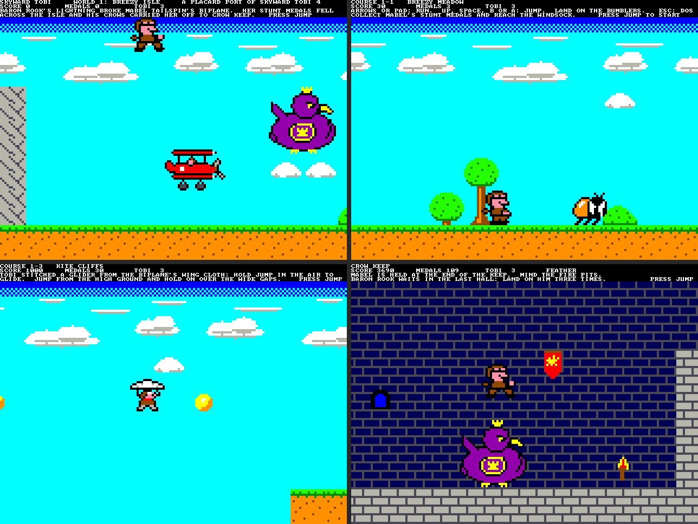
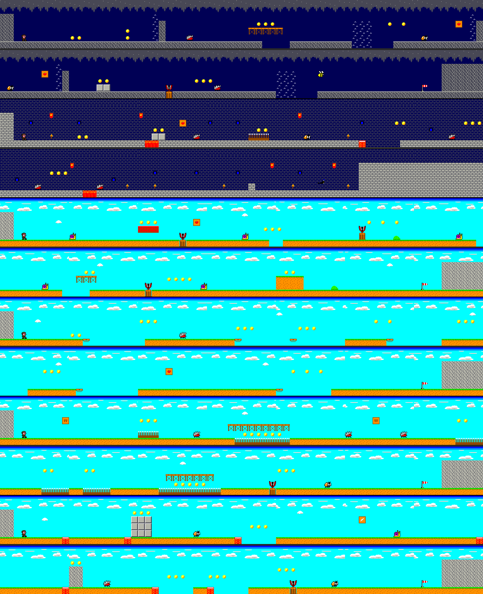
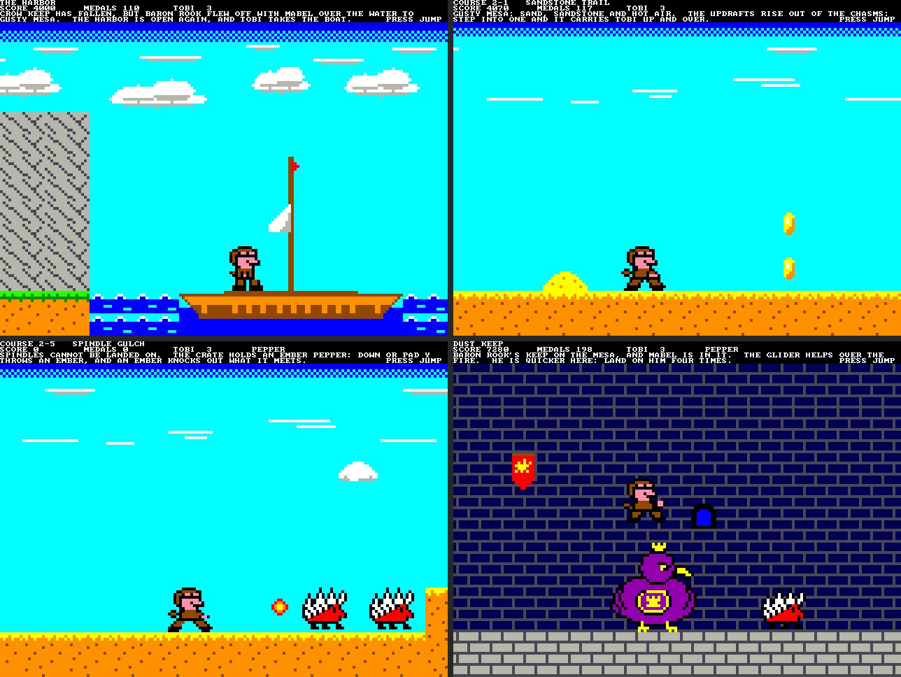
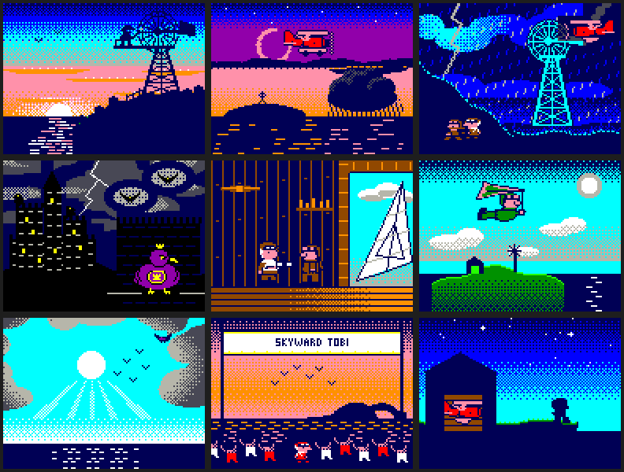

# Skyward Tobi

`sdcard/SKYWARD.PLC` is a side-scrolling platform game: Breezy Isle and
Gusty Mesa, the two worlds of *Skyward Tobi 4*, an NES game by Mark Szlemko
(github.com/Zebshine/skyward-tobi-4), ported to the Placard.  It is a
library program for the SD card (run it from the DOS's file browser; Esc
goes back), made by `src/scripts/gen_skyward.py`.  Everything it reads
after it starts is in the card's `SKYWARD/` folder.

Date: 11/14/2026

## The game

Baron Rook's lightning broke Mabel Tailspin's biplane, her Stunt Medals fell
across Breezy Isle and his crows carried her off to Crow Keep.  Tobi, the
isle's young mechanic, runs after them.  When Crow Keep falls the Baron
flies off with her over the water to Gusty Mesa, and Tobi takes the boat.

| File | Course | Name | The idea |
|---|---|---|---|
| `CA` | title | | The story; the jump key starts the game |
| `CB`-`CG` | story | | Six of Mark's story pictures (see "Music and story pictures") |
| `CH` | 1-1 | Breezy Meadow | Running, jumping, the first Bumblers, one gap |
| `CI` | 1-2 | Bramble Bluffs | Bluffs two blocks high, Buzzbees at head height, more gaps |
| `CJ` | 1-3 | Kite Cliffs | The glider: islands with gaps too wide to jump |
| `CK` | 1-4 | Whistling Cave | Air vents that carry Tobi over walls and out of pits; Spindles |
| `CL` | fort | Gale Fort | Thorns, fire pits, a bounce drum, then Captain Squall |
| `CM` | 1-5 | Shellback Beach | Shellbys and their sliding shells; Snapjaws in their stumps |
| `CN` | 1-6 | Skyrail Rise | Lifts that run back and forth over the gaps |
| `CO` | 1-7 | Thorn Garden | The Tengu Geta walks on thorns; bridges for those without it |
| `CP` | 1-8 | Bouncy Boughs | Bounce drums: over tall walls and wide gaps |
| `CQ` | bonus | Cloud Cellar | A room of medals and a Glide Feather |
| `CR` | keep | Crow Keep | Fire pits, then Baron Rook: land on him three times |
| `CS` | the harbor | | The boat to Gusty Mesa (a picture) |
| `CT` | 2-1 | Sandstone Trail | Updrafts out of the chasms |
| `CU` | 2-2 | Thermal Ridge | One updraft after another |
| `CV` | 2-3 | Updraft Canyon | Lifts and updrafts over a canyon; a Glide Feather |
| `CW` | 2-4 | Drywell Cavern | A lift over a well of thorns, a vent over a wall |
| `CX` | 2-5 | Spindle Gulch | The Ember Pepper, and Spindles to try it on |
| `CY` | 2-6 | Glider Gorge | A Glide Feather for the gorges; lifts for those without it |
| `CZ` | 2-7 | Tengu Skywalk | Bridges and thorns in the sky, with the Tengu Geta |
| `C0` | 2-8 | Mirage Mesa | Blocks that cannot be seen; the medals lie along them |
| `C1` | fort | Squall Fort | Captain Squall again: four landings |
| `C2` | keep | Dust Keep | Fire pits and a quicker Baron Rook: four landings |
| `C3` | ending | | Mabel is free |
| `C4`-`C6` | story | | Mark's three closing pictures, then the title again |

- **Controls:** arrow keys or SNES pad 1 Left / Right to run; Up, Space,
  pad B or A to jump; Down or pad Y to throw an ember (with the Ember
  Pepper); Esc back to the DOS.  A jump needs a new key press.
- **Glider:** hold the jump key in the air and Tobi falls slowly (3/8 of a
  pixel a frame, against up to 5).  Kite Cliffs and Crow Keep give it; the
  Glide Feather gives it anywhere.
- **Enemies:** land on a Bumbler or a Buzzbee for 100 points.  A **Spindle**
  is all needles and a **Snapjaw** all teeth: they cannot be landed on.  A
  Snapjaw is up out of its stump for 64 frames and down for 64.  A
  **Shellby** landed on pulls into its shell; touch the shell and it slides
  away, knocking out whatever it meets, until the end of its run.  A sliding
  shell hurts unless it is landed on, which stops it.
- **Bosses:** Captain Squall (Gale Fort) and Baron Rook (Crow Keep) take
  three landings each (1,100 points); in Squall Fort and Dust Keep, four.
- **Crates:** jump into one from below.  A **Sky Berry** takes one hit for
  Tobi; an **Ember Pepper** does too, and throws embers: one at a time,
  straight ahead for 80 byte columns or to the first wall, and an ember
  knocks out any enemy but a boss (100 points); a **Glide Feather** takes
  a hit and is a glider; the **Tengu Geta**
  is a sandal that walks on thorns and lands on Spindles and Snapjaws, and
  takes a hit of its own.  What Tobi carries is on the score line and goes
  on to the next course.
- **Course pieces:** thorns hurt from above; a bounce drum throws Tobi
  about six blocks up; an air vent lifts him as long as he is in it; a lift
  carries him; a mirage block (Mirage Mesa) is solid and cannot be seen.
- **Medals** are 10 points each.  The windsock ends a course.
- **Lives:** three.  After a lost life Tobi comes back where he last stood
  and blinks for 1.5 s, safe.  With none left the game goes back to the title.
- Each course starts on a card with its name and two lines of text and
  waits for the jump key.

## What is from Skyward Tobi 4, and what is not

Used, under its MIT License (Copyright (c) 2026 Mark Szlemko; the notice
is in `gen_skyward.py`, next to the art): the story, the cast, the course
names and each course's idea, the Stunt Medals, the glider, the power-ups,
the sprite frames of Tobi, the Bumbler, the Buzzbee, the Spindle,
Shellby, the Snapjaw, the Tengu Geta, Captain Squall and Baron Rook
(`skyward_art.py` holds the newer ones), recolored for the Placard's 16
colors, the nine story pictures (`skyward_story.py`) and the songs
(`skyward_nes_songs.py` and `skyward_nes_instruments.py` are his
`music/songs.py` and `music/instruments.py`, unchanged).

Changed or left out:

| NES game | Here | Why |
|---|---|---|
| 256 × 240, 13 rows of tiles, hardware scrolling and sprites | 160 × 112, 5 rows of tiles, all drawn in software | The Placard has no scroll registers or sprites; see "How it draws" |
| Courses laid out on 13 rows, about 200 tiles long | Each course built again around its idea on 5 rows, 128 tiles long (1,024 byte columns, so positions wrap for free) | The screen, and the engine's 10-bit positions |
| 2 worlds on two maps joined by a boat, treasure houses, secret exits, Sun Bell Tower | Both worlds' courses in a row, the boat as a picture between them | The Placard's screen; kept simple |
| Dotted blocks that the Sun Bell makes solid | Mirage blocks: always solid, never seen | No bell |
| Run button, speed that builds up, a run meter, a status box | One running speed; the score is a text line | The Placard's screen: four text lines over the playfield |
| Big and small Tobi; the jacket's color shows the power-up | Small Tobi; the power-up is named on the score line | 16 × 16 sprites, drawn in software |
| Ember Pepper: bouncing embers, two at a time; a reserve box | One ember at a time, straight ahead; no reserve box | Kept simple |
| Baron Rook takes five hits in Dust Keep | Four, and he moves every frame | A fight the same size as the others |
| A shell can be carried, and breaks bricks | It slides and knocks out enemies | Kept simple |
| Captain Squall runs at Tobi and leaps | He runs the hall end to end | Kept simple |
| Music on seven channels: two pulses, triangle, noise, the MMC5's echo and pad | Four voices: melody, harmony, bass, drums; the echo and pad left out | The four-voice player |
| Per-frame volume lists, the DPCM drum samples | Attack, decay and sustain envelopes; drums as wave programs (a noise click, then a falling triangle) | The player's instruments |
| Tempo in 1/256 ticks a frame, hurry mode | A whole number of frames a row ("Above the Clouds" 7 frames instead of 6.74, so 4 % slower); no hurry mode | The player's speed |
| The map, Starpower, treasure-house and game-over songs | Not used (no map, no star, no treasure houses) | |
| Story pictures with one line under each, 256 × 240 | The same pictures, 128 × 96 in a white frame on the playfield; the line on the text rows | The Placard's screen |
| Battery save | None | |

## The screen

| Rows | Mode | What |
|---|---|---|
| 0-31 | 1 bpp, 1x | Four lines of 80-column text: the course's name, the score line (score, medals, lives, power-up, geta), two lines of story or help |
| 32-479 | 4 bpp, 4x | The playfield, 160 × 112 pixels of 4 × 4 |

The playfield has three bands: the high sky (cells 0-15, scrolls at 1/8 of
the course's speed), the clouds (16-31, 1/2) and the course (32-111, five
rows of 16 × 16 tiles).  In the forts the two sky bands are the wall, in
the cave the roof.

## How it draws

The engine is `gen_scroller.py`'s (the Runner demo), with five tile rows
instead of three and a course read from the card:

1. Wait for vertical blanking.
2. Draw the bands and the course, 8,960 bytes, top to bottom ahead of the
   beam.  Each distinct byte column of a band picture, and each of the
   eight byte columns of a tile in a tile row, is a *strip*: unrolled code
   that stores that column's bytes with immediates (video memory is
   column-major, so a column is one page pair).
3. Draw the sprites over it with a blitter in the RAM.  Each sprite frame
   is compiled code as well: a store for a solid byte, read / AND / OR /
   write for a byte that is half transparent.
4. Music (`mus_frame`), pads, keyboard, the game's rules, the score line.

The background is finished at about 58 % of the time the beam takes to
reach the course's first row.  The tile map is in the RAM, so a crate that
has been opened is one byte changed in it.

## Music and story pictures

The music is the four-voice tracker player (`placard_mus.masm`,
[MUSIC.md](../sound/MUSIC.md)) playing Mark's songs, arranged for it by
`src/scripts/skyward_music.py` (`python3 skyward_music.py --wav DIR` renders
them).  Each course file carries its course's song as subtune 0 and two
short tunes after it: "Gate Reached" (subtune 1, at the windsock) and
"Oops" (subtune 2, when a life is lost; the course's song comes back after
it).  The title plays "Skyward Fanfare", Breezy Isle's courses "Skyward"
or "Above the Clouds" as on the NES, Whistling Cave and Drywell Cavern the
cave song, Gusty Mesa "Mesa Wind", the forts and keeps "Crow Keep March",
the harbor the second map tune and the story pictures and the ending the
story tune.  Sound effects (jump, crate, stomp, medal, ember and so on)
play on the player's fifth voice, instruments 0-3 of every song file.

The player takes about 20 % of the CPU with four voices; it runs after the
sprites are drawn, and the frame still ends well inside its time (see
Testing).  While the card is read the music is silent (the song is read
again with the course), except between story pictures, where the story
tune plays on: `load_course` calls `mus_frame` between sectors.

A story picture (`kind` 2) is a course file whose RAM image holds the
picture itself, 128 × 96 pixels in a white frame on the night blue,
written over the playfield as the file is read; the frame loop draws
nothing over it.  Its line of text is on the text rows; the jump key goes
on.

`SKYWARD/CA.LVL` to `C6.LVL` are the title, the six opening pictures, the
21 courses, the harbor, the ending and the three closing pictures.  A file
is the 5 sectors of the song, 4 sectors of tables and then a straight image
of the RAM from x6000, as many whole byte columns (sectors) as the course's
strips (or the picture) reach: 21 to 45 KB.  `load_course` reads them to
x3700-x42FF, x5400-x59FF and x6000 on (about 0.5 s, 0.8 s for a picture);
the playfield goes black a column at a time as the image passes over it,
and the first frame draws it again.

A course is 5 rows of 128 letters in `gen_skyward.py` (`COURSES`).  Tiles:
`#` ground, `H` `B` `K` `D` blocks, `=` a bridge, `^` thorns, `U` a bounce
drum, `$` an air vent, `1` `2` `3` `4` a crate (Sky Berry, Ember Pepper,
Glide Feather, Tengu Geta), `u` a stump, `i` a mirage block.  Things that stand in it: `S` the start, `o` a medal,
`e` a Bumbler, `z` a Buzzbee, `x` a Spindle, `k` a Shellby, `j` a Snapjaw,
`l` a lift, `G` the windsock, `Q` Captain Squall, `R` Baron Rook (`q` and
`V`: the same two with four hits, and Rook moving every frame), `M`
Mabel, `p` the biplane.  The first two and the last four tile columns are a
wall, so the wrap from byte column 1,023 to 0 never shows.  A course may
have 8 objects, 40 medals and 32 different (tile row, tile) pairs.

A tile's type is a byte: 1 solid, + 2 thorns, + 4 a bounce drum, 8 an air
vent, x10 a crate with its power-up in the top bits.  An object's kind is
bits as well: 1 a 32 × 32 boss with three hits, 2 a picture, 4 spiked, 8 a
Snapjaw, x10 a lift, x20 a Shellby, x40 one that moves every frame.

## Testing

`python3 src/scripts/test_skyward_sim.py` boots the 32K ROM in
`placard_sim.py` from a card with `BOOT.CFG` = `SKYWARD.PLC` and plays the
game through pad 1 with a bot.  The bot looks ahead with a Python model of
the rules (the same file), so the model and the program are compared on
every frame too.  For every frame the test checks the background and the
sprites byte for byte against `gen_skyward.py`'s model and that the
drawing is ahead of the beam (a story picture: byte for byte against the
picture); that the song is in the sound buffer on at least 3 frames in 4;
at the end, that every course was cleared in order, that the strips are
unchanged and that Esc brings the DOS back.  With the music the background
is done by 66 % of the beam's time and the whole frame's work by about
48 % of the frame.  A whole game is about 26,200 frames and takes about
two and a half hours;
`--course n` starts at course n, `--stop-after n` stops when course n
loads, `--stomp` has the bot land on every enemy it can (the Shellbys'
shells, the crates), and `--course 1 --lives 1 --walk --stop-after 0` (a
bot that only walks, with one life) checks that the title comes back when
the last life is lost.

`python3 src/scripts/gen_skyward.py --preview DIR` draws every course's
whole length.
