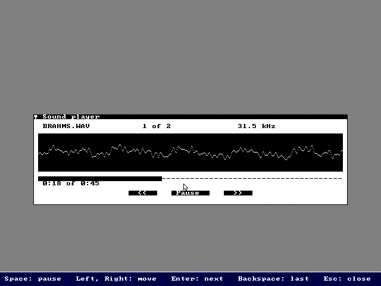

# Sound player (`WAVE.PLC`)

Date: 2026-11-22

`sdcard/WAVE.PLC` (`src/scripts/wave.masm`) plays the `.WAV` files in the
card's `SOUNDS` folder.  It reads each file from the SD card while it
plays, so a recording of any length plays from a card: speech, a song,
any number of instruments.

The screen is a card on a board, in [Pinboard](PINBOARD.md)'s look and
with its mouse pointer: the file's name, its number in the folder and its
speed; a moving waveform of what is playing; a slider with the time
played under it; and three buttons.

## The file

A plain WAV file with these settings:

| | |
|---|---|
| Format | PCM (not compressed) |
| Bits | 8, unsigned |
| Channels | 1 (mono) |
| Sample rate | 31,469 Hz, 15,734 Hz or 7,867 Hz |
| Name on the card | up to 8 letters or digits and `.WAV` |

That is the board's own sound ([SOUND.md](../sound/SOUND.md)): the video
circuit reads one unsigned 8-bit sample on every scan line, 31,469 a
second, and the file's samples go to the sound buffer as they are.  The
two slower rates write every sample two or four times.

| Rate | Card space | Sounds like | CPU for the sound | With the waveform |
|---|---|---|---|---|
| 31,469 Hz | 1.9 MB a minute | everything the board's 10.6 kHz output filter passes | 55 % | 63 % |
| 15,734 Hz | 0.9 MB a minute | AM radio: fine for speech, dull for music | 31 % | 38 % |
| 7,867 Hz | 0.5 MB a minute | a telephone | 18 % | 26 % |

The sound alone is reading the card and feeding the sound buffer.  The
waveform adds 7 % at any rate, and a mouse that is moving about 2 %.

The player reads the rate from the file and takes the nearest of the
three, so a file at another rate plays faster or slower than it was
recorded: 32,000 Hz plays 1.7 % slow, which is hard to hear; 44,100 Hz
or 22,050 Hz are far off and should be converted.  A file with 16 bits
or two channels is named on the screen and skipped.  Other chunks in
front of the samples (the `LIST` chunk ffmpeg writes) are fine as long
as the samples start in the file's first 512 bytes.

### Making one

`src/scripts/gen_wave.py` makes a file from any sound file ffmpeg reads
(MP3, WAV, FLAC, OGG, M4A, a video's sound):

    python3 gen_wave.py song.mp3 -o ../../sdcard/SOUNDS/SONG.WAV
    python3 gen_wave.py talk.wav -o TALK.WAV --rate half
    python3 gen_wave.py song.flac -o PART.WAV --start 30 --seconds 20

It mixes to one channel at the exact rate, brings the loudest sample to
97 % of full scale, and adds half a step of noise before rounding to 8
bits, which turns the rounding error into a steady soft hiss instead of
a distortion that follows the sound.

ffmpeg alone also makes a file the player takes (no level or noise
step):

    ffmpeg -i song.mp3 -ac 1 -ar 31469 -c:a pcm_u8 SONG.WAV

So does any sound editor that exports "WAV, unsigned 8-bit PCM, mono" at
a project rate of 31469 Hz (Audacity: Tracks, Resample; Export, Other
uncompressed files).

8 bits leave about 48 dB between the loudest sound and the hiss, so the
soft parts of music with loud and soft parts sit close to it.
`--compress` brings them up first (the level over a third of a second,
halved in dB against the loudest part, at most 12 dB up).

The two files on the card are made by `gen_wave_demo.py`:

| File | What | Rate | Size |
|---|---|---|---|
| `BRAHMS.WAV` | Brahms, Hungarian Dance No. 5, played by the United States Army Strings: a public domain recording from Musopen (`src/sounds/README.md`), 46 seconds, with `--compress` | 31,469 Hz | 1.4 MB |
| `HELLO.WAV` | speech from espeak-ng, 9 seconds | 15,734 Hz | 138 KB |

## Keys and mouse

| Key | Mouse | Does |
|---|---|---|
| Space | the Pause button (it says Play while paused) | pause, and go on |
| Right, Left | a click on the slider; hold the button and move along it | go to another place in the file |
| Enter | the `>>` button | the next file (after the last, the first) |
| Backspace | the `<<` button | the file before |
| Esc | the pin in the card's title | back to the DOS, or to Pinboard |

The slider has 64 cells, each a 64th of the file.  Right and Left go one
cell on or back from the one that is playing.  A click goes to the cell
under the pointer, and while the button is held the sound follows the
pointer along the slider, so a place can be found by ear.  The first
cell starts the file again.  All of this works while paused too.

The files play in the order they are in the folder (255 at most).  After
the last one the player goes back by itself.

**The waveform** is the sector being played: 512 samples, one pixel
across each, 64 rows for the 256 levels.  At the full rate that is 16 ms
of sound, drawn again 30 times a second.

## From Pinboard

In [Pinboard](PINBOARD.md)'s Files card, Enter on a `.WAV` file (or a
click on the chosen one) runs the player on that file.  The files are
then those of its folder, which need not be `SOUNDS`; when the folder's
last file ends, or at Esc or a click on the pin, Pinboard comes back in
that folder with the file still chosen.  The player's card is its own
drawing, not one of Pinboard's cards: Pinboard is not in memory while a
sound plays (it has about 50 bytes free, and feeding the sound buffer
takes over half the CPU), so the player brings Pinboard's font and
pointer with it and the screen stays in the same style.  Pinboard leaves the folder's first cluster, the
file's number among the folder's `.WAV` files and the mark "S" in the
menu block (x5D19-x5D1F, `placard_menu.asm`), the bytes the photo viewer
uses with the mark "V".

## How it keeps up

The sound buffer x5DF3-x5FFF is a ring of 525 bytes that the video reads
once a frame.  The line read (x5000) says where the video is in it, in
groups of four lines.

1. `fs_read` reads a sector to x4000.  That takes about 7 ms, 227 scan
   lines.
2. The sector goes to the ring in pieces of 256 ring bytes.  A piece is
   written when 268 lines or more are free between the write pointer
   and the video, starting just behind what was written last.  Copying
   a piece takes about 33 lines.
3. With the sector used up, the next is read at once.  The ring then
   holds about 495 samples not played yet and the read uses 227 of them.

So the ring never runs empty and the video never passes the writing: the
samples come out in order, none lost and none twice.  A card can answer
about 7 ms late before a gap would be heard.

**The FAT.**  When a sector is the first of a new cluster, `fs_read` may
have to read a FAT sector first, and two reads in a row are as long as
the whole ring.  So when the sector just read was its cluster's last,
the player looks the next cluster up itself (`fs_nextc`, putting the
reader's cluster back afterwards) right after a piece, when the ring is
full.  The FAT sector is then already in the reader's buffer when
`fs_read` needs it.

**The ends.**  After a file's last sample the player writes a piece of
silence, waits until the video is in it, and then fills the whole ring
with silence, so the end is clean.  Pause writes silence in place of
samples; Esc and the keys that change the file silence the ring first.

**The screen and the mouse.**  A half of the waveform (256 points, about
38 scan lines of work) is drawn only when the ring is full enough that
no piece is due, so it never delays the sound.  The keys and the mouse
are read once a frame, and the mouse's bytes are taken as they come
(`ps2_poll` in the loop) so that reading it never waits for the rest of a
packet.  The pointer is taken off the screen while something is drawn
under it.

**Going to a place.**  Slider cell c is the file's sector
ceil(c × sectors / 64).  The player silences the ring, starts the
reader again at the file's first cluster, passes the clusters before
that sector (`fs_nextc`), and sets the reader to the sector.  It works
out the samples left, the time and the slider for that place, and the
sound starts with the first sample of that sector.  Going to the far
end of a 1.4 MB file leaves 28 ms of silence on a card with 4 KB
clusters, and 0.17 s on one with a sector a cluster (2,800 clusters to
pass).

RAM: the program at x0100, the font at x3000-x37FF and the pointer's
tables at x3800-x39FF (`wave_data.asm`, made by `gen_wave_data.py` from
Pinboard's), zero page x20-x9F, the sector at x4000-x41FF, a page of
silence at x4200, the waveform's rows at x4300-x44FF, the screen under
the pointer at x4500.

## Next to the four-voice music player

| | This player | [Music player](../sound/MUSIC.md) |
|---|---|---|
| Plays | a recording: anything | four voices of its instruments |
| Rate | 31,469 Hz (or 15,734, 7,867) | 15,734 Hz |
| CPU | 55 % (31 %, 18 %) for the sound | 20 % |
| Card space | 1.9 MB a minute (0.9, 0.5) | 1 to 2 KB a song |
| The SD card while it plays | in use | free |

A game that wants a recorded tune under it has the half rate's 69 % of
the CPU left, but can't load from the card meanwhile.

## Test

`src/scripts/test_wave.py` (needs node) runs the player in the web
emulator's core, which takes the DAC's sample on every scan line.  Its
test files are noise with no 80h in it, so every sample played is known
to be a file's or silence.  It checks that three files at the three
rates play whole and in order with only silence between them, a header
with other chunks, a 16-bit stereo file skipped, a 300 KB file on cards
with 1 and 8 sectors a cluster (the first reads the FAT again every 256
sectors, with the mouse moving all the time), the keys (no sample lost
or repeated over a pause), Esc with the ring silent, and Pinboard: Enter
on a file, the file played, Pinboard back in the folder.

For moving in a file it checks that after Right, Left, a click on the
slider, and holding the button and moving along it, the DAC plays the
file from the first sample of the sector each cell starts at and nothing
else but silence; that the time and the slider show the place; that the
waveform is one pixel a column and each half is the samples of a sector
of the file; and the Pause, `>>` and `<<` buttons and the pin.

Not tried on hardware yet.
