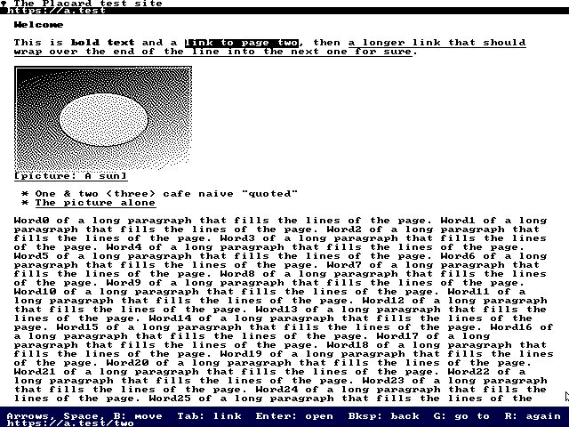
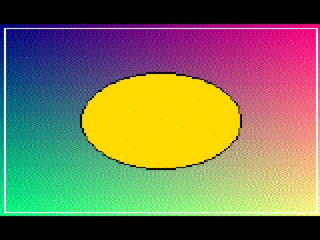

# Web browser (`WEB.PLC`)

Date: 2026-11-22

`sdcard/WEB.PLC` (`src/scripts/web.masm`) is a web browser for a Placard
with the [WiFi card](../architecture/WIFICARD.md).  It shows a page's
text with its links, the page's pictures in black and white, and a
picture alone in 256 colors.

The Placard cannot do a browser's work: a page today is hundreds of
kilobytes of HTML sent packed over an encrypted connection, and its
pictures are JPEG and PNG files.  So the work is split:

| The WiFi module (ESP32-C3) | The Placard |
|---|---|
| fetches the page: HTTPS or HTTP, redirects, gzip | asks for the lines on the screen and draws them |
| reads the HTML and lays the text out in lines of 76 characters | scrolls, chooses a link, sends the choice back |
| keeps the links' addresses and the pages to go back to | types the address |
| decodes the pictures, scales them and dithers them to the Placard's pixels | puts the pixels in its video RAM |

The module's side is `src/firmware/wifi_card/` (`browser.cpp`, `html.cpp`,
`image.cpp`): plain C++ that is built into the module's firmware and,
unchanged, into the program the simulators use in place of a module.
"The browser's commands" in [WIFICARD.md](../architecture/WIFICARD.md) is
what the two say to each other.

**Where it stands.**  The browser runs in the emulator against the
module's own code, on made-up sites and on the real web, and
`test_web.py` checks it.  It has not run on hardware: no WiFi card is
built, and the firmware has not been compiled for a module or loaded into
one.  How much of the module's memory a large page and its pictures take
is worked out, not measured.

## Using it

Run `WEB.PLC` from the DOS, or with Enter on it in
[Pinboard](PINBOARD.md)'s Files card.  The first time, it asks for the
network's name and password; the module keeps them, and joins by itself
after that.  Then it asks for an address.

Type an address (`example.com`, `en.wikipedia.org/wiki/PLA`) or words to
search for.  An address without `http://` is tried with HTTPS first and
with plain HTTP if the site has none.  Words (anything with a space, or
without a dot) go to DuckDuckGo's plain HTML search, and its answers are
links to the sites themselves.

| Key | |
|---|---|
| Down, Up | 3 lines on, or back |
| Space, B | a screen on, or back |
| Home | the top of the page |
| Tab or Right, Left | the next link, the one before; past the screen's last or first link the page moves a screen |
| Enter | open the link chosen |
| Backspace | the page before (the module keeps 8), at the line it was left at |
| G, Ctrl+L | type an address or words |
| R | fetch the page again |
| Esc | back to the DOS or Pinboard |

The mouse: a click on a link opens it, the right button goes back, and the
pin in the title closes the browser.

The screen has the page's title beside the pin, its address under it, 43
lines of the page, and Pinboard's rail with the keys and a line of
messages.  The address of the link chosen is in that line.

## What a page looks like

Text is black on white in the Placard's 8 x 8 font, 76 characters to a
line, a line every 10 pixel rows so a link's underline has its own rows.

| In the page | On the screen |
|---|---|
| headings, bold | bold (every black pixel twice) |
| a link | underlined; the one chosen is white on black |
| lists | `*` or `1.` and an indent |
| a table | its cells side by side, two spaces apart, wrapped as text |
| letters with accents, curly quotes, dashes | the nearest ASCII (`cafe`, `"`, `-`) |
| a picture | its pixels, 1 bit each, above a line `[picture: its words]` |
| a form's field, a button | `[____]`, `[Search]`, to look at only |
| scripts, styles, hidden parts, video | left out |

A page longer than about 1,200 lines comes in parts: its last line is the
link `[More of this page]`, and Backspace goes back to the part before.

What it does not do: nothing can be typed into a page (no forms, no
logging in), there are no cookies, no JavaScript and no style sheets, so
a site that builds its page with scripts shows little or nothing.  The
module does not check a site's certificate: the connection is encrypted,
but the site is not proven to be the one named.

## Pictures

**In the page.**  After the text is up, the module fetches the page's
pictures one at a time (24 at most, while no key is waiting) and the
lines under each move down as it arrives.  A picture is scaled down to
fit 608 pixels across and 200 down, never up, turned to gray and dithered
(Atkinson) to 1 bit a pixel.  Pictures under 12 pixels are passed over,
and all the pictures of a page share 32 KB of pixels (a full-width
picture 200 rows high is 15 KB).

**Alone.**  Enter on a picture's line (or an address that is a picture)
shows it on the whole screen in the board's 256 colors, with its shape
kept: 240 rows of 80 pixels, or of 160 on a rev B board's 160-read rows
([HIRES.md](../video/HIRES.md)), the [photo viewer](PHOTOS.md)'s two
modes.  The module scales and dithers it (Floyd-Steinberg) to the
board's colors, and the Placard fetches it a column at a time, about
half a second in all.  H changes between 80 and 160 across; it starts at
160 when Pinboard is in a color mode, which only a rev B board has.  Any
other key brings the page back.

| Kind | |
|---|---|
| JPEG, baseline | shown; decoded at 1/2, 1/4 or 1/8 size when that is all the screen needs |
| JPEG, progressive | shown from its first scans: less detail on a large one, since the module cannot hold all its coefficients |
| PNG | shown, all color types; not the interlaced kind |
| GIF | its first frame |
| WebP, SVG, AVIF | not shown: the line says which kind it is |

## How the Placard draws it

The module is told the page's size once (VIEW: 76 columns, 10 pixel rows
a line).  For each line on the screen the Placard sends ROW and gets
either text with marks (a link starts, with its number; a link ends; bold
starts; bold ends) or a strip of a picture's pixels, already in the
video RAM's order.  It draws a character by copying its 8 font rows into
the screen and writing the two rows under it: white, or black for an
underline.  A whole screen is 43 requests and takes about 0.13 seconds in
the emulator; the link moves about 70,000 bytes a second.

While it draws, it lists the links on the screen (line, columns,
number).  Tab walks that list, the mouse looks a click up in it, and
choosing a link draws only the lines it is in again.

Screen line n is pixel rows 24 + 10 n to 33 + 10 n.  A column of the
1 bpp screen is two pages of the video RAM that change at row 224; lines
0-19 are in the first and lines 20-42 in the second, so no line is in
both and a character is always 10 bytes in one page.

RAM: the program x0100-x1BFF, Pinboard's font and pointer x3000-x39FF
(`wave_data.asm`), the request x4000, the reply x4100, the links on the
screen x4200-x46FF, zero page x20-x71.

## Files

| | |
|---|---|
| `src/scripts/web.masm` | the Placard's program (`asm_expand.py`, then `gen_plc.py web.asm -o ../../sdcard/WEB.PLC`) |
| `src/firmware/wifi_card/browser.cpp`, `browser.h` | fetching, addresses, the page's lines and links, history, the commands |
| `src/firmware/wifi_card/html.cpp` | HTML into lines |
| `src/firmware/wifi_card/image.cpp`, `image.h` | gzip, JPEG, PNG, GIF, scaling and dithering |
| `src/firmware/wifi_card/wifi_card.ino` | the module's firmware, which hands commands 30-3B to that code |
| `src/firmware/wifi_card/host/wifi_host.cpp` | the same code as a program for this computer, for the simulators |
| `src/scripts/wifi_host.py` | builds and runs it; `python3 wifi_host.py ADDRESS` prints a real page as the Placard gets it, `--png OUT.png` draws it |
| `src/scripts/test_web.py` | the checks |

## Testing

`python3 test_web.py` (needs node, g++ and Pillow) runs the module's code
on a made-up web: layout, redirects, chunked and gzip bodies, links and
back, pictures of each kind, a page in parts.  Then it runs `WEB.PLC` in
the web emulator's core with a WiFi card whose module is that same code,
and compares every line and every picture byte on the screen with what
the module gave: an address typed, the links, moving, a picture in the
page and alone at both widths, the mouse, joining a network, no card, a
module with the old firmware, and Pinboard.

The emulator in the browser has no WiFi card (it has no module to run),
so `WEB.PLC` says there is no card there.
