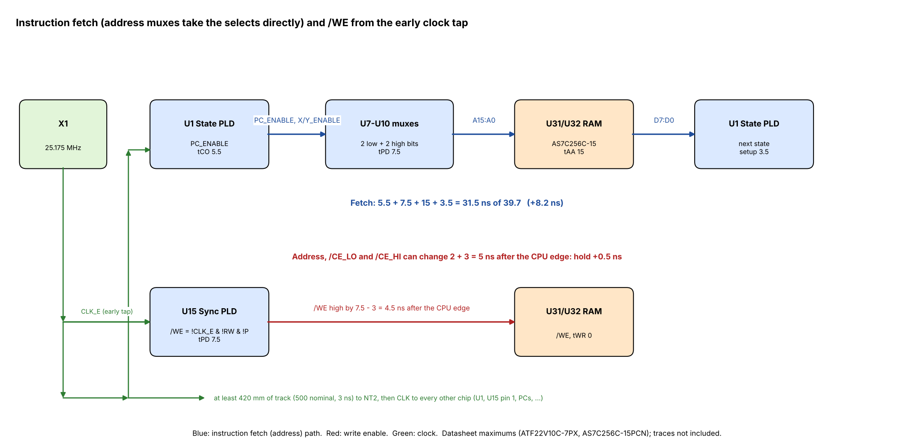

# Instruction fetch timing

Date: 2026-11-02

The instruction fetch is the loop that sets the clock: it starts and ends
in the State PLD, so clock skew cannot help it.  This note describes how
the address side of every CPU read is built and what it leaves.  The
summary of all paths is in [TIMING.md](TIMING.md).

(`src/scripts/gen_fetch_paths.py` draws it.)

## The address muxes

The four address mux PLDs (U7-U10, `ATF22V10_QUAD_MUX.pld` revision 02)
take the address-source selects straight from the PLDs that register
them: PIXEL_ENABLE from the Sync PLD, and PC_ENABLE, X_ENABLE and Y_ENABLE
from the State PLD.  All four are registered outputs, valid at tCO, so the
address reaches the RAM one PLD pass after the clock.

    low bit:   A = PIXEL_ENABLE & VIDEO
                 # !PIXEL_ENABLE & PC_ENABLE & PC
                 # !PIXEL_ENABLE & !PC_ENABLE & X_ENABLE & XREG
                 # !PIXEL_ENABLE & !PC_ENABLE & !X_ENABLE & DREG
    high bit:  A = PIXEL_ENABLE & VIDEO
                 # !PIXEL_ENABLE & PC_ENABLE & PC
                 # !PIXEL_ENABLE & !PC_ENABLE & Y_ENABLE & YREG     (otherwise 00h)

Each chip takes two low and two high address bits (8 + 6 data inputs, 4
selects, 4 outputs, all 22 pins), so one source file serves all four:

| Mux chip | Bits | Sources per bit |
|---|---|---|
| U7 | A1:A0, A9:A8 | D, X, video, PC / 00h, Y, video, PC |
| U8 | A3:A2, A11:A10 | |
| U9 | A5:A4, A13:A12 | |
| U10 | A7:A6, A15:A14 | |

The I/O decode PLD (U12) rebuilds A15 from the same selects and sources
(PIXEL_ENABLE, PC_ENABLE, Y_ENABLE, H9, PC15, Y7) for the upper RAM chip's
/CE_HI, so it settles with the mux outputs, at 13 ns.  The lower chip's
/CE is the mux's A15 output.

## The fetch

| Stage | ns |
|---|---:|
| State PLD, PC_ENABLE (Q1) clock to output | 5.5 |
| Address mux PLD | 7.5 |
| RAM tAA | 15.0 |
| State PLD setup (next state from the opcode); the IR PLD's is the same | 3.5 |
| Total | 31.5 of 39.72 (+8.2) |

On the board this is +4.5 (+4.1 for the fetch right after a branch, where
the PC loads at the same edge).

The RAM's output enable is the other limit.  The memory control PLD only
turns /RAM_OE and /ROM_OE on in the low half of the clock, so the opcode
through /OE is clock fall 19.9 + memory control 7.5 + tOE 7 + setup 3.5 =
37.9 ns, +1.9 from the datasheets.  On the board it is −0.2 from RAM and
−1.1 from the cartridge ROM, because DATABUS0 runs 336 mm from U31 and
361 mm from J8 to the State PLD.  That path also caps the clock's high
half at 54.6 % of the period.

## Other reads on the same address path

| Read | Datasheet | Board |
|---|---:|---:|
| Operand into D (LOAD_IMM), /OE limited | +3.4 | +1.2 (RAM), +0.4 (cartridge) |
| X/Y-indexed read after FETCH ([XY_TIMING.md](XY_TIMING.md)) | +3.4 | +1.2 |
| Zero-page read `[0,D]`: the D register (10.5) and the mux | +3.4 | −1.1 |
| Upper 32K read through /CE_HI | +9.7 | |
| Video read ([VIDEO_TIMING.md](VIDEO_TIMING.md)) | +3.4 | −1.1 |

## The end of a write

With no extra pass between the selects and the muxes, the address, both
chip selects and /CE_HI can change 5 ns after the clock edge (tCO min 2 +
mux min 3), sooner than a PLD can raise /WE from the same edge (up to
7.5 ns).  So /WE is made by the Sync PLD from **CLK_E**, an early tap of
the clock: X1 drives the Sync PLD's pin 9 first, then at least 420 mm of
track (500 mm nominal, 3 ns) to the net tie NT2, and only then every other
clock input.  /WE rises about 3 ns before the edge the rest of the board
sees, which leaves +0.5 ns of address hold from the datasheets and +0.6
on the board.  The details are in [WE_TIMING.md](WE_TIMING.md).

The lead has room both ways: below 2.5 ns the hold fails, and above about
7.9 ns /WE could fall before the address and /CE_HI have settled.  The
board has 459 mm (2.8 ns).

## Board rules

- CLK_E: X1 → U15 pin 9 → at least 420 mm of track → NT2, with no other
  load on it.
- Keep PC_ENABLE, X_ENABLE, Y_ENABLE and PIXEL_ENABLE short to the four
  muxes, and the muxes close to the RAMs.
- The data bus back to the State and IR PLDs (U1, U17) is the limit of
  every read through /OE: keep every bit within about 230 mm of the RAMs
  and J8.
