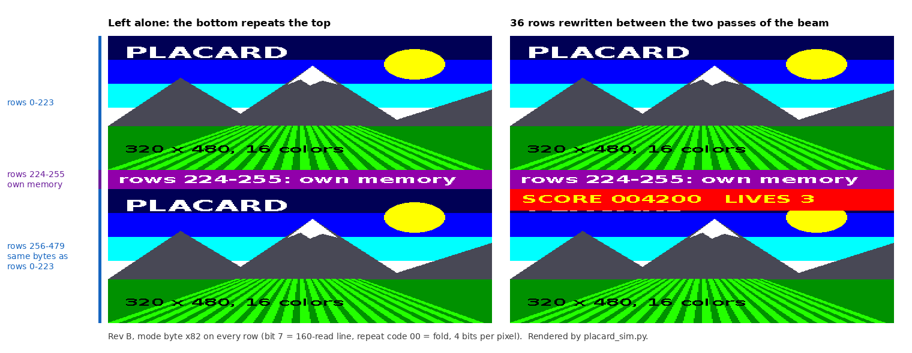

# 160-read lines (rev B)

Date: 2026-11-17

On rev B, bit 7 of a row's mode byte makes the video read a byte every
4 clocks on that row instead of every 8: 160 bytes per line instead of 80.
Together with 2x or 4x line repeat, or the fold (each keeps the screen
inside the RAM), this gives three new kinds of row.  It replaces the blank line of rev A
([VIDEO.md](VIDEO.md#blank-line)).  No chip is added; five PLDs are
reprogrammed and three nets move.

Rev A boards cannot do this with PLD changes: within one line their video
address depends only on the seven H counter pins, so a line has at most 128
addresses.  With five wires and five bent pins they can:
[REVB_MOD.md](../hardware/REVB_MOD.md).  Everything else in the docs describes rev A; this page is the
whole difference.

## Modes

| Mode byte bits 1:0 | Normal row (bit 7 = 0) | 160-read row (bit 7 = 1) |
|---|---|---|
| 00, 1 bpp | 640 across, 2 colors | not a mode (do not use) |
| 01, 2 bpp | 320 across, 4 colors | **640 across, 4 colors** |
| 10, 4 bpp | 160 across, 16 colors | **320 across, 16 colors** |
| 11, 8 bpp | 80 across, 256 colors | **160 across, 256 colors** |

| Bits 3:2 on a 160-read row | Rows | Screen memory |
|---|---|---|
| 01, 2x | 240 | 160 x 240 = 38,400 bytes (all of x6000-xFFFF used by the picture, as a 1x screen today) |
| 10 or 11, 4x | 120 | 160 x 120 = 19,200 bytes |
| 00, fold | 480, wrapping every 256 | 160 x 256 = 40,960 bytes: rows 0-223 and rows 256-479 are the same bytes ([The fold](#the-fold-480-rows)) |

Row tint (bits 6:4) works as on any row.  Every row picks its own mode, so
normal rows and 160-read rows can share a screen; which ones can do so
without sharing bytes is in [Mixing row types](#mixing-row-types).

Mode bytes x5A00-x5A1F (lines 512-543, never shown) must stay 0 on rev B:
bit 7 set there would make reads in the vertical blanking.

## Memory layout

A 160-read row has 160 byte columns, c = 0 (left) to 159.  Each of the 80
normal columns is split in two halves of 256 bytes:

    address = x6000 + c * 256 + low byte            (high byte = x60 + c)

    v = row + 32                                    (row 0-479, as in VIDEO.md)
    fold: low byte = v & xFF
    2x:   low byte = (v & xFE) | v8
    4x:   low byte = x80 | (v & x7C) | (v8 << 1) | v7

In the fold and in 2x every byte of x6000-xFFFF belongs to the picture, so
fold rows and 2x rows of one screen share bytes.  In 4x the low 128
bytes of every 256 are free (20 KB in 128-byte pieces).  The library
routine `vid_addr_hi` does this sum ([LIBRARY.md](../software/LIBRARY.md#video-and-system)).

## Mixing row types

The color mode (bits 1:0) never changes where a row's bytes are, so 640-wide
4-color, 320-wide 16-color and 160-wide 256-color rows mix freely.  What
matters is the repeat and whether the row is a 160-read row.  A 160-read row
uses the same low byte as a normal row of the same repeat, in both halves
of the column, so:

| Screen (top / bottom) | Shares bytes? |
|---|---|
| 160-read 2x with normal 2x, either order, split anywhere | no |
| 160-read 4x with normal 4x, either order, split anywhere | no |
| normal 1x on top (any height to row 96), 160-read 4x below | no |
| normal 1x on top, 160-read 2x below | no while the 160-read rows end by row 255; a 160-read 2x row from 256 on uses the bytes of an odd 1x row in the top 224 |
| 160-read rows on top, normal 1x below | yes |
| 2x on top, 4x below (160-read or normal, any mix) | no only if the split is at row 96 or above it, or at row 352 or below it |
| 4x on top, 2x below (160-read or normal, any mix) | yes |
| fold rows with anything | yes, except 4x rows below a fold band that ends by row 96 |

So an 80-column text band of 1x rows over a 160-read picture works with a
4x picture, or with a 2x picture that stops at row 255 (normal 2x rows can
go below it).  A 2x text area (640 x 240, 1 bpp) goes with a 160-read 2x
picture anywhere.  Rows of 4 lines keep one mode for all four, rows of 2
for both.

Only the 160-read rows cost the extra stall clocks.  Use `vid_addr` for a
normal row and `vid_addr_hi` for a 160-read row.

(Table made by trying every split of every pair of row types against the
simulator's row addresses.)

## The fold: 480 rows

With repeat code 00 a 160-read row is one line tall, as on a normal 1x row:
640 x 480 in 4 colors, 320 x 480 in 16 or 160 x 480 in 256.  That would be
76,800 bytes, and there are 40,960, so the row address drops its top bit and
the memory wraps every 256 lines:

| Rows | Memory |
|---|---|
| 0-223 | low bytes x20-xFF |
| 224-255 | low bytes x00-x1F, their own |
| 256-479 | low bytes x20-xFF again: the same bytes as rows 0-223 |

Left alone, the screen shows its top 224 rows, a 32-row band, and the top
224 rows again.  To make the two parts differ, a program rewrites bytes
between the two passes of the beam (after line r of the top has been shown
and before line r + 256), twice per frame.

How much can differ: a full 160-read screen leaves the CPU about 343,000
clocks per frame, and the library's fastest store loop takes about 14 clocks
per byte, so about 24,000 bytes per frame is the ceiling with nothing else
running.  Two fully different parts would need 71,680 (35,840 shared bytes,
twice).  At half the CPU that is about 30 to 40 rows of the lower part that
differ from the upper, plus the 32 rows that have their own memory.  The
cost is per byte, so it is the same in all three color modes.

Each row still has its own mode byte, so the two parts can differ in tint
and in color mode without any rewriting.  The mode costs one product term
less than the 2x it replaced on this code (audio slot PLD revision 06) and
no wire.

## CPU cost

A 160-read line stalls the CPU for 162 clocks of 800 instead of 82.  A
whole screen of 160-read rows takes 18.3 % of all clocks for video instead
of 9.1 %, so programs run about 10 % slower than on a normal screen.  Only
the rows with bit 7 set cost more.

## How it works

The count H2:H0 runs two clocks behind the 8-clock group, as before.  On a
normal line the video reads once per group (count 111, shown from 000).  On
a 160-read line it reads twice:

| | Read | Count H2:H0 at the read | Shown at counts | Address A8 |
|---|---|---|---|---|
| Byte A | every line | 111 | 000-011 | 0 |
| Byte B | 160-read lines, and only while RUN is high | 011 | 100-111 | 1 |

RUN gates read B because the cartridge loader needs the clocks between the
normal video reads, and the RAM (so the mode bytes too) is random while it
loads.

**The color decoder is not told.**  Its H2 and H1 pins come from Sync PLD
pins 16 and 15.  On a 160-read line, while VIDEN is high, the Sync PLD puts
the next lower count bit on each, so the decoder walks through a byte in 4
clocks with its normal logic: 2 bpp picks its four pixels one clock each,
4 bpp its two nibbles two clocks each, 8 bpp ignores the selects.

| Sync PLD pin | Normal line | 160-read line, VIDEN high | Goes to |
|---|---|---|---|
| 14 `H0` | H0 | H0 | color decoder, H counter |
| 15 `S1` | H1 | H0 | color decoder H1 pin, H counter |
| 16 `S2` | H2 | H1 | color decoder H2 pin, H counter |
| 21 `T2` (new) | H2 | H2 | H counter, audio slot PLD |

VIDEN only changes when the count is 000 or was just 111, and those two
counts look the same on the pins either way, so the switch never disturbs
the count.

**The H counter is not told either.**  It advances on
`T2 & H0 & !(S2 & S1)`, which is count 101 on both kinds of line.

**The audio slot PLD marks the line.**  The Sync PLD has no pin for bit 7,
so the audio slot PLD (which gets Q7 of the line code register) raises
BLANK_RD through groups 48-127 of a 160-read line, and in group 28, where
the last byte is still on screen for two clocks.  BLANK_RD is otherwise
only high in blanking, so `VIDEN & BLANK_RD` is "160-read line" for the
Sync PLD.  The audio slot PLD also makes the half-column address bit:
A8 = !T2 on a 160-read line (0 for read A, 1 for read B), and A7, A1, A0
as the layout above (in the fold they are simply V7, V1, V0).

## What changes on the board

| Net | Rev A | Rev B |
|---|---|---|
| T2 (new) | | Sync PLD pin 21 to H counter pin 6 and audio slot PLD pin 16 |
| /P0 | I/O decode pin 17 to Sync pin 21 | I/O decode pin 17 to Sync pin 4 |
| V4 | V counter to Sync pin 4 (and elsewhere) | no longer goes to the Sync PLD |
| LC7 (line code register Q7) | to H counter pin 6 | to audio slot PLD pin 21 |
| /AC_SEL | audio slot PLD pin 21 to the AC source driver /OE2 | IR PLD pin 22 to the AC source driver /OE2 |
| I1 | also to audio slot PLD pin 16 | no longer goes to the audio slot PLD |

/AC_SEL is the same signal (low when I1 = 1).  The IR PLD makes it as a
registered copy, which takes one PLD delay (7.5 ns) out of the AC source
path.

| PLD | File in `src/pld/rev_b/` | Revision | Change |
|---|---|---|---|
| Sync | `ATF22V10_SYNC.pld` | 13 | select shift, T2, read B, VSYNC from V9, V3:V1 |
| H counter | `ATF22V10_HCOUNT.pld` | 09 | enable from T2, S2, S1, H0; blank line removed |
| Audio slot | `ATF22V10_AUDIO.pld` | 06 | line marker on BLANK_RD, half-column A8, T2 and LC7 in, /AC_SEL out of it; revision 06: the fold on repeat code 00 |
| IR | `ATF22V10_IR.pld` | 02 | makes /AC_SEL on pin 22 |
| Color decoder | `ATF22V10_COLORDECODER.pld` | 09 | same pins; the blended grays use H2 and H1 only |

The rev A sources in `src/pld/` are unchanged.  All five compile clean in
WinCUPL for the ATF22V10C (2026-11-17; HSYNC uses 12 of its 12 terms).

**Grays.**  The five blended 8 bpp grays
([COLORS.md](COLORS.md)) blend over the two select pins only, in quarters
of a byte, so they come out the same on both kinds of line.  Gray xB5 has
the higher blue level 1/4 of the time instead of 1/8, a little lighter (+2.6 % instead of -1.5 % from
the ideal ramp).

**VSYNC.**  With V4 off the Sync PLD, VSYNC is `!V9 & V3 & V2 & !V1`: lines
508-509 instead of 532-533.  The vertical porches become 9 lines front and
34 back (rev A: 33 front, 10 back).  Standard VGA is 10 and 33.

## Timing

No new slow path.  Read B is the same path as read A, twice as often.  New
paths: A8 from T2 (Sync tCO 5.5 ns + audio slot tPD 7.5 ns = 13 ns, three
clocks before each read) and BLANK_RD into the Sync PLD (H counter tCO 5.5
+ 7.5 + setup 3.5 = 16.5 ns of 39.7 ns).  The rev B board has to be routed
before these get real track delays.

## Models and tests

| What | Where |
|---|---|
| VHDL models of the five rev B PLDs | `src/hdl/*_revb.vhd`; `basys_top` takes `boardRevB => true` (default false, rev A) |
| GHDL test | `src/sim/tb_hires_lines.vhd`: lines that switch between normal and 160-read, every line 800 clocks, 160 reads 4 clocks apart, each byte shown with selects 00, 01, 10, 11 |
| Python simulator | `placard_sim.py --rev b`; `test_hires.py` compares the screen and the stall count with the equations |
| Web emulator | Board: rev B in the options ([EMULATOR.md](../software/EMULATOR.md)) |
| Library | `vid_addr_hi` ([LIBRARY.md](../software/LIBRARY.md#video-and-system)) |

Programs that use the blank line for speed on rev A (it shows as a
160-read row on rev B) have not been changed.
